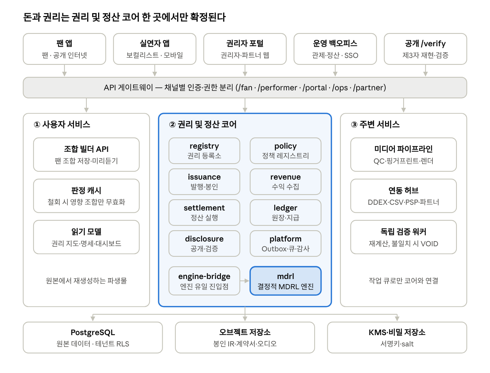
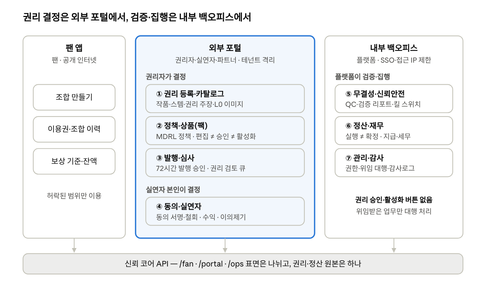

# dobedubpop 시스템 아키텍처 및 업무 분리안

- 작성일: 2026-10-12
- 원본(공유 문서): https://claude.ai/code/artifact/9db7d516-16a3-4822-a995-ea0671a5fba3

**사용자 관점.** 참여자는 각자 자기 앱에서 자기 일만 한다. 권리자는 권리자 포털에서 권리를 등록하고 분배 규칙을 승인하며, 보컬리스트는 실연자 앱에서 동의하고 수익을 확인하고, 팬은 팬 앱에서 허락된 범위 안에서 조합하고 감상한다. 플랫폼 운영자는 운영 백오피스에서 권리 생성부터 지급까지의 흐름을 지켜보고 문제를 처리하지만, 권리를 대신 결정하지 않는다.

**서비스 안정성 관점.** 돈과 권리를 다루는 권리 및 정산 코어는 하나로 묶어, 판정·봉인·정산·원장을 한 데이터베이스의 한 트랜잭션 안에서 처리한다. 그래서 금액이 어긋나거나 중복 지급되지 않는다. 오디오 처리나 외부 연동처럼 무겁거나 실패가 잦은 일은 처리·연동 서비스로 떼어내, 그쪽 장애가 코어와 사용자 화면으로 번지지 않게 한다.

권리 생성부터 지급까지 실제 코드로 돌린 예시는 [예시: Dynamite 2차 이용](예시_Dynamite_2차이용_권리생성에서_지급까지_20261012.md)에 있다.

## 아키텍처 한눈에

모든 채널은 게이트웨이를 거쳐 들어오고, 권리 판정·발행 봉인·정산·원장은 권리 및 정산 코어 안에서만 확정된다. 사용자 서비스와 처리·연동 서비스는 코어의 원본을 직접 쓰지 않는다.

## 구조 결정과 근거

권리 및 정산 코어(권리 판정·발행 봉인·정산·원장)는 하나의 프로세스와 하나의 PostgreSQL에 둔다. 돈과 권리가 같은 트랜잭션 안에서 정합해야 하기 때문이다.

- **MDRL은 라이브러리로 호출한다.** 네트워크 서비스로 만들면 결정성(같은 입력 → 같은 digest)이 흔들린다. MDRL을 import하는 곳은 `engine-bridge` 하나뿐이다.
- **원본 데이터는 데이터베이스에 있다.** IR은 이 데이터로 만든 JSON 문서이고, 모든 정산은 데이터베이스가 아니라 IR 문서를 읽어 계산한다.
- **비동기는 Outbox + pg-boss로 처리한다.** 상태 변경과 Outbox 기록을 한 트랜잭션에 쓰고 워커가 이어받는다.

**IR 문서는 언제 만들고 어떻게 쓰나.** 정책 컴파일, 조합 발행, 정산 때 데이터베이스에서 필요한 내용을 읽어 IR 문서를 만든다. 문서에는 내용으로 계산한 해시(digest)를 붙여 저장하고, 저장한 문서는 수정·삭제할 수 없다. 조합의 정산은 그 조합이 발행될 때 만든 IR 문서를 읽는다. 그래서 발행 뒤에 데이터베이스의 권리 정보가 바뀌어도, 이미 발행된 조합의 정산 금액은 바뀌지 않는다.

| 효과 | 내용 |
| --- | --- |
| 재현 | 같은 사본이면 언제 다시 계산해도 같은 금액이 나온다 |
| 검증 | 독립 검증 워커나 외부 파트너가 같은 사본으로 다시 계산해 확인한다 |
| 분쟁 대응 | "이 번호의 사본으로 계산했다"고 금액의 근거를 증명한다 |
| 변경 격리 | 표가 바뀌어도 이미 확정된 거래의 근거는 바뀌지 않는다 |

코어 밖으로 떼어낼 것은 부하나 장애 성격이 코어와 다른 다섯 가지다.

| 분리 대상 | 분리 이유 | 코어와의 경계 |
| --- | --- | --- |
| 오디오 처리 서비스 (스템 기술 검수·소스 출처 검사·조합 렌더링) | CPU·GPU를 많이 쓰고 실패가 잦다 | 작업 큐로 요청, 결과만 코어에 기록 |
| 연동 허브 (DDEX·유통사 CSV·PSP 웹훅·파트너 API) | 외부 포맷이 코어 모델을 오염시키지 않게 번역한다 | 원본 해시 보관, 거부 큐, 정규화된 이벤트만 전달 |
| 조합 빌더 API와 판정 캐시 | 조합 후보가 수십만~백만 단위이고 팬 트래픽은 읽기 위주다 | 캐시 키에 `policy_digest`·`revocation_epoch` 포함, 철회 시 영향 조합만 무효화 |
| 독립 검증 워커 | 정산 결과를 다른 신원으로 재계산해야 검증의 의미가 있다 | 실행 워커와 다른 서비스 계정, 불일치 시 run VOID |
| 읽기 모델 (권리 지도·명세·대시보드) | 조회 형태가 다양하고 원본에서 언제든 재생성할 수 있다 | 원본을 쓰지 않음, 그래프 DB는 탐색 병목이 실측될 때만 도입 |

**멀티테넌시.** 테넌트는 포털에 로그인해 일하는 조직 단위다(레이블·기획사·출판사·신탁단체·파트너·플랫폼 운영, 팬은 플랫폼 기본 테넌트). 테넌트는 데이터를 볼 수 있는 범위를 정하는 단위이고, 정산 금액은 테넌트가 아니라 파티(권리 주체)에 귀속된다. 모든 테넌트가 데이터베이스 하나를 같이 쓰고, PostgreSQL 행 단위 보안(RLS)으로 다른 테넌트의 행을 데이터베이스가 직접 걸러낸다. 앱 코드가 조회 조건을 빠뜨려도 다른 테넌트의 데이터는 반환되지 않는다.

| 데이터 | 볼 수 있는 테넌트 | 예(Dynamite) |
| --- | --- | --- |
| 소유 데이터: 곡·녹음·스템·팩·정책·계약 | 등록한 테넌트(`owner_tenant_id`)만 열람·수정 | 레이블 L이 등록한 팩은 L만 수정한다 |
| 참여 데이터: 정산 라인·명세·지급 | 해당 파티가 소속된 테넌트만 열람 | 작가 W2 몫의 정산 라인은 W2가 소속된 테넌트만 본다 |
| 운영 조회 | 운영 백오피스가 ⑧ 관제의 단계별 통제(마스킹·사유 기록)를 거쳐 전 테넌트 조회 | 이상거래 조사 때 관련 팩을 조회한다 |

한 곡에 여러 테넌트의 파티가 권리를 나눠 가져도, 다른 테넌트의 계약·지분 상세는 볼 수 없다. 현재 데이터모델 v2.8에는 소유 테넌트 컬럼(`owner_tenant_id`)이 없고 코어에도 테넌트 개념이 없으므로, 두 곳 모두 추가해야 한다.

## 오디오 처리 서비스

오디오 파일을 직접 다루는 일은 한 서비스로 모으되, 성격이 다른 세 기능으로 나눈다. 이 서비스는 권리를 판단하지 않고 기술 신호만 만들며, 스템을 사용 가능(READY)으로 바꾸거나 발행을 허용하는 결정은 권리 및 정산 코어가 내린다.

| 기능 | 언제 | 하는 일 | 결과(코어에 기록) | 실패·의심 시 |
| --- | --- | --- | --- | --- |
| 스템 기술 검수(QC) | 권리자 포털에서 스템 업로드 직후 | 포맷(샘플레이트·비트 깊이), 클리핑(True Peak), 무음, 라우드니스(LUFS), 파일 해시 측정 | `stem.qc_status`, `qc_fail_code` | 운영 백오피스 ⑤ 자동 QC 실패 큐 → 재업로드 요청 |
| 소스 출처 검사 | 업로드 직후(QC와 병행) | 상용 음원 대조(음향 지문), AI 생성 판별, 등록 가창자 음성 대조, 메타데이터(ISRC·크레딧) 정합 | `source_integrity_check`: PASS·SELF_MATCH·REVIEW·BLOCK | ⑤ 소스 무결성 검사 큐 → 권리자 소명. 통과하지 못하면 스템 READY 불가 |
| 조합 렌더링 | 팬이 조합할 때(미리듣기), 발행 후(마스터) | 슬롯별 스템과 반주를 서버에서 믹스다운, 5초 미리듣기, 합성 마스터(DRM), 비가청 워터마크 삽입, 렌더 결과가 봉인된 스템 배정과 일치하는지 검증 | `preview_url`, `render_url`, 렌더 해시, 워터마크 ID | ⑤ 렌더 무결성 큐 → 재렌더링 |

- **원본 스템은 밖으로 내보내지 않는다.** 마스터 권리자 계약 조건(서버사이드 렌더링 한정·반출 금지)에 따라 팬 앱에는 렌더 결과만 보낸다.
- **다운로드·상업 이용 스탬프**가 발급되면 반출용 워터마크(`export_watermark_id`)를 새로 넣어, 외부 유출 시 발급 건과 조합·발행 봉인까지 역추적한다.
- **정산 계산은 렌더 결과를 쓰지 않는다.** 정산의 사용량(구간 길이)은 발행 봉인에 기록된 스템 배정에서 나온다.

'핑거프린트'·'지문'이 서로 다른 것을 가리켜 혼동되므로 아래 이름으로 구분하고, 설계 문서(데이터모델 v2.8, UI 가이드 v1.6, IA, 조합제약·검증·코어규격 설계)도 이 이름으로 맞췄다. 컬럼 이름 같은 식별자는 그대로 두었고, 봉인 digest(`mdrl:sha256:…`)는 지문이라 부르지 않는다.

| 부르는 이름 | 식별자(그대로 유지) | 무엇인가 | 만드는 곳 |
| --- | --- | --- | --- |
| 음향 지문 | `FINGERPRINT_MATCH` | 소리에서 뽑은 지문. 업로드한 스템이 기존 상용 음원인지 대조한다 | 오디오 처리 서비스(소스 출처 검사) |
| 조합 구성 해시 | `fingerprint_hash`, `content_fingerprint` | 스템 버전·구간·믹스 설정·렌더 엔진 버전을 정규화한 해시. 소리가 아니라 구성으로 만든다 | 권리 및 정산 코어(발행·유일키 검사) |
| 반출 지문 참조 | `rights_stamp.fingerprint_ref` | 다운로드·상업 이용으로 반출된 음원을 나중에 식별하기 위한 참조 | 오디오 처리 서비스(렌더링)가 만들고 코어에 기록 |

현재 구현에는 세 기능이 모두 없다. 코어(`rights-core`)의 스템 테이블에는 파일·QC·렌더 정보가 없다.

## 권리 및 정산 코어 모듈

코어는 9개 모듈로 나뉘며 모듈 사이는 함수 인터페이스로만 호출한다. 다른 모듈의 테이블은 직접 쓰지 않는다. 현재 `rights-core`가 이 구조를 따른다.

| 모듈 | 책임 | 소유 데이터(주요) |
| --- | --- | --- |
| `registry` 권리 등록소 | 파티·작품·녹음·보이스·스템, 권리 주장·위임의 이중 시간축 버전, 분쟁 | `party`, `work`, `stem`, `right_claim`, `mandate`, `dispute` |
| `policy` 정책 레지스트리 | MDRL 정책 작성·컴파일·시뮬레이션, 승인·활성화, 재고정 | `policy_version` |
| `issuance` 발행 | 팩 활성화 검사, 발행 시 스냅샷 동결 | `vocal_pack`, `rights_snapshot`, `issue_seal` |
| `revenue` 수익 수집 | 이벤트 멱등 수집, 순매출 확정, 무결성 플래그 | `revenue_event` |
| `settlement` 정산 실행 | 배치 선정, 평가, 결과 봉인, 재계산 검증, 확정 | `settlement_run`, `allocation_line`, `unallocated_holding` |
| `ledger` 원장·지급 | 복식 원장 반영, 보류 해제, 지급 지시·PSP 연동, 명세 | 원장 테이블, `payout_instruction` |
| `disclosure` 공개 | Rights Manifest, 공개본, 플랫폼 서명, `/verify` | `manifest` |
| `engine-bridge` 엔진 경계 | 행→IR 변환, 봉인 저장, MDRL 호출 (MDRL을 import하는 유일한 모듈) | `sealed_document`, `attestation` |
| `platform` 공통 기반 | Outbox, 작업 큐, 감사 로그, 서명 API, 권한 | `outbox`, `audit_log`, `user_account` |

## 사용자 업무 시스템 분리

업무 시스템은 사용자 유형이 아니라 권한을 기준으로 나누고, 신뢰 경계에 따라 앱 4개(팬 앱, 실연자 앱, 권리자 포털, 운영 백오피스)로 배포한다. 플랫폼은 권리를 결정하지 않지만, 권리 생성부터 정산까지 전 구간을 조회하고 이슈에 개입한다.

실연자 앱은 모바일 전용 앱으로 따로 둔다. 보컬리스트는 동의 서명·철회와 수익 확인처럼 짧고 잦은 본인 업무를 휴대폰에서 하고, 본인 인증·푸시 알림이 필요하며, 테넌트 권한이 아니라 본인 데이터만 본다. 권리자 포털은 권리자·파트너용 웹으로 남는다. 네 앱은 같은 코어를 쓰지만 API 표면과 인증이 다르고, 운영 백오피스는 SSO와 접근 IP 제한 뒤에만 둔다.

## 업무 시스템별 결정 주체와 직무 분리

권리에 관한 결정(①~③)은 권리자만, 동의(④)는 실연자 본인만 하고, 플랫폼(⑤~⑧)은 관제·검증·집행만 한다. 플랫폼 화면에는 권리 승인 버튼을 두지 않는다.

| 업무 시스템 | 배포 앱 | 결정 주체 | 핵심 업무 | 반드시 분리할 직무 |
| --- | --- | --- | --- | --- |
| ① 권리 등록·카탈로그 | 권리자 포털 | 권리자 | 작품·녹음·스템·슬롯, 권리 주장·위임, L0 원본 권리 이미지 | — |
| ② 정책·상품(팩) | 권리자 포털 | 권리자 | MDRL 정책 작성·시뮬레이션, 팩 차분, 승인·활성화 | 편집자 ≠ 승인자 ≠ 활성화자 |
| ③ 발행·심사 | 권리자 포털 | 권리자 | 72시간 발행 승인 큐, 권리 검토 큐(침해·브랜드 훼손) | — |
| ④ 동의·실연자 | 실연자 앱(모바일) | 실연자 본인 | 동의 서명·철회, 내 스템 사용 이력, 수익 조회, 이의제기 | — |
| ⑧ 권리 파이프라인 관제 | 운영 백오피스(홈) | 플랫폼 | 권리 생성부터 지급까지 단계별 관제, 한 건 추적, 영향 분석, 이슈 배정 | 관제 담당자 ≠ 감사 담당자 |
| ⑤ 무결성·신뢰안전 | 운영 백오피스 | 플랫폼 | QC, 검증 리포트(PASS/FAIL만), 플랫폼 정책 검토, 킬 스위치, 분쟁 | 조사자 ≠ 판정자 |
| ⑥ 정산·재무 | 운영 백오피스 | 플랫폼 | 배치 실행·확정, 원장, 보류 해소, 지급, 세무 | 실행자 ≠ 확정자, 계좌 변경자 ≠ 승인자 |
| ⑦ 관리·감사 | 운영 백오피스 | 플랫폼 | 테넌트, 사용자·권한, 위임 대행 업무함, 감사로그 | — |

테넌트가 명시적으로 위임한 업무만 ⑦의 대행 업무함에서 처리하고, 처리 내역은 `acting_on_behalf_of`로 감사로그에 남긴다. 직무 분리는 서비스 검사와 DB 제약으로 이중 강제한다.

## 권한의 세 가지 구분

플랫폼은 권리를 결정하지 않지만 전 구간을 조회하고 개입한다. 개입은 흐름을 멈추고, 돈을 묶고, 다시 돌리고, 권리자에게 넘기는 것까지다.

| 권한 | 권리자 | 플랫폼(운영 백오피스) |
| --- | --- | --- |
| 결정: 권리 내용 확정·승인·활성화 | 한다 | 하지 않는다(위임받은 업무만 대행 업무함에서) |
| 조회: 권리 생성부터 정산·지급까지 | 자기 테넌트만 | 전 테넌트, 단계별 통제 적용 |
| 개입: 멈춤·보류·재처리·라우팅 | 자기 범위 안에서 | 한다. 권리 내용은 바꾸지 않는다 |

## ⑧ 권리 파이프라인 관제

⑧은 운영 백오피스의 홈이다. 파이프라인을 단계별로 보고, 이슈를 ⑤ 무결성·신뢰안전과 ⑥ 정산·재무 큐로 넘기거나 권리자에게 라우팅한다.

| 단계 | 관제할 신호 | 플랫폼의 1차 대응 | 최종 결정 |
| --- | --- | --- | --- |
| 권리 등록(L0·권리 주장·위임) | 증빙 미확인, 지분 합계 오류, 위임 만료 임박 | 권리자에게 보완 요청 | 권리자 |
| 정책(컴파일·승인·활성화) | 재고정 대기 정책, `FACTS_CLAIMANT_DRIFT` 경보 | 활성화 차단 상태 표시, 재고정 요청 | 권리자 |
| 팩 활성화 | 계승 위반, 동의 커버리지 부족, stale 팩 | 검증 리포트 FAIL, 판매 노출 중지 | 권리자 |
| 조합 발행(게이트·봉인) | 게이트 거부율, 72시간 승인 만료 | 거부 사유 집계, 기한 임박 알림 | 권리자 |
| 수익 유입·대사 | 미매칭·중복·충돌 이벤트, 원천 보고와의 차이 | 거부 큐 처리, 재수집 | 플랫폼 |
| 정산 실행·검증 | 재계산 불일치(목표 0건), 사유별 보류 금액 | run VOID, 재실행 | 플랫폼(실행자 ≠ 확정자) |
| 원장·지급 | 지급 실패, 계좌 냉각, 중복 웹훅 | 지급 보류, 재시도 | 플랫폼 |
| 분쟁·철회(전 구간) | 분쟁으로 일시정지된 팩 수, 철회 전파 지연 | 영향 범위 산출, 자동 보류, 킬 스위치(법규·사기 사유) | 권리자 판정, 플랫폼 집행 |

신호 대부분은 시스템통합 설계 6.6절(관측)과 IA의 1.2 실시간 모니터링·4.0 권리 구조 통합 인스펙터에 이미 정의돼 있다. ⑧은 화면별로 흩어진 이 신호를 파이프라인 하나로 묶는다.

n차 저작권이라서 두 기능이 필수다.

- **한 건 추적**: 조합 ID·매출 이벤트 ID·파티 중 하나로 시작해 원곡 → 녹음 → 스템 → 조합 → (2차 조합) → 매출 → 정산 라인 → 지급을 한 화면에 잇는다. 단계마다 봉인 digest·정책 버전·기준 시점을 표시해 금액의 근거를 설명한다.
- **영향 분석**: 권리 주장 변경·동의 철회·분쟁이 생기면 하위 파생 조합, 미정산 매출, 확정된 정산 라인까지 영향 범위를 보여주고, 보류할 것과 역분개할 것을 가른다. 기획서 13.3절의 역방향 의존성 인덱스가 기반이다.

전 테넌트 조회는 테넌트 격리와 충돌하지 않도록 단계별로 연다.

| 조회 단계 | 범위 | 조건 |
| --- | --- | --- |
| 기본 조회 | 상태·메타데이터·금액 합계·digest, 개인정보 마스킹 | 관제 역할이면 항상 |
| 상세 조회(break-glass) | 계약서 원문, 개인별 지분, 계좌 정보 | 이슈 케이스에 연결하고 사유를 기록한 경우만 |
| 감사 | 모든 조회·개입 기록 | 감사로그에 남기고, 관제 담당자와 감사 담당자를 분리 |

## 확장 경로

분리는 미리 하지 않고, 아래 신호가 실측될 때 한 단계씩 진행한다.

| 신호 | 조치 | 유지할 원칙 |
| --- | --- | --- |
| 정산 이벤트가 하루 1,000만 건 규모로 실측됨 | 정산 실행을 별도 워커 풀로 분리, 정산 그룹 단위 집계 도입 | DB 공유, run 단위 트랜잭션 |
| 권리 그래프 탐색이 병목으로 실측됨 | 그래프 읽기 모델(또는 그래프 DB) 도입 | 원본은 PostgreSQL, 읽기 모델은 재생성 가능 |
| 외부 유통사·DSP 연동 시작(로드맵 3단계) | 연동 허브를 독립 배포 | 코어에는 정규화된 이벤트만 전달 |
| 팬 조합 트래픽이 코어 응답에 영향을 줌 | 조합 빌더·판정 캐시를 독립 배포 | 발행 봉인은 코어에서만 만든다 |
| 파트너가 정산 결과를 직접 검증하려 함 | MDRL tarball과 `/verify` 공개 | 엔진은 라이브러리 하나, 같은 버전이면 같은 digest |

성능 목표(권리 게이트 캐시 적중 p95 100ms, 예상 배분 반영 p95 5초)는 기획서의 제안값이며 아직 실측되지 않았다.

## 현재 구현과의 차이와 다음 작업

코어(`rights-core` + `mdrl`)는 이 구조를 따르고 테스트(엔진 300, 코어 DB 295, 백오피스 73, E2E 15)를 통과한다. 남은 작업 14개를 앞 작업이 뒤 작업의 전제가 되도록 네 단계로 묶었다. "선행"은 먼저 끝나야 하는 작업 번호다.

**1단계: 코어의 권리 기반** — 다른 모든 작업의 전제

- [ ] **1** 소유 테넌트 컬럼(owner_tenant_id)을 데이터모델과 코어에 추가하고, 테넌트 격리를 행 단위 보안(RLS)으로 강제
- [ ] **2** 보컬리스트 동의(허락 범위·철회)를 코어에 저장
- [ ] **3** 이용허락 판정을 조합 발행 게이트에 연결 (선행 2)
- [ ] **4** 실연 권리 위임(예: 보컬리스트 → 소속사)을 실연 몫 수령에도 적용할지 결정하고 정책에 반영

**2단계: 화면·API 채널 분리**

- [ ] **5** API를 채널별 표면(/fan, /performer, /portal, /ops, /partner)과 인증 정책으로 분리 (선행 1)
- [ ] **6** 백오피스 SPA를 권리자 포털(registry·policy·issuance)과 운영 백오피스(settlement·ledger·payout)로 분리하고, 개발 도구 화면(dev)을 운영 빌드에서 제외 (선행 5)
- [ ] **7** 플랫폼 조회의 단계별 통제(마스킹·break-glass·조회 감사로그) (선행 5)
- [ ] **8** ⑧ 권리 파이프라인 관제 홈(단계별 신호 집계, 한 건 추적, 영향 분석) (선행 6, 7)

**3단계: 오디오 처리와 새 사용자 앱**

- [ ] **9** 오디오 처리 서비스: 스템 기술 검수·소스 출처 검사(통과해야 스템 READY) (선행 1)
- [ ] **10** 오디오 처리 서비스: 조합 렌더링(미리듣기·마스터·워터마크) (선행 9)
- [ ] **11** 실연자 앱(모바일): 동의 서명·철회, 내 스템 사용 이력, 수익·명세, 이의제기, 본인 인증·푸시 알림 (선행 2, 5)
- [ ] **12** 팬 앱 조합 API와 판정 캐시 (선행 3, 5, 10)

**4단계: 매출 확장**

- [ ] **13** 감상 매출(TRAFFIC) 수집과, 구독·광고 수익을 조합별 재생 비중으로 배정하는 단계 (선행 12)
- [ ] **14** 연동 허브(DDEX·유통사 CSV·PSP·파트너), 로드맵 3단계 (선행 5)

2·3·4·13번은 [Dynamite 예시](예시_Dynamite_2차이용_권리생성에서_지급까지_20261012.md)의 구현 공백에서 가져왔다. 결정(2026-10-12): 실연자 포털만 별도 모바일 앱으로 분리하고, 권리자 포털은 권리자·파트너용 웹 코드베이스 하나로 둔다.

## 근거 문서

저장소 내 경로 기준이다.

- `02_MDRL_언어규격/02_구현계획/MDRL_시스템통합_아키텍처_설계_v1.0.md` — 모듈형 모놀리스 결정, 모듈 경계, 직무 분리(2절, 6.5절)
- `02_MDRL_언어규격/03_정산인프라_연계설계/보컬조합_권리관리_정산인프라_기획설계_v1.0.md` — 저장소 선택, 처리 규모, 역할별 화면, 단계별 계획(6·13·15·20절)
- `03_dobedupop_플랫폼설계/최신설계/백오피스_IA_와이어프레임_Userflow.md` — 4대 포털, 권한 매트릭스, 운영 원칙(1·2절)
- `03_dobedupop_플랫폼설계/최신설계/데이터모델_v2.8.md` — 엔티티와 테넌트 격리
