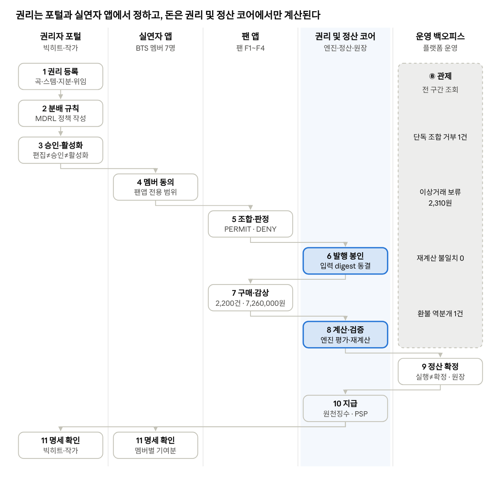

# 예시: BTS "Dynamite" 보컬 조합 2차 이용, 권리 생성에서 지급까지 (가상 시나리오)

- 작성일: 2026-10-12, 개정 2026-10-14(BTS Dynamite 실제 곡 정보 반영), 2026-10-15(구현 1~14번 반영: 동의·본인 인증·발행 게이트, 팬 앱 조합 판정, 실연자 앱 알림, 4월 감상 매출 실정산)
- 원본(공유 문서의 "예시: Dynamite 2차 이용" 탭): https://claude.ai/code/artifact/9db7d516-16a3-4822-a995-ea0671a5fba3
- 상위 문서: [시스템 아키텍처 및 업무 분리안](시스템_아키텍처_및_업무분리안_20261012.md)

BTS "Dynamite"를 팬이 멤버 보컬을 바꿔 조합하는 팬앱 전용 2차 이용으로 가정하고, 실제 MDRL 엔진과 정산 코어로 끝까지 돌린 결과다. 4개 팬 조합의 구매 2,200건(7,260,000원)에서 환불 1건을 뺀 순매출 7,256,700원이 권리 생성 때 정한 분배율대로 나뉘고, 권리자 4곳에 5,077,380원(원천징수 후 4,910,080원)이 지급됐다. 이어 4월 구독 수익 1,000,000원을 조합별 재생 비중으로 나눠 감상 매출로 정산했다(12단계, 다음 지급 대상).

> **가상 시나리오다.** 개발자와 관계자가 친숙한 곡으로 흐름을 이해하도록 만든 설명용 사례이며, 실제 계약·지분·정산과 무관하다. 금액은 손으로 계산한 값이 아니라 `04_구현_소스코드/rights-core/src/scenario/dynamite.ts`를 실행해 얻은 값이다([실행 결과 JSON](예시_Dynamite/dynamite-report.json)).

| 구분 | 내용 |
| --- | --- |
| 실제 정보 | 곡 크레딧·발매 정보, 멤버 7명, 멤버별 원곡 총 가창 시간(팬 집계 근사치) |
| 가정 | 멤버별 파트 묶음을 슬롯 하나로 본 구성, 멤버 전원이 모든 파트를 녹음했다는 설정, 지분·분배율·가격·판매량, 레이블·소속사·작가의 권리 관계와 위임, 원천징수율 |

## 곡 정보 (실제)

| 항목 | 내용 |
| --- | --- |
| 곡 | Dynamite |
| 아티스트 | BTS (RM, 진, 슈가, 제이홉, 지민, 뷔, 정국) |
| 발매 | 2020-08-21 |
| 레이블 | Big Hit (유통 Columbia·Sony Music) |
| 작사·작곡 | David Stewart, Jessica Agombar |
| 프로듀서 | David Stewart |
| 길이·조성·템포 | 3:19, E장조, 114 BPM |

## 멤버별 파트와 슬롯

원곡의 멤버별 총 가창 시간(팬 집계 근사치)을 그대로 슬롯 길이로 쓴다. 실제 곡에서는 한 멤버의 파트가 곡 전체에 흩어져 있지만, 이 예시는 멤버별 파트 묶음 하나를 슬롯 하나로 본다(가정).

| 슬롯 | 원곡에서 부른 멤버 | 원곡 총 가창 시간 | 비중 |
| --- | --- | --- | --- |
| 정국 파트 | 정국 | 71.9초 | 37.3% |
| 지민 파트 | 지민 | 40.8초 | 21.2% |
| 뷔 파트 | 뷔 | 26.2초 | 13.6% |
| 진 파트 | 진 | 23.0초 | 11.9% |
| RM 파트 | RM | 18.1초 | 9.4% |
| 제이홉 파트 | 제이홉 | 6.6초 | 3.4% |
| 슈가 파트 | 슈가 | 6.2초 | 3.2% |
| 합계 | | 192.8초 | 100% |

멤버 전원이 7개 파트를 모두 녹음했다고 가정해 보컬 스템은 49개(7명 × 7파트)이고, 반주(MR)는 정산 대상에서 뺀다. 가창 시간은 출처마다 조금씩 다르다(예: 정국 71.9~73.5초, 제이홉 6.6~8.6초).

## 등장 주체 (권리 관계는 가정)

| 주체 | 역할 | 권리·지분(가정) | 쓰는 앱 |
| --- | --- | --- | --- |
| 빅히트 뮤직(레이블) | 녹음(마스터) 보유, 곡·스템 등록 | 녹음 100% | 권리자 포털 |
| 빅히트 뮤직(소속사) | 멤버 7명의 소속사 | 멤버 실연 몫 수령(위임) | 권리자 포털 |
| David Stewart | 작사·작곡 | 작품 50% | 권리자 포털 |
| Jessica Agombar | 작사·작곡 | 작품 50% | 권리자 포털 |
| BTS 멤버 7명 | 파트별 보컬 스템 실연, 동의 | 자기 스템 실연 100%(수령은 소속사) | 실연자 앱 |
| 팬 F1~F4 | 조합·구매·감상 | 없음(이용권만) | 팬 앱 |
| 플랫폼 | 검증·관제·정산 집행 | 수수료·운영비 | 운영 백오피스 |

같은 회사가 레이블과 소속사를 함께 맡으므로, 역할별로 파티 두 개로 등록했다.

**테넌트(로그인 조직)와 보이는 범위.** 운영에서는 빅히트 뮤직이 레이블 테넌트로 권리자 포털에 들어와 자기가 등록한 곡·스템·정책만 보고 고친다(RLS). 멤버와 팬은 소속 없는 개인(플랫폼 기본 테넌트)이라 자기 파티의 데이터만 본다. 플랫폼 운영은 전 구간을 보되, 다른 테넌트의 상세를 열면 열람 기록이 남고 계좌 토큰은 가려진다. 이 시나리오는 흐름을 보이려고 코어 함수를 system 범위로 직접 부르므로 테넌트 격리 경로는 거치지 않는다. 예외로 멤버의 동의 서명은 각 멤버 본인 계정(파티 범위)으로 했다.

## 전 과정 흐름



권리는 권리자 포털(권리자)과 실연자 앱(멤버)에서 정해지고, 금액은 권리 및 정산 코어에서만 계산된다. 운영 백오피스는 전 구간을 관제하고 정산 확정만 집행한다.

그림은 3월 구매 정산과 5월 지급까지(1~11단계)를 그렸다. 4월 감상 매출(12단계)은 그림에 없다. 그림 11단계의 "멤버별 기여분"은 실연자 앱 "수익" 탭에서 본다(위임 전 몫의 참고값).

## 봉인되는 IR 한눈에

발행 봉인(S3)은 IR이 아니라, facts·정책·조합 지분·멤버 IR 네 개의 digest를 묶어 고정하는 불변 레코드(`issue_seal`)다.

IR은 모두 JSON이고, JCS로 정규화한 뒤 SHA-256으로 digest를 만든다. 파일을 열었을 때 어떤 IR인지 알려 주는 표시는 아래 세 방식 중 하나다.

| 종류 표시 | 최상위 JSON 모양 | 해당 IR |
| --- | --- | --- |
| `module` 필드 | 객체. 머리 필드 `mdrl`·`module`·`id`·`version`·`depends_on`·`visibility_default` 아래에 본문 `body`를 둔다. 예: `{"mdrl": "1.0", "module": "facts", "id": "fsc_dynamite", "version": "1", "depends_on": [], "visibility_default": "PARTIES", "body": {…}}` | facts, 정책 |
| `format` 필드 | 객체. 최상위에 `format` 문자열(종류/버전)과 내용 필드를 나란히 둔다. 예: `{"format": "mdrl-projection/1", "facts_digest": "…", "vectors": {…}, …}` | 조합 지분, 정산 결과, 역분개 결과 |
| 표시 없음 | 객체 `{"members": {…}}` 또는 배열 `[{"id": "ev_orig_0001", "type": "PRIMARY", "amount": "3300", "currency": "KRW", "integrity": "CLEAR"}, …]` | 멤버(객체), 매출(배열) |

표시가 없는 IR은 파일만으로는 종류를 알 수 없고, 봉인 레코드(`sealed_document.kind`)로 구분한다.

| 봉인 | IR 종류 | 종류 표시 | 최상위 JSON 모양 | 만드는 때 | 담는 내용 | 이 예시 |
| --- | --- | --- | --- | --- | --- | --- |
| S1 | facts IR | `module: "facts"` | 객체(머리 필드 + `body`) | 정책 컴파일(1~2단계) | 주체·작품·녹음·보이스·스템, 권리 주장·위임 | 곡당 1개(`2e77bb42…`) |
| S2 | 정책 IR | `module: "allocation"` | 객체(머리 필드 + `body`) | 정책 컴파일(2~3단계) | 1·2차 분배율, 벡터 식, 반올림, 참조 facts digest | 정책 버전당 1개(`1cbc37c4…`) |
| S3-a | 조합 지분 IR | `format: "mdrl-projection/1"` | 객체 | 조합 발행(6단계) | 발행 시각 기준 역할별 기여 벡터와 권리 경로 | 조합당 1개(4개) |
| S3-b | 멤버 IR | 없음 | 객체 `{"members": {"pty_jungkook": "1429/10000", …}}` | 조합 발행(6단계) | 참여 멤버와 비율(유리수, 합 1) | 조합당 1개(4개) |
| S4-a | 매출 IR | 없음 | 배열(매출 이벤트 목록) | 정산 run(8~9단계, 12단계) | run에 들어간 매출 이벤트(id·유형·금액·통화·무결성 상태) | run당 1개(3월 4개, 4월 4개) |
| S4-b | 정산 결과 IR | `format: "mdrl-allocation-result/1"` | 객체 | 정산 run(8~9단계, 12단계) | 풀·라인·보류, `result_digest` | run당 1개(3월 4개, 4월 4개) |
| S4-r | 역분개 결과 IR | `format: "mdrl-reversal-result/1"` | 객체 | 확정 후 환불 | 원 라인을 되돌리는 음수 라인 | 환불당 1개(1개) |

## 1~3단계: 권리 생성, 분배 규칙, 권리자 승인

**1. 권리 생성(권리자 포털).** 빅히트 뮤직(레이블)이 곡·녹음·파트 슬롯 7개·보컬 스템 49개를 등록하고, 권리 주장(녹음 100% 레이블, 작품 David Stewart·Jessica Agombar 각 50%, 스템별 실연 멤버)과 위임(멤버 7명 → 빅히트 뮤직(소속사), 실연)을 기록한다. 정책을 컴파일할 때 코어가 이 데이터를 facts IR(S1)로 만들어 봉인한다(`mdrl:sha256:2e77bb42…`).

스템에 오디오를 올리면 오디오 처리 서비스가 기술 검수(포맷·무음·True Peak·라우드니스)와 소스 출처 검사(상용 음원 대조·같은 파일 재사용·길이)를 하고, 코어가 READY·QC_FAILED·REVIEW·BLOCKED를 정한다. READY가 아닌 스템은 발행되지 않는다(`STEM_NOT_READY`). 이 예시는 49개 스템을 메타데이터로만 등록했으므로 검수 대상이 아니고 렌더도 하지 않는다.

**2. 분배 규칙(MDRL 정책).**

```text
allocation "pol_dynamite_fan" version 1 {
  uses facts "fsc_dynamite"@1 digest "mdrl:sha256:…";   // 컴파일 때 봉인된 facts digest로 고정
  scope { pack: pak_dynamite_fan; events: [PRIMARY, TRAFFIC]; currency: KRW; }
  bind { time: ISSUE_TIME; }
  tier1 {
    platform = 25%;
    ops = 5%;
    rights = 70%;
  }
  tier2 rights {
    split {
      master = graph(MASTER_OWNER) : 40%;
      performer = performance_pool(HYBRID, fixed: 40%, usage: 60%, featured_weight: 70%) |> cap(50%) via mandate : 45%;
      work = graph(WORK_AUTHOR) : 15%;
    }
  }
  rounding { method: HIERARCHICAL_LRM_V1; tie: party_id_asc; }
}
```

- **1차 분할**: 매출을 플랫폼 25%, 운영 5%, 권리자 풀 70%로 나눈다.
- **2차 분할(권리자 풀)**: 마스터 40%는 레이블에, 실연 45%는 조합에 참여한 멤버에게, 작품 15%는 작가 지분대로 간다.
- **실연 몫(HYBRID)**: 40%는 참여 멤버에게 똑같이, 60%는 실제 부른 시간에 비례해 나누고, 한 사람은 50%를 넘지 못한다.
- **위임(via mandate)**: 멤버 몫은 1인 상한을 먼저 적용한 뒤 소속사로 보낸다(결정 2026-10-13: 소속사가 있으면 소속사가 수령).
- **반올림**: 1원 단위 최대잉여법(HIERARCHICAL_LRM_V1). 어느 단계에서도 합계가 정확히 보존된다.

**3. 승인·활성화(직무 분리).** 정책은 편집자(EDITOR)가 작성하고, 승인자(WORK_APPROVER)가 승인하고, 활성화 담당자(ACTIVATOR)가 활성화한다(정책 IR(S2) `mdrl:sha256:1cbc37c4…`). 이어 팬앱 전용 팩 `DYNAMITE-FAN`을 활성화하면서, 팩에 선언된 권리자 11곳(레이블·소속사·작가 2·멤버 7)이 facts의 권리 주장과 일치하는지 검사한다.

## 4~6단계: 멤버 동의, 이용허락 판정, 발행 봉인

**4. 멤버 동의(실연자 앱).** 멤버 7명이 각자 실연자 앱 계정으로 본인 인증을 마친 뒤(인증 전에는 `IDENTITY_REQUIRED`로 서명 불가) 자기 보이스 사용을 아래 범위로 허락한다. 레이블(녹음)과 작가(작품)의 허락은 플랫폼이 계약서를 근거로 같은 범위로 옮겨 적는다. 동의는 코어의 `consent_agreement`에 저장되고, 판정은 판정 시점에 유효한 동의를 읽어 한다. 철회하면 행을 지우지 않고 철회 시각을 남기며, 다시 동의하면 이전 철회를 대체한다. 무기한 동의는 받지 않는다(종료일 필수).

| 차원 | 허락 범위 |
| --- | --- |
| 행위 | 미리듣기, 조합, 개인 소장, 앱 내 링크 공유 |
| 지역 | 한국 |
| 매체 | 팬 앱 |
| 청중 | 팬 커뮤니티 |
| 기간 | 2026-01-01 ~ 2027-01-01 |

**5. 이용허락 판정(팬 앱).** 엔진 판정 결과다. 발행할 때마다 코어가 같은 판정을 한다. 조합이 쓰는 작품·녹음과 부른 멤버의 보이스마다 요구를 만들고, 발행 시각에 유효한 동의로 판정한다. PERMIT이 아니면 발행을 거부한다(`ISSUE_NOT_LICENSED`). 기본 이용 범위는 팬앱 조합(COMBINE·KR·FAN_APP·FAN_COMMUNITY)이다.

| 요청 | 판정 | 사유 |
| --- | --- | --- |
| 팬앱에서 원곡 배치 조합 감상 | PERMIT | — |
| 같은 조합을 내려받아 외부 SNS에 게시 | DENY | `GRANT_SCOPE_WIDENING` — 허락 범위 밖 |
| 멤버 한 명의 동의가 철회된 뒤(가정) 같은 조합 감상 | DENY | `GRANT_REVOKED` — 동의 철회 |

**조합 판정(팬 앱).** 팬은 저장하기 전에 배치를 시험해 볼 수 있다(`POST /fan/combinations/check`). 판정은 실제 발행 함수를 SAVEPOINT 안에서 돌리고 되돌리는 방식이라, 이용허락·스템 오디오·정산 사전 검사까지 발행과 결과가 같고 아무 행도 남지 않는다. 같은 배치를 다시 물으면 캐시에서 답한다. 아래는 시나리오가 발행 전에 실제로 물은 결과다.

| 배치(팬) | 발행 가능 | 사유 | 캐시 |
| --- | --- | --- | --- |
| 원곡 배치(F1), 정국·지민 맞바꾸기(F2), 랩 파트를 보컬 멤버가(F3), 진 확장(F4) | 예 | — | 새로 계산 |
| 정국 혼자 7개 파트(F1, 첫 질문) | 아니오 | `ISSUE_NOT_SETTLEABLE` | 새로 계산 |
| 같은 배치 다시 질문 | 아니오 | `ISSUE_NOT_SETTLEABLE` | 캐시 적중 |

캐시 키는 팩·활성 정책 digest·배치·멤버 비율·이용 범위다. 멤버 한 명이 동의를 철회하면 그 멤버의 보이스를 쓴 판정만 지워지고, 그 멤버가 없는 배치의 판정은 그대로 남는다. 캐시는 안내용이고 실제 발행은 언제나 게이트를 다시 돈다.

**6. 발행 봉인 S3(팬 앱 → 권리 및 정산 코어).** 팬이 파트마다 부를 멤버를 골라 저장하면, 이용허락 판정(5단계)을 통과한 경우에만 facts IR(S1)과 정책 IR(S2)은 그대로 가리키고 조합 지분 IR과 멤버 IR을 새로 만들어 봉인한다. 이후 이 조합의 모든 정산은 이 네 IR만 입력으로 쓴다.

| 조합(팬) | 바꾼 파트 | 참여 멤버 비율(멤버 IR) | 조합 지분 IR | 멤버 IR |
| --- | --- | --- | --- | --- |
| vc_bts_orig (F1, 원곡 배치) | 없음 | 7명 각 약 1/7 | `fe70064c…` | `e19c2b4c…` |
| vc_bts_swap (F2, 정국·지민 맞바꾸기) | 정국 파트→지민, 지민 파트→정국 | 7명 각 약 1/7 | `e1e3bc9c…` | `e19c2b4c…` |
| vc_bts_vocal (F3, 랩 파트를 보컬 멤버가) | RM 파트→진, 슈가 파트→뷔, 제이홉 파트→지민 | 정국 1/7, 지민·뷔·진 각 2/7 | `52f585f7…` | `475db798…` |
| vc_bts_jin (F4, 진이 정국·지민 파트까지) | 정국 파트→진, 지민 파트→진 | 진 3/7, 뷔·RM·제이홉·슈가 각 1/7 | `a773b1ed…` | `d2b28108…` |
| vc_bts_solo (거부) | 정국이 7개 파트 전부 | 정국 1 | 봉인 안 됨 | 봉인 안 됨 |

F1과 F2는 참여 멤버와 비율이 같아 멤버 IR이 같지만, 누가 어느 파트를 불렀는지가 달라 조합 지분 IR이 다르다. 정국 혼자 부른 조합은 1인 상한 50%를 지킬 수 없어(`ALLOC_INFEASIBLE`) 발행 전에 거부됐다(`ISSUE_NOT_SETTLEABLE`).

조합 지분 IR에는 발행 시각(`as_of`)이 들어가므로 digest는 발행할 때마다 다르다. 2026-10-15 재실행에서 F2~F4의 digest가 바뀐 것은 발행 시 멤버 알림을 쓰면서 발행 시각이 몇 밀리초씩 밀렸기 때문이다. 금액은 하나도 바뀌지 않았다.

**멤버 알림(실연자 앱).** 발행되면 그 조합에 스템이 쓰인 멤버에게 "내 보이스가 새 조합에 쓰였습니다" 알림이 간다(웹 푸시를 구독했으면 푸시도). 이 예시에서 진·뷔는 4개 조합 모두에 쓰여 4건, 나머지 5명은 3건씩 받았다. 멤버는 실연자 앱의 "사용" 탭에서 어느 조합의 어느 파트에 몇 초가 쓰였는지 본다.

**렌더.** 운영에서는 발행 직후 서버가 마스터(WAV, 조합마다 다른 워터마크)를 렌더하고, 발행한 팬만 받는다. 저장 전 미리듣기는 5초 MP3다. 이 예시는 오디오가 없어 렌더하지 않았다.

## 7~8단계: 이용 매출과 계산

**7. 이용 매출.** 3월 한 달 동안 팬들이 조합을 건당 3,300원에 소장 구매했다.

| 조합 | 구매 건수 | 매출(원) | 비고 |
| --- | --- | --- | --- |
| vc_bts_orig (원곡 배치) | 1,200 | 3,960,000 | 4월 10일 환불 1건(−3,300) |
| vc_bts_swap (정국·지민 맞바꾸기) | 500 | 1,650,000 | — |
| vc_bts_vocal (랩 파트를 보컬 멤버가) | 300 | 990,000 | — |
| vc_bts_jin (진 확장) | 200 | 660,000 | 1건 이상거래 의심(FLAGGED) |
| 합계 | 2,200 | 7,260,000 | 환불 반영 순매출 7,256,700 |

**8. 구매 1건(원곡 배치, 3,300원) 계산.** 엔진이 낸 결과다.

| 단계 | 버킷 | 계산 | 금액(원) | 받는 곳 |
| --- | --- | --- | --- | --- |
| 1차 | 플랫폼 | 3,300 × 25% | 825 | 플랫폼 |
| 1차 | 운영 | 3,300 × 5% | 165 | 플랫폼 |
| 1차 | 권리자 풀 | 3,300 × 70% | 2,310 | 아래로 |
| 2차 | 마스터 | 2,310 × 40% | 924 | 빅히트 뮤직(레이블) |
| 2차 | 실연 | 2,310 × 45% = 1,039.5 | 1,040 | 빅히트 뮤직(소속사), 멤버 7명 몫 합계 |
| 2차 | 작품 | 2,310 × 15% = 346.5 | 346 | David Stewart 173, Jessica Agombar 173 |

실연 몫은 소속사가 한꺼번에 받지만, 엔진은 소속사로 보내기 전의 멤버별 기여분도 계산할 수 있다. 아래는 조합별 구매 1건의 실연 몫 1,040원을 멤버별로 나눈 값이다(위임 라우팅을 뺀 같은 정책으로 엔진 시뮬레이션, 원).

| 조합 | 정국 | 지민 | 뷔 | 진 | RM | 제이홉 | 슈가 |
| --- | --- | --- | --- | --- | --- | --- | --- |
| 원곡 배치 | 292 | 191 | 144 | 134 | 118 | 81 | 80 |
| 정국·지민 맞바꾸기 | 191 | 292 | 144 | 134 | 118 | 81 | 80 |
| 랩 파트를 보컬 멤버가 | 337 | 257 | 209 | 237 | — | — | — |
| 진 확장 | — | — | 169 | 520 | 142 | 105 | 104 |

- 원곡 배치에서 정국이 가장 많은 것은 가장 오래 부르기 때문이다(고정분 약 59원은 7명이 같고, 나머지는 부른 시간에 비례).
- 정국·지민 맞바꾸기에서는 두 사람의 몫이 그대로 뒤바뀐다. 몫은 이름이 아니라 실제로 부른 시간을 따라간다.
- 진 확장에서 진은 원래 계산으로는 실연 몫의 50%를 넘지만, 1인 상한 50%(520원)에 걸려 넘친 몫이 다른 멤버에게 다시 나뉜다.

**감상 매출.** 같은 정책은 감상 매출(`TRAFFIC`)도 받는다. 원곡 배치 조합에 50,000원이 배정되면 같은 발행 봉인으로 플랫폼 12,500 + 운영 2,500, 빅히트 뮤직(레이블) 14,000, 빅히트 뮤직(소속사) 15,750, David Stewart 2,625, Jessica Agombar 2,625원으로 나뉜다(엔진 시뮬레이션). 실제 수집·배정·정산은 12단계에서 4월분으로 돌렸다.

## 9~10단계: 정산, 원장, 지급

3월 정산은 조합별 run 4개가 모두 재계산 검증을 통과한 뒤 확정됐고, 권리자 4곳에 총 5,077,380원(원천징수 후 4,910,080원)이 지급됐다.

**9. 정산 배치(운영 백오피스 ⑥).**

1. 운영자(SPACE_OPS)가 3월 배치를 만들면 조합별 run 4개가 생긴다.
2. 엔진이 발행 봉인과 매출로 계산해 결과를 봉인하고, 독립 검증 워커가 다시 계산해 같은 digest인지 확인한다(4/4 VERIFIED).
3. 다른 사람(SPACE_SETTLE)이 확정하면 원장에 정산 분개(SETTLEMENT) 4건이 기록된다.
4. 이상거래 의심 1건은 플랫폼·운영 몫만 배분하고, 권리자 풀 2,310원은 조사 보류(FRAUD_REVIEW)로 묶는다.
5. 확정 뒤 들어온 환불 1건은 원 계산을 라인별로 정확히 되돌리는 역분개(REVERSAL)로 처리한다.

**10. 지급과 명세.** 5월 1일 지급 실행 결과다. 원천징수율은 플랫폼 지급 정책의 기본값(국내 법인 0%, 해외 22%)을 가정했다.

| 권리자 | 3월 정산 | 환불 역분개 | 지급 총액 | 원천징수 | 실지급 |
| --- | --- | --- | --- | --- | --- |
| 빅히트 뮤직(소속사) | 2,286,960 | −1,040 | 2,285,920 | 0 | 2,285,920 |
| 빅히트 뮤직(레이블) | 2,031,876 | −924 | 2,030,952 | 0 | 2,030,952 |
| David Stewart | 380,427 | −173 | 380,254 | 83,650 | 296,604 |
| Jessica Agombar | 380,427 | −173 | 380,254 | 83,650 | 296,604 |
| 합계 | 5,079,690 | −2,310 | 5,077,380 | 167,300 | 4,910,080 |

- 금액은 모두 원(KRW)이다. 이상거래 의심 건의 권리자 풀 2,310원은 조사 보류 중이고, 해제되면 다음 지급에 반영된다.
- 멤버 7명은 직접 받는 금액이 없고, 실연 몫은 소속사가 받는다. 멤버는 실연자 앱 "수익" 탭에서 위임 전 자기 기여분을 조합별로 본다. 확정된 정산을 같은 정책으로 다시 계산하되 소속사로 보내는 단계만 뺀 참고값이다(위 기여분 표와 같은 계산).
- 실제 해외 작가의 원천징수율은 조세조약·신고에 따라 다르다. 22%는 시나리오용 정책값이다.
- 지급 후 4곳의 미지급 잔액은 모두 0이고, 권리자별 명세의 항등식(기초 + 정산 + 역분개 − 지급 = 기말)이 성립했다.

## 12단계: 4월 감상 매출(재생 비중 배정)

구매는 조합 한 건에 매출 한 건이 바로 붙지만, 구독·광고 수익은 기간 단위로 들어온다. 그래서 재생을 먼저 모으고, 기간이 끝나면 수익을 재생 비중으로 나눈다. 아래는 5월 지급 뒤에 따로 돌린 실제 결과이며, 위의 3월 정산과 5월 지급 금액은 바뀌지 않는다.

**재생 기록(팬 앱).** 4월 한 달 동안 감상자 50명이 네 조합을 들었다(가정). 재생 시각은 단말이 아니라 코어 시계로 적는다. 30초 이상이면 유효 재생이다. 한 사람이 같은 조합을 24시간 안에 10번 넘게 들으면 그 뒤 재생은 FLAGGED로 남기고 배정에서 뺀다.

| 조합 | 유효 재생 | 제외 | 수익 풀 배정(원) |
| --- | --- | --- | --- |
| vc_bts_orig (원곡 배치) | 600 | — | 594,059 |
| vc_bts_swap (정국·지민 맞바꾸기) | 250 | 30초 미만 30회 | 247,525 |
| vc_bts_vocal (랩 파트를 보컬 멤버가) | 100 | — | 99,010 |
| vc_bts_jin (진 확장) | 60 | 한 사람의 반복 재생 5회(FLAGGED) | 59,406 |
| 합계 | 1,010 | | 1,000,000 |

**풀 배정(운영 백오피스, 정산 담당).** 4월 구독 수익 1,000,000원을 풀로 등록하고 배정했다. 재생 비중대로 나눈 몫의 원 미만은 최대잉여법으로 정리한다. 내림 몫의 합이 999,997원이라, 남은 3원을 소수부가 큰 진 확장(.94)·랩 파트(.90)·맞바꾸기(.75) 순으로 1원씩 줬다. 조합마다 `TRAFFIC` 매출 이벤트가 하나씩 생기고, 이벤트 시각은 4월의 마지막 밀리초다. 이 정책은 감상 매출을 받는다(`events: [PRIMARY, TRAFFIC]`). 감상 매출을 받지 않는 정책의 조합이면 그 재생은 배정에서 빠진다.

**4월 정산.** 구매와 같은 경로다. 조합별 run 4개가 재계산 검증을 통과했고(4/4 VERIFIED), 다른 사람이 확정해 정산 분개 4건이 더 기록됐다(3월분과 합쳐 8건).

| 받는 곳 | 4월 감상 정산(원) | 비율 |
| --- | --- | --- |
| 플랫폼 | 250,000 | 25% |
| 운영 | 50,000 | 5% |
| 빅히트 뮤직(소속사) | 315,001 | 31.5% |
| 빅히트 뮤직(레이블) | 280,000 | 28% |
| David Stewart | 52,500 | 5.25% |
| Jessica Agombar | 52,499 | 5.25% |
| 합계 | 1,000,000 | |

- 비율은 구매 정산·감상 시뮬레이션과 같다. 같은 정책·같은 발행 봉인이기 때문이다. 소속사 +1원과 Jessica Agombar −1원은 조합별 run 4개에서 각각 원 단위로 정리한 결과다.
- 4월분은 다음 지급 대상이다. 5월 지급 뒤라 위 지급 표와 명세에는 들어가지 않는다.
- 외부 음원 서비스의 감상 매출은 재생 수가 아니라 유통사가 정한 조합별 금액으로 연동 허브(유통사 CSV·DDEX DSR)를 거쳐 들어온다. 이 예시에는 외부 유통이 없다.

## 운영 백오피스 ⑧ 관제에 보이는 것

| 단계 | 신호 | 플랫폼의 대응 |
| --- | --- | --- |
| 발행 | 정국 1인 전 파트 조합 거부(`ISSUE_NOT_SETTLEABLE`), 판정 캐시 항목·적중 | 거부 사유 집계, 팬앱 안내 문구 확인 |
| 수익 | 이상거래 의심 1건(진 확장 조합) | 권리자 풀 2,310원 자동 보류, ⑤ 신뢰안전 큐로 배정 |
| 수익(감상) | 4월 유효 재생 1,010회, 과다 반복 재생 5회 제외, 기간이 끝났는데 배정 안 된 풀 0 | 반복 재생 계정 확인, 기간 끝난 풀 배정 |
| 정산 | run 4개 재계산 일치(불일치 0건) | 확정 가능 표시, ⑥ 정산 큐로 넘김 |
| 환불 | 확정 후 환불 1건 → 역분개 1건 | 원장 반영과 권리자별 음수 라인 확인 |
| 동의 철회(가정) | 멤버 한 명 철회 → 새 발행 거부(`ISSUE_NOT_LICENSED`), 그 보이스를 쓴 판정 캐시만 무효화, 그 멤버가 부른 발행 조합의 노출 자동 중지(마스터 다운로드·재생 기록 거부), 본인에게 알림 | 영향 분석: 노출이 멈춘 조합, 보류할 미정산 매출, 역분개를 검토할 확정 라인. 멤버가 다시 동의하면 노출이 풀린다 |

한 건 추적 예(구매 `ev_orig_0001`):

1. 매출 3,300원 → 조합 vc_bts_orig(팬 F1, 원곡 배치)
2. 발행 봉인(S3, IR 4개 묶음): facts IR `2e77bb42…`, 정책 IR `1cbc37c4…`, 조합 지분 IR `fe70064c…`, 멤버 IR `e19c2b4c…`
3. 3월 정산 결과 IR(S4) `3f3306e5…` → 라인 4개(소속사 1,040, 레이블 924, David Stewart 173, Jessica Agombar 173)
4. 4월 10일 환불 → 역분개 `f98b3987…`(같은 라인 음수)
5. 5월 지급 `pay-2026-05`에서 순액으로 상계
6. 4월 감상: 구독 풀 `pool_sub_2026_04`에서 594,059원 → `TRAFFIC` 이벤트 `ev_tr_pool_sub_2026_04_vc_bts_orig` → 같은 발행 봉인으로 4월 정산 결과 IR `907a589e…`

## 재현 방법과 구현 공백

아래 명령으로 같은 결과를 다시 얻을 수 있다. 같은 입력이면 같은 digest가 나온다(2026-10-15에도 두 번 실행한 보고서가 바이트 단위로 같았다).

```bash
cd 04_구현_소스코드
docker compose up -d
npm run scenario:dynamite -w rights-core -- --out ../../00_프로젝트_개요/예시_Dynamite
```

이 예시가 드러낸 구현 공백이다.

- [x] 멤버 동의의 저장·철회(2026-10-15): 코어 `consent_agreement`에 저장하고, 실연 동의는 본인만 서명·철회한다. 철회하면 영향받는 발행 조합을 감사 로그에 남긴다.
- [x] 이용허락 판정의 발행 게이트 연결(2026-10-15): 발행할 때 작품·녹음·쓰인 보이스의 동의로 판정하고, 허락되지 않으면 `ISSUE_NOT_LICENSED`로 거부한다. 동의를 철회한 멤버가 부른 새 조합은 발행되지 않는다.
- [x] 감상 매출(`TRAFFIC`) 수집(2026-10-15): 팬 앱이 재생을 보고하고, 구독·광고 수익 풀을 기간의 조합별 유효 재생 비중으로 나눠 조합마다 `TRAFFIC` 매출을 만든다. 그 뒤는 구매와 같은 정산 경로다. 이 예시는 12단계에서 4월분을 실제로 배정·정산했다.
- [x] 실연자 앱(2026-10-15): 본인 인증, 동의 서명·철회, 내 스템 사용 이력, 명세, 이의제기, 알림·웹 푸시. 모바일 PWA다.
- [x] 멤버별 기여분 표시(2026-10-15): 실연자 앱 "수익" 탭이 위임 전 내 몫을 조합별 참고값으로 보여 준다. 확정 후 환불과 이상거래 보류를 반영한다.
- [x] 철회 후 노출 중지(2026-10-15): 동의를 철회하면 그 자산을 쓴 발행 조합의 마스터 다운로드·재생 기록이 자동으로 멈추고(410 `EXPOSURE_STOPPED`), 다시 동의하면 풀린다.
- [x] 실연 위임 수령 결정(2026-10-13): 소속사가 있는 멤버의 실연 몫은 소속사가 수령한다. 엔진의 버킷 단위 via mandate로 반영했다.

이 공백은 [아키텍처 문서](시스템_아키텍처_및_업무분리안_20261012.md)의 "현재 구현과의 차이와 다음 작업" 목록에 합쳤다(동의 저장 2번, 발행 게이트 연결 3번, 위임 수령 결정 4번, 실연자 앱 11번, 감상 매출 13번, 멤버별 기여분 표시 16번, 철회 후 노출 중지 17번).

## 출처

- 곡 크레딧·발매일·길이·조성·템포: [Wikipedia — Dynamite (BTS song)](https://en.wikipedia.org/wiki/Dynamite_(BTS_song)) (2026-10-14 확인)
- 멤버별 가창 시간 교차 확인: [Cheatsheet — Which BTS Member Has the Most Lines in 'Dynamite'?](https://www.cheatsheet.com/entertainment/bts-member-most-lines-dynamite.html)(정국 73.5초, 지민 40.3초, 제이홉 8.6초), [Koreaboo — BTS line distributions](https://www.koreaboo.com/lists/bts-line-distributions-songs-music-videos/)(비율 순위)
- 시나리오에 쓴 7명 전체 초 단위 값(정국 71.89초 등)은 검색으로 찾은 팬 집계이며, 원문은 직접 확인하지 못했다. 근사치로만 쓴다.

근거 코드: `04_구현_소스코드/rights-core/src/scenario/dynamite.ts`, 실행 결과: `00_프로젝트_개요/예시_Dynamite/dynamite-report.json`
