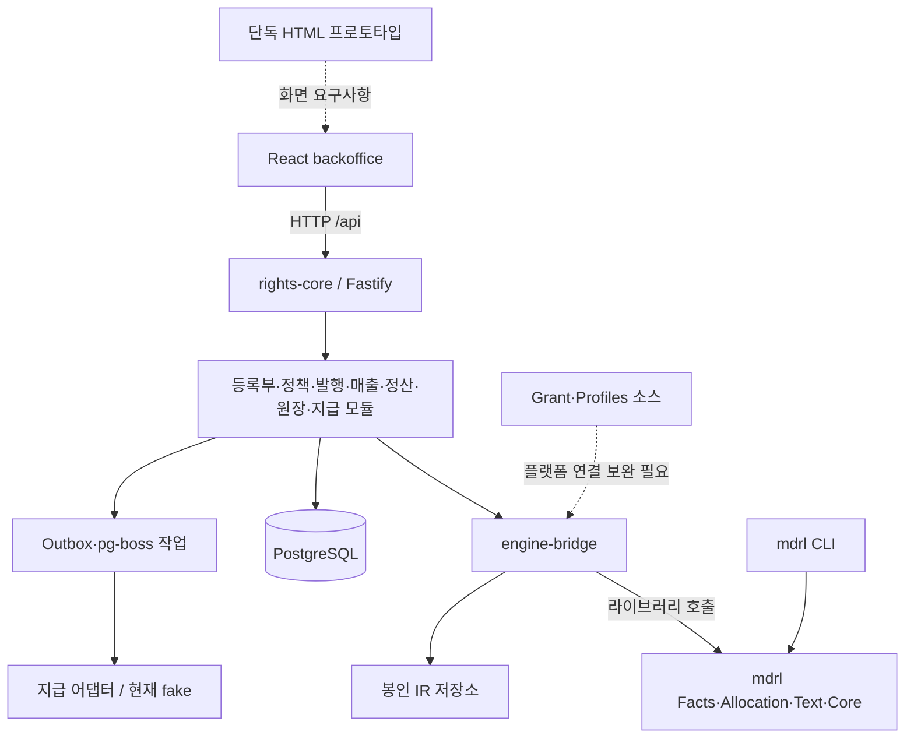

# dobedupop · mdrl 프로젝트 구성 및 상호 연관성 분석

> 이 문서는 정합화 이전의 분석 스냅샷이다. 후속 변경과 현재 검증 결과는 [정합화 검증 기록](정합화_검증결과_20261012.md)을 참조한다.

- 분석일: 2026-10-12
- 대상: 1차 정리 이후의 문서, npm 워크스페이스, TypeScript 소스, SQL 마이그레이션, HTML 시안.
- 명칭 기준: 사용자가 지정한 `dobedupop`과 `mdrl`. 현 저장소의 `dobedubpop` 표기는 이 기준과 다름.
- 분석 방식: 문서와 실제 호출 경로 비교, 단위 테스트·타입 검사·빌드·패키지 import 검사.
- 범위: 구조와 연결 상태 분석. 기존 문서·소스의 수정이나 추가 재배치는 수행하지 않음. mdrl 빌드 산출물은 검증 과정에서 재생성.

## 1. 핵심 판단

현재 프로젝트는 **음악 2차이용 권리언어를 개발하는 작업**과 **그 언어를 보컬 조합 서비스의 운영·정산에 적용하는 작업**이 결합된 구조다.

실행 코드의 중심은 `mdrl → rights-core → backoffice`의 세 구성 요소다. mdrl은 계산 규칙과 결정적 평가를 담당하고, rights-core는 저장·승인·발행·매출·원장·지급 상태를 관리하며, backoffice는 이를 조작하고 검증하는 관리자 화면이다.

설계와 구현의 성숙도는 같지 않다. **보컬 조합의 권리 사실·안분·봉인·원장 연계는 구현되어 있고, 범용 Grant 판정과 프로파일 확장은 소스가 존재하지만 플랫폼과의 연결이 덜 된 상태**다. 단독 HTML 시안과 React 콘솔도 서로 다른 산출물이다.

현재 단계는 ‘범용 음악 2차이용 플랫폼 완성’보다 **보컬 조합 정산을 중심으로 한 통합 검증용 구현체에 범용 mdrl 기능을 확장하는 단계**로 보는 것이 정확하다.

## 2. 폴더별 역할과 문서 관계

| 현재 폴더 | 역할 | 다른 영역과의 관계 |
|---|---|---|
| `00_프로젝트_개요` | 용어, 문서 진입점, 전체 구조 안내 | 사업·규격·제품 설계·구현의 기준을 연결 |
| `01_기획_비즈니스` | 사업 목적, 참여자, 수익 모델, 사업·특허 자료 | 플랫폼이 무엇을 지원해야 하는지 정의 |
| `02_MDRL_언어규격` | 언어 레퍼런스, 그래프·정책 설계, 구현·통합 계획 | mdrl 엔진 및 rights-core 연결 방식의 근거 |
| `03_dobedubpop_플랫폼설계` | 데이터모델, 화면·운영 설계 | 공통 언어를 실제 보컬 조합 서비스에 적용 |
| `04_구현_소스코드` | 엔진·서버·콘솔·HTML 시안 | 설계를 실행 가능한 흐름으로 검증 |
| `05_참고자료` | 벤치마킹과 초기 검토 자료 | 배경 자료. 현재 구현 계약과 구분 필요 |
| `99_아카이브` 및 각 히스토리 폴더 | 과거 버전과 이전 산출물 | 변경 이유 추적과 복원 |

1차 정리로 목적별 탐색은 쉬워졌다. 다만 `02_MDRL_언어규격`에는 공통 언어 규격뿐 아니라 보컬 팩·권리스탬프·운영 게이트처럼 제품에 종속된 설계도 포함된다. 폴더 위치만으로 ‘모든 mdrl 구현에 필수인 규칙’이라고 해석하면 안 된다.

문서의 역할은 다음과 같이 구분하는 편이 적합하다.

- **사업기획서**: 서비스 목적과 사업 범위.
- **mdrl 레퍼런스북**: 공통 개념과 목표 언어 체계.
- **코어 규격·적합성 자료·코드**: 현재 실행 가능한 문법·타입·계산 계약의 대조 기준.
- **시스템 통합 아키텍처**: DB 행을 IR로 변환하고 봉인하여 엔진을 호출하는 계약.
- **데이터모델·SQL 마이그레이션**: 목표 데이터모델과 실제 설치 스키마. 두 문서를 동일시하지 않음.
- **UI 가이드·HTML 시안**: 목표 운영 화면과 상호작용.
- **React 콘솔·E2E 코드**: 현재 실제 API에 연결된 업무 흐름.

현재 개요 문서의 ‘최신 확정 문서/SSOT’ 선언만으로 이들 사이의 차이가 해소되지는 않는다. 언어 설명서, 실행 API, 제품 정책은 기준의 종류가 다르며 각각 버전과 적용 범위를 가져야 한다.

## 3. 실제 런타임 구조

### 3.1 mdrl: 독립 계산·검증 계층

- TypeScript 패키지명과 CLI 이름은 현재 `mdrl`.
- `core`: ID·열거형·시간·정규화·digest·유리수·범위 연산.
- `facts`: 자산·주체·권리 주장·위임의 검증과 기여 벡터 계산.
- `allocation`: 정책 평가, 계층별 금액 배분, 보류, 결과 검증·역분개 관련 계산.
- `text`: Facts·Grant·Allocation 파서와 포매터.
- `grant`: 별도의 이용허락 판정 소스.
- `profiles`: 보컬 조합·AI 믹스 프로파일과 레지스트리 소스.
- `spec`, `conformance`, `test`: 문법·스키마·적합성 예제·테스트.
- DB 저장, 승인자의 실제 인증, 송금 실행은 엔진 외부 책임.

### 3.2 rights-core: 업무·영속성 계층

- Fastify 기반의 모듈형 모놀리스. mdrl을 네트워크 서비스가 아니라 workspace 라이브러리로 호출.
- 등록부, 정책, 발행, 매출, 정산, 원장, 지급 모듈을 포함.
- `engine-bridge`가 DB 행↔IR 변환, 봉인, 엔진 호출, 검증의 핵심 접점.
- PostgreSQL을 원본 저장소로 사용하고 Outbox와 pg-boss로 비동기 작업 처리.
- 현재 blob 저장은 파일시스템 어댑터. 설계상의 오브젝트 저장소와 배포 구현을 구분해야 함.
- 지급 사업자 인터페이스가 있으나 실제 선택 가능한 어댑터는 fake뿐임.

### 3.3 backoffice: 통합 검증용 운영 UI

- React 19·Vite·React Query 기반.
- 당사자·자산·권리 주장·위임·분쟁·정책·팩·발행·매출·정산·원장·지급·명세서 화면.
- `/api` 요청을 개발 프록시가 rights-core의 8080 포트로 전달.
- `x-actor` 헤더와 개발용 사용자 전환을 사용하는 검증 환경. 운영 인증과 동일하지 않음.
- 팬 앱이 완성되어 이 콘솔로 연결된 구조로 해석하면 안 됨. 개요 시퀀스의 ‘팬→Backoffice’는 실제 제품의 팬 접점과 검증 도구를 혼합한 표현.

### 3.4 HTML 시안과 초기 팬 앱

- `prototypes/...v2.7.html`: 더 넓은 운영 화면을 설명하는 단독 시안. API 이름이 문구로 등장하는 것과 실제 서버 요청은 별개.
- React 콘솔: 업무 API를 호출해 데이터를 처리하는 별도 구현.
- `Vocal-Combination-App`: npm workspaces에 포함되지 않은 초기 독립 웹앱.
- HTML 버전과 React 패키지 버전은 서로 다른 계열. v2.7 시안의 모든 기능이 React 콘솔에 구현됐다는 의미가 아님.

## 4. 그래프와 DSL이 연결되는 방식

### 4.1 현재 그래프는 별도 그래프 DB가 아닌 도메인 관계와 조합 지분 계산

현재 Facts 모델은 Work·Recording·Voice·Stem·Party와 Claim·Mandate로 구성된다.

- 구조 관계: `Stem.of → Recording`, `Recording.of → Work`, `Stem.slot`.
- 권리 관계: `PERFORMED_BY`, `OWNED_BY`, `CONTROLLED_BY`, `WRITTEN_BY`, `CONTRIBUTED_BY`.
- 위임 관계: 원 수익자와 수령 위임 대상의 연결.
- 시간 관계: `valid`, `recorded_at`, `superseded_at`로 적용 시점과 기록 시점 구분.
- 사용량: 스템별 밀리초를 입력하여 역할별 권리자 벡터와 계산 경로 산출.

따라서 ‘Stem-to-Work 그래프’는 **오디오 구성 요소에서 악곡·녹음·실연·수익자 관계를 따라가는 계산 모델**로 구현된다. 데이터는 관계형 DB와 JSON IR로 저장하며 전용 그래프 DB 사용은 확인되지 않았다.

현재 구현의 `Recording.of`는 단일 Work 참조이고, 플랫폼 facts scope도 곡 중심이다. 이는 복수 악곡 매시업·샘플링·반복 파생을 포괄하는 범용 n차 이용 그래프보다 좁다. 범용화를 위해서는 복수 원천 연결, 파생 사용 구간, 중복 경로 처리의 규격·스키마·평가기 변경이 함께 필요하다.

### 4.2 DSL은 관계를 금액으로 변환하는 정책

- Facts: 누구와 어떤 자산이 어떤 권리·지분·위임 관계인지 표현.
- Projection: 해당 시점과 실제 사용량에 따른 역할별 수익자 벡터.
- Allocation: 매출을 어떤 버킷으로 나누고 어떤 벡터·계약 비율을 적용할지 표현.
- Result: 금액, 보류, 계산 근거, 입력·결과 digest.
- Ledger: 계산 결과를 채무·보류·조정·지급 상태로 기록.

그래프만으로 요율이 결정되는 것은 아니며, DSL만으로 실제 권리 사실이 성립하는 것도 아니다. 두 입력을 연결하고 그 버전을 고정하는 것이 이 프로젝트의 핵심이다.

### 4.3 실제 업무 흐름과 봉인

1. 운영자가 주체·악곡·녹음·스템·권리 주장·위임을 등록.
2. 정책 텍스트를 파싱하고 Facts digest에 고정하여 정책 버전을 봉인.
3. 권리자 커버리지·분쟁·정책 상태를 검사하여 팩 활성화.
4. 슬롯별 스템 선택과 멤버 비율로 조합 발행.
5. `issue_seal`에 Facts·정책·조합 지분·멤버 digest와 시점을 저장.
6. 매출 이벤트를 수집하고 정산 작업이 발행 봉인의 입력으로 mdrl 평가 수행.
7. 결과의 배분·보류 라인을 저장하고 검증·확정·원장 반영.
8. 지급 대상과 지시를 생성하고 어댑터 결과를 반영.

근거: [정책 연결](../04_구현_소스코드/rights-core/src/engine-bridge/policy.ts), [발행 봉인](../04_구현_소스코드/rights-core/src/engine-bridge/issue.ts), [정산 호출](../04_구현_소스코드/rights-core/src/engine-bridge/settle.ts).

## 5. 현재 연결 상태와 차이

| 영역 | 확인된 상태 | 의미 |
|---|---|---|
| Facts → 기여 벡터 → Allocation | 소스와 서버 호출 경로 존재 | 현재 정산 구현의 중심 |
| 정책·발행·정산 봉인 | 서버 연결 존재 | 과거 계산 재현과 감사의 기반 |
| 원장·보류·역분개·지급 | 모듈·SQL·UI 존재 | 계산 엔진 외부에 업무 상태를 분리 |
| Grant 엔진 | 소스·단위 테스트 존재 | 독립 구현이 존재한다는 수준 |
| Grant → 발행·정산 서버 | 현재 호출 경로에서 연결 확인 안 됨 | 기존 활성화·분쟁·정산 가능성 검사와 범용 허락 판정은 구분 필요 |
| Profiles → 평가기 | 등록 소스 존재, 평가기의 레지스트리 호출 확인 안 됨 | 등록만으로 새 음악 이용 유형이 실행 가능한 상태는 아님 |
| 범용 다중 Work·n차 그래프 | 현재 모델은 보컬·단일 Work 중심 | 목표 범위와 구현 프로파일의 차이 |
| 실지급·운영 인증 | fake PSP·개발 신원 사용 | 통합 검증과 상용 운영 준비도는 별도 |

## 6. 구체적인 정합성 문제

### 6.1 플랫폼명 기준 불일치

- 사용자가 지정한 이름: `dobedupop`.
- 현재 루트 README, 개요 문서, 플랫폼설계 폴더, workspace 이름: `dobedubpop`.
- README에는 오히려 `dobedupop`이 과거 표기라고 적혀 있음.
- 후속 정리 시 사용자 지정 표기를 기준으로 바로잡을 항목. 이번 분석에서 자동 변경하지 않음.

### 6.2 레퍼런스북 API 예제가 현재 패키지 계약과 다름

- 레퍼런스북 8장은 `@rights-dsl/mdrl` 단일 import를 사용하나 현재 패키지명은 `mdrl`이고 루트 export도 없음.
- `mdrl/grant`, `mdrl/profiles`는 소스가 존재해도 `package.json` exports에 선언되지 않음.
- 실제 import 검사: `mdrl/core` 성공, Grant·Profiles는 `ERR_PACKAGE_PATH_NOT_EXPORTED`, `@rights-dsl/mdrl`은 `ERR_MODULE_NOT_FOUND`.
- 레퍼런스북의 `evaluate` 예시는 실제 필수 입력인 `projection`, `snapshot`, `runId` 및 Result 래퍼 처리와 다름.
- 결과적으로 설명서의 예제를 그대로 복사해서 현재 엔진을 사용하는 것은 불가능. ‘설명용 개념 예제’ 또는 실제 실행 예제로 구분·수정 필요.

근거: [레퍼런스북](../02_MDRL_언어규격/MDRL_언어레퍼런스북_v1.0.md), [패키지 export](../04_구현_소스코드/mdrl/package.json), [평가기 입력](../04_구현_소스코드/mdrl/src/allocation/evaluate.ts).

### 6.3 Grant·Profiles의 연결 경계

- `evaluateGrant`는 존재하지만 rights-core의 발행 경로는 팩 상태·분쟁·커버리지·Allocation 사전 평가를 중심으로 동작.
- `issue_seal`에는 Grant 판정 digest를 저장하는 필드가 현재 없음.
- 프로파일 레지스트리는 등록·조회 기능을 제공하나, 실제 Facts·Allocation 검증과 평가기는 고정 타입·열거형을 중심으로 구현.
- 언어 확장 완료를 판단하려면 ‘프로파일 등록 → 문법/IR 검증 → 평가 → 서버 결과 저장’까지 같은 프로파일 버전을 전달하는 시험이 필요.

### 6.4 보류 사유의 타입과 DB 제약 불일치

- mdrl 열거형과 서버의 정산 결과 타입은 `LICENSE_UNVERIFIED`를 허용.
- `0011_settlement.sql`의 `unallocated_holding.reason`은 `RIGHTS_DISPUTE`, `FRAUD_REVIEW`만 허용.
- 현재 마이그레이션에서 이 제약을 확대하는 후속 SQL은 확인되지 않음.
- 해당 보류 사유가 실제 저장 경로로 들어오면 새 스키마 기준으로도 제약 위반 가능. 현재 일반 정산 경로에서 반드시 발생한다는 뜻은 아니며, Grant 연결 시 해결해야 할 경계 불일치임.

근거: [엔진 열거형](../04_구현_소스코드/mdrl/src/core/enums.ts), [서버 결과 타입](../04_구현_소스코드/rights-core/src/engine-bridge/settle.ts), [DB 제약](../04_구현_소스코드/rights-core/migrations/0011_settlement.sql).

### 6.5 명칭 변경과 저장 데이터 호환성

- 코드의 언어명 변경은 패키지·CLI를 넘어 digest 접두어·IR 형식·DB 도메인에도 반영됨.
- 이들은 화면 문구가 아니라 데이터 계약임. 이전 형식으로 저장된 봉인이나 DB가 있다면 호환 읽기·변환·버전 전략이 필요.
- 현재 마이그레이터는 적용된 파일 이름을 기록하고 이미 실행한 SQL을 건너뜀. 초기 SQL의 명칭만 고쳤다고 기존 DB가 자동 변환되지는 않음.
- 기존 운영 데이터의 존재 여부나 실제 이전 성공은 이번 분석에서 확인하지 않음.

### 6.6 문서 내 범위와 용어 차이

- 개요 색인의 ‘5개 계층’ 설명과 본문 계층 설명이 다름. Core·Facts·Grant·Allocation·Ledger를 계층으로 두고 Profiles를 횡단 확장 규격으로 구분하는 편이 일관됨.
- 개요의 Pack 설명은 음원 묶음에 가깝지만 구현에서는 Facts 범위·정책·권리자 선언·상태가 결합된 발행/운영 단위.
- 시스템 통합 문서에는 이동 전 상대경로가 남아 있음. 상위 참조가 실제 문서 위치를 가리키도록 정비 필요.
- 이전 권리정산 베이스라인은 출판사·관리단체를 제외했지만 현재 공통 열거형에는 `PUBLISHER`, `CMO`가 존재. 공통 언어의 표현 범위와 dobedupop 제품의 허용 역할 범위를 분리해 명시할 필요가 있음.

## 7. 실행 검증 결과

| 검사 | 결과 |
|---|---|
| mdrl 단위 테스트 | 300개 통과 |
| backoffice 단위 테스트 | 11개 파일, 73개 통과 |
| mdrl 배포 소스 빌드 | 통과 |
| rights-core 타입 검사 | 통과. mdrl 재빌드 후에도 통과 |
| backoffice 타입 검사 | 통과 |
| mdrl 전체 타입 검사 | 실패. 테스트 코드의 undefined 가능성 오류 6건 |
| Grant·Profiles 패키지 import | 공개 export 부재로 실패 |
| PostgreSQL 기반 서버 통합 시험·브라우저 E2E | 이번 분석에서는 실행하지 않음 |

mdrl 타입 오류 위치: `test/core/scope.test.ts` 50·87행, `test/text/grant.test.ts` 60·61행, `test/text/parse-facts.test.ts` 89·90행. 단위 테스트 통과와 정적 타입 검사 통과는 별개다.

이전 분석 시점의 rights-core 보류 타입 오류 2건은 현재 코드에서 해소되어 있음. 이번 결과가 현재 상태를 대체한다.

## 8. 다음 작업의 우선순위

1. **명칭·기준 문서 정합**: dobedupop 표기 복원, 언어 규격/실행 계약/제품 정책의 기준 분리, 오래된 경로 정리.
2. **현재 실행 계약 고정**: 레퍼런스북 예제를 실제 패키지 exports·입출력에 맞추고 mdrl 전체 타입 검사 통과.
3. **Grant 연결**: 호출 시점, 요구 권리 도출, 판정 봉인, 철회·분쟁 재평가, DB 보류 사유를 한 흐름으로 정합화.
4. **프로파일 적용 경로 완성**: 보컬 조합 프로파일의 타입·어휘·계산 규칙을 공통 코어와 구분하고 등록부터 저장까지 검증.
5. **제품 기능 대응표 작성**: HTML 화면·UI 설계 항목별 React 화면, API, DB, 테스트의 연결을 표시.
6. **범용화와 운영 준비 분리**: 다중 Work·n차 파생·채널별 권리 확장은 언어/모델 과제로, 실제 인증·결제·지급·배포는 운영 과제로 관리.

핵심 개발 단위는 **‘mdrl 공통 코어 + 보컬 조합 프로파일 + rights-core 통합 계약 + dobedupop 운영 UI’**다. 이 네 범위의 책임과 버전을 명시하면 문서와 코드가 다시 뒤섞이는 것을 줄일 수 있다.
