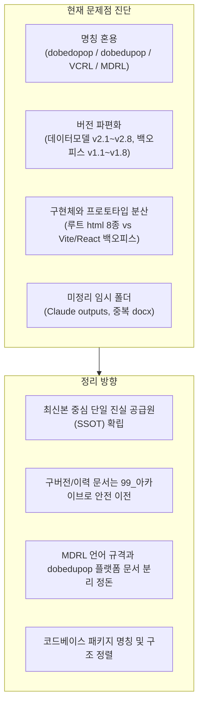

# [dobedupop] 프로젝트 문서 및 코드체계 일괄 정리 마스터 플랜

## 1. 개요 및 목적

본 프로젝트는 **음악 n차 저작권 및 2차이용 권리관리/정산 언어(MDRL)**를 기반으로 한 **보컬 조합/음악 참여형 디지털 자산 플랫폼 서비스(dobedupop)**입니다.

현재 기획서, 기술 설계 문서, 화면 프로토타입, 구현 소스 코드가 여러 버전으로 파편화되어 혼재되어 있습니다. 이를 프로젝트 목적과 핵심 맥락에 부합하도록 표준화하고 체계적으로 재배치합니다.

---

## 2. 핵심 명칭 및 용어 표준화 기준

| 항목 | 표준 명칭 (공식) | 이전/혼용 명칭 (정리 대상) | 설명 및 용도 |
| :--- | :--- | :--- | :--- |
| **플랫폼/서비스명** | **dobedupop** | `dobedopop`, `dobedupop`, `Vocal Combination` | 소비자 참여형 보컬 조합 및 음악 2차이용 유통/정산 플랫폼 |
| **권리관리 언어** | **MDRL**<br>*(Music Derivative Rights Language)* | `vcrl`, `VCRL`, `보컬조합권리언어`, `음악 2차 저작권 정의 언어` | 음악 2차이용 권리선언, 범위대수, 계층안분, 정산원장을 정의하는 독립형 외부 DSL |
| **관리자 콘솔** | **dobedupop Console (Backoffice)** | `보컬조합 백오피스`, `권리정산 인프라`, `settlement-admin` | 트랙/스템/슬롯 관리, MDRL 정책 배포, 정산 모니터링 백오피스 |

---

## 3. 현황 진단 및 문제점 분석



### 3.1 주요 파편화 현황

1. **설계 문서 버전 혼재 (`02_설계문서`)**:
   - `데이터모델.md`, `v2.1` ~ `v2.8` (총 9개 파일)
   - `백오피스_UI설계가이드_작품슬롯스템_팩관리_v1.0` ~ `v1.6` (총 7개 파일)
   - `보컬조합_백오피스_구성방안_v1.1` ~ `v1.8.docx` (총 8개 파일)
   - `2차이용_권리관리언어_마스터규격_v0.1` ~ `v0.3`, docx `v0.4` ~ `v0.6`, `MDRL_언어레퍼런스북_v1.0.md`
2. **구현 코드 및 프로토타입 혼재 (`03_구현문서_코드`)**:
   - HTML 단독 프로토타입 파일 8개가 루트에 흩어져 있음 (`dobedopop-backoffice-prototype_v2.3` ~ `v2.7.html`, `settlement-admin-console.html` 등).
   - 실제 최신 구현체는 모노레포 구조(`backoffice`, `rights-core`, `vcrl`)로 개발 중이나 언어 패키지명이 `vcrl`로 남아 있음.
3. **루트 임시 폴더**:
   - `Claude outputs/`: 과거 산출물 docx 2개 방치.

---

## 4. 제안하는 디렉토리 재구조화 (Target Directory Structure)

```
Vocal Combination/ (프로젝트 루트)
├── 00_프로젝트_개요/                        # [신설] 프로젝트 전체 헌장, 로드맵, 아키텍처 개요
│   ├── README.md                          # dobedupop & MDRL 통합 소개 문서
│   └── 프로젝트_용어_및_아키텍처_맵.md
│
├── 01_기획_비즈니스/                       # (구 01_기획문서)
│   ├── 최신_사업기획서/                     # v1.15 최신 확정본 및 IR Deck
│   │   ├── dobedupop_사업기획서_v1.15.docx
│   │   ├── dobedupop_IR_Deck.pdf
│   │   └── 특허_명세서_초안.docx
│   └── 기획_히스토리/                      # 과거 버전(v1.12~v1.14 등)
│
├── 02_MDRL_언어규격/                       # [분리/명확화] MDRL 핵심 언어 규격 단일 진실원
│   ├── MDRL_공식_레퍼런스북_v1.0.md          # ★ 핵심 언어 마스터 규격
│   ├── grammar/                           # EBNF 문법 정의 (facts, grant, allocation, profile)
│   ├── core_specs/                        # 코어 엔진/정산DSL/안분/인프라 상세 설계
│   │   ├── 안분정책_AllocationPolicy_설계.md
│   │   ├── Stem2Work그래프_정산DSL_설계.md
│   │   ├── 정책게이팅엔진_설계.md
│   │   └── 검증_승인_권리스탬프_설계.md
│   └── 규격_히스토리/                      # v0.1 ~ v0.6 마스터규격 문서
│
├── 03_dobedupop_플랫폼설계/                 # [분리/명확화] 백오피스 및 서비스 설계
│   ├── 최신설계/
│   │   ├── dobedupop_데이터모델_v2.8.md       # ★ 최신 데이터모델 SSOT
│   │   ├── dobedupop_백오피스_UI설계가이드_v1.6.md # ★ 최신 백오피스 UI 가이드 SSOT
│   │   ├── dobedupop_백오피스_구성방안_v1.8.docx
│   │   └── dobedupop_IA_와이어프레임_Userflow.md
│   └── 설계_히스토리/                      # 데이터모델 v2.1~2.7, UI가이드 v1.0~1.5 등
│
├── 04_구현_소스코드/                       # (구 03_구현문서_코드)
│   ├── prototypes/                        # [정리] 단독 HTML 목업/프로토타입 모음
│   │   ├── backoffice/                    # dobedupop-backoffice-prototype_v2.7.html 등
│   │   └── fan-ux/                        # fan-ux, vocal-flow 목업
│   ├── mdrl-core/ (또는 vcrl)             # MDRL TypeScript 레퍼런스 구현체/컴파일러
│   ├── rights-core/                       # 원장/정산/DB 플랫폼 백엔드 (Fastify, PG)
│   └── backoffice/                        # dobedupop 관리자 콘솔 웹앱 (React 19, Vite)
│
├── 05_참고자료/                           # 벤치마킹, 외부 리포트, 시장 조사
└── 99_아카이브/                           # 중복, 미사용 구버전, 임시 산출물(Claude outputs 포함)
```

---

## 5. 단계별 실행 계획

1. **1단계: 버전 분리 및 최신본(SSOT) 식별**
   - 데이터모델(`v2.8`), 백오피스 UI 가이드(`v1.6`), 백오피스 구성방안(`v1.8`), 사업기획서(`v1.15`), MDRL 언어레퍼런스(`v1.0`)를 각 영역의 **공식 기준 문서**로 지정.
   - 중간 히스토리 파일들을 서브폴더(`히스토리/` 또는 `99_아카이브/`)로 격리하여 혼선을 방지.
2. **2단계: 프로토타입 HTML 및 임시 파일 정리**
   - 루트의 `dobedopop-backoffice-prototype_v2.7.html` 등 8개 HTML 파일을 `prototypes/` 디렉터리로 묶고, 오타(`dobedopop` -> `dobedupop`) 수정.
   - `Claude outputs/` 폴더를 정리하여 필요한 파일은 각 위치로 이전 후 폴더 제거.
3. **3단계: 코드베이스 의존성 및 명칭 동기화 전략 수립**
   - 코드(`vcrl` 패키지)와 `rights-core` 간의 npm workspace 의존성(`"vcrl": "0.1.0"`)이 깨지지 않도록, 언어 명칭 변경(VCRL → MDRL)에 대한 안전한 마이그레이션(alias, 리네이밍) 준비.
4. **4단계: 최상위 README 및 프로젝트 가이드 문서 생성**
   - 새로운 작업자나 AI가 폴더를 열었을 때 바로 목적과 구조를 파악할 수 있도록 마스터 가이드 제공.
