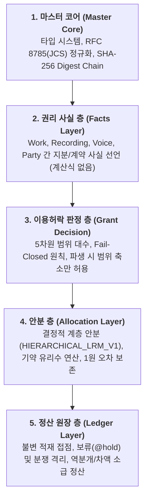
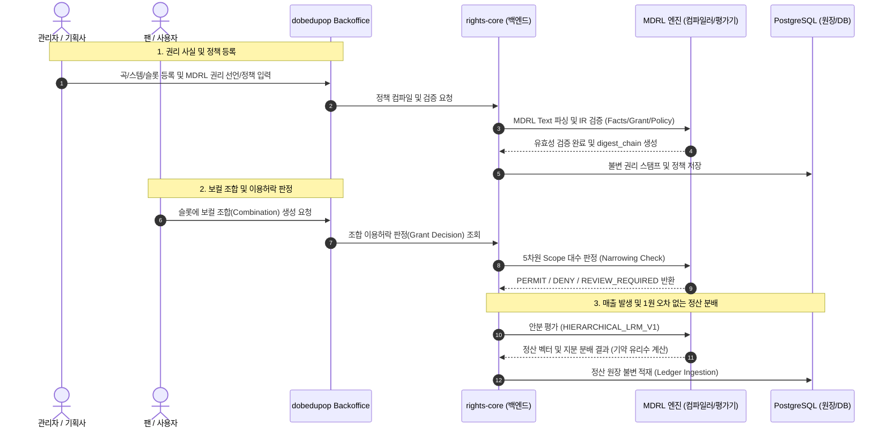

# dobedupop & MDRL 용어 사전 및 시스템 아키텍처 맵

## 1. 표준 용어 사전 (Terminology)

### 1.1 프로젝트 및 브랜드
* **dobedupop (두비더팝)**: 사용자/팬 참여형 보컬 조합 및 음악 n차 저작권 유통/정산 플랫폼의 공식 명칭입니다. (과거 문서의 `dobedopop`, `dobedubpop`은 모두 `dobedupop`으로 표준화합니다.)
* **MDRL (Music Derivative Rights Language)**: 음악 2차이용 및 파생 저작물의 권리 선언, 이용허락 판정, 안분(수익배분), 정산 원장을 정의하는 독립형 외부 도메인 특화 언어(External DSL)입니다. (코드 및 초기 설계명 `VCRL`에서 일반화/표준화됨.)
* **dobedupop Console (Backoffice)**: 플랫폼 관리자 및 저작권자/기획사를 위한 통합 운영 콘솔로, 트랙/스템/슬롯 관리, MDRL 정책 배포 및 검증, 정산 모니터링을 담당합니다.

### 1.2 핵심 도메인 모델 (Domain Entities)
* **Work (저작물)**: 작곡/작사/편곡 등 음악적 창작물 단위.
* **Recording (녹음물/음원)**: Work를 실연하여 고정한 마스터 음원.
* **Voice (음성/보컬)**: 실연자(가수) 또는 AI 음성 모델의 가창 데이터.
* **Stem (스템 트랙)**: 음악을 구성하는 개별 오디오 트랙 (예: 보컬, 드럼, 베이스, 반주 MR 등).
* **Slot (슬롯)**: 음악 내에서 보컬이나 특정 악기를 교체/조합할 수 있도록 지정된 가변 구간/파트.
* **Combination (조합/파생물)**: 팬 또는 사용자가 특정 Work의 Slot에 원하는 Voice/Stem을 결합하여 생성한 2차 음원.
* **Pack (팩)**: 조합에 사용할 수 있도록 패키징된 Voice/Stem 또는 테마별 음원 묶음.

### 1.3 MDRL 5개 계층 개념 (5-Layer Architecture)

---

## 2. 전체 플랫폼 및 파이프라인 아키텍처

---

## 3. 코드베이스 구조 및 2단계 리팩토링 로드맵

현재 `04_구현_소스코드` 내의 패키지 구성은 다음과 같습니다:

| 디렉터리 | 역할 | 현재 패키지명 | 향후 로드맵 (2단계) |
| :--- | :--- | :--- | :--- |
| `04_구현_소스코드/mdrl` | MDRL 파서, EBNF 문법, IR 컴파일러, CLI | `vcrl` | 디렉터리는 `mdrl`로 변경 완료. 패키지명·CLI·`.vcrl` 확장자를 `mdrl`(또는 `@dobedupop/mdrl`)로 리네이밍 |
| `04_구현_소스코드/rights-core` | Fastify 기반 정산/원장 API 서버, DB 마이그레이션 | `rights-core` | `vcrl` 의존성을 `mdrl`로 업데이트 |
| `04_구현_소스코드/backoffice` | React 19 + Vite 기반 dobedupop 관리자 콘솔 UI | `backoffice` | 화면 내 명칭 및 최신 API 연동 정돈 |
| `04_구현_소스코드/prototypes` | 최신 단독 HTML 프로토타입 (`dobedupop-backoffice-prototype_v2.7.html`) | - | 최신 기능 반영 및 목업 모음 유지 |
