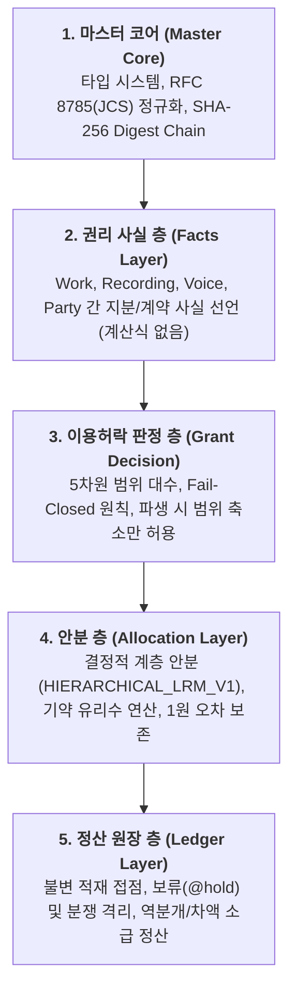
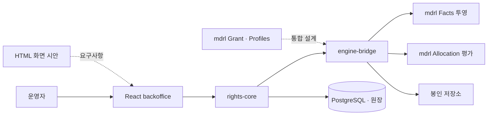

# dobedupop & MDRL 용어 사전 및 시스템 아키텍처 맵

## 1. 표준 용어 사전 (Terminology)

### 1.1 프로젝트 및 브랜드
* **dobedupop (두비덥팝)**: 사용자/팬 참여형 보컬 조합 및 음악 n차 저작권 유통/정산 플랫폼의 공식 명칭입니다. (현재 표기는 `dobedupop`, 역사 자료의 이전 표기는 보존합니다.)
* **MDRL (Music Derivative Rights Language)**: 음악 2차이용 및 파생 저작물의 권리 선언, 이용허락 판정, 안분(수익배분), 정산 원장을 정의하는 독립형 외부 도메인 특화 언어(External DSL)입니다. (초기 설계명 `VCRL`은 코드·문서 모두 `MDRL`로 통일되었습니다.)
* **dobedupop Console (Backoffice)**: 플랫폼 관리자 및 저작권자/기획사를 위한 통합 운영 콘솔로, 트랙/스템/슬롯 관리, MDRL 정책 배포 및 검증, 정산 모니터링을 담당합니다.

### 1.2 핵심 도메인 모델 (Domain Entities)
* **Work (저작물)**: 작곡/작사/편곡 등 음악적 창작물 단위.
* **Recording (녹음물/음원)**: Work를 실연하여 고정한 마스터 음원.
* **Voice (보이스)**: 누구의 목소리인가를 나타내는 권리 대상. 사람(`HUMAN`) 또는 AI 음성 모델(`AI`)이며, 오디오 파일이 아니다. 실연자 1명(또는 AI 모델 1개)당 곡마다 1개이고, `OWNED_BY` 주장으로 권리자(party)를 가리킨다.
* **Stem (스템)**: 특정 녹음의 특정 슬롯에 들어가는 실제 오디오 파일. 보컬 스템은 `PERFORMED_BY` 주장으로 그 목소리의 보이스를 가리키고, 반주(MR) 같은 비권리 스템(`rights_bearing=false`)은 보이스와 연결되지 않는다. 한 보이스로 여러 스템을 녹음할 수 있다(예: 정국이 7개 파트를 녹음하면 스템 7개, 보이스 1개).
* **보이스와 스템을 나누는 이유**: 기여 시간은 스템 단위(어느 슬롯에 몇 ms)로 재고, 몫의 귀속·동의·철회는 보이스 단위로 관리한다. 목소리의 권리자나 동의 상태가 바뀌면 보이스 하나만 고치면 되고, 그 목소리로 녹음한 스템 전부에 반영된다.
* **용어 구분**: "보컬"은 오디오를 가리키는 말(보컬 스템, 보컬팩, 보컬 조합)로만 쓰고, 목소리 주체에는 "보이스"를 쓴다. 팩 화면의 멤버 목록인 `voice_asset`(보이스 에셋)은 팩 표시용 행이며 facts IR의 `voice`와 다른 엔티티다(`voice_asset.voice_id`로 연결).
* **Slot (슬롯)**: 음악 내에서 보컬이나 특정 악기를 교체/조합할 수 있도록 지정된 가변 구간/파트.
* **Combination (조합/파생물)**: 팬 또는 사용자가 특정 Work의 Slot에 원하는 Voice/Stem을 결합하여 생성한 2차 음원.
* **Pack (팩)**: Facts 범위, 사용 가능한 스템, 권리자 선언, 활성 정책과 상태를 연결하는 발행·운영 단위.

### 1.3 MDRL 5개 계층 개념 (5-Layer Architecture)

---

## 2. 전체 플랫폼 및 파이프라인 아키텍처

현재 실행 경로는 다음과 같습니다. Grant·프로파일 연결은 [통합 설계 베이스라인](../02_MDRL_언어규격/02_구현계획/MDRL_Grant_프로파일_통합설계_베이스라인_v1.0.md)의 후속 구현 대상입니다.

- 팬 앱은 별도 제품 접점이며 현재 React 콘솔을 팬 서비스로 사용하지 않습니다.
- Profiles는 횡단 확장 규격입니다. 현재 등록만으로 파서·평가기의 고정 어휘가 확장되지는 않습니다.
- Ledger의 업무 상태와 지급은 rights-core 책임입니다.

---

## 3. 코드베이스 구조 및 2단계 리팩토링 로드맵

현재 `04_구현_소스코드` 내의 패키지 구성은 다음과 같습니다:

| 디렉터리 | 역할 | 현재 패키지명 | 향후 로드맵 (2단계) |
| :--- | :--- | :--- | :--- |
| `04_구현_소스코드/mdrl` | MDRL 파서, EBNF 문법, IR 컴파일러, CLI | `mdrl` | 개명 완료(패키지·CLI·`.mdrl`·digest 접두어). 필요 시 `@dobedupop/mdrl` 스코프 적용 |
| `04_구현_소스코드/rights-core` | Fastify 기반 정산/원장 API 서버, DB 마이그레이션 | `rights-core` | `mdrl` 의존성 반영 완료(DB 도메인 `mdrl_id`) |
| `04_구현_소스코드/backoffice` | React 19 + Vite 기반 dobedupop 관리자 콘솔 UI | `backoffice` | 화면 내 명칭 및 최신 API 연동 정돈 |
| `04_구현_소스코드/prototypes` | 최신 단독 HTML 프로토타입 (`dobedupop-backoffice-prototype_v2.7.html`) | - | 최신 기능 반영 및 목업 모음 유지 |
