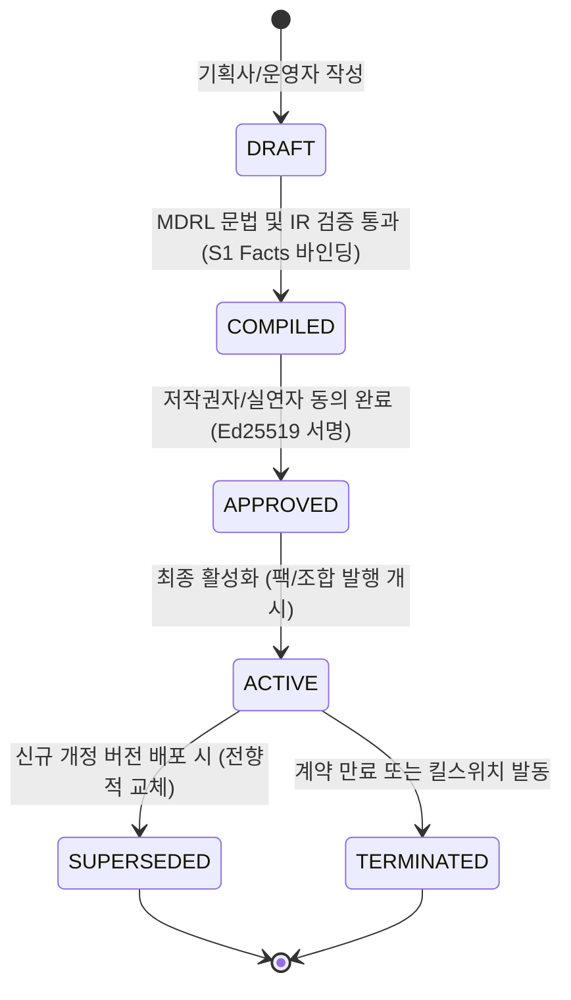

# dobedupop 플랫폼의 MDRL 연계 구조 정밀 점검 및 버전 관리 표준 제안서

## 1. 개요 및 총평

본 검토서는 **음악 n차 창작(보컬 조합, 리믹스, AI 파생 등)** 환경에서 **MDRL(Music Derivative Rights Language)**이 `dobedupop` 플랫폼 및 외부 연계 시스템(외부 DSP, 음원 유통사, 신탁관리단체 CMO, AI 보이스 제공사)과 유기적으로 결합하여 권리를 생성·검증·계산·감사하는 아키텍처를 점검하고, 산업 표준에 부합하는 **버전 관리 및 배포 운영 체계**를 제안합니다.

### 📌 아키텍처 성숙도 종합 평가
> **핵심 결론**: dobedupop의 MDRL 연계 설계(`engine-bridge`, 데이터모델 v2.8)는 **국제 표준 수준의 암호학적 무결성(RFC 8785 JCS, SHA-256 Digest Chain)과 금융권 원장 수준의 불변성(Append-Only, HIERARCHICAL_LRM_V1)**을 갖추고 있습니다.  
> 특히 **"관계형 DB 행이 원본(Source of Truth)이고, 모든 시스템 결정은 불변 봉인된 IR(Sealed IR)로만 수행한다"**는 원칙은 n차 파생 음악 비즈니스에서 발생할 수 있는 데이터 위변조와 소급 분쟁을 원천 차단하는 매우 강력한 설계입니다.

---

## 2. 라이프사이클 단계별 연계 로직 점검

```mermaid
flowchart LR
    subgraph Step1 ["1. 권리 생성 (Creation)"]
        A["DB 행 원본<br>(Work, Stem, Voice, Party)"] --> B["convert-facts.ts<br>(결정적 변환)"]
        B --> C["S1: Facts 봉인 IR<br>(mdrl:sha256)"]
    end

    subgraph Step2 ["2. 권리 검증 (Grant Decision)"]
        C --> D["Grant Engine<br>(5차원 범위 대수)"]
        D --> E["동의 계층(T0~T3)<br>Fail-Closed 판정"]
        E --> F["S2: 정책 IR 봉인<br>(depends_on Facts)"]
    end

    subgraph Step3 ["3. 정산 계산 (Allocation)"]
        F --> G["S3: 발행 봉인<br>(issue_seal 동결)"]
        G --> H["settle.ts / evaluate<br>(HIERARCHICAL_LRM_V1)"]
        H --> I["기약 유리수 계산<br>1원 오차 보존"]
    end

    subgraph Step4 ["4. 감사 및 원장 (Audit & Ledger)"]
        I --> J["S4: 결과 IR 봉인<br>(result_digest)"]
        J --> K["원장 적재<br>(Append-Only)"]
        K --> L["rederiveIssue<br>(제3자 무신뢰 재검증)"]
    end

    Step1 --> Step2 --> Step3 --> Step4
```



---

### [1단계: 권리 생성] n차 파생 사실 선언 (Facts Layer)

#### 1) 현재 구현 및 작동 구조
* **도메인 엔티티 ↔ MDRL Facts 매핑**:
  * 저작물(`Work`), 녹음물(`Recording`), 보컬/음성(`Voice`: HUMAN/AI), 스템(`Stem`: 반주/보컬 파트), 슬롯(`Slot`)이 플랫폼 DB에 저장됩니다.
  * 파생 창작 시 원곡 스템에 새로운 Voice(실연자 또는 AI 모델)가 조합되면, `convert-facts.ts`가 이를 단일 `FactsDocument` IR로 결정적 변환합니다.
* **이중 시간축(Bitemporal Axis) 보장**:
  * 법적 효력 구간인 `valid_from` ~ `valid_to`(효력 시간)와 플랫폼에 등록된 `recorded_at` ~ `superseded_at`(기록 시간)을 분리 관리하여, 계약 변경 시에도 과거 시점의 권리 상태를 왜곡 없이 복원합니다.
* **결정적 직렬화(Deterministic Digest)**:
  * 엔티티 정렬, 밀리초 UTC 통일, RFC 8785(JCS) 정규화를 거쳐 `mdrl:sha256:<hash>` digest를 생성하고 `sealed_document`에 영구 보존합니다.

#### 2) 표준 적합성 점검 및 보완 권고사항
* ✅ **우수**: 관계형 정규화의 유연성과 블록체인/해시체인 수준의 불변성을 완벽히 양립함.
* ⚠️ **보완점 (외부 연계)**: 글로벌 음원 유통사 및 DDEX(ERN, MWI) 연계를 위한 **식별자 어댑터 강화** 필요.
  * ISWC(저작물), ISRC(녹음물), ISNI/IPI(권리자) 외에 **AI 보이스 모델 식별자(AI Model Fingerprint)** 표준 필드를 Facts 확장에 명시화 권장.

---

### [2단계: 권리 검증] 이용허락 및 정책 게이팅 (Grant Layer)

#### 2) 현재 구현 및 작동 구조
* **5차원 범위 대수 (Scope Algebra)**:
  * 이용 지역(Territory), 유통 채널(Channel), 기간(Term), 이용 목적(Purpose), 독점 여부(Exclusivity)의 5개 축으로 권리를 정의합니다.
* **축소 전용 계승 (Narrowing Only) & Fail-Closed**:
  * 파생 창작 단계(원본 L0 → 팩 L1 → 조합 L2)가 깊어질수록 허용 범위는 상위 범위의 **교집합(Subset)**으로만 축소될 수 있으며, 권리 확장은 원천 차단됩니다.
  * 불확실하거나 미인증된 권리는 즉시 거부(`GRANT_SCOPE_WIDENING`, `GRANT_NO_EVIDENCE`)됩니다.
* **동의 계층(T0~T3) 게이팅**:
  * 원천 동의(T0) → 조합 동의(T1) → 팩 동의(T2) → 팬 발행 동의(T3) 매트릭스가 검증되어야만 팩 및 조합이 활성화(`ACTIVE`)됩니다.

#### 2) 표준 적합성 점검 및 보완 권고사항
* ✅ **우수**: 권리 침해를 사전에 구조적으로 차단하는 엄격한 수학적 대수 모델 구축.
* 💡 **보완점 (연계 인터페이스)**: 외부 플랫폼(유튜브 숏폼, 틱톡 등) 연계를 위한 **"경량 라이선스 검증 토큰(Decision Token/JWT)" 규격** 제공 필요.
  * 음원 재생/다운로드 시 외부 시스템이 MDRL 엔진 전체를 실행하지 않고도, 서명된 검증 토큰(`attestation`)만으로 5ms 이내에 즉시 재생 허용 여부를 판정할 수 있도록 인터페이스 확장 권장.

---

### [3단계: 정산 계산] 1원 오차 없는 계층 안분 (Allocation Layer)

#### 1) 현재 구현 및 작동 구조
* **결정적 계층 안분 (`HIERARCHICAL_LRM_V1`)**:
  * `Tier 1 (플랫폼 3풀: 플랫폼/권리자/팬)` → `Tier 2 (저작권/실연권/제작권 버킷)` → `개별 권리자` 순으로 하향 분배합니다.
* **기약 유리수 연산 (Conservation of Value)**:
  * 부동소수점(`float`, `double`)을 전면 배제하고, 분수(`"n/d"`) 유리수 연산과 층별 최대 잔여법(Largest Remainder Method)을 적용하여 **매출 총액과 분배액의 총합이 1원 단위까지 정확히 일치**함을 보장합니다.
* **분쟁 및 부정 격리 (`@hold`)**:
  * 권리 분쟁(`RIGHTS_DISPUTE`)이나 부정 스트리밍 의심(`FRAUD_REVIEW`) 발생 시, 해당 몫만 즉시 `@hold` 버킷으로 격리되고 나머지 정상 권리자의 정산은 지연 없이 집행됩니다.

#### 2) 표준 적합성 점검 및 보완 권고사항
* ✅ **우수**: 금융/회계 감사 기준을 충족하는 완벽한 금액 보존성 확보.
* 💡 **보완점 (글로벌 확장)**: 향후 해외 매출 발생 시 환율 적용 기준 시점(FX Snapshot)을 `issue_seal` 또는 `revenue_event`에 연동하는 환율 고정 규약 보강 권장.

---

### [4단계: 감사 및 원장] 불변 발행 봉인과 재검증 (Ledger Layer)

#### 1) 현재 구현 및 작동 구조
* **발행 봉인 (`issue_seal`)**:
  * 팬이 조합 음원을 발행하는 순간, 당시 유효한 `facts_digest`, `policy_digest`, `projection_digest`, `members_digest`가 단일 트랜잭션으로 봉인되어 `issue_seal`에 영구 기록됩니다.
  * 이후 플랫폼 관리자가 정책을 바꾸거나 원곡 권리자가 지분을 수정해도, **이미 발행된 조합 음원의 정산 공식은 100% 동결**되어 소급 변조되지 않습니다.
* **무신뢰 재검증 (`rederiveIssue`)**:
  * 회계 감사관이나 외부 권리자는 봉인된 원본 데이터로부터 언제든 동일한 결과 해시(`result_digest`)가 산출되는지 독립적으로 검증할 수 있습니다.

---

## 3. MDRL 봉인 단계(S1 ~ S5) 및 생성 위치 총괄 매트릭스

본 매트릭스는 dobedupop 플랫폼과 MDRL 엔진 간에 교환·봉인되는 모든 중간 표현(IR)의 생애주기, 형식, 담는 내용, 그리고 **"시스템 상 어디에서 어떤 주체와 모듈에 의해 생성되는지"**를 정의합니다.

### 3.1 봉인 단계 및 IR 라이프사이클 마스터 표

모든 IR은 JSON이며 JCS 정규화 후 SHA-256으로 digest를 만든다. "JSON 구조" 열은 종류를 구분하는 방법이다. **MDRL 문서**는 공통 봉투(`mdrl`·`module`·`id`·`version`·`depends_on`·`body`)의 `module` 값으로, **엔진·코어 출력**은 최상위 `format` 문자열로 구분한다. **단순 JSON**은 식별 필드가 없어 봉인 레코드의 `sealed_document.kind`로만 구분한다.

| 봉인 | IR 종류 | JSON 구조(식별 필드) | 만드는 때 | 담는 내용 | 생성 위치 및 주체 | 산출물 및 봉인 대상 |
| :--- | :--- | :--- | :--- | :--- | :--- | :--- |
| **S1** | **facts IR** | MDRL 문서<br>(`mdrl: "1.0"`, `module: "facts"`) | 정책 컴파일<br>(1~2단계) | 주체·작품·녹음·보이스·스템, 권리 주장·위임<br>(계산식 없음) | • **UI/화면**: 백오피스 작품/녹음/보이스 등록, 권리자 포털<br>• **엔진 모듈**: `rights-core/src/engine-bridge/convert-facts.ts`<br>• **생성 주체**: 기획사 관리자 / 저작권자 (`SPACE_EDITOR`) | 곡당 1개<br>(`sealed_document`, kind=`facts`) |
| **S2** | **정책 IR<br>(allocation)** | MDRL 문서<br>(`mdrl: "1.0"`, `module: "allocation"`) | 정책 컴파일<br>(2~3단계) | 1·2차 분배율, 벡터 식, 반올림, 참조하는 facts digest | • **UI/화면**: 백오피스 MDRL 정책 편집기 (`PolicyDetail.tsx`)<br>• **엔진 모듈**: `rights-core/src/policy/service.ts`, `mdrl/src/text`<br>• **생성 주체**: 기획사 / 마스터 권리자 (`SPACE_EDITOR`) | 정책 버전당 1개<br>(`sealed_document`, kind=`allocation`) |
| **S3-a** | **투영 IR<br>(projection)** | 엔진 출력<br>(`format: "mdrl-projection/1"`) | 조합 발행<br>(6단계) | 발행 시각 기준 역할별 기여 벡터와 권리 경로<br>(쓰인 스템의 사용 시간 반영) | • **UI/화면**: dobedupop 팬 조합 발행 API (`/combos/issue`)<br>• **엔진 모듈**: `rights-core/src/engine-bridge/issue.ts` (`buildProjection`)<br>• **생성 주체**: 팬(사용자)의 보컬 조합 발행 트랜잭션 | 조합당 1개<br>(`sealed_document`, kind=`projection`) |
| **S3-b** | **멤버 IR<br>(members)** | 단순 JSON 객체, 식별 필드 없음<br>(`{"members": {party: "n/d"}}`, 기약 유리수, 합 1) | 조합 발행<br>(6단계) | 보컬리스트별 참여 멤버 비율 | • **UI/화면**: dobedupop 팬 조합 발행 API (`/combos/issue`)<br>• **엔진 모듈**: `rights-core/src/engine-bridge/issue.ts` (`membersIr`)<br>• **생성 주체**: 팬(사용자)의 보컬 선택 비율 | 조합당 1개<br>(`sealed_document`, kind=`members`) |
| **S4** | **매출 IR(events) +<br>정산 결과 IR** | 매출: 단순 JSON 배열, 식별 필드 없음<br>결과: 엔진 출력(`format: "mdrl-allocation-result/1"`) | 정산 run<br>(8~9단계) | 입력 매출 이벤트, 풀·라인·보류, `result_digest` | • **UI/화면**: 백오피스 정산 배치 실행기, 백그라운드 정산 워커<br>• **엔진 모듈**: `rights-core/src/settlement/service.ts`, `engine-bridge/settle.ts`<br>• **생성 주체**: 플랫폼 정산 운영자 (`SPACE_OPS`) | run당 1쌍<br>(`sealed_document`, kind=`events` & `allocation_result`) |
| **S4-r** | **역분개 결과 IR<br>(reversal_result)** | 엔진 출력<br>(`format: "mdrl-reversal-result/1"`) | 확정 후 환불 | 원 라인을 되돌리는 음수 라인 | • **UI/화면**: PG 결제 취소 웹훅, 백오피스 환불 집행기<br>• **엔진 모듈**: `rights-core/src/engine-bridge/reverse.ts` (`reverseEvent`)<br>• **생성 주체**: 정산 확정자 (`SPACE_SETTLE`) | 환불당 1개<br>(`sealed_document`, kind=`reversal_result`) |
| **S5** | **감사 Manifest 번들<br>(manifest)** | 코어 출력<br>(`format: "mdrl-audit-manifest/1"`) | 정산 배치 확정 및<br>외부 감사 배포 | [S1 facts + S2 policy + S3 projection/members + S4 result] + Ed25519 서명 패키징 | • **UI/화면**: 배치 확정 API (`confirmBatch`), 감사 번들 다운로드 API<br>• **엔진 모듈**: `rights-core/src/engine-bridge/manifest.ts`<br>• **생성 주체**: 플랫폼 확정자 (`SPACE_SETTLE`) / 외부 감사관 | 배치/run당 1개<br>(`sealed_document`, kind=`manifest`) |

### 3.2 핵심 아키텍처 원칙 및 생성 메커니즘

1. **S3 발행 봉인의 참조 불변성 (Digest Pointers)**:
   * 팬이 보컬 조합 음원을 발행(`S3`)할 때, facts IR(`S1`)과 정책 IR(`S2`)은 새로 복사하거나 중복 저장하지 않습니다.
   * 이미 봉인된 **S1의 digest(`facts_digest`)**와 **S2의 digest(`policy_digest`)**를 포인터로 참조하며, 발행 시점에 동적으로 계산되는 **투영 IR(`S3-a`)**과 **멤버 IR(`S3-b`)**만 새롭게 생성하여 봉인합니다.
   * 이 4개의 Digest가 단일 트랜잭션으로 **`issue_seal` 행에 영구 동결**되며, 이후 원곡 권리자가 지분을 수정하거나 기획사가 정책을 개정하더라도 **기존 발행된 조합 음원의 정산 규칙은 100% 영구 불변**합니다.

2. **S5 감사 매니페스트를 통한 Zero-Trust 무신뢰 검증**:
   * 플랫폼 내부 PostgreSQL 원장을 외부에 노출하지 않고도, 신탁관리단체(KOMCA, 음실련)나 외부 회계법인에 `S5 Manifest` 번들 파일만 제공하면 제3자가 오픈소스 CLI(`mdrl verify --manifest manifest.json`)로 단독 검증을 완결할 수 있습니다.

---

## 4. MDRL 버전 관리 및 배포 운영 표준안 제안

MDRL이 다수의 기획사, 실연자, 플랫폼 간의 법적 계약을 담는 언어이므로, 단순 코드 변경 이상의 **체계적인 3계층 버전 관리 거버넌스**가 필수적입니다.

### 4.1 3계층 버전 아키텍처

```
[Layer 1: 언어 엔진 규격 버전 (MDRL Spec Version)]
  예: mdrl: "1.0", "1.1", "2.0"
  - EBNF 문법, 중간 표현(IR) 스키마, 파서, 해시 알고리즘 변경 시 갱신
  - 하위 호환성 보장 원칙 (SemVer 준수)

[Layer 2: 비즈니스 정책 템플릿 버전 (Policy Template Version)]
  예: pol_vocal_default:1, pol_ai_duet:2
  - 수수료율, 배분 공식, 안분 트리 템플릿의 개정
  - DRAFT → COMPILED → APPROVED → ACTIVE 상태머신 관리

[Layer 3: 개별 저작물 발행 봉인 인스턴스 (Issue Seal Instance)]
  예: snp_202610_001 (Immutable Digest Chain)
  - 실제 판매/발행 시점의 고유 스냅샷
  - 한 번 봉인되면 영구 불변 (수정 불가, 폐기만 가능)
```

---

### 4.2 정책(Policy) 생애주기 상태머신 및 직무분리(SoD)



* **엄격한 직무 분리 통제 (Separation of Duties)**:
  * `작성자 (EDITOR)` ≠ `권리 승인자 (APPROVER)` ≠ `시스템 활성화자 (ACTIVATOR)`
  * 승인 및 활성화는 각 주체의 개인키 기반 **Ed25519 서명(`attestation`)**이 첨부되어야만 DB에 반영됩니다.

---

### 4.3 계약 수정 시의 개정 및 소급 정산 워크플로

실제 음악 산업에서는 음원 출시 후 뒤늦게 "작사가 지분 변경"이나 "실연자 누락 정정"이 빈번하게 발생합니다. MDRL은 이를 다음과 같이 명확히 처리해야 합니다:

| 시나리오 | 처리 방식 | 시스템 동작 원리 |
| :--- | :--- | :--- |
| **전향적 수정**<br>(신규 판매부터 적용) | **새 버전 배포 (`SUPERSEDED`)** | • 새 정책 버전(`v2`)을 컴파일·봉인하고 팩에 활성화.<br>• 이전 발행분은 `v1` 봉인으로 영구 정산, 신규 발행분은 `v2`로 정산. |
| **소급적 정정**<br>(과거 정산분 금액 조정) | **역분개 및 차액 정산 (`REVERSAL & SHADOW`)** | • 기존 원장 행을 직접 수정하는 것은 절대 금지(불변 원칙 위반).<br>• `engine-bridge/reverse.ts`를 실행하여 과거 지급분을 역분개(`REVERSAL`).<br>• 정정된 정책으로 가상 정산(Shadow Report)을 돌려 발생한 차액(`DELTA`)을 차기 배치에서 가산/차감. |
| **분쟁 발생**<br>(지분 다툼 접수) | **타겟 격리 (`@hold`)** | • 분쟁 발생 시 즉시 해당 파티의 `right_claim` 상태를 `DISPUTED`로 변경.<br>• MDRL 엔진이 해당 지분을 `@hold`로 자동 격리하고 나머지 정상 분배는 지속. |

---

### 4.4 외부 연계 시스템 대상 배포 프로토콜 (Distribution Protocol)

외부 연계 시스템(외부 정산소, 감사 기관, 저작권 신탁단체)에 MDRL 정책과 정산 결과를 배포할 때는 **표준 공개 Manifest 번들**을 사용합니다.

```json
{
  "$schema": "https://dobedupop.com/schemas/mdrl/manifest-v1.json",
  "manifest_digest": "mdrl:sha256:7a9c...",
  "target_scope": {
    "work_id": "wrk_universe_01",
    "iswc": "T-123456789-0"
  },
  "sealed_artifacts": {
    "facts": {
      "digest": "mdrl:sha256:4c8f...",
      "uri": "https://registry.dobedupop.com/blobs/4c8f..."
    },
    "policy": {
      "version": "1.2",
      "digest": "mdrl:sha256:3223...",
      "uri": "https://registry.dobedupop.com/blobs/3223..."
    }
  },
  "attestations": [
    {
      "role": "LEGAL_APPROVER",
      "party_id": "pty_label_alpha",
      "public_key": "ed25519:Ab3x...",
      "signature": "sig:9f8e..."
    }
  ]
}
```

1. **내용 주소 기반 배포**: 모든 문서는 URL 경로가 아닌 SHA-256 Digest로 식별되므로 중간 변조가 원천 차단됩니다.
2. **독립 CLI 검증**: 연계 시스템은 플랫폼 서버에 접속하지 않고도 오픈소스 MDRL CLI(`mdrl verify --manifest manifest.json`)를 통해 독자적으로 무결성을 100% 검증할 수 있습니다.

---

## 5. 실행 권고 로드맵 (Actionable Checklist)

1. **단기 완료 과업**:
   * [x] 디렉토리 및 `mdrl` 레퍼런스 구현체 표준화 (완료)
   * [x] `rights-core`의 `manifest.ts` 생성기 추가 (공개용 번들 자동 패키징 완료)
   * [x] 역분개(`reverse`) 및 사후 정산 섀도 리포트(`shadowReport`) E2E 시나리오 테스트 보강 (완료)
   * [x] 관리자 콘솔(`backoffice`) 내 MDRL 정책 버전 히스토리 Diff 뷰어 탑재 (완료)
2. **중기 (1개월)**:
   * [ ] 외부 연계용 경량 라이선스 판정 토큰 API(`GET /api/v1/license/token`) 정의
3. **장기**:
   * [ ] DDEX(ERN/MWI) ↔ MDRL Facts 양방향 변환 커넥터 표준화
   * [ ] 저작권 신탁단체(KOMCA, 음실련 등) 전용 정산 검증 포털 연동
