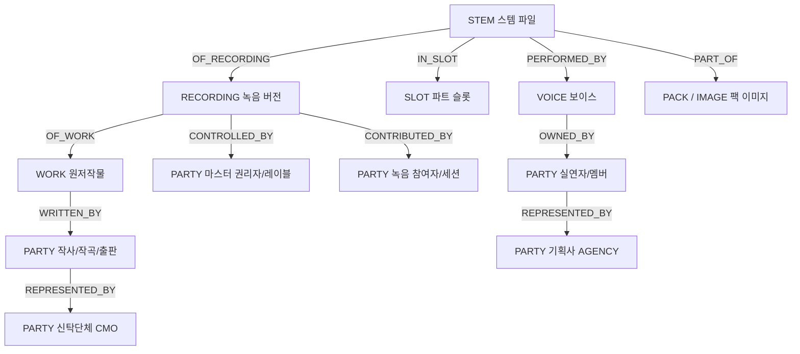

# Stem-to-Work 그래프 · 정산 DSL 기술 설계 명세서

- **문서 상태**: 설계 확정 (v2.7 정합)
- **상위 문서**: `안분정책_AllocationPolicy_설계.md`, `데이터모델_v2.7.md`, `백오피스_UI설계가이드_작품슬롯스템_팩관리_v1.6.md`
- **적용 대상**: 권리 관계 분석 엔진 (Rights Graph Engine), 정산 DSL 컴파일러 (VC-DSL), 백오피스 정산 정책 편집기

---

## 1. 개요 및 아키텍처 원칙

본 문서는 보컬조합 플랫폼의 권리 귀속 및 정산 자동화를 위한 두 가지 핵심 기술 메커니즘을 정의합니다.

1. **Stem-to-Work 그래프 (권리 사실 — Facts)**: 조합에 사용된 스템(Stem) 파일에서 출발하여 보이스(Voice), 파트 슬롯(Slot), 팩/이미지(Pack/Image), 원음 녹음(Recording), 원저작물(Work)을 거쳐 최종 법적 지급 주체(Party)까지의 권리 경로를 DAG(방향성 비순환 그래프)로 모델링하고, "누가 정당한 청구권자인가"와 "역할별 기본 지분 벡터가 얼마인가"를 계산합니다.
2. **정산 DSL (VC-DSL, 권리 정책 — Policy)**: 그래프 해석 결과와 스냅샷 사용량을 입력받아 권리자 풀 내부 분배 규칙을 선언적으로 기술하는 도메인 특화 언어(DSL)입니다. 정적 검증을 거쳐 컴파일된 산출물은 `settlement_policy` 및 `allocation_policy` 엔티티로 영속화되어 정산 엔진에서 실행됩니다.

> **핵심 원칙**: **"그래프는 변하지 않는 권리 사실(Facts)이고, DSL은 비즈니스에 따른 안분 정책(Policy)이다."** 두 영역을 엄격히 분리하여 권리 관계의 투명성과 정책 변경의 유연성을 동시에 확보합니다.

---

# A. Stem-to-Work 그래프 (Rights Graph Engine)



## A1. 노드 (Graph Nodes)

| 노드 유형 | 식별자 (Key) | 대응 데이터 엔티티 | 설명 |
| :--- | :--- | :--- | :--- |
| `STEM` | `stem_id` (`stm_`) | `stem` | 조합 타임라인에 배치되는 오디오 녹음 파일 최소 단위 |
| `SLOT` | `slot_id` (`slt_`) | `part_slot` | 곡의 타임라인 구간 (Section) 및 악기/보컬 레이어 (Layer) |
| `VOICE` | `voice_id` (`voc_`) | `voice` | 누구의 목소리인가를 나타내는 권리 대상(사람 또는 AI). 오디오 파일이 아니다(오디오는 `STEM`). 팩 화면의 멤버 목록 `voice_asset`과는 다른 엔티티다(데이터모델 v2.8 3.2) |
| `PACK` | `pack_id` (`pak_`) | `vocal_pack` | L1 퍼블리싱 단위 (보컬팩 이미지) |
| `IMAGE` | `image_id` (`rim_`) | `rights_image` | L0 원본 권리 이미지 템플릿 |
| `RECORDING`| `recording_id` (`rcd_`) | `recording_version`| 마스터 음원 녹음 버전 |
| `WORK` | `work_id` (`wrk_`) | `work` | 원저작물 (악곡 및 가사) |
| `PARTY` | `party_id` (`pty_`) | `party` | 실제 정산금을 수취하는 법인, 개인 아티스트, 신탁단체 |

## A2. 엣지 및 가중치 (Graph Edges)

| 엣지 유형 | 방향 (Source → Target) | 속성 (Attributes) | 설명 및 비즈니스 규칙 |
| :--- | :--- | :--- | :--- |
| `PERFORMED_BY` | `STEM` → `VOICE` | `share_bps` | 스템 내 가창 기여도 (한 스템에 듀엣/코러스 등 복수 실연자 시 분할) |
| `OWNED_BY` | `VOICE` → `PARTY(MEMBER/AI)` | `share_bps` | 보이스의 권리 귀속 (개인 멤버 또는 AI 원천 제공자) |
| `IN_SLOT` | `STEM` → `SLOT` | 구조적 연결 | 스템이 속한 곡의 구간 및 레이어 |
| `OF_RECORDING` | `STEM` → `RECORDING` | 구조적 연결 | 스템이 추출된 원본 마스터 녹음 버전 |
| `PART_OF` | `STEM` → `PACK` | `selectable`, `locked` | 팩 내 스템 선택 가능 여부 및 필수 잠금 여부 |
| `CONTROLLED_BY`| `RECORDING` → `PARTY(LABEL)` | `share_bps` | 마스터 권리 소유권 (공동 제작 시 지분 분할) |
| `OF_WORK` | `RECORDING` → `WORK` | 구조적 연결 | 녹음의 대상이 되는 원저작물 |
| `WRITTEN_BY` | `WORK` → `PARTY(AUTHOR)` | `share_bps`, `role_detail`| 저작자 지분 (`work_credit` 기반: 작사/작곡/편곡) |
| `CONTRIBUTED_BY`| `RECORDING` → `PARTY(SESSION)`| `share_bps`, `eligible`| 세션/엔지니어 등 녹음 참여자 (`recording_credit`) |
| `REPRESENTED_BY`| `PARTY` → `PARTY(CMO/AGENCY)`| `share_bps`, `valid_to` | 권리 징수 및 대행 수령 위임 (신탁단체 또는 기획사 일괄 수령) |

- **공통 속성**: `edge_id`, `role` (`PERFORMER | MASTER | WORK | AGENCY | AI | SESSION`), `valid_from`, `valid_to`, `graph_version`.

## A3. 그래프 불변식 (Graph Invariants)

1. **단방향 비순환 그래프 (Strict DAG)**: 엣지는 항상 `STEM` $\rightarrow$ 자산/저작물 $\rightarrow$ `PARTY` 상향 단방향입니다. 사이클 감지 시 그래프 저장/활성화가 즉시 거부됩니다.
2. **분기 합계 10000 bps 보존**: 동일한 `(source_node, edge_type)` 그룹의 모든 하위 `share_bps` 합은 정확히 10000 bps (100.00%)여야 합니다.
3. **위임 홉 수 제한 (`REPRESENTED_BY`)**: 대행 위임은 최대 2홉(예: 저작자 $\rightarrow$ 서브출판사 $\rightarrow$ 신탁단체)을 초과할 수 없습니다.
4. **시점 정합성 질의 (`as_of`)**: 모든 엣지는 유효 기간(`valid_from <= as_of < valid_to`)에 한해 평가됩니다.
5. **버전 불변성**: 그래프 갱신 시 기존 버전 행을 UPDATE하지 않고 새 `graph_version`을 발급합니다.

## A4. 8대 청구권자 역할별 경로 해석 알고리즘

입력값: 발행 스냅샷의 스템 사용량 벡터 $\mathbf{u}[s] \in [0, 1]$ ($\sum u[s] = 1.0$, `snapshot_stem_assignment.duration_ms` 기반).

각 역할(`claimant_role`)별로 그래프 엣지의 **경로 가중치 곱(Path Product)** 을 통해 독립적인 파티 지분 벡터 $\mathbf{w}_{\text{role}}[p]$를 산출합니다.

```
1. PERFORMER (실연자) :
   STEM ─PERFORMED_BY─> VOICE ─OWNED_BY─> PARTY(MEMBER) [─REPRESENTED_BY─> AGENCY]
2. MASTER_OWNER (마스터 권리자) :
   STEM ─OF_RECORDING─> RECORDING ─CONTROLLED_BY─> PARTY(LABEL)
3. WORK_AUTHOR / CMO (저작권자 / 신탁) :
   STEM ─OF_RECORDING─> RECORDING ─OF_WORK─> WORK ─WRITTEN_BY─> PARTY(AUTHOR) [─REPRESENTED_BY─> CMO]
4. AI_PROVIDER (가상 AI 원천) :
   STEM(AI) ─PERFORMED_BY─> VOICE(AI) ─OWNED_BY─> PARTY(AI_PROVIDER)
5. RECORDING_CONTRIBUTOR (녹음 참여자) :
   STEM ─OF_RECORDING─> RECORDING ─CONTRIBUTED_BY─> PARTY(SESSION)
```

$$\mathbf{w}_{\text{role}}[p] = \sum_{s \in \text{Stems}} \mathbf{u}[s] \times \prod_{e \in \text{Path}(s \to p, \text{role})} \frac{\text{share\_bps}(e)}{10000}$$

- **역할별 독립 벡터 유지**: 한 파티가 마스터 권리자이자 실연자이더라도 벡터를 사전 합산하지 않고 역할별 벡터를 분리 유지합니다 (계약 버킷이 역할 단위로 체결되기 때문).

## A5. 청구권자(Claimant) 자동 도출 및 커버리지 가드

그래프 해석 결과는 팩의 `claimant` 목록과 1:1 대조 검증을 수행합니다.

| 검증 상황 | 감지 사유 | 시스템 동작 |
| :--- | :--- | :--- |
| **청구권자 누락** | `claimant`에 존재하나 그래프 경로 결과 0 | `GRAPH_UNCOVERED_CLAIMANT` 에러 $\rightarrow$ 팩 활성화 거부 |
| **경로 단절** | 중간 엣지(예: `VOICE` 미등록) 누락 | `GRAPH_PATH_MISSING` 에러 $\rightarrow$ 스템 등록 QC 실패 |
| **미등록 파티 출현** | 권리 원장(`rights_image_party`) 밖의 파티 | `GRAPH_UNKNOWN_PARTY` 에러 $\rightarrow$ 그래프 컴파일 거부 |
| **신탁곡 자동 라우팅** | `work.cmo_managed = TRUE` | 저작자 개인 지분을 `CMO` 1행으로 대행 라우팅 |

## A6. 그래프 스냅샷 동결 (`snapshot_graph_path`)

조합 발행 시점의 `graph_version`과 계산된 경로별 가중치를 `snapshot_graph_path` 테이블에 영구 동결합니다. 정산 엔진은 런타임에 그래프를 재탐색하지 않고 동결된 경로 행만 조회합니다.

- **`snapshot_graph_path` 컬럼**: `snapshot_id`, `path_seq`, `stem_id`, `role`, `party_id`, `weight_bps`, `edge_ids[]`.

---

# B. 정산 DSL (VC-DSL Specification)

## B1. 설계 목표 및 제약

- **선언적 정책 관리**: 복잡한 안분 룰을 사람이 직관적으로 리뷰하고 버전 관리할 수 있는 텍스트 문법 제공.
- **컴파일 타임 정적 검증**: 문법 오류, 지분 합계 10000 bps 불일치, 청구권자 누락을 컴파일 시점에 100% 차단.
- **결정적 실행 (Determinism)**: 난수, 런타임 시계(`now()`), 외부 I/O를 배제하여 100% 동일한 원 단위 계산 재현성 보장.
- **범위 한정**: DSL은 **Tier 2 권리자 풀 내부 안분**만을 다루며, Tier 1 순매출 3풀 산정은 상위 정산 규칙(`settlement_rule`)에 위임합니다.

## B2. 타입 시스템 (Type System)

| 타입 | 설명 | 리터럴 예시 |
| :--- | :--- | :--- |
| `Ratio` | 0.0 ~ 1.0 범위의 비율 (내부적으로 bps 또는 정밀 실수) | `40%`, `5000 bps`, `12.5%` |
| `Vector` | `party_id → Ratio` 매핑 (합계 항상 1.0) | `graph(role: MASTER)`, `member_pct()` |
| `Bucket` | 이름, 1차 지분율(`Ratio`), 하위 표현식(`Vector`)의 결합체 | `performer = graph(role: PERFORMER) : 50%;` |
| `Money` | 금융 정산 정수 금액 (KRW) | `₩3,430`, `3430` |

## B3. 표준 내장 함수 (Built-in Functions)

| 함수 시그니처 | 반환 타입 | 설명 |
| :--- | :--- | :--- |
| `graph(role: ClaimantRole)` | `Vector` | A절 그래프 해석 엔진이 산출한 역할별 지분 벡터 |
| `member_pct()` | `Vector` | 스냅샷에 동결된 팬 빌더 참여 멤버 비율 |
| `stem_time(include_locked: Bool)` | `Vector` | 배정된 스템의 타임라인 구간 초 기반 지분 벡터 |
| `contract(party_id: String)` | `Vector` | 특정 단일 파티 100% 고정 귀속 벡터 |
| `performance_pool(mode, ...)` | `Vector` | 4대 실연 풀 모드(`USAGE_WEIGHTED`, `FIXED`, `HYBRID`, `MEMBER_PCT`) 및 가중치/보장 계산 |
| `mix(v1: w1, v2: w2, ...)` | `Vector` | 복수 벡터의 가중 선형 결합 ($\sum w_i = 100\%$) |
| `layer(contract) { ... }` | `Vector` | 1층 계약 버킷 확정 후 2층 하위 풀 재안분 |
| `cap(v: Vector, party: ID, max: Ratio)`| `Vector` | 특정 파티 독식 방지 상한 적용 후 잔여 비례 재분배 |
| `floor_guarantee(v: Vector, min: Ratio)`| `Vector` | 미선택 멤버 최저 보장 풀 할당 후 재정규화 |

## B4. EBNF 문법 정의

```ebnf
Program       ::= "policy" PolicyName "version" Integer "{" Scope Input Buckets Allocate Guards Rounding "}" ;
PolicyName    ::= StringLiteral ;
Scope         ::= "scope" "{" "pack" ":" StringLiteral ";" "event" ":" EventType ";" "}" ;
EventType     ::= "PRIMARY" | "RESALE" | "TRAFFIC" ;
Input         ::= "input" "{" "pool" ":" "rights_pool" ";" "}" ;
Buckets       ::= "buckets" "{" { BucketDef } "}" ;
BucketDef     ::= Ident "=" VectorExpr ":" Ratio ";" ;
Allocate      ::= "allocate" "{" LayerExpr | VectorExpr "}" ;
LayerExpr     ::= "layer" "(" "contract" ")" "{" { Ident "->" VectorExpr ";" } "}" ;
VectorExpr    ::= GraphCall | MemberPctCall | StemTimeCall | MixCall | PoolCall | Ident ;
GraphCall     ::= "graph" "(" "role" ":" RoleType ")" ;
RoleType      ::= "MASTER" | "PERFORMER" | "WORK" | "AGENCY" | "AI_PROVIDER" | "SESSION" ;
MixCall       ::= "mix" "(" Ident ":" Ratio { "," Ident ":" Ratio } ")" ;
PoolCall      ::= "performance_pool" "(" "mode" ":" PoolMode { "," Ident ":" Ratio } ")" ;
PoolMode      ::= "USAGE_WEIGHTED" | "FIXED" | "HYBRID" | "MEMBER_PCT" ;
Guards        ::= "guards" "{" { GuardItem ";" } "}" ;
GuardItem     ::= "require_all_claimants_covered" | "sum_buckets" "==" "100%" ;
Rounding      ::= "rounding" "{" "unit" ":" "KRW" ";" "remainder" ":" RemRule ";" "tie" ":" TieRule ";" "}" ;
RemRule       ::= "LARGEST_SHARE" | "SMALLEST_ID" ;
TieRule       ::= "party_id_asc" | "party_id_desc" ;
Ratio         ::= Number "%" | Number "bps" ;
```

## B5. 정책 코드 예제

### 예제 1: 기본 계층형 템플릿 (`VC-ALLOC-DEFAULT-V1`)
```vc-dsl
policy "VC-ALLOC-DEFAULT-V1" version 1 {
  scope {
    pack: "pak_nova_debut_01";
    event: PRIMARY;
  }
  input {
    pool: rights_pool;
  }

  buckets {
    master    = graph(role: MASTER)    : 40%;
    performer = graph(role: PERFORMER) : 50%;
    copyright = graph(role: WORK)      : 10%;
  }

  allocate {
    layer(contract) {
      performer -> member_pct();
      copyright -> graph(role: WORK);
    }
  }

  guards {
    require_all_claimants_covered;
    sum_buckets == 100%;
  }

  rounding {
    unit: KRW;
    remainder: LARGEST_SHARE;
    tie: party_id_asc;
  }
}
```

### 예제 2: 4대 실연 풀 HYBRID 모드 및 독식 방지 Cap 적용
```vc-dsl
policy "VC-ALLOC-HYBRID-V2" version 2 {
  scope {
    pack: "pak_nova_summer_02";
    event: PRIMARY;
  }
  input {
    pool: rights_pool;
  }

  buckets {
    master    = graph(role: MASTER)    : 45%;
    performer = graph(role: PERFORMER) : 45%;
    agency    = contract("pty_star_agency") : 10%;
  }

  allocate {
    layer(contract) {
      performer -> performance_pool(
        mode: HYBRID,
        hybrid_fixed: 40%,
        hybrid_usage: 60%,
        featured_weight: 70%,
        cap_limit: 50%
      );
    }
  }

  guards {
    require_all_claimants_covered;
    sum_buckets == 100%;
  }

  rounding {
    unit: KRW;
    remainder: LARGEST_SHARE;
    tie: party_id_asc;
  }
}
```

## B6. 컴파일 및 정적 검증 파이프라인

```
  [DSL 소스 텍스트] ──> [Lexer/Parser] ──> [AST (추상구문트리)]
                                                │
                                                ▼
                                    [정적 유효성 검사 (Static Analysis)]
                                    ├ 1. 버킷 지분 합 10000 bps 검증 (DSL_SUM_MISMATCH)
                                    ├ 2. mix/pool 가중치 합 100% 검증 (DSL_WEIGHT_MISMATCH)
                                    ├ 3. 청구권자 커버리지 완전성 검증 (DSL_UNCOVERED_CLAIMANT)
                                    └ 4. 타입 및 미식별 참조 검사 (DSL_TYPE_ERROR, DSL_UNKNOWN_REF)
                                                │
                                                ▼
                                    [실행 플랜 & Digest 생성]
                                    digest = sha256(canonical_ast)
                                                │
                                                ▼
                                    [DB 엔티티 자동 영속화]
                                    - allocation_policy (alp_)
                                    - alloc_layer
                                    - share_bucket & member
                                    - performance_pool_setting
```

- **엔티티 자동 매핑**: DSL 컴파일러는 별도의 수동 DB 입력 없이 `allocation_policy`, `alloc_layer`, `share_bucket`, `performance_pool_setting` 테이블 행을 자동 생성하여 기존 정산 엔진 및 백오피스와 100% 호환됩니다.

## B7. 런타임 실행 시맨틱 (Runtime Semantics)

1. **스냅샷 입력 로드**: `rights_snapshot`에서 `snapshot_member_pct`, `snapshot_stem_assignment`, `snapshot_graph_path` 로드.
2. **고정밀 유리수 계산**: 중간 안분 비중 계산은 `NUMERIC(38, 18)` 고정밀도로 수행.
3. **단 1회 최종 반올림**: 파티별 계산액에 대해 `floor(R * share)` 절사 후, 잔여 금액을 `remainder` 및 `tie` 규칙에 따라 1원씩 배분.
4. **합계 무오차 검증**: $\sum \text{amount}[p] == R$ 불일치 시 트랜잭션 롤백 및 배치 중단.
5. **감사 추적성 확보**: `allocation_line.base_breakdown_json`에 AST 경로, 그래프 가중치, 베이스별 분해 내역 동결 기록.

---

## C. 확정 사항 및 기술 결정 (Resolved Decisions)

1. **잠금 스템(Locked Stem) 시간 분모 포함 여부**:
   - **결정**: 해당 잠금 스템의 `rights_bearing = TRUE`이면 시간 합산 분모 및 분자에 포함합니다. 강제 배정 구간이라도 실연자의 음성이 포함되어 있다면 정당한 보상을 지급합니다.
2. **`REPRESENTED_BY` 위임 홉 수 한도**:
   - **결정**: 최대 2홉으로 고정합니다 (예: 작사가 $\rightarrow$ 퍼블리셔 $\rightarrow$ 신탁단체). 3홉 이상의 복합 위임은 플랫폼 수기 등록 단계에서 단일 홉으로 사전 평탄화합니다.
3. **그래프 버전 갱신 시 기존 발행분 처리**:
   - **결정**: 과거 발행된 조합은 발행 시 동결된 `rights_snapshot` 및 `snapshot_graph_path`를 영구 참조하므로 소급 적용되지 않습니다. 신규 발행분부터 새 그래프 버전이 적용됩니다.
4. **백오피스 UI 제공 형태**:
   - **결정**: 일반 모드에서는 백오피스 UI의 버킷 슬라이더 및 라디오 버튼 폼을 통해 DSL을 자동 생성하고, 개발자/관리자 모드에서는 DSL 텍스트 직접 편집 및 실시간 AST/시뮬레이션 뷰를 제공합니다.
