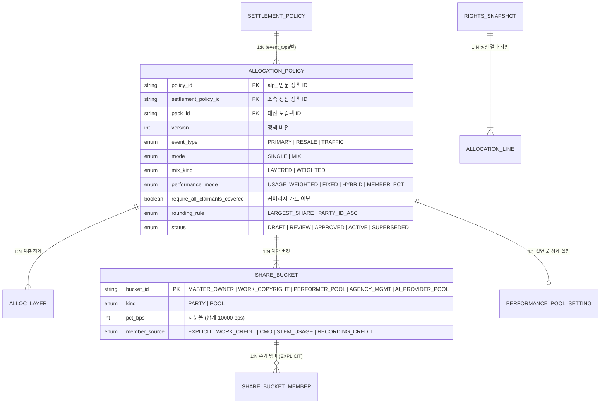

# 권리자 풀 내부 안분 (AllocationPolicy) 설계 명세서

- **문서 상태**: 설계 확정 (v2.7 정합)
- **상위 문서**: `데이터모델_v2.7.md`, `백오피스_IA_와이어프레임_Userflow.md`, `백오피스_UI설계가이드_작품슬롯스템_팩관리_v1.6.md`
- **적용 대상**: dobedopop 보컬조합 정산 룰 엔진 (Settlement Engine), 백오피스 정책 관리 (SPACE/권리자 콘솔), 권리 스냅샷 (Snapshot)

---

## 1. 개요 및 설계 원칙

본 문서는 플랫폼 순매출에서 Tier 1 플랫폼 수수료 및 팬 인센티브 풀을 공제한 **권리자 풀 (Rights Pool, 예: 순매출의 70%)** 을 마스터 권리자(레이블), 저작권자/CMO, 실연자(멤버/세션), 기획사, AI 원천 제공자 등 **청구권자(Claimant)** 에게 공정하고 투명하게 배분하는 **Tier 2 안분 정책(Allocation Policy)** 의 규격을 정의합니다.

### 1.1 핵심 설계 원칙
1. **2계층 정책 상속 구조 (L0 Baseline → L1 Pack Policy)**:
   - **L0 원본 권리 이미지 (`rights_image`)**: 마스터 권리자가 정의한 정산 베이스라인(`settlement_policy_baseline`)에서 권리자 풀 하한(`rights_pool_bps_floor`) 및 실연 풀 하한(`performer_bucket_bps_floor`)을 설정합니다.
   - **L1 팩 이미지 (`vocal_pack`)**: 팩 단위의 버전화된 정산 정책 객체(`settlement_policy`)를 통해 베이스라인을 상속받거나 허용 범위 내에서 세부 차분(Tier 1 `settlement_rule`, Tier 2 `allocation_policy`)을 확정합니다.
2. **청구권자(Claimant) 사실 기반 자동 도출**:
   - 청구권자는 수기 등록이 아닌 L0 권리 원장(`rights_image_party`)과 자산 크레딧(`work_credit`, `recording_credit`, `stem_credit` 등)에서 시스템이 100% 자동 도출·물질화합니다.
3. **불변 스냅샷 동결 (Snapshot Immutability)**:
   - 조합 발행(`ISSUED`) 시점의 유효 정산 정책, 계약 버킷, 스템 배정 초, 팬 빌더 멤버 %를 `rights_snapshot` 하위 테이블에 영구 동결합니다. 정산 엔진은 오직 발행 시점의 스냅샷만을 참조합니다.
4. **Append-Only 원장 및 원 단위 무오차 보존**:
   - 모든 배분 결과는 `allocation_line`에 추가 전용(Append-Only)으로 기록됩니다.
   - 원화 정수(`BIGINT`) 절사(Floor) 후 잔여 금액은 최대 지분자(`LARGEST_SHARE`)에 배정하여 **권리자 풀 총액과 안분 라인 합계의 100.00% 일치**를 강제합니다.

---

## 2. 확정 기본 규격 및 기본 템플릿

신규 보컬팩 및 1차 소장(`PRIMARY`)에 적용되는 표준 기본 템플릿 ID: `VC-ALLOC-DEFAULT-V1`.

| 항목 | 표준 확정값 | 설계 근거 및 비즈니스 규칙 |
| :--- | :--- | :--- |
| **안분 모드 (`mode`)** | `MIX` / `LAYERED` (계층형 믹스) | 계약적 권리(누구의 몫인가)와 실제 사용량(어떻게 배분할 것인가)의 평가 레이어를 엄격히 분리 |
| **1층 (`alloc_layer` 1)** | `CONTRACT` 계약 버킷 | 마스터 권리자, 저작권 풀(또는 CMO), 실연자 풀, 기획사 등 1차 계약 지분(합계 10000 bps) 확정 |
| **2층 (`alloc_layer` 2)** | `PERFORMANCE` (실연 풀) | 실연자 풀(`PERFORMER_POOL`) 내부 배분 (기본: `MEMBER_PCT` 또는 `USAGE_WEIGHTED`) |
| **실연 풀 분배 모드** | `MEMBER_PCT` (기본 템플릿) / `USAGE_WEIGHTED` (대체 가능) | 팬이 빌더에서 조정한 멤버 비중 스냅샷과 1:1 일치 보장 (고지 투명성) |
| **스템 시간 메트릭** | `ASSIGNED_DURATION` (`duration_ms`) | 발행된 타임라인 구간의 배정 밀리초/초. 청취 재생(Streaming Play) 시간은 정산에 미반영 |
| **잠금 스템 (Locked)** | 권리 대상(`rights_bearing=true`)이면 포함 | 강제 고정 구간이라도 실연/보이스가 포함되어 있으면 정당한 지분 인정 |
| **청구권자 커버리지** | `require_all_claimants_covered = true` | 도출된 청구권자가 버킷에서 누락되어 지분이 0이 되는 정책은 저장/활성화 불가 (차단 게이트) |
| **수치 정밀도 및 단위** | 비율: `bps` (10000 bps = 100%), 계산: `NUMERIC(16,12)`, 금액: `BIGINT` (KRW) | 금융 원장 무오차 정밀도 보장 |
| **반올림 및 잔여 배분** | Floor 절사 후 잔여액을 `LARGEST_SHARE` 파티에 1원씩 가산 (동률 시 `party_id ASC`) | 라인 총합 = 권리자 풀 금액 완전 일치 |
| **2차 재판매 (`RESALE`)** | 1차 정책과 분리된 독립 정책 객체 적용 | 2차 거래 수수료 및 창작자/실연자 로열티 요율 독립 관리 |

---

## 3. 안분 베이스 (Allocation Bases)

안분 엔진은 청구권자 집합 $P = \{p_1, p_2, \dots, p_n\}$ 위에서 각 베이스별 비중 벡터 $\mathbf{v}$ ($\sum v[p] = 1.0$)를 생성합니다.

```
                  ┌────────────────────────────────────────────────────────┐
                  │                 Claimant Set (P)                       │
                  └────────────────────────────────────────────────────────┘
                                      │
          ┌───────────────────────────┼───────────────────────────┐
          ▼                           ▼                           ▼
  [STEM_TIME 베이스]          [MEMBER_PCT 베이스]          [CONTRACT 베이스]
  - 스템 배정 구간 초           - 팬 빌더 멤버 %            - L0/L1 계약 버킷 bps
  - rights_bearing 필터        - 스냅샷 동결 값             - EXPLICIT / 도출 원천
```

### 3.1 `STEM_TIME` (스템 사용량 베이스)
타임라인에 배정된 스템의 길이(밀리초/초)에 비례하여 지분을 산출합니다.

$$v_{\text{time}}[p] = \frac{\sum_{s \in S(p)} \text{duration\_ms}(s)}{\sum_{s \in S_{\text{valid}}} \text{duration\_ms}(s)}$$

- $S(p)$: 파티 $p$에 매핑된 권리 유효(`rights_bearing = TRUE`) 스템 집합 (설정에 따라 잠금 스템 포함).
- $S_{\text{valid}}$: 조합에 포함된 전체 유효 스템 집합.
- 분모가 0이거나 스템-파티 매핑 결손 시 평가 실패 $\rightarrow$ `unallocated_holding(MISSING_CREDIT)` 보류 처리.

### 3.2 `MEMBER_PCT` (빌더 멤버 비율 베이스)
팬이 조합 발행 시 확정한 참여 멤버 비율(`snapshot_member_pct`)을 그대로 사용합니다.

$$v_{\text{member}}[p] = \frac{\text{pct\_bps}[p]}{10000}$$

- 발행 검증(`ISSUANCE_RATIO`)을 통과한 불변 스냅샷 값을 사용하므로 항상 $\sum v_{\text{member}}[p] = 1.0$입니다.
- 실연자가 아닌 권리자(마스터 레이블, 저작자, 신탁단체 등)의 값은 0입니다.

### 3.3 `CONTRACT` (사전 계약 지분 베이스)
정산 정책에 명시된 계약 버킷(`share_bucket`) 지분율에 따라 배분합니다.

$$v_{\text{contract}}[b] = \frac{\text{pct\_bps}[b]}{10000} \quad (\text{단, } \sum_{b \in B} \text{pct\_bps}[b] = 10000)$$

- **단일 파티 버킷 (`kind = PARTY`)**: 지정된 $p$에게 해당 지분 전액 직접 귀속.
- **풀 버킷 (`kind = POOL`)**: 2층(`PERFORMANCE` 등)에서 하위 규칙에 따라 재안분.

---

## 4. 분배 구조 및 믹스 모드 (Mix Modes)

### 4.1 계층형 믹스 (`LAYERED`) — **표준 기본 모드**
1. **1층 (`CONTRACT`)**: 1차 계약 버킷 비율에 따라 권리자 풀 금액 $R$을 각 버킷 금액 $R_b$로 확정 분할합니다.
   $$R_b = R \times \frac{\text{pct\_bps}[b]}{10000}$$
2. **2층 (`PERFORMANCE` 등 POOL 재안분)**:
   - 각 POOL 버킷에 대해 지정된 `member_source` 및 `performance_mode`를 적용하여 풀 내부 멤버 $p \in M_b$에게 분배합니다.
   - **기본 모드**: `MEMBER_PCT` (팬 지정 비중) 또는 `USAGE_WEIGHTED` (스템 타임 비중).
   - **4대 실연 풀 모드 (`performance_pool_setting`)**:
     - `USAGE_WEIGHTED`: 주실연자/부실연자 가중치(`featured_weight_bps` / `non_featured_weight_bps`) 반영 스템 사용량 비례.
     - `FIXED`: 풀 소속 멤버 전원 균등 분배.
     - `HYBRID`: 고정 균등 풀(`hybrid_fixed_bps`) + 사용량 비례 풀(`hybrid_usage_bps`) 결합.
     - `MEMBER_PCT`: 빌더 멤버 비중 100% 반영.
     - **보호 옵션**: 미선택 멤버 최저 보장(`floor_guarantee_bps`), 특정 1인 독식 방지 상한(`cap_limit_bps`).
3. **직접 귀속 파티**: POOL이 아닌 `PARTY` 버킷(마스터 권리자, 기획사 등)은 1층 금액 $R_b$가 최종 정산액이 됩니다.

### 4.2 가중치 혼합 모드 (`WEIGHTED`)
단일 층에서 세 베이스 벡터를 가중 선형 결합합니다.

$$\mathbf{v}_{\text{final}} = w_T \mathbf{v}_{\text{time}} + w_M \mathbf{v}_{\text{member}} + w_C \mathbf{v}_{\text{contract}} \quad (w_T + w_M + w_C = 1.0)$$

- 계약 버킷이 POOL을 포함하는 경우, 결합 전 버킷 내부 지분을 펼친 단일 벡터를 구성합니다.

### 4.3 단일 베이스 모드 (`SINGLE`)
단 하나의 베이스($\mathbf{v}_{\text{time}}$, $\mathbf{v}_{\text{member}}$, $\mathbf{v}_{\text{contract}}$ 중 택 1)만으로 100% 배분합니다.
- `require_all_claimants_covered = true`인 경우, 지분이 0이 되는 필수 청구권자가 존재하면 정책 활성화 및 정산 평가가 거부됩니다.

---

## 5. 데이터 모델 및 엔티티 명세



### 5.1 `allocation_policy` (안분 정책 마스터)
- `policy_id` (PK, `alp_`), `settlement_policy_id` (FK `settlement_policy`), `pack_id` (FK `vocal_pack`), `version`.
- `event_type`: `PRIMARY` (1차 소장), `RESALE` (2차 거래), `TRAFFIC` (스트리밍/광고).
- `mode`: `SINGLE | MIX`, `mix_kind`: `LAYERED | WEIGHTED`.
- `performance_mode`: `USAGE_WEIGHTED | FIXED | HYBRID | MEMBER_PCT`.
- `weight_stem_bps`, `weight_member_bps`, `weight_contract_bps` (가중치 합계 10000 bps).
- `require_all_claimants_covered` (`BOOL`, 기본 TRUE): 청구권자 누락 방지 게이트.
- `rounding_rule`: `LARGEST_SHARE` (기본), `status`: `DRAFT | REVIEW | APPROVED | ACTIVE | PAUSED | SUPERSEDED`.
- `effective_from`: 발효 일시.

### 5.2 `alloc_layer` 및 `share_bucket`
- **`alloc_layer`**: `(policy_id, version, layer_order)` PK (`layer_order = 1`: CONTRACT, `layer_order = 2`: PERFORMANCE).
- **`share_bucket`**: `(policy_id, version, bucket_id)` PK.
  - `bucket_id`: `MASTER_OWNER`, `WORK_COPYRIGHT`, `PERFORMER_POOL`, `AGENCY_MGMT`, `AI_PROVIDER_POOL`, `RECORDING_CONTRIB`.
  - `kind`: `PARTY` (단일 파티 직접 귀속) | `POOL` (2차 안분 풀).
  - `pct_bps`: 1층 내 지분율 (버킷 합계 = 10000 bps 강제).
  - `member_source`: 버킷 수취 멤버 및 내부 비율 도출 방식 (`EXPLICIT`, `WORK_CREDIT`, `CMO`, `STEM_USAGE`, `RECORDING_CREDIT`).
- **`share_bucket_member`**: `(policy_id, version, bucket_id, party_id)` PK, `pct_bps` (`member_source = EXPLICIT`일 때 사용).

### 5.3 `performance_pool_setting` (실연 풀 세부 규칙)
- `setting_id` (PK), `policy_id` (FK), `version`.
- `featured_weight_bps` (기본 6000 bps), `non_featured_weight_bps` (기본 4000 bps).
- `hybrid_fixed_bps`, `hybrid_usage_bps`, `floor_guarantee_bps`, `cap_limit_bps`.

### 5.4 스냅샷 및 정산 원장 연동
- **`rights_snapshot` (`snp_`)**: `pack_effective_policy`의 평탄화 결과인 `recipe_json`, `snapshot_member_pct`, `snapshot_stem_assignment`, `snapshot_bucket`, `snapshot_bucket_member`, `snapshot_layer`, `snapshot_claimant`를 동결.
- **`allocation_line` (`aln_`)**: `(event_id, party_id, line_kind)` UNIQUE. 최종 계산액 `amount_krw`, 지분율 `share_ratio`, 감사용 `base_breakdown_json` 기록.

---

## 6. 정산 평가 알고리즘 (Settlement Evaluation Algorithm)

입력값: 매출 이벤트의 권리자 풀 순금액 $R$ (`pool_line.rights_pool_krw`), 동결된 `rights_snapshot`.

```
[입력: rights_pool_krw (R), rights_snapshot]
                       │
                       ▼
         [1. 스냅샷 무결성 및 청구권자 검증]
         - recipe_json 파싱 및 claimant 목록 확인
         - 멤버 % 합계 10000 bps 검증 (불일치 시 배치 중단)
                       │
                       ▼
         [2. 베이스 벡터 계산 및 믹스 평가]
         - 1층: CONTRACT 버킷별 금액 배분 (R_bucket)
         - 2층: POOL 버킷에 대해 member_source별 재안분
                       │
                       ▼
         [3. 커버리지 및 제약 가드 검사]
         - require_all_claimants_covered 검증
         - 청구권자 지분 0 발생 시 -> unallocated_holding 격리
                       │
                       ▼
         [4. Floor 절사 및 원 단위 잔여 배분]
         - amount[p] = floor(R * share[p])
         - remainder = R - sum(amount)
         - remainder를 지분 내림차순(동률 시 party_id ASC)으로 1원씩 가산
                       │
                       ▼
         [5. 원장 저장 (allocation_line Append)]
         - sum(amount) == R 검증 (불일치 시 롤백)
         - base_breakdown_json 포함하여 INSERT
```

---

## 7. 백오피스 운영 및 직무 분리 (SoD)

1. **역할 및 권한 분리**:
   - **정책 편집 (`editor_party_id`)**: 마스터 권리자 (`AGENCY_ADMIN` / `LABEL_ADMIN`).
   - **저작권 버킷 승인 (`work_bucket_approver_party_id`)**: 저작권자 또는 대행사 (`PUBLISHER` / `CMO`).
   - **정책 활성화 확정 (`activator_party_id`)**: 기획사 관리자 (편집자와 동일 계정 불가).
   - **배치 실행자 (`SPACE_OPS`) ≠ 배치 확정자 (`SPACE_SETTLE`)**: 플랫폼 내부 정산 직무 분리.
2. **사전 시뮬레이션 및 섀도 검증 필수**:
   - 정책 변경 및 활성화 전, 최근 $N$건의 실제 발행 스냅샷에 초안 정책을 대입하여 시뮬레이션 금액 변동 리포트를 확인해야 합니다.
3. **무결성 및 부정 방지 연동 (IFPI 5원칙)**:
   - `revenue_event.integrity_status = FLAGGED`인 의심 건은 배치에서 격리되어 권리자 풀 금액이 `unallocated_holding(reason_code = FRAUD_REVIEW)`로 보류됩니다.

---

## 8. 예외 처리 및 장애 대응 매트릭스

| 예외 상황 | 발생 원인 | 처리 및 시스템 동작 |
| :--- | :--- | :--- |
| **청구권자 누락 (Coverage Fail)** | 도출된 청구권자가 버킷에 미포함 | 정책 활성화 거부 (`COVERAGE_GUARD_FAIL`). 정산 시 발생 시 해당 이벤트 보류 |
| **스템 크레딧 결손 (Missing Credit)** | 스템에 가창자/권리자 매핑 누락 | 해당 스템을 시간 분모에서 제외 후 재정규화, 감사로그 기록, 정산은 보류 |
| **빌더 멤버 % 합계 오류** | 클라이언트 변조 또는 발행 버그 | 스냅샷 검증 실패로 정산 즉시 중단 및 긴급 알림 발송 |
| **풀 버킷 멤버 전원 0%** | 배정 스템 및 멤버 % 전무 | 해당 버킷 금액 전액 `unallocated_holding(COVERAGE_GUARD_FAIL)` 격리 |
| **부정 이용 의심 매출** | 비정상 결제/스트리밍 어뷰징 감지 | `revenue_event.integrity_status = FLAGGED` 전환, 정산 산정 제외 및 보류 |
| **결제 취소 및 환불** | 사용자 환불 승인 | 기존 원장 수정 없이 `line_kind = REVERSAL` 음수 라인 역분개 기록 |

---

## 9. 기본 템플릿 계산 예시

- **조건**: 1차 소장(`PRIMARY`), 권리자 풀 금액 $R = \text{₩3,430}$.
- **1층 계약 버킷**: 마스터(레이블) 40% (4,000 bps), 실연자 풀 50% (5,000 bps), 저작권(신탁) 10% (1,000 bps).
- **2층 실연자 풀 (`MEMBER_PCT`)**: 멤버 A 30%, 멤버 B 30%, 멤버 C 25%, 멤버 D 15%.

### 계산 및 잔여 배분표

| 파티 (Party) | 역할 | 최종 지분율 ($s$) | 계산액 ($R \times s$) | Floor 절사액 | 잔여 1원 배분 | 최종 확정액 |
| :--- | :--- | :--- | :--- | :--- | :--- | :--- |
| **레이블 (Master)** | 마스터 권리자 | 40.00% | ₩1,372.00 | ₩1,372 | **+1원** (최대 지분 1위) | **₩1,373** |
| **신탁단체 (CMO)** | 저작권 관리 | 10.00% | ₩343.00 | ₩343 | - | **₩343** |
| **멤버 A** | 실연자 (30%) | 15.00% | ₩514.50 | ₩514 | **+1원** (차순위 지분, ID 우선) | **₩515** |
| **멤버 B** | 실연자 (30%) | 15.00% | ₩514.50 | ₩514 | - | **₩514** |
| **멤버 C** | 실연자 (25%) | 12.50% | ₩428.75 | ₩428 | - | **₩428** |
| **멤버 D** | 실연자 (15%) | 7.50% | ₩257.25 | ₩257 | - | **₩257** |
| **합계 (Total)** | - | **100.00%** | **₩3,430.00** | **₩3,428** | **+2원** | **₩3,430** |

> **잔여 배분 결과**: Floor 절사 후 발생한 잔여 2원은 지분율 내림차순에 따라 레이블(+1원) 및 멤버 A(+1원, 멤버 B와 동률이나 `party_id` 오름차순 우선)에게 배분되어 총합 ₩3,430과 1원 단위까지 완벽하게 일치합니다.

