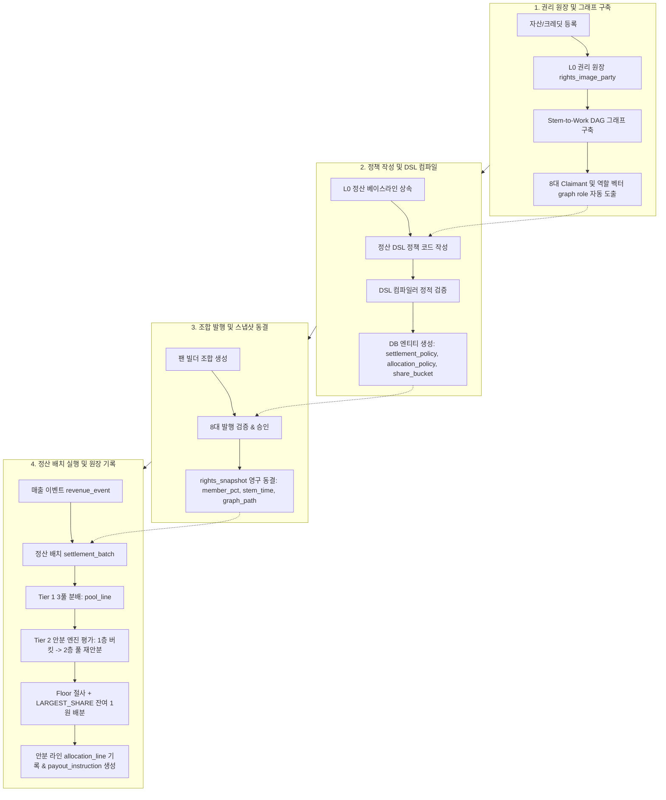

# 안분 정책(AllocationPolicy) · Stem-to-Work 그래프 · 정산 DSL 통합 요약

- **문서 상태**: 설계 확정 (v2.7 정합)
- **대상 문서**:
  - `안분정책_AllocationPolicy_설계.md`
  - `Stem2Work그래프_정산DSL_설계.md`
- **상위 및 참조 문서**: `데이터모델_v2.7.md`, `백오피스_IA_와이어프레임_Userflow.md`, `백오피스_UI설계가이드_작품슬롯스템_팩관리_v1.6.md`

---

## 1. 개요 및 3대 핵심 축의 관계

dobedubpop 보컬조합 플랫폼의 권리 정산 시스템은 **"사실(Facts)과 정책(Policy)의 엄격한 분리"** 원칙 위에 구축되어 있습니다. 본 문서는 권리 정산을 완성하는 세 가지 핵심 컴포넌트인 **Stem-to-Work 그래프**, **정산 DSL(VC-DSL)**, **안분 정책(AllocationPolicy)** 의 역할과 유기적 상호 관계를 요약합니다.

```
┌─────────────────────────────────────────────────────────────────────────────┐
│ 1. Stem-to-Work 그래프 (권리 사실 - Facts)                                  │
│    "누가 정당한 청구권자이며, 녹음/저작물 구조상 기본 기여 경로가 어떻게 되는가?"   │
└──────────────────────────────────────┬──────────────────────────────────────┘
                                       │ 8대 청구권자(Claimant) & 역할별 지분 벡터 제공
                                       ▼
┌─────────────────────────────────────────────────────────────────────────────┐
│ 2. 정산 DSL (선언적 정책 언어 - Policy Language)                            │
│    "계약과 비즈니스에 따라 권리자 풀을 어떻게 나눌 것인가? (사람이 읽는 선언)"   │
└──────────────────────────────────────┬──────────────────────────────────────┘
                                       │ 컴파일 (정적 검증, 합계 10000 bps, Digest 생성)
                                       ▼
┌─────────────────────────────────────────────────────────────────────────────┐
│ 3. 안분 정책 (런타임 실행 모델 - Execution Model)                           │
│    "발행 스냅샷과 결합하여 정산 배치 시 1원 단위까지 무오차로 분배하는 DB 엔티티" │
└─────────────────────────────────────────────────────────────────────────────┘
```

| 컴포넌트 | 핵심 성격 | 주요 입력 | 주요 출력 / 역할 |
| :--- | :--- | :--- | :--- |
| **Stem-to-Work 그래프** | **권리 사실 (Facts)** | 스템, 슬롯, 보이스, 녹음, 저작물, 권리 원장(`rights_image_party`) | 8대 `claimant` 자동 도출, 역할별 기초 가중치 벡터 $\mathbf{w}_{\text{role}}$ |
| **정산 DSL (VC-DSL)** | **선언적 정책 (Policy)** | 그래프 해석 벡터, 계약 지분율, 4대 실연 풀 모드, 가드 조건 | 정적 유효성 검증된 AST, 정책 다이제스트(해시) |
| **안분 정책 (AllocationPolicy)**| **실행 모델 (Model)** | DSL 컴파일 산출물, `rights_snapshot` 동결 데이터, 매출 원장 | `allocation_line` (Append-Only 무오차 원장), 지급 지시 |

---

## 2. 전체 엔드투엔드(End-to-End) 데이터 흐름



---

## 3. 핵심 메커니즘 상세 요약

### 3.1 Stem-to-Work 그래프 (권리 사실 분석)
- **구조**: `STEM` $\rightarrow$ `VOICE` / `SLOT` / `RECORDING` / `PACK` $\rightarrow$ `WORK` $\rightarrow$ `PARTY`로 이어지는 엄격한 상향 단방향 DAG.
- **8대 청구권자(`claimant_role`)**:
  1. `MASTER_OWNER`: 마스터 음원 권리자(레이블).
  2. `WORK_AUTHOR`: 작사/작곡/편곡 저작자 (`work_credit`).
  3. `CMO`: 신탁관리곡(`work.cmo_managed = true`) 시 저작자를 대행하는 신탁단체 1행.
  4. `PERFORMER_FEATURED`: 주실연자 (가창 멤버).
  5. `PERFORMER_NON_FEATURED`: 부실연자 (코러스/세션).
  6. `AGENCY`: 기획사 매니지먼트.
  7. `AI_PROVIDER`: 가상 AI 보이스 원천 제공자.
  8. `RECORDING_CONTRIBUTOR`: 녹음 참여자 (`recording_credit.settlement_eligible = true`).
- **해석**: 스냅샷의 스템 배정 구간 초($\mathbf{u}$)와 그래프 엣지 가중치 곱($\prod \text{share\_bps}$)을 결합하여 역할별 독립 지분 벡터 $\mathbf{w}_{\text{role}}$ 산출.
- **불변 스냅샷**: 발행 시 `snapshot_graph_path`에 계산된 가중치를 복제 동결하여 정산 시 런타임 그래프 탐색 부하 제거.

### 3.2 정산 DSL (VC-DSL, 선언적 정책)
- **문법 구조**:
  - `scope`: 보컬팩(`pack`) 및 이벤트(`PRIMARY | RESALE | TRAFFIC`) 지정.
  - `buckets`: 1층 1차 계약 지분 정의 (예: 레이블 40%, 실연자 풀 50%, 저작권 10%).
  - `allocate`: `layer(contract)` 블록 내에서 하위 풀 재안분 규칙 선언.
  - `guards`: `require_all_claimants_covered` (청구권자 누락 차단), `sum_buckets == 100%`.
  - `rounding`: 금융 반올림 규칙 (`KRW`, `LARGEST_SHARE`, `party_id_asc`).
- **정적 검증 (Static Analysis)**: 버킷 합계 불일치(`DSL_SUM_MISMATCH`), 청구권자 미커버(`DSL_UNCOVERED_CLAIMANT`), 타입 에러 등을 컴파일 시점에 완벽 차단.
- **산출물**: 정규화된 AST의 SHA-256 digest를 생성하고, DB 테이블(`allocation_policy`, `alloc_layer`, `share_bucket`, `performance_pool_setting`)을 자동 프로비저닝.

### 3.3 안분 정책 (AllocationPolicy, 런타임 분배)
- **2계층 믹스 (`LAYERED`) 분배**:
  - **1층 (`CONTRACT`)**: 권리자 풀 금액 $R$을 1차 계약 버킷별로 분할.
  - **2층 (`PERFORMANCE` 등)**: POOL 버킷에 대해 지정된 실연 풀 모드를 적용하여 멤버에게 재안분.
- **4대 실연 풀 모드 (`performance_pool_setting`)**:
  - `MEMBER_PCT`: 팬 빌더가 조정한 멤버 비중 스냅샷 반영 (기본 템플릿).
  - `USAGE_WEIGHTED`: 스템 배정 밀리초(`ASSIGNED_DURATION`) 및 주/부실연자 가중치 반영.
  - `FIXED`: 풀 소속 멤버 전원 균등 분배.
  - `HYBRID`: 고정 균등 풀 + 사용량 비례 풀 결합.
  - **보호 옵션**: 미선택 멤버 최저 보장 풀(`floor_guarantee_bps`), 특정 1인 독식 방지 상한(`cap_limit_bps`).
- **무오차 잔여 배분 알고리즘**:
  1. 각 파티별 배분액 = $\lfloor R \times \text{share}[p] \rfloor$ (Floor 절사).
  2. 잔여액 $\Delta = R - \sum \text{amount}[p]$ 산출.
  3. $\Delta$원을 지분율 내림차순(동률 시 `party_id` 오름차순)으로 1원씩 가산하여 **총합 100.00% 일치 강제**.

---

## 4. 거버넌스, 직무 분리(SoD) 및 안전장치

1. **엄격한 직무 분리 (Separation of Duties)**:
   - **정책 편집 (`editor_party_id`)**: 마스터 권리자 (`AGENCY_ADMIN` / `LABEL_ADMIN`).
   - **저작권 버킷 승인 (`work_bucket_approver_party_id`)**: 저작권자 또는 신탁단체 (`PUBLISHER` / `CMO`).
   - **정책 활성화 확정 (`activator_party_id`)**: 기획사 관리자 (편집자와 동일 계정 차단).
   - **배치 실행자 (`SPACE_OPS`) ≠ 배치 확정자 (`SPACE_SETTLE`)**: 정산 집행 분리.
2. **사전 시뮬레이션 및 섀도 실행**:
   - 정책 개정 시 최근 실제 발행 스냅샷 $N$건에 대해 섀도 실행을 수행하여 원 단위 차액 변동 리포트 검증 필수.
3. **무결성 및 부정 방지 연동 (IFPI 5원칙)**:
   - 이상 거래 및 어뷰징 의심 이벤트(`revenue_event.integrity_status = FLAGGED`)는 정산 배치에서 자동 격리되며, 권리자 풀 금액은 `unallocated_holding(reason_code = FRAUD_REVIEW)`로 안전하게 보류됩니다.
4. **Append-Only 원장 및 환불 역분개**:
   - 정산 원장은 INSERT 전용이며, 결제 취소/환불 시 기존 행을 수정하지 않고 `line_kind = REVERSAL` 음수 라인으로 역분개하여 다음 배치에서 상계합니다.

---

## 5. 결론 및 요약표

| 구분 | Stem-to-Work 그래프 | 정산 DSL (VC-DSL) | 안분 정책 (AllocationPolicy) |
| :--- | :--- | :--- | :--- |
| **담당 영역** | 권리 경로 및 지분 사실 분석 | 정책 선언 및 정적 검증 | 런타임 정산 계산 및 원장 기록 |
| **변경 빈도** | 자산/크레딧 등록 시 1회 고정 | 팩 기획/계약 변경 시 개정 | 정산 주기마다 불변 스냅샷 기반 실행 |
| **저장 위치** | `snapshot_graph_path` | `allocation_policy_source` (AST/텍스트) | `allocation_policy`, `allocation_line` |
| **주요 역할자** | 시스템 자동 도출 (QC 검증) | 마스터 권리자 편집 / 기획사 확정 | 정산 엔진 자동 실행 (배치 확정자 승인) |
