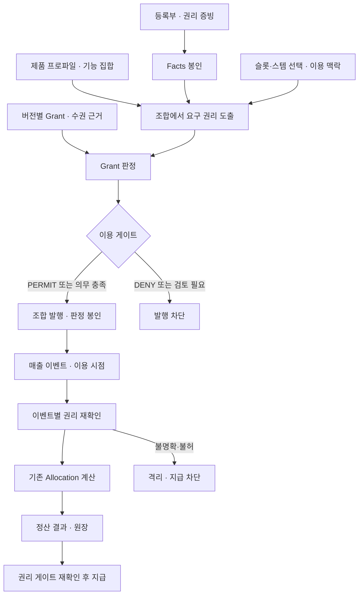

# dobedupop · mdrl Grant·프로파일 통합 설계 베이스라인 v1.0

- 기준일: 2026-10-12.
- 문서 상태: 이번 정리에서 확정한 후속 구현 기준. 이 문서의 신규 API·테이블·게이트는 미구현.
- 적용 대상: 보컬 조합의 Stem-to-Work 그래프, 이용허락 DSL, 안분 DSL, 발행·매출·정산·지급 연계.
- 제품명: `dobedupop`. 언어명: `mdrl`.
- 제품 범위: 직접 권리자와 적법한 수권 근거를 가진 대리 주체. 출판사·신탁/관리단체·NFT는 본 제품 프로파일에서 제외.
- 공통 언어의 기존 어휘·과거 데이터는 유지. 제품 프로파일에서 제외된 역할이 발견되면 자동 삭제·재배분하지 않고 등록 또는 활성화를 차단.

## 1. 구조와 책임

| 구성 요소 | 책임 | 경계 |
|---|---|---|
| mdrl 공통 코어 | 타입, 시간, 범위 연산, 정규화·digest | DB·인증·수권 사실 확정 없음 |
| Facts / Projection | 자산·주체·권리 주장·사용량을 결정적 기여 벡터로 변환 | 권리 주장만으로 이용허락을 만들지 않음 |
| Grant | 요구 범위와 유효한 허락의 포함 관계 판정 | 등록부의 수권·공동권리 커버리지 검사는 플랫폼과 협력 |
| Allocation | 정책·조합 지분·이벤트에 따른 금액 보존 안분 | 이용허락 판정을 대체하지 않음 |
| 보컬 조합 제품 프로파일 | 허용 어휘, 요구 권리 도출, 지원 기능과 버전 고정 | 미구현 함수를 등록만으로 실행하지 않음 |
| rights-core / engine-bridge | 원본 조회, 수권 검사, 엔진 호출, 봉인·재평가 | mdrl import는 engine-bridge에 집중 |
| rights-core 업무 모듈 | 승인·활성화·발행·매출·원장·보류·지급 | 상태 전이와 동시성 보장 |
| backoffice | 근거·판정·보류 사유 표시와 승인 작업 | 클라이언트가 PERMIT·요구 권리를 확정하지 않음 |



## 2. 그래프 모델

### 2.1 현재 모델을 유지하는 1차 적용 범위

- 구조: `Stem.of → Recording.of → Work`, `Stem.slot → Slot`.
- 실연: `Stem --PERFORMED_BY→ Voice --OWNED_BY→ Party`.
- 권리: `Recording --CONTROLLED_BY→ Party`, `Work --WRITTEN_BY→ Party`, `Recording --CONTRIBUTED_BY→ Party`.
- 수령 위임: `Party --Mandate→ Party`. 수령 위임과 이용허락 권한 위임은 다른 관계로 관리.
- 조합: 선택된 슬롯·스템·사용 구간을 `rights_snapshot` 및 사용량 봉인에 연결.
- 제한: Recording은 단일 Work. 복수 Work 매시업·원천이 불명확한 파생·순환 참조는 1차 제품 프로파일에서 거부.
- 같은 스템의 중복 선택·같은 권리자의 여러 경로는 요구 권리 도출 시 정규화. 안분에서는 현재 사용량·역할별 조합 지분 규칙을 따르며 허락 개수를 지분으로 환산하지 않음.

### 2.2 권리 요구를 도출하는 경로

| 원천 | 요구 단위 | 1차 요구 유형 | 수권 근거 |
|---|---|---|---|
| 선택 Recording | 녹음물 × 통제 권리자 | MASTER | 해당 시점의 검증된 CONTROLLED_BY 및 별도 수권 증빙 |
| 연결 Work | 악곡 × 저작 권리자 | WORK | 해당 시점의 검증된 WRITTEN_BY 및 별도 수권 증빙 |
| 선택 Stem의 Voice | Voice × 실연 권리자 | PERFORMER | PERFORMED_BY·OWNED_BY 및 해당 이용에 대한 증빙 |
| AI 음성·모델 | 모델 제공자 × 허용 이용 | 확장 프로파일 대상 | HUMAN 보컬 프로파일로 통과시키지 않음 |
| Recording 기여자 | 계약상 별도 승인 대상 | 승인 필요 여부를 증빙으로 확정 | CONTRIBUTED_BY만으로 자동 허락자 또는 저작권자로 간주하지 않음 |

- MASTER·WORK·PERFORMER는 시스템 내부 요구 유형. 실제 계약상 권리 범위와 증빙 연결은 권리 검토자가 등록.
- 공동권리자 중 한 명의 허락으로 전체 권리를 충족시키지 않음. 각 요구 권리자의 허락 또는 전체를 대표할 수 있는 검증된 권한 필요.
- 권리자 누락·미검증 주장·지분 불완전·상충 증빙은 `REVIEW_REQUIRED` 또는 명시적 거부. 입력에 없는 권리를 있다고 추정하지 않음.
- 프로파일은 수권 경로마다 유효기간·기록시점·권한 범위·대표 대상 집합을 검사. 기존 수익 수령 Mandate를 수권 근거로 재사용하지 않음.

## 3. 프로파일 계약

### 3.1 버전 식별

- 공통 정의: 기존 `vocal-combination@1.0`.
- 제품 적용 정의: 신규 `dobedupop-vocal@1.0`.
- 식별 묶음: `{ id, version, definitionDigest, engineVersion, capabilitiesDigest }`.
- 등록 키: `(id, version)`. 동일 키·동일 digest 재등록은 멱등, 다른 digest 등록은 거부.
- definition은 불변 복사·봉인. 조회 결과의 배열 변경으로 정의가 바뀌지 않게 처리.
- 기존 `ProfileRegistry`의 id별 덮어쓰기 방식은 새 버전 계약을 만족하지 않으므로 후속 구현에서 교체/호환 어댑터 제공.
- 현재 MDRL envelope에 임의의 profile 키를 추가하지 않음. 플랫폼 실행 문맥 봉인으로 전달하고 향후 언어 규격 버전에서만 envelope 확장.

### 3.2 제품 허용 범위

- 지원 그래프: 단일 Work, HUMAN Voice, 슬롯별 Stem 조합.
- 허용 직접 권리자: AUTHOR, LABEL, PERFORMER, SESSION. AGENCY는 검증된 역할·위임 범위 안에서만 사용.
- FAN과 PLATFORM은 제품 참여 주체. 팬 참여 자체를 저작 권리로 자동 변환하지 않음. 보상은 별도 계약·정책에 근거.
- PUBLISHER, CMO, AI_PROVIDER의 제품 권리 참여는 1차 범위 밖. 공통 코드 enum을 삭제하지 않음.
- 이용 행위: PREVIEW, COMBINE, PERSONAL_HOLD, SHARE_LINK, PLATFORM_DISTRIBUTE, LIMITED_USE, COMMERCIAL, DOWNLOAD. RESALE은 토큰과 독립된 계약상 재판매 요구가 확정될 때 별도 제품 정책으로 활성화.
- 매체·지역·대상: 제품 설정의 허용 목록으로 정규화. 알 수 없는 문자열·빈 집합은 거부. `*`를 전체 허용으로 암묵 해석하지 않음.
- 사용량: `ASSIGNED_LAYER_MS`.
- 정산 함수: 현재 구현된 graph, contract, member_pct, performance_pool, mix, cap, floor_guarantee 중 제품별 허용 목록. 구현 capabilities와 교집합만 활성화.
- 매출: 현재 서버가 수용하는 이벤트만 지원. 프로파일에 TRAFFIC이 등록돼 있다는 이유만으로 서버 지원을 선언하지 않음.

## 4. DSL과 플랫폼 입력 계약

### 4.1 DSL 책임 분리

- Facts DSL: 자산·권리자·Claim·수령 위임의 구조적 사실.
- Grant DSL: grantor/grantee, asset, right_type, scope, obligations, 상태, valid, recorded_at.
- Allocation DSL: 수익 버킷·역할·계약 벡터·기여 벡터·반올림.
- Profile: 위 세 문서에 허용되는 어휘와 제품 불변식. 실행 규칙은 버전 고정된 코드와 적합성 시험으로 제공.
- 파서 성공, 타입 검증 성공, 권리 검토 승인, 서비스 이용 허용은 각각 별도 상태.

### 4.2 플랫폼의 신규 실행 문맥

아래는 후속 구현의 설계 타입이며 현재 공개 mdrl 타입이 아니다.

```typescript
type RightsContext = {
  format: "dobedupop-rights-context/1";
  packId: string;
  subjectPartyId: string;
  profile: { id: string; version: string; definitionDigest: string };
  engineVersion: string;
  capabilitiesDigest: string;
  factsDigest: string;
  assignmentsDigest: string;
  requestedScope: Scope;
  asOf: string;
  knownAt: string;
  revocationEpoch: string;
};
type RequiredRight = {
  id: string;
  asset: string;
  rightType: "MASTER" | "WORK" | "PERFORMER";
  authorityPartyId: string;
  claimRefs: string[];
  scope: Scope;
};
```

- subjectPartyId는 서버가 인증·위임 문맥으로 확정. 클라이언트가 임의로 바꿀 수 없음.
- requirements는 서버가 봉인된 Facts·조합·프로파일에서 도출. 요청 본문의 임의 requirements를 승인 근거로 사용하지 않음.
- 그랜트 후보는 대상 권리자·적법한 대표 수권자·grantee·유효 시간·scope에 맞춰 서버가 필터링.
- grantee 생략은 공개 허락을 증빙·승인한 경우에만 허용. 생략 자체로 모든 사용자 허용으로 취급하지 않음.
- 기존 evaluateGrant의 requirement에는 authorityPartyId가 없으므로 요구별 후보군을 나누어 호출하고 플랫폼에서 AND 집계. 서로 다른 권리자의 후보가 섞이지 않게 함.

## 5. 판정 알고리즘과 의무

1. 프로파일의 버전·digest·실행 capabilities 일치 확인.
2. Facts·조합·Scope 검증. 기간은 `[from,to)`, canonical UTC. 이용 시점 포함 확인.
3. 모든 원천 경로를 추적해 RequiredRight 집합 생성, 안정적 ID 순서로 정렬.
4. 요구별 권리자·수권·grantee 적합 후보 조회. 누락 또는 미검증을 허용으로 바꾸지 않음.
5. 철회 상태는 해당 grant 버전 계보에 적용. 무관한 철회 grant가 대체 가능한 유효 grant를 무조건 취소하지 않도록 충돌 집합 정의.
6. 대체 허락의 선택은 고정된 우선순위와 ID 순서로 결정. 서로 다른 의무를 유리하게 골라 우회할 수 없도록 승인된 대체 그룹만 사용.
7. `evaluateGrant`로 범위·시점 판정, 요구별 결과와 후보 제외 이유 기록.
8. 하나라도 DENY면 DENY, 없고 하나라도 REVIEW_REQUIRED면 REVIEW_REQUIRED. 그 외 의무가 있으면 PERMIT_WITH_OBLIGATION.
9. 의무별 이행 증빙을 확인해 업무 게이트 결정. 알 수 없는 의무 또는 미이행 의무는 차단.
10. 전체 입력·결과를 봉인하고 트랜잭션 직전 epoch·활성 프로파일·정책 버전을 재확인.

| Grant 결과 | 업무 처리 |
|---|---|
| PERMIT | 다른 발행 불변식도 만족할 때 발행 가능 |
| PERMIT_WITH_OBLIGATION | 의무 처리기가 지원하고 증빙이 연결된 경우에만 발행 가능 |
| DENY | 발행 불가. 이유·미충족 권리 표시 |
| REVIEW_REQUIRED | 검토 큐에 적재. 검토자의 클릭만으로 허락을 덮어쓰지 않고 근거를 보완해 재판정 |

- 의무 예: 출처 표시 문구·게시 위치의 렌더링 증빙, 배포 범위 제한의 채널 설정 증빙.
- 사후 의무는 기한·책임자·모니터링을 등록하고 불이행 시 신규 배포 차단. 이를 지원하지 않는 1차 구현에서는 해당 허락을 활성화하지 않음.
- 현 평가기의 digest는 전체 요청 Scope·epoch를 충분히 묶지 않음. 이를 단독 승인 토큰으로 사용하지 않음.

## 6. 봉인·데이터 구조

### 6.1 봉인 단위

- 신규 형식 `dobedupop-grant-evidence/1`: RightsContext, 정렬된 RequiredRight, 수권·증빙 refs, 후보 Grant 문서 digests, 요구별 판정, 유효 범위, 의무 이행 refs, 최종 업무 게이트.
- evidenceDigest = 전체 canonical evidence의 digest. 입력 scope·주체·프로파일·시간·epoch 중 하나가 바뀌면 다른 digest.
- 기존 issue_seal은 변경하지 않고 확장 연결 테이블로 신규 발행의 evidenceDigest를 참조.
- Grant 판정 digest와 플랫폼 evidenceDigest를 구별. 후자를 발행·정산 근거의 연결 키로 사용.

### 6.2 신규 논리 테이블과 제약

| 테이블 | 키·필수 값 | 불변식 |
|---|---|---|
| profile_definition | PK(id,version), definition_digest, capabilities_digest | 동일 버전 덮어쓰기 금지 |
| pack_rights_config | pack_id, revision, profile_id/version, subject 정책, scope 정책, epoch | 승인된 revision만 활성화; 변경 시 epoch 증가 |
| grant_document_version | PK(grant_id,version), document_digest, evidence_refs, approval 상태 | 허락 본문은 불변 버전 |
| grant_authority | grant 버전, authority_party_id, represented_party_id, 권한 scope, 근거 digest | 수령 Mandate와 분리, 유효 기간 포함 |
| grant_status_event | 고유 event_id, grant 버전, 상태, effective_at, recorded_at, reason | append-only; 철회 계보와 이중 시간 보존 |
| rights_decision | decision_id, evidence_digest, context_digest, result, gate, evaluated_at | 증빙·입력 재현 가능 |
| issue_rights_binding | snapshot_id PK/FK, decision_id FK, profile id/version | 신규 모드의 모든 발행에 필수 |
| revenue_rights_binding | event_id, evaluation_revision, decision_id, occurred_at | 이벤트의 사용 맥락과 연결, 중복 반영 방지 |
| rights_review_case | case_id, affected_ref, cause, status, decision_id | 정산 격리/재평가 작업의 근거 |

- 봉인·증빙·FK가 같은 트랜잭션에서 연결되도록 구현. blob 업로드 성공 후 DB 실패에 대한 미참조 blob 정리 정책 필요.
- 정산 타입과 DB의 LICENSE_UNVERIFIED 불일치는 **새 마이그레이션**으로 해소. 기존 0011 파일을 수정해 설치 DB가 바뀐다고 가정하지 않음.
- ledger HOLD 계정, release, reversal, statement, payout 차단까지 동일 사유를 지원한 후 기능 활성화.
- 이번 정리에서는 DDL을 실행하거나 기존 DB를 변경하지 않음.

## 7. 업무 호출 시점·동시성

| 시점 | 처리 |
|---|---|
| Grant 작성 | 문법·구조·profile 어휘 검사, 증빙 연결, 작성자 기록 |
| Grant 승인/활성화 | 기존 승인 역할 분리 적용, 수권·공동권리 커버리지 검토, 불변 버전 고정 |
| 팩 활성화 | 허용 스템·기본 이용 범위의 커버리지 점검. 개별 팬의 실제 이용 판정을 대체하지 않음 |
| 발행 미리보기 | 예상 requirements와 판정 제공. 예약·발행 권한 없음 |
| 발행 확정 | 잠금 안에서 실제 assignments·주체·scope 재판정, 의무 확인, Allocation preflight, 봉인·발행 원자적 처리 |
| 신규 채널 배포 | 발행 당시와 다른 media/territory/action이면 신규 권리 문맥 판정 |
| 매출 수집 | 서버가 채널 맵·occurred_at을 검증, 원 이벤트와 이용 맥락 저장 |
| 정산 계산 | 발생 시점의 허락과 기록 시점 기준으로 재현·재평가. 현재의 철회를 과거 유효 허락의 자동 무효화로 사용하지 않음 |
| 정산 확정·지급 | 미해결 review/격리·epoch 변경 확인. 변경 시 재평가 전 지급 중단 |

- 팩 설정/epoch와 관련 Grant 상태를 일관된 잠금 순서로 읽음. 철회와 발행 경쟁 시 먼저 커밋된 변경이 반영되도록 직렬화.
- 동일 발행 멱등키의 payload digest가 달라지면 충돌. 기존 응답을 다른 scope에 재사용하지 않음.
- 캐시 키: facts, assignments, subject, scope, profile, Grant 집합, asOf, knownAt, epoch의 digest 묶음. expiry만으로 철회 반영을 대체하지 않음.
- 대량 팬 버전은 공통 Facts·Grant·정책 봉인을 공유하고 조합별 차이만 저장. 조합 전체의 사전 열거는 하지 않음.

## 8. 정산 보류·철회·재평가

- 발행 전에 불허: 발행 차단, 정산 라인 미생성.
- 이미 발생한 매출에 허락 누락·분쟁: 수익 이벤트는 보존하고 rights_review_case와 정산 격리로 연결.
- 1차 통합은 이벤트/스냅샷의 모호한 허락에 대해 기존 격리를 우선 사용. 영향을 특정하지 못한 금액을 임의로 권리자에게 배분하지 않음.
- LICENSE_UNVERIFIED 부분 금액 보류는 requirement→bucket 영향 범위가 검증된 후 활성화. 불명확하면 전체 정산 단위를 격리.
- 보류를 원장에 올릴 경우 금액 보존과 추적성을 유지. 기존 AllocationResult의 lines를 후처리로 바꾸고 기존 digest를 유지하는 행위 금지.
- 후속 보류 결과는 별도 버전의 결과 형식/검증기를 설계하거나 정산 격리로 유지. 이번 베이스라인은 격리를 기본값으로 확정.
- Grant 철회/분쟁은 상태 이벤트·Outbox를 같은 트랜잭션에 기록. 영향받는 신규 발행·배포·정산·지급을 재검사.
- 이전 발행 봉인·확정 원장 불변. 소급 효력이 확인되면 기존 역분개/정정 절차로 새 버전을 만들고 원본과 연결.
- LICENSE_UNVERIFIED 해제에는 새로운 허락 판정·증빙과 승인 필요. 현재의 운영자 수동 배분만으로 해제하지 못하도록 guard 추가.
- 이미 지급 완료된 금액은 지급 전 보류와 별개인 정정/회수 업무로 관리. 지급 기록을 삭제하지 않음.

## 9. 신규 API와 콘솔 계약

아래 경로는 **설계된 신규 API**이며 현재 호출 가능한 엔드포인트가 아니다.

| API | 권한·입력·출력 |
|---|---|
| GET /rights-profiles | 읽기 권한; 지원 버전·digest·capabilities 반환 |
| POST /grants/:id/versions | RIGHTS_EDITOR; sourceText·수권/증빙 refs; 검증 결과·문서 digest 반환 |
| POST /grants/:id/versions/:version/approve | WORK_APPROVER; 작성자와 다른 사용자, 승인할 document digest 명시 |
| POST /grants/:id/versions/:version/activate | ACTIVATOR; 승인 digest와 버전 일치 확인 |
| POST /grants/:id/versions/:version/revoke | ACTIVATOR; effectiveAt·reason·증빙 필수; epoch 증가 |
| PUT /packs/:id/rights-config | RIGHTS_EDITOR; 프로파일·기본 scope·예상 revision; 활성화는 별도 승인 |
| POST /packs/:id/rights-preview | assignments·requestedScope; 서버가 주체·요구 권리 확정; 판정과 누락 근거 반환 |
| GET /issues/:snapshotId/rights | 발행의 evidence·프로파일·의무·현 상태 반환 |
| POST /rights-review/:caseId/reevaluate | RIGHTS_EDITOR; 새 근거로 재판정; 원 판정 보존 |

- 기존 POST /issues는 신규 모드에서 requestedScope와 멱등키를 받음. requirements·grantDecision·permit=true를 클라이언트 승인값으로 받지 않음.
- 오류 구분: 잘못된 문법/입력, 미지원 프로파일, 요구 권리 누락, 검토 필요, 의무 미충족, 버전 충돌. 상세 코드는 구현 시 API 계약 시험으로 고정.
- 콘솔: 팩에 프로파일·범위·허락 커버리지, 발행에 경로별 미충족 권리·의무·봉인, 정산에 영향 이벤트·보류 이유·재평가 이력 추가.
- 공개 API·권리자 포털에는 증빙 원문·개인정보를 그대로 반환하지 않음. 권한별 refs/요약을 제공.

## 10. 인수 기준과 적용 순서

| 검증 시나리오 | 기대 결과 |
|---|---|
| 공동 저작자 2명 중 1명만 허락 | 전체 Work 요구 미충족, 발행 불가 |
| 동일 stem 중복 경로 | 요구 권리 중복 생성/중복 지급 없음 |
| 타 사용자에게만 허락된 grant | grantee 불일치, 발행 불가 |
| 수령 위임만 존재 | 이용허락 수권으로 사용 불가 |
| 지역/매체/행위/대상/기간 중 하나 초과 | 범위 확장 거부 |
| 기간 끝 시각 또는 잘못된 valid | 종료 경계 거부 또는 입력 검증 실패 |
| 미지원 프로파일 버전/어휘/함수 | 활성화·발행 차단 |
| obligation 존재·이행 근거 없음 | PERMIT_WITH_OBLIGATION이어도 발행 차단 |
| 철회와 발행 동시 실행 | epoch와 잠금으로 오래된 허락 발행 방지 |
| 같은 결정에서 scope·주체·epoch만 변경 | 다른 evidenceDigest |
| 과거 매출 뒤 장래 효력 철회 | 과거 봉인 유지, 실제 효력 기간에 맞춰 영향 판정 |
| 허락 누락 매출 재수집 | 매출 멱등 보존, 격리 중복 원장 반영 없음 |
| 보류 해제에 새 판정 없음 | 해제 거부 |
| 기존 봉인 재검증 | 변경 전 결과를 재현; 과거 판정을 새 규칙으로 덮어쓰지 않음 |

- 1단계: 프로파일 버전/기능 검증, Grant의 valid·scope·subject·공동권리 단위 검증과 결정성 보완.
- 2단계: Grant 등록/승인/수권·증빙·봉인 저장과 위 API 구현.
- 3단계: 신규 발행 모드에서 필수 Gate 연결; 기존 데이터는 `legacy`로 식별하고 Grant 검증 완료로 표시하지 않음.
- 4단계: 이벤트 맥락·철회 Outbox·격리·정산 확정/지급 guard 연결.
- 5단계: 기능 대응표의 콘솔 화면과 통합 시험 연결 후 활성화.
- 배포 조건: 신규 모드의 필수 binding 누락 없음, 기존 재현 시험 통과, 재평가/해제/경쟁 시험 통과. 미완료 경로를 기본 PERMIT으로 우회하지 않음.
- 별도 후속 범위: 다중 Work·n차 파생 그래프, AI 프로파일, 실제 인증·외부 배포·실지급, 다중 테넌트.

## 11. 현재 구현 접점

- [Grant 평가기](../../06_MVP/dobedupop/packages/mdrl/src/grant/evaluate.ts)
- [프로파일 레지스트리](../../06_MVP/dobedupop/packages/mdrl/src/profiles/registry.ts)
- [발행 서비스](../../06_MVP/dobedupop/services/rights-core/src/issuance/service.ts)
- [발행 봉인](../../06_MVP/dobedupop/services/rights-core/src/engine-bridge/issue.ts)
- [정산 연결](../../06_MVP/dobedupop/services/rights-core/src/engine-bridge/settle.ts)
- [보류 해제](../../06_MVP/dobedupop/services/rights-core/src/settlement/holds.ts)

