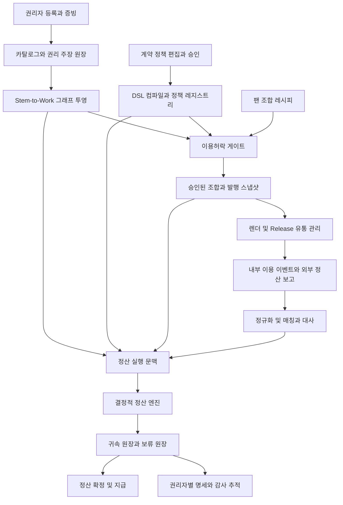
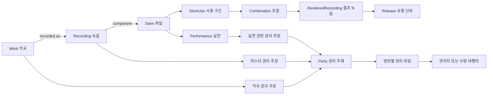

# 보컬조합 권리관리 및 정산 인프라 기획 설계

**Stem-to-Work 그래프와 정산 DSL 기반 다중 스템 다중 참여자 다중 채널 로열티 시스템**

작성일 2026년 9월 27일 · 버전 1.0 · 상태 제안 설계 · 검토 대상 사업 책임자, 음악 권리 담당자, 법무, 정산 운영자, 개발 책임자

## 1. 추진 결론

보컬조합을 **허락받은 음악 구성요소를 조합하고, 결과물의 출처와 이용 조건을 증명하며, 수익 발생 근거에 따라 권리자별 금액을 재현 가능하게 계산하는 인프라**로 추진한다. 팬 서비스는 이 인프라를 검증하는 첫 적용처이고, 이후 레이블·유통사·팬 플랫폼에 권리 판정 API와 정산 서비스를 제공한다.

핵심 제품은 세 가지다.

1. **Stem-to-Work 그래프**: 어떤 녹음·실연·악곡이 결과물에 포함되었고, 누가 어떤 범위의 권리를 주장·관리·허락하는지 연결한다.
2. **정산 DSL과 결정적 실행 엔진**: 계약을 검토 가능한 규칙으로 표현하고, 같은 입력과 버전에 대해 같은 배분 결과를 산출한다.
3. **권리 판정과 정산 증빙**: 매 이용·매 정산에서 적용한 계약, 정책, 사용량, 금액, 보류 사유를 역추적한다.

**조합 생성은 저작권의 자동 생성이 아니다.** 결과물 생성, 신규 권리의 성립 여부, 기존 권리의 이용허락, 계약상 보상 청구권을 각각 기록한다. 팬에게 기본 제공하는 것은 조합 참여권·정해진 이용권·계약상 인센티브이며, 공동저작권이나 마스터 소유권이 자동 부여되는 모델로 설계하지 않는다.

**실시간은 즉시 계산과 가시성을 뜻한다.** 내부 이벤트는 수 초 내 예상 배분을 보여 줄 수 있지만 외부 DSP의 확정 보고, 입금, 환불, 세무, 분쟁 처리까지 실시간으로 끝난다고 약속하지 않는다. 예상액·확정액·지급가능액·지급완료액을 분리한다.

### 1.1 적용 범위와 전제

- 국내에서 정식 계약한 1~2개 음악 IP와 원곡·재녹음 스템으로 시작한다. 국내의 특정 사용료율을 모든 상품에 공통 적용하지 않는다.
- 기존 L0 원본 권리 이미지 → L1 팩 → 팬 조합 → 스냅샷 → 정산 구조를 유지한다.
- 초기에는 플랫폼 내 소장·재생과 직접 매출을 검증한다. 외부 DSP, 숏폼, 영상 동기화, 해외, AI 음성은 별도 권리 프로필을 추가한다.
- 본 문서의 배분율·처리량·일정은 **제안 또는 계산 예시**다. 실제 계약 요율, 구현 완료 상태, 성능 실측값이 아니다.
- 기존 문서를 수정하거나 기존의 ‘설계 확정’ 결정을 자동 대체하지 않는다. 아래 변경 목록을 차기 설계 개정에 반영하는 제안이다.

## 2. 내부 문서 통합 결과

상세 출처 목록과 조사 범위는 함께 제공하는 [참조문서 리서치 검토대장](</Users/changkyuneun/Vocal Combination/02_MDRL_언어규격/03_정산인프라_연계설계/참조문서_리서치_검토대장.md>)에 기록한다. 기본 설계 기준은 사업기획서 v1.15, 백오피스 구성방안 v1.8, 데이터모델 v2.7, UI 설계가이드 v1.6이며, 버전명이 최신이라는 이유만으로 상충 내용을 사실로 확정하지 않았다.

| 내부 기반 | 계승할 내용 | 이번 설계의 확장 또는 수정 제안 |
|---|---|---|
| 사업기획서 v1.15 | 공식 라이선스, 4종 보컬 소스, 팬 참여, B2B 인프라 | 결과물·권리·보상 구분, 채널별 별도 수익 경로 |
| 데이터모델 v2.7 | Party/Tenant 분리, L0/L1, T0~T3 동의, 2계층 정산 | 권리 주장과 증빙, 수익권과 수령권 분리, 이중 시간축 |
| Stem2Work그래프 정산DSL 설계 | 그래프 경로, 역할별 벡터, 불변 스냅샷, 결정적 실행 | 전체 그래프가 아닌 계산용 투영만 DAG, 범위별 지분, 실행 문맥 |
| AllocationPolicy 설계 | Tier 1·2, 4대 실연 풀, 보류, 직무 분리 | 모든 역할에 시간 가중 적용 금지, 0원과 누락 구분, 반올림 명세 |
| 정책게이팅엔진 | 단조 축소, 사유 코드, 의무, 만료·철회 | 권리 요구사항별 AND/OR, 사용 예약, 철회 버전 캐시 |
| 검증·승인·권리스탬프 | 발행 전 검증, 승인, 스탬프 | 스탬프는 플랫폼 증빙이며 공적 권리 등록·법률 판정과 구분 |
| 조합제약·유일키 | 예약, 중복 방지, 제약 검증 | 음원 동일성·상품 희소성·정산 동일성을 서로 다른 키로 관리 |
| 백오피스·IA·UI 문서 | 등록자·검증자·승인자·집행자 구분 | 한 곡의 권리 지도, 권리자별 설명, 분쟁 영향 분석 |
| 초기 NFT·특허·AI 전략 문서 | 사용자 조합·유통·보상, 음성 동의 추적 | NFT 소유만으로 저작권 취득한다는 전제 미채택; 특허성은 별도 검토 |

### 2.1 기존 명세와 충돌하는 지점

| 번호 | 기존 표현 또는 규칙 | 제안 결정과 이유 |
|---|---|---|
| D01 | 그래프는 변하지 않는 권리 사실 | **버전별 주장은 불변**, 실제 권리 상태는 변경·정정될 수 있다. 계약 증빙과 확인 상태를 저장한다. |
| D02 | 발행 당시 스냅샷만 영구 적용 | 발행 증거는 보존하되 이용 시 유효 허락과 수익 발생 시 적용 계약을 별도 해석한다. 소급 정정은 조정 원장으로 처리한다. |
| D03 | 모든 엣지 그룹 10000bps | 소유 지분·계약 배분 등 정규화가 필요한 그룹에만 적용한다. 구성요소 포함·크레딧·허락 엣지는 지분이 아니다. |
| D04 | 모든 역할에 스템 시간×경로 지분 | 실연 풀의 계약상 배분과 악곡 지분·마스터 귀속은 별개다. 해당 권리·수익 종류의 기준만 적용한다. |
| D05 | 신탁 여부 Boolean → CMO 한 행 | 권리 종류·지역·기간·지분별 관리 위임과 수령 경로를 두고 원저작자 명세를 유지한다. |
| D06 | 미선택 멤버 0이면 커버리지 실패 | 권리 검토 필요와 금전 지급 자격을 분리한다. 계약상 무배분·고정 실연료·미선택 0은 근거가 있으면 정상이다. |
| D07 | MR/FX는 rights_bearing=false | 이 플래그를 ‘보컬 사용량 풀 제외’로 한정한다. MR/샘플의 마스터·악곡 권리 검토까지 제외하지 않는다. |
| D08 | 팩=채널=캠페인=에디션 | 기존 상품 계층은 유지하고 외부 이용 문맥 `exploitation_profile`을 추가한다. 팩 하나가 여러 매체에 이용될 수 있다. |
| D09 | 지분 최대자 잔여 배분 | 과거 정책은 유지한다. 신규 정책에는 최대 소수잔여법을 제안하고 규칙 버전을 고정한다. 두 방법을 혼용하지 않는다. |
| D10 | DSL 정적 검증으로 모든 오류 차단 | 문법·타입·고정 합계는 정적 검증, 미확인 권리·사용량·분쟁·입금은 런타임 검증이다. |
| D11 | L0 전체 허용 지역은 합집합 | 합집합은 검색용 후보 상한이다. 실제 조합은 포함된 권리 요구사항을 모두 충족해야 허용된다. |
| D12 | 모든 기존 테이블과 100% 자동 호환 | 기존 DSL 예제·문법·함수·역할 ENUM의 불일치를 해소하고, 어댑터와 검증 후 단계적으로 이관한다. |

## 3. 외부 리서치와 설계에 주는 시사점

조사 기준일은 2026년 9월 27일이다. 아래는 확인한 1차 출처와 그에 따른 설계 판단을 구분한 것이다. 표준의 특정 버전이나 계약상 요율은 연결 상대와 별도로 고정한다.

| 조사 영역 | 확인 내용 | 설계에 반영할 판단 |
|---|---|---|
| 국내 이용허락 | 허락받은 이용 방법·조건의 범위에서 이용하고, 이용권 양도에도 동의 문제가 있다. [저작권법 제46조](https://www.law.go.kr/LSW/lsLinkCommonInfo.do?chrClsCd=010202&lsJoLnkSeq=1029423517) | 소장·재생·외부 유통·다운로드·재판매를 각각 허락으로 모델링한다. |
| 2차적저작물 | 2차적저작물 보호는 원저작자 권리에 영향을 주지 않으며, 작성·이용 권리가 별도로 규정된다. [제5조](https://law.go.kr/lsLinkCommonInfo.do?lsJoLnkSeq=1021872399), [제22조](https://www.law.go.kr/lsLinkCommonInfo.do?chrClsCd=010202&lsJoLnkSeq=1033063597) | 새 파일·조합 ID·NFT 발행만으로 신규 저작권을 확정하지 않는다. 창작 기여 심사와 이용허락은 별개다. |
| 녹음 제작 메타데이터 | RIN은 녹음 제작 과정의 기술 정보와 참여자·역할을 구조화한다. [DDEX RIN](https://kb.ddex.net/implementing-each-standard/recording-information-notification-%28rin%29/rin-faq/) | 스템 등록 때부터 세션·실연자·녹음·악곡의 출처를 받는다. |
| 산업 데이터 교환 | ERN은 발매·이용 조건, DSR은 판매·이용보고, RDR은 녹음·실연 관련 정보를 교환한다. [DDEX Standards](https://new.ddex.net/standards/) | 자체 그래프는 내부 표현이며 표준 메시지 어댑터를 둔다. DDEX 자체를 정산 알고리즘으로 취급하지 않는다. |
| 저작물 권리 지분 | MWN은 악곡 권리 지분 통지를 다룬다. [DDEX MWN](https://service.ddex.net/doc/Standards/MWN-P1-131/MWDR-3218%20-%20MWN%20Part%201%20Messages%20v1.3.1.pdf) | 외부 지분 통지는 출처 있는 주장으로 수신하고 겹치는 청구를 검증한다. |
| 녹음 식별 | 동일 녹음은 같은 ISRC, 창작적 차이로 실질적으로 달라진 녹음은 새 코드가 필요한 기준이 있다. 인코딩 변경만으로 새 코드를 부여하지 않는다. [IFPI ISRC Handbook](https://isrc.ifpi.org/images/downloads/ISRC_Handbook.pdf) | 조합 ID, 음원 파일 해시, ISRC를 분리한다. 미발매 조합을 전부 외부 발매하지 않는다. |
| 식별자 호환 | DDEX는 ISRC·ISWC·ISNI 및 네임스페이스가 붙은 자체 식별자를 지원한다. [DDEX 식별자](https://rin.ddex.net/recording-information-notification/6-syntax-and-semantics-of-rin-messages/6.6-proprietary-identifiers/) | 내부 ID는 먼저 부여하고 외부 ID를 별도 매핑한다. 코드는 권리 보유의 증거를 대신하지 않는다. |
| 미국 악곡 정산 | The MLC의 범위는 미국의 적격 디지털 서비스에 대한 포괄 기계적 이용허락이며 공연·동기화·음반 로열티 전체를 다루지 않는다. [The MLC](https://blog.themlc.com/resources/what-types-of-licenses-does-the-mlc-administer) | 국가별 징수 체계를 플러그인으로 분리한다. MLC 입금과 마스터 수익을 같은 풀로 중복 분배하지 않는다. |
| 미국 디지털 실연 정산 | SoundExchange가 설명하는 해당 미국 법정 정산 구조는 권리자 50%, 주실연자 45%, 비주실연자 기금 5%다. [SoundExchange](https://www.soundexchange.com/digital-performance-royalties/) | 이 비율은 특정 제도 사례다. 국내 팬 조합 상품이나 모든 스트리밍의 기본값으로 복제하지 않는다. |
| 정산 시차·미매칭 | MLC는 이용보고와 악곡의 매칭, 미매칭 금액의 추후 매칭, 월별 분배를 설명한다. [MLC Blanket Royalties](https://www.themlc.com/blanket-royalties) | 미매칭·보류·지연보고를 정상 운영 상태로 설계한다. |
| 부정 이용 | IFPI는 2026년 9월 14일 SII에서 신원·권리 확인, 콘텐츠 검토, 조사·대응, 적법한 정보 공유, 효과 측정을 제시했다. [IFPI SII](https://www.ifpi.org/music-companies-unite-in-new-commitment-to-combat-streaming-fraud-in-order-to-protect-artists-songwriters-and-fans/) | 사용 이벤트에 검증 상태를 붙이고 이상 재생으로 팬 보상과 권리료가 이중 증폭되지 않게 한다. |
| AI 유통 조건 | IFPI의 2026년 7월 발표는 AI 관련 차트 적격성에 적법한 서비스, 인간 기여, 조작 우려 등을 제시한다. [IFPI AI 차트 원칙](https://www.ifpi.org/ifpi-rolls-out-global-principles-for-the-eligibility-of-recordings-developed-using-ai-in-official-music-charts-worldwide/) | 차트 적격성과 법적 이용허락은 별개 속성이다. AI 표기·유통 적격성을 추가 게이트로 둔다. |

### 3.1 기존 서비스와 비교

| 비교 대상 | 공식 자료에서 확인되는 기능 | 본 제안의 추가 검증 영역 |
|---|---|---|
| Revelator | 계약별 DSP·지역·채널·포맷 요율, 수령자별 분배를 지원한다. [공식 계약 가이드](https://docs.revelator.com/pro/getting-started/onboarding-to-revelator/ingesting-your-rights) | 팬이 선택한 구간별 스템에서 출발하는 권리 커버리지와 결과물별 결정적 계산 증빙 |
| SoundCloud Fan-powered Royalties | 팬의 실제 청취 시간·광고·구독 기여를 바탕으로 배분하며 외부 플랫폼 유통에는 그 플랫폼의 정산 모델이 적용된다. [공식 설명](https://help.soundcloud.com/hc/en-us/articles/1260801306810-Fan-powered-Royalties) | 청취자의 수익 기여와 조합 제작자의 스템 선택 기여를 분리하여 결합하는 모델 |
| DDEX 기반 공급망 | 녹음·악곡·참여자·발매·이용보고의 교환 표준을 제공한다. [공식 표준 안내](https://new.ddex.net/standards/) | 내부 그래프·DSL을 산업 표준 메시지와 연결하는 어댑터 |

공개 자료에서 확인되지 않은 기능을 경쟁사에 없다고 단정하지 않는다. 대체·제휴 판단은 실제 계약 샘플과 스템 조합 시나리오를 넣은 데모로 검증한다.

### 3.2 차별화 주장 범위

기존 산업에도 권리 지분, 녹음과 악곡 연결, 이용보고, 분쟁 정산, 계약 기반 로열티 시스템이 존재한다. **‘그래프를 쓴다’ 또는 ‘규칙 언어를 쓴다’만으로 세계 최초·독점적 신규성을 주장하지 않는다.**

제안하는 차별화는 **팬의 구간별 조합 레시피 → 이용 문맥별 허락 증명 → 역할별 보상 벡터 → 결정적 계산 → 정정 가능한 원장**을 하나의 연속된 증빙으로 연결하는 데 있다. 수십만 버전을 일괄 복제하지 않고 공유 그래프와 희소 사용량 벡터로 처리하는 방식도 검증할 기술 가설이다. 상용 경쟁 제품의 내부 구현, 특허 청구항 비교, 자유실시 여부는 이번 공개자료 조사만으로 결론내리지 않는다.

## 4. 음악 권리를 다루는 기본 논리

### 4.1 반드시 분리할 여섯 가지 개념

| 개념 | 질문 | 데이터 |
|---|---|---|
| 크레딧 | 누가 작사·작곡·가창·연주·제작했는가 | `credit`, `performance` |
| 권리 주장 | 누가 어떤 법적·계약상 권리를 갖는다고 주장하는가 | `right_claim`, 증빙·확인 상태 |
| 관리 권한 | 누가 어느 범위에서 허락·징수·수령할 수 있는가 | `mandate` |
| 이용허락 | 이 자산을 이 방식으로 사용할 수 있는가 | `license_grant`, `consent` |
| 수익 배분 | 특정 수익 풀에서 누구에게 얼마를 귀속하는가 | `entitlement`, `allocation_policy` |
| 지급 경로 | 귀속된 금액을 어느 계좌·대행사에 보낼 것인가 | `payout_route`, `payout_instruction` |

레이블이 마스터를 보유한다고 악곡의 편곡·영상 이용까지 자동 허락할 수 있는 것은 아니다. 기획사 소속 관계는 모든 이용에 대한 대리 권한을 뜻하지 않는다. 녹음 엔지니어 크레딧은 곧바로 로열티 청구권을 뜻하지 않는다. 동일인은 작곡가·실연자·제작자 역할을 동시에 가질 수 있으므로 역할별 원장 라인을 보존한다.

### 4.2 음악 이용 유형별 처리

| 상황 | 확인해야 할 권리·계약 | 계산 기준 |
|---|---|---|
| 원곡 멀티트랙 분리·조합 | 기존 녹음 이용·변형, 악곡 이용, 실연·표시 조건 | 원천 마스터 계약과 실연 계약을 분리 |
| 멤버의 다른 파트 재녹음 | 악곡 이용, 신규 실연, 새 녹음 귀속 | 원곡 마스터 지분을 새 녹음에 자동 승계하지 않음 |
| 코러스·듀엣 스템 | 한 파일 안의 복수 실연자, 주·부실연 역할 | 스템 내부 실연 지분과 역할별 풀 |
| 샘플·매시업·복수 악곡 | 샘플 녹음과 악곡 허락, 편곡·개작 조건 | 관련 Work 전부의 허락 필요; 곡별 계약 안분 |
| 번역 가사·새 편곡 | 원저작물 이용과 변경 허락, 새 창작 기여 | 승인된 새 Work 관계와 별도 권리 주장 |
| 영상·광고·게임 | 악곡과 마스터의 해당 사용 허락, 브랜드·출연 동의 | 건별 사용료·기간·매체·최소보장 계약 |
| 방송·매장·비대화형 이용 | 해당 국가의 허락·보상금·징수 체계 | 외부 단체 보고 및 정산과 대조 |
| 구독·광고 | 수익 기간·시장·상품, 유효 이용량, 단체 정산 범위 | 계약상 풀 산정 후 조합별 배정 |
| 개인 소장·양도 | 소장 계약, 재생 조건, 이용권 양도·재판매 허락 | 판매대금과 거래 로열티 기준액 분리 |
| AI 보컬 | 학습 데이터·모델·목소리 이용·출력물의 각각의 허락 | 계약상 AI 제공 대가; 인간 실연료와 자동 동일시 금지 |

위 표는 계약 체크리스트와 시스템 분류다. 실제 법정 권리·징수 방식은 관할과 이용 형태에 따라 법무가 확인하여 `jurisdiction_profile`로 승인한다. 사람 목소리를 하나의 양도 가능한 ‘소유권’ 노드로 단순화하지 않는다.

## 5. 특화 모델 제안

### 5.1 곡 중심 다면 권리 모델

제품상 명칭은 **곡 중심 권리·이용·보상 모델**로 한다. 하나의 `Work`를 중심으로 녹음, 스템, 팬 조합, 이용 채널을 묶되 권리 정보는 다음 좌표로 저장한다.

`대상 자산 × 권리 종류 × 이용 행위 × 지역 × 매체/채널 × 유효 기간 × 권리 주체`

예를 들어 같은 곡의 같은 실연자라도 ‘국내 앱 내 소장’, ‘일본 숏폼 공유’, ‘전 세계 브랜드 광고’는 서로 다른 허락과 보상 조건을 가질 수 있다. 단일 `share_bps` 컬럼으로 이를 표현하지 않는다.

### 5.2 특정 곡 예시

가상곡 **별빛 W001**의 계약 입력을 다음과 같이 가정한다. 실재 곡·권리자와 무관하다.

| 주체 | 별빛에 대한 관점 | 시스템에서 보장할 것 |
|---|---|---|
| 작곡가 A 60%, 작사가 B 40% | 어떤 보컬 조합에서도 악곡 지분 유지, 가사 변경 통제 | 보컬 선택으로 악곡 지분이 변하지 않음 |
| 출판사 P | A 지분 중 허락받은 범위 관리 | A의 권리와 P의 관리 권한을 구분 |
| 신탁·관리단체 C | 특정 지역·권리의 징수 및 수령 | 관할·기간별 중복 청구 검사, 원저작자 상세 유지 |
| 레이블 L | 원곡 녹음 R001의 마스터 및 스템 반출 통제 | 마스터 기반 경로와 외부 유통 승인 |
| 신규 녹음 제작사 N | 협업 보컬 녹음 R002의 별도 귀속 | R001과 다른 마스터 조건 |
| 보컬 V1·V2·V3 | 실제 사용과 계약상 최저보장, 왜곡 방지 | 구간·역할·계약을 연결한 배분 설명 |
| 코러스 H | 잠금 코러스라도 실제 사용되는 경우 보상 | 팬이 선택하지 못한다는 이유로 배제하지 않음 |
| 기획사 M | 아티스트 브랜드 통제 및 위임된 수령 | 이용 승인권과 수령 대행을 별도 위임 |
| 팬 F | 나의 조합·허용 이용·참여 보상 확인 | 저작권 소유와 혼동 없는 카드·명세 |
| 유통사 D | 적격한 마스터·메타데이터, 청구 중복 방지 | Release/ISRC/보고행 매핑, 반려·삭제 이력 |

V1의 원곡 스템은 KR·JP 앱 재생 가능, V2의 재녹음은 KR 앱만 가능, H는 KR·JP 앱 및 숏폼 허용이라고 가정한다. V1+V2+H 조합은 **KR 앱에서만 허용**된다. JP 앱이나 광고에 쓰려면 해당 부족 권리의 추가 계약이 필요하다. UI에는 ‘V2 재녹음의 일본 이용 미허락’처럼 이유와 교체 가능 스템을 보여 준다. 라이선스가 없는 상태에서 금액만 배분해 이용을 정당화하지 않는다.

### 5.3 권리자별 최적화가 가능한 계약 모드

| 모드 | 적합한 운영 | 배분 원칙 | 주의점 |
|---|---|---|---|
| 균등 FIXED | 그룹 전체 참여 가치 | 계약상 대상자에게 고정 비율 또는 균등 | 실제 가창량과 다른 이유를 고지 |
| 사용량 USAGE_WEIGHTED | 다중 보컬·세션 | 승인된 구간 사용량과 역할 가중 | 법정 지분·작곡 지분을 시간으로 변경하지 않음 |
| 혼합 HYBRID | 그룹 안정성과 참여 유인 병행 | 예: 고정 40%+사용량 60% | 미선택자 보장은 합의된 풀에서만 |
| 팬 지정 MEMBER_PCT | 참여형 캠페인 | 승인된 실연 풀 내 팬 지정 비율 | 음악 기여의 객관적 사실로 표시하지 않음 |
| 계약 우선 CONTRACT | 광고·외부 마스터 유통 | 고정료, 매출 비례, 최소보장 등 | 다른 매체 요율을 자동 상속하지 않음 |

권장 초기값은 **계약 버킷 고정 + 실연 풀 HYBRID**다. 팬 지정은 선택 기능으로 둔다. 팬 선호가 원저작자 몫을 바꾸거나, 보컬 비중을 조작해 부정 보상을 만드는 구조를 피한다. 계약이 사용량 기준이면 그 계약을 우선한다.

## 6. 전체 시스템 구조



### 6.1 저장소와 서비스 선택

| 방안 | 장점 | 비용·제약 | 판단 |
|---|---|---|---|
| RDB 관계 모델 + 그래프 투영 + 규칙 IR | 원장 트랜잭션, 기존 v2.7 활용, 운영 단순 | 복잡한 탐색은 읽기 모델 필요 | **초기 권장** |
| 그래프 DB 중심 + 별도 금융 원장 | 다단계 영향 분석·시각화 유리 | 이중 저장·동기화·운영 부담 | 탐색 병목이 실측되면 도입 |
| 스마트컨트랙트 중심 자동 지급 | 외부 검증 가능한 일부 기록 | 환불·분쟁·개인정보·오프체인 증빙 처리 어려움 | 선택적 증빙 앵커링만 후순위 |

초기 시스템은 PostgreSQL의 권리·정책·원장을 원본으로 두고, 오브젝트 저장소에 계약서·보고서·오디오를 보관한다. 트랜잭션 Outbox와 작업 큐로 렌더·정산·외부 전송을 연결한다. 그래프 읽기 모델과 캐시는 원본으로부터 재생성 가능해야 한다. 분석용 저장소는 금융 원장을 대신하지 않는다.

## 7. Stem-to-Work 그래프 구조

### 7.1 그래프는 네 영역으로 나눈다

1. **출처 그래프**: Work → Recording → Stem → StemUse → Combination → RenderedRecording → Release.
2. **권리 그래프**: 자산 → RightClaim → Party, Claim → Evidence, Claim → Mandate → 관리자.
3. **허락 그래프**: 자산·Claim → LicenseGrant → Scope, Consent, Obligation.
4. **경제 그래프**: RevenueEvent → PolicyVersion → Entitlement → Beneficiary → PayoutRoute.

각 영역을 하나의 탐색 화면으로 연결하되, 어떤 엣지가 법적 지분이고 어떤 엣지가 사용량인지 타입으로 구분한다. 파생 출처와 배분 의존성은 비순환을 요구한다. 조직 관계·교차 위임까지 포함한 전체 지식 그래프에 단일 DAG 조건을 강제하지 않는다. 위임 순환은 지급 경로 계산에서 차단한다.



### 7.2 핵심 엔티티

| 엔티티 | 필수 데이터 | 불변식 |
|---|---|---|
| `work` | 내부 ID, 제목, 저작자 크레딧, ISWC 매핑 | 결과 녹음 증가와 악곡 증가를 동일시하지 않음 |
| `recording_version` | 녹음 ID, 원천, 제작 정보, ISRC 매핑 | 신규 재녹음의 귀속은 별도 확인 |
| `stem` | 파일 해시, 원천 녹음, 오디오 길이·QC | 파일 교체는 새 버전 |
| `performance` | 인간 실연자, 역할, 세션, 실연 구간 | AI 모델 제공자와 구분 |
| `stem_use` | stem_version, source in/out, target in/out, layer, 반복·변형 | 동일 스템의 반복 사용을 각각 표현 |
| `combination_manifest` | 정렬된 StemUse, 믹스 프리셋, 엔진 버전, 해시 | 변경 시 새 manifest |
| `right_claim` | subject, right_type, claimant, share, scope, evidence, status | 동일 범위 중복·초과 지분 검사 |
| `mandate` | principal, agent, 권한 종류, scope, share, 증빙 | 허락 권한·징수 권한·수령 권한 분리 |
| `license_grant` | licensor, licensee, 대상, 행위·매체·국가·기간, 조건 | 서명자의 권한 증빙 필요 |
| `entitlement` | beneficiary, earning_type, 계약 ID, 수익 풀, 계산 기준 | 크레딧만으로 생성하지 않음 |
| `exploitation_profile` | channel, medium, use_type, territory, monetization | 플랫폼 내부 배포와 외부 유통 분리 |
| `release` | 결과 녹음, 유통사, 외부 ID, 배포 상태, 허용 지역 | 조합 발행과 외부 발매 승인 분리 |
| `settlement_context` | 발행 스냅샷, 이용 시점, 그래프·정책·엔진 버전, 입력 digest | 계산 결과 재현 가능 |
| `allocation_line` | event/run, beneficiary, role, bucket, 금액·통화, 근거 | 같은 파티의 여러 역할을 합쳐 잃지 않음 |

`right_claim.status = ASSERTED | VERIFIED | DISPUTED | SUPERSEDED`로 구분한다. VERIFIED는 정해진 검토 절차를 통과했다는 뜻이며 법원의 확정 판결과 같은 의미로 표시하지 않는다.

### 7.3 범위와 시간

공통 범위는 `right_type, actions, territories, media, channel_ids, valid_from, valid_to`다. 금전 지분에는 `share_basis`를 명시한다. 악곡 전체 대비 소유 지분, 특정 지분의 관리 비율, 계약 풀의 배분 비율은 다른 값이다.

**이중 시간축**을 사용한다.

- `valid_from/to`: 계약·권리의 실효 기간.
- `recorded_at/superseded_at`: 시스템이 해당 정보를 알고 있던 기간.

예: 9월 20일에 9월 1일부터 유효한 권리 이전이 등록되면, 9월 10일 당시 판단의 재현과 현재 증빙 기준으로 9월 10일 수익을 재계산하는 일이 모두 가능하다. 수정 전 기록을 삭제하지 않는다.

### 7.4 두 가지 스냅샷

- **발행 스냅샷**: 조합 레시피, 당시 허락, 팬 약관, 승인, 기본 계약과 정책을 보존한다.
- **정산 실행 스냅샷**: 실제 이용·수익 문맥, 적용 시점 규칙, 지급 대상, 정정 버전과 실행 엔진을 보존한다.

계약마다 `binding_time = ISSUE_TIME | USAGE_TIME | SALE_TIME | REPORT_PERIOD`를 명시한다. 보고기간 중 계약이 바뀌었는데 세부 이용일이 없으면 임의 비례 배분하지 않고 계약상 기간 배분 규칙 또는 수동 대사를 적용한다. 만료 후 과거의 정당한 이용에 대한 지연 입금은 과거 이용 시점을 기준으로 처리한다.

## 8. 이용허락 평가 알고리즘

### 8.1 권리 요구사항의 AND와 대체 허락의 OR

‘모든 계약의 교집합’만으로는 부정확하다. 동일 권리를 제공하는 대체 계약은 선택 가능한 반면 서로 다른 필수 권리는 모두 확보해야 한다.

1. 조합과 이용 문맥으로 `Requirement(asset, right_type, scope)` 집합을 만든다.
2. 각 요구사항에 대해 해당 범위를 적법하게 커버하는 허락 경로를 찾는다.
3. 동일 요구사항의 대체 경로는 OR, 서로 다른 필수 요구사항은 AND로 평가한다.
4. 공동권리의 필요한 지분·대표권 커버리지는 법무 승인 프로필에 따라 검증한다. 단 한 명의 허락으로 전체가 커버된다고 가정하지 않는다.
5. 선택된 경로 안에서 상위 허락 → 팩 → 캠페인 → 조합 조건은 단조 축소한다.
6. 적용 가능한 금지·법적 중지와 모순된 허락은 우선순위로 조용히 덮지 않는다. 범위를 확인하고 충돌은 검토 큐로 보낸다.
7. `PERMIT | PERMIT_WITH_OBLIGATION | DENY | REVIEW_REQUIRED`와 선택한 근거 경로를 반환한다. REVIEW_REQUIRED는 외부 이용 실행 관점에서는 불허다.

권리료 미확정은 이용허락 부족과 다르다. 이용허락 부족이면 발행·이용을 막고, 이미 발생한 수익의 수령 주체 불명은 금전 보류로 처리한다.

### 8.2 횟수 제한과 철회

횟수 제한은 평가 후 성공 시 차감만 하는 방식으로 동시 초과 이용을 막을 수 없다. **평가 → 원자적 예약 → 행위 실행 → 확정 소비 또는 만료 해제**로 처리하고 각 단계에 멱등 키를 둔다. 실행 중 실패와 결과 불명은 별도 상태로 남긴다.

철회·법적 중지는 `revocation_epoch`를 증가시키고 해당 계약·스템의 역방향 인덱스로 영향 조합과 Release를 찾는다. 캐시 키에 그래프·정책 버전과 epoch를 포함한다. 오래된 캐시로 긴급 차단을 무력화하지 않도록 중요 동작은 최신 차단 목록을 확인한다. 외부 DSP 삭제는 요청과 실제 반영을 분리하여 추적한다.

## 9. 사용량과 배분 알고리즘

### 9.1 실연 풀에서만 사용하는 기여 벡터

실연 풀의 계약 대상 집합을 P, 실제 사용 인스턴스를 U라 할 때 다음과 같이 제안한다.

`x[p] = Σ(u∈U) duration_target(u) × layer_weight(u) × performer_share(u,p)`

`usage[p] = x[p] / Σ(q∈P)x[q]`

- duration은 결과 타임라인에서의 승인된 사용 구간이다. 크로스페이드·반복·타임스트레치는 manifest에 기록한다.
- 동일 레이어의 겹침, 다중 레이어의 동시 사용은 서로 다른 상황이다. 기본 메트릭 `ASSIGNED_LAYER_MS`는 레이어별 합을 허용하므로 전체 합이 곡 길이보다 길 수 있다.
- 볼륨을 올리거나 소리를 크게 만드는 행위로 지분을 늘리지 않는다. 레이어 가중치와 무음·뮤트 처리 기준은 계약 정책으로 고정한다.
- 부분 청취 기준 정산이 필요한 채널은 별도 `QUALIFIED_LISTEN_MS` 정책을 사용한다. 발행된 배정 길이와 실제 청취 길이를 섞지 않는다.
- 미확인 실연 지분을 제거한 뒤 남은 사람에게 자동 재정규화하지 않는다. 해당 풀을 보류하거나 미확인 지분만 계산 가능하면 그 부분을 보류한다.

동일 악곡 W001의 작곡가 A 60%, 작사가 B 40%는 위 `usage`의 영향을 받지 않는다. 복수 악곡이 섞이면 곡별 배분 근거를 따로 승인한다. 마스터도 소스 사용량 기준 계약일 때만 시간 배분을 적용한다.

### 9.2 HYBRID와 상·하한

`v[p] = alpha × fixed[p] + (1-alpha) × usage[p]`

`fixed`와 `usage`의 대상·합계·0 분모 처리를 명시한다. 사용량이 0일 때 균등 분배를 임의 적용하지 않고 승인된 fallback이 없으면 보류한다.

상·하한은 실현 가능성 `Σfloor[p] ≤ 1 ≤ Σcap[p]`, 각 `floor[p] ≤ cap[p]`부터 확인한다. 이후 하한 배정 → 잔여를 기초 가중치로 배정 → 상한 도달자를 고정하고 나머지에게 반복 배정하는 water-filling 방식을 사용한다. 반복 횟수는 대상자 수에 의해 제한되며 잔여 대상의 가중치가 모두 0이면 승인된 균등 fallback 또는 오류를 적용한다. 상한을 적용하고 한 번 재정규화하는 방식은 상한을 다시 위반할 수 있어 금지한다.

### 9.3 금액 계산과 보존

중간값은 정확한 유리수 또는 오차 경계가 명시된 고정소수점으로 계산한다. IEEE 부동소수점은 금액 원장에 사용하지 않는다. 통화별 최소 단위를 정책에 저장하며 KRW를 모든 통화에 강제하지 않는다.

`exact[p] = pool_amount × v[p]`

최대 소수잔여법은 각 exact를 절사한 뒤 `pool_amount - Σfloor(exact)`개의 최소 단위를 **소수잔여 내림차순**, 동률이면 안정된 대상 ID 순으로 배정한다. 정책의 `rounding_scope`는 계약상 정산 그룹(통화·기간·계약·풀)이다. 매 스트림마다 원 단위 반올림하면 소액 편향이 커지므로 예상액은 고정소수점으로 누적한다.

부모 버킷의 확정 정수 금액을 자식에게 분배하는 계층형 방식을 채택하면 각 분할 단계의 보존식을 검증한다. 기존 문서의 ‘전역 최종 한 번 반올림’과 혼용하지 않고 새 알고리즘 버전 `HIERARCHICAL_LRM_V1`로 구분한다. 과거 `LARGEST_SHARE` 결과는 변경하지 않는다.

### 9.4 고급 계약의 계산 순서

고급 계약은 비율 하나로 평탄화하지 않고 계산 단계와 적용 기준액을 저장한다.

| 계약 조항 | 엔진 표현 | 잘못 처리하기 쉬운 점 |
|---|---|---|
| 단위당 요율과 매출 비례 중 큰 금액 | `max(qualified_count × unit_rate, eligible_revenue × rate)` | 합산인지 큰 값인지 계약에 따라 다름 |
| 기간 최소보장 MG | `max(period_earned, guarantee)`의 부족분을 계약 부담 주체가 추가 계상 | 부족분을 다른 권리자 풀에서 임의 차감하지 않음 |
| 회수 가능한 선급금 | 대상 계약의 확정 귀속액에서 허용 한도까지 회수 | 지급 시 비용 공제와 이중 회수 금지 |
| 비회수 고정료 | 지급 일정에 따라 별도 의무 기록 | 매출이 없어도 의무가 생길 수 있음 |
| 누진 요율 | 구간별 증분 또는 전체 금액 적용을 명시 | 임계점 돌파 시 과거 구간 재계산 여부 |
| 제작자 포인트·매니지먼트 수수료 | 어느 버킷의 gross/net에서 계산하는지 명시 | 마스터 지분·작곡 지분과 혼동 금지 |
| 교차 회수 | 허용된 계약 그룹과 계정만 지정 | 다른 곡·권리·아티스트로 무제한 전파 금지 |
| 조세·원천징수 | 귀속 후 지급 단계의 국가·수취자별 승인 프로필 | 거래 세금 공제와 지급 원천징수 중복 금지 |

보통은 기준액 확정 → 독립된 권리 의무 계산 → 계약 풀 분배 → 기간 최소보장 비교 → 허용 선급금 회수 → 지급 단계 공제 순서로 구성하되 계약별 실행 플랜이 순서를 고정한다. ‘권리료가 항상 매출의 일부’라는 가정은 최소보장·고정료 계약에서 성립하지 않는다. 기준액보다 의무가 크면 플랫폼·계약 부담자의 추가 비용·채무를 명시하며 보존식을 맞추기 위해 권리료를 축소하지 않는다.

## 10. 정산 DSL 설계

### 10.1 언어 범위

**VC-DSL 2는 제안 규격이며 아직 구현된 언어가 아니다.** 기존 Tier 2 안분 언어를 유지하는 호환 모드와, 수익 원천·매체·시점·공제·배분을 명시하는 확장 모드를 구분한다. UI가 생성한 정책과 전문가가 작성한 텍스트는 같은 AST로 컴파일한다.

DSL은 법적 권리의 성립 여부를 판정하지 않는다. 승인된 권리·계약 사실을 입력받아 금액을 계산한다. 이용허락은 별도 게이트가 담당하되 동일한 권리·계약 버전을 참조한다. 외부 스크립트 실행, 네트워크, 현재 시계 읽기, 난수, 무제한 반복을 허용하지 않는다.

### 10.2 타입과 표준 연산

| 타입·연산 | 의미 | 검증 |
|---|---|---|
| `Money<Currency>` | 통화가 있는 금액 | 통화 혼합 금지, FX 입력 명시 |
| `Ratio` | 0~1 비율 | 유리수 또는 정밀 소수, 합계 검사 |
| `DurationMs`, `Count` | 시간·건수 | 금액과 암묵 변환 금지 |
| `PartyVector<Role>` | 역할별 배분 벡터 | 대상·근거·합계 검사 |
| `Scope`, `Period` | 적용 범위와 시간 | 중복 정책과 기간 경계 검사 |
| `basis(report, profile)` | 검증된 매출 기준액 | gross/net 구분, 이미 공제한 비용 중복 차감 금지 |
| `contract_vector(id)` | 승인된 계약 비율 | 존재·버전·범위 검증 |
| `usage_vector(metric, role)` | 사용량 기반 벡터 | 권리 종류별 허용 메트릭 |
| `mix`, `bounded` | 혼합, 상·하한 | 실현 가능성 검사 |
| `split`, `allocate` | 풀 분리와 귀속 | 각 분할 금액 보존 |
| `hold` | 미지급 보류 | 금액과 사유·해제 조건 보존 |
| `recoup` | 허용 계정의 선급금 회수 | 대상·잔액·동시성 검증 |

### 10.3 정책 예시

아래는 11절의 가상 계약을 표현한 **제안 문법**이다. 이름으로 참조한 계약·프로필·벡터는 사전 등록하고 버전을 고정한다. 실제 법정 요율이 아니다.

```text
policy "STARLIGHT_KR_APP_PRIMARY" version 1 language "VC-DSL/2" {
  scope {
    pack = "PACK_W001";
    event = PRIMARY;
    channel = APP;
    territory = KR;
    currency = KRW;
  }
  bind {
    contract = "CONTRACT_W001@1";
    time = SALE_TIME;
    royalty_basis = "DIRECT_NET_V1";
    ownership = "RIGHTS_W001@1";
  }
  input {
    amount = basis(report, "DIRECT_NET_V1");
    performers = mix(
      contract_vector("V1_V2_V3_EQUAL@1"), 40%,
      usage_vector(ASSIGNED_LAYER_MS, FEATURED), 60%
    );
  }
  split amount {
    platform = 25%;
    fan_reward_budget = 5%;
    rights = 70%;
  }
  split rights {
    master = 40%;
    work = 10%;
    featured = 40%;
    chorus = 10%;
  }
  allocate {
    master -> contract_vector("MASTER_L@1");
    work -> contract_vector("WORK_A60_B40@1");
    featured -> performers;
    chorus -> contract_vector("CHORUS_H@1");
  }
  guard {
    require license_coverage(context);
    require eligible_entitlements_resolved;
    require no_duplicate_collection;
    require money_conserved;
  }
  exceptions {
    unresolved_entitlement -> hold(AFFECTED_POOL);
    missing_required_license -> reject;
    suspicious_usage -> hold(AFFECTED_EVENT);
  }
  rounding {
    algorithm = HIERARCHICAL_LRM_V1;
    scope = CONTRACT_PERIOD_CURRENCY_POOL;
    tie = ENTITLEMENT_ID_ASC;
  }
}
```

### 10.4 구조 문법과 실행 순서

규범 문법은 다음 구조를 기준으로 별도 parser 명세에서 확장한다. 위 예시의 함수 시그니처·열거형까지 구현 acceptance test로 고정한다.

```text
Program = policy ID version INT language VERSION
          { Scope Bind Input Split* Allocate Guard Exceptions Rounding }
Expression = Literal | Reference | BuiltinCall
Split = split MoneyReference { BucketName = Ratio ; ... }
Allocation = BucketReference -> VectorExpression ;
```

실행 순서는 `입력 검증 → scope 선택 → 계약·버전 고정 → basis 계산 → 벡터 계산 → split → allocate → guard → 보류 분리 → 반올림 → 원장 기록`이다. exceptions는 실패 종류별 처리 표이며 arbitrary catch-all로 권리 검증 실패를 무시할 수 없다. 플랫폼·팬 풀도 해당 예산 계정에 귀속하여 전체 금액 보존에 포함한다.

### 10.5 컴파일과 승인

1. Parser가 AST를 만든다. 알 수 없는 필드·함수·암묵적 기본값은 오류로 처리한다.
2. 타입·통화·비율·버전 참조·역할별 메트릭·범위 중복·상하한을 검증한다.
3. 동일 문맥에 여러 정책이 매칭되면 모호성 오류를 낸다. 명시적인 상위 계약과 amendment 관계만 허용한다.
4. AST와 사용한 템플릿·함수 라이브러리·컴파일러·엔진 버전 전체로 digest를 만든다. 소스 AST만 해시해서 실행 의미 변경을 놓치지 않는다.
5. 기존 데이터로 시뮬레이션하고 영향을 받는 권리자별 차액을 제시한다.
6. 계약 범위별 승인자가 서명한 후 별도 활성화 담당자가 배포한다. 코드 작성자 혼자 금액 정책을 활성화하지 못한다.
7. 배포한 정책은 불변이다. 롤백은 이전 버전을 재선택하는 신규 배포 기록이며 확정 원장을 삭제하지 않는다.

정적 검증은 등록된 입력의 정합을 보장할 뿐 입력 계약이 진실이라는 것을 증명하지 않는다. 유효 입력에서도 0 분모·변경된 분쟁 상태·외부 보고 불일치가 발생하므로 런타임 가드가 필요하다.

## 11. 가상곡 별빛의 정산 계산 예시

### 11.1 국내 앱 소장 판매

한 정산 그룹의 고객 결제액 11,000원, 거래 세금 1,000원, 계약상 공제 가능한 PG 비용 300원으로 가정한다. 이 세금액과 비용은 예시 입력이며 상품별 세무 판단이나 실제 PG 요율을 제시하는 것이 아니다.

`배분 기준액 = 11,000 - 1,000 - 300 = 9,700원`

| Tier 1 | 비율 | 금액 |
|---|---:|---:|
| 플랫폼 | 25% | 2,425원 |
| 팬 보상 예산 | 5% | 485원 |
| 권리자 풀 | 70% | 6,790원 |
| 합계 | 100% | 9,700원 |

팬 보상 예산은 곧바로 팬의 현금 인출 가능 로열티가 아니다. 포인트·크레딧·선정 보상의 지급 조건과 회계 처리에 따라 별도 예산·부채 계정으로 관리한다.

| 권리자 풀 내부 | 비율 | 금액 | 기준 |
|---|---:|---:|---|
| 마스터 L | 40% | 2,716원 | 계약 고정 |
| 악곡 A·B | 10% | 679원 | A 60%, B 40% |
| 주실연 V1·V2·V3 | 40% | 2,716원 | 균등 40% + 사용량 60% |
| 코러스 H | 10% | 679원 | 잠금 코러스 계약 |

사용량 비율이 V1 60%, V2 30%, V3 10%라면 혼합 비율은 각각 49⅓%, 31⅓%, 19⅓%다. 최대 소수잔여법으로 V1 1,340원, V2 851원, V3 525원을 배분한다. 악곡은 A 407원, B 272원이다.

`2,716 + 407 + 272 + 1,340 + 851 + 525 + 679 = 6,790원`

A의 해당 수익을 P가 위임 수령하더라도 A의 407원 귀속 라인을 P의 저작 지분으로 바꾸지 않는다. 명세에는 ‘A 귀속 407원 / P 수령’이 남는다. V1의 사용량이 늘어도 A·B의 60:40은 변하지 않는다.

### 11.2 같은 조합의 다른 채널

| 채널 | 조건 | 처리 |
|---|---|---|
| JP 앱 | V2의 JP 이용 미허락 | 유통 불허, 새 허락 또는 V2 교체 필요 |
| KR 외부 DSP | 별도 유통 승인을 받고 마스터 순입금 100,000원 | MASTER_RECEIPT 전용 정책. 위 소장 상품 25/5/70을 자동 적용하지 않음 |
| 악곡 관리단체 별도 입금 | 해당 악곡 이용의 별도 수령액 | WORK_COLLECTION 정책. DSP 마스터 입금에 이미 포함된 권리 종류인지 대사 |
| 광고 영상 | 광고주·매체·기간 승인이 없는 상태 | 자동 견적·유통 금지, 건별 허락 심사 |
| 재판매 | 판매가 20,000원, 계약상 거래 로열티 5% 가정 | 로열티 1,000원만 해당 정책의 풀. 판매자 귀속금·수수료와 별도 처리 |

### 11.3 선급금·환불·분쟁

- **선급금 회수**: V1의 허용된 회수 잔액이 1,000원이고 해당 계약 수익에서만 회수 가능하면 귀속 1,340원 중 회수 1,000원, 지급 전 잔액 340원. 선급금 잔액과 회수 원장을 같은 트랜잭션으로 갱신한다. 작곡가·다른 멤버 몫을 자동 상계하지 않는다.
- **전액 환불**: 정책이 바뀌어도 원 거래의 실제 배분 6,790원 등 원장 라인을 반대로 기록한다. PG 비용 환급 여부는 별도 거래 사실에 따른다. 지급 완료분은 계약상 허용된 회수·차기 상계 또는 채권으로 처리한다.
- **부분 환불**: 원 배분 라인의 비율과 누적 환불 상한을 이용한다. 마지막 잔액 환불은 남은 원장액을 정확히 상쇄한다.
- **A 지분 분쟁**: 지분 자체가 다투어져 B의 금액에도 영향이 있으면 악곡 풀 679원을 보류한다. A의 계좌 확인만 지연된 것이면 A의 확정 귀속 407원만 지급 보류한다. 두 상황을 같은 코드로 처리하지 않는다.

## 12. 정산 원장과 현금 흐름

### 12.1 상태 모델

`RECEIVED → NORMALIZED → MATCHED → ESTIMATED → RECONCILED → APPROVED → PAYABLE → PAID`

별도 분기: `UNMATCHED`, `DISPUTE_HOLD`, `FRAUD_HOLD`, `PAYMENT_FAILED`, `ADJUSTED`.

예상치는 확정 부채로 오인되지 않게 별도 계산 영역에 둔다. 외부 보고만 있고 입금이 없으면 채권과 권리자 귀속액을 기록할 수 있으나 지급가능 전환 조건은 계약과 현금 대사에 따른다. 선지급을 하려면 별도 금융·신용 정책이 필요하다.

### 12.2 이벤트 입력 계약

```text
RevenueEvent {
  tenant_id, source_system, source_event_id, source_revision,
  event_kind, occurred_at, received_at, usage_period,
  combination_id?, recording_id?, release_id?, external_recording_id?,
  channel_id, medium, use_type, territory, currency,
  gross_amount?, reported_net_amount?, deductions[], basis_profile,
  collected_right_types[], payment_reference?, report_line_id,
  integrity_status, raw_document_hash, original_event_id?
}
```

중복 방지 키는 `(tenant_id, source_system, source_event_id, source_revision)`이며, 동일 키의 다른 payload는 충돌로 격리한다. 보고서 개정본은 원본을 삭제하지 않고 supersedes 관계를 가진다. 외부 집계행을 여러 조합에 나눌 근거가 없으면 임의 분배하지 않는다.

`deductions[]`에는 종류·근거 문서·적용 주체·이미 공제 여부를 둔다. DSP 순입금에 플랫폼 수수료나 원천징수를 다시 차감하는 오류를 막는다. 환율은 기준일·소스·환율 ID를 고정하고 원통화와 지급통화, 환차손익을 구분한다.

### 12.3 복식 원장과 보존식

운영 정산 원장은 복식 구조로 만들고 법정 회계 계정과는 회계 담당자가 매핑한다. 예시의 배분 기준액 9,700원 수령 후에는 현금/정산 clearing 9,700원을 플랫폼 2,425원, 팬 보상 예산 계정 485원, 권리자 미지급금 6,790원으로 대체한다. 거래 세금·PG 공제는 상위 거래 원장과 연결한다.

검증식은 다음과 같다.

- 각 journal의 동일 통화 `차변 합계 = 대변 합계`.
- `배분 기준액 = 플랫폼 귀속 + 팬 예산 + 권리자 귀속 + 미배분 보류`.
- `권리자 귀속 = 지급 전 순잔액 + 선급금 회수 + 지급 단계 공제 + 지급완료 누계`를 상태·기간별 일관된 관점에서 대사한다.
- 확정 원장은 수정·삭제하지 않는다. 정정은 원 분개 참조 역분개와 새 분개를 남긴다.

지급 지시는 정산 확정과 분리한다. PSP의 idempotency key, 외부 지급 ID, webhook inbox로 중복 지급을 막는다. 응답을 잃으면 상태 조회·대사를 먼저 하고 새 지급 요청을 무조건 만들지 않는다. ‘정확히 한 번 전달’ 대신 재전송 가능한 메시지와 멱등한 금전 효과를 설계한다.

## 13. 수십만 조합의 처리 구조

### 13.1 조합 공간과 실체화

8개 슬롯에 각 6개 보컬 선택지가 있으면 제약 전 후보는 `6^8 = 1,679,616`개다. 후보 전체를 파일·권리 그래프·정산 계획으로 미리 생성하지 않는다. 팬이 저장·발행한 조합만 manifest를 만들고 렌더는 요청·발행·공식 유통 단계에서 수행한다.

100,000개 발행 조합 × 평균 20개 StemUse는 2,000,000개 사용 참조다. 이를 노드 전체 복제 대신 공유 원천 그래프와 조합별 희소 벡터로 저장한다. 이 수치는 용량 설계 예시이며 실제 오디오 길이·계약 수·이벤트량에 따른 별도 산정이 필요하다.

### 13.2 세 가지 키

- `content_fingerprint`: 스템 버전, 순서, source/target 구간, 레이어, 반복·변형, 믹스 설정, 렌더 엔진 버전의 정규 표현 해시.
- `issuance_identity`: 기존 캠페인/팩/팬×캠페인 희소성 규칙에 따른 발행 유일키.
- `settlement_signature`: 권리 사실 버전, 계약·정책 digest, 이용 문맥, 기여 벡터, 수령 문맥의 정규 표현 해시.

같은 정산 signature를 가진 서로 다른 음원은 계획 캐시를 공유할 수 있지만 음원 ID·매출 이벤트·지급 라인은 병합하지 않는다. 같은 음원도 계약·국가·시점이 다르면 정산 signature가 달라진다. 미세한 믹스 차이로 희소성 규칙을 우회하는 문제는 상품 유일성 정책에서 처리한다.

### 13.3 계산 비용과 캐시

역할별 스템→수익자 행렬 M을 먼저 컴파일하고 조합 사용량 벡터 u와 곱해 `v = uM`을 계산한다. 이는 해당 계약이 사용량 안분을 정한 역할에만 적용한다. 고정 악곡 지분은 별도 벡터를 사용한다.

전체 가능한 경로를 나열하면 조합 수보다 권리 경로 수가 폭증할 수 있다. 계산용 DAG에서 동일 기여 항목을 memoization하고 `contribution_id`로 중복 경로를 제거한다. 사전 집계는 도달 가능한 엣지와 희소 벡터 연산량에 비례하도록 설계한다. 최종 규모·속도는 벤치마크로 확인한다.

캐시 키는 `tenant + graph_digest + policy_digest + engine_version + context + revocation_epoch`다. 조회 편의를 위한 캐시와 지급 실행 근거의 불변 저장은 다르다. 계약 철회 시 역방향 의존성 인덱스로 영향 조합만 무효화한다.

### 13.4 성능 목표와 검증 조건

| 항목 | 제안 목표 | 검증 방법 |
|---|---|---|
| 내부 권리 게이트 | 캐시 적중 p95 100ms 이내, 비적중 p95 500ms 이내 | 100,000 조합, 복수 계약·지역 부하 테스트 |
| 내부 예상 배분 반영 | 이벤트 수신 후 p95 5초 이내 | 정상·중복·지연·폭주 이벤트 혼합 |
| 정산 처리 | 1일 1,000만 이벤트 처리 가능성 검증 | 합의한 CPU·DB·동시성 조건을 기록해 재현 |
| 금액 정확성 | 보존식 불일치·중복 지급 0건 | golden dataset, 재실행, 장애 주입 |
| 철회 전파 | 내부 민감 동작 차단 p95 5초 목표 | 캐시 장애·큐 지연 포함; 외부 DSP는 별도 SLA |

성능 목표는 계약상 SLA가 아니다. 비용은 오디오 렌더·보관, 이벤트 보관, 원장 라인 수, 외부 데이터 공급 비용을 분리하여 산정한다. 평균 15개 귀속 라인이면 1,000만 이벤트를 건별 확정하는 경우 1.5억 라인이 생기므로, 원본 이벤트 추적을 보존하면서 계약상 정산 그룹 단위 집계를 우선 검증한다.

## 14. 다중 채널 및 외부 연동

| 연동 영역 | 입력·출력 | 내부 대응 |
|---|---|---|
| DDEX RIN | 녹음·구성요소·크레딧 | Recording, Stem, Performance, Credit |
| DDEX MWN / LRAW | 악곡 권리 지분 / 녹음과 악곡 연결 | RightClaim, work-recording 관계 |
| DDEX ERN | 발매 정보·이용 조건·변경·삭제 | Release, ExploitationProfile |
| DDEX DSR / RDR | 이용·매출 보고 / 녹음·실연 관련 교환 | 외부 보고 inbox, 매칭·정산 |
| 단체·유통사 CSV/API | 실제 상대방 포맷과 정산 증빙 | 버전별 adapter, 원본 해시, reject queue |
| 결제·지급 사업자 | 거래·환불·입금·지급 결과 | RevenueEvent, CashReceipt, Payout |

DDEX 도입 전 구현 라이선스와 상대방 프로필을 확인한다. [DDEX 구현 안내](https://kb.ddex.net/implementing-each-standard/recording-information-notification-%28rin%29/). 자체 스템·팬 조합 개념을 표준 필드에 억지로 넣지 않고 proprietary namespace와 별도 내부 manifest를 사용한다. 메시지 형식 통과와 실제 유통 승인·권리 확인을 구분한다.

외부 수익에는 `collection_route = DIRECT | DISTRIBUTOR | SOCIETY | THIRD_PARTY`와 수익에 포함된 `right_types`를 부여한다. 같은 이용을 보고하는 여러 파일은 동일한 수익일 수도 있고 악곡·마스터의 독립 수익일 수도 있다. 이벤트 ID만이 아니라 보고 출처·기간·권리 종류·계약·정산 참조로 대사한다.

## 15. 백오피스와 권리자 경험

### 15.1 한 곡의 권리 지도

곡 상세 첫 화면에서 악곡 → 녹음 → 스템 → 조합 → Release를 따라 이동한다. 각 관계에서 권리 주체, 확인 증빙, 허용 국가·채널, 만료, 분쟁, 수익·보류액을 확인한다. ‘한국 앱 허용 / 일본 숏폼 미허락 / 광고 심사 필요’처럼 문맥별 상태를 보여 준다.

### 15.2 역할별 화면

| 사용자 | 주요 화면 | 실행 권한 |
|---|---|---|
| 작사·작곡·출판 | 곡별 지분, 변형·가사 사용 승인, 악곡 정산 | 자기 권리 또는 위임 범위 승인 |
| 레이블 | 마스터·스템 출처, 유통 허락, 매출·회수 | 보유·관리 범위의 계약 편집 |
| 실연자 | 내 스템 사용, 계약 모드, 예상·확정·지급, 이의제기 | 본인 동의, 명세 열람·이의 |
| 기획사 | 브랜드·공존 제약, 승인 큐, 대행 수령 | 확인된 위임 범위의 실행 |
| 단체·유통사 | 레퍼토리·보고 파일, 미매칭, 중복 청구 | 위임·연동 범위 데이터 교환 |
| 플랫폼 | 정합·대사·분쟁·정산·지급 | 증빙 기반 집행, 법적·운영 차단 |
| 팬 | 이용권 요약, 조합 이력, 보상 기준·잔액 | 허락된 조합·이용, 이의제기 |

소속사 활성화만으로 타 권리자의 미동의를 대체하지 않는다. 편집자와 승인·활성화 담당자, 배치 실행자와 확정자, 지급 계좌 변경자와 승인자를 분리한다. 공유 권리자는 여러 테넌트의 자산에 연결될 수 있지만, Party 공유가 다른 테넌트 계약 열람을 허용하지 않는다.

### 15.3 정산 설명서

모든 확정 명세에 원거래·이용기간 → 기준액·공제 → 계약·정책 버전 → 권리 버킷 → 구간·벡터 → 귀속액 → 회수·세금·지급 경로를 연결한다. 금액이 0이면 ‘미선택’, ‘일시금 계약’, ‘다른 징수 경로’, ‘분쟁 보류’를 구별한다. 팬에게 다른 권리자의 계좌·계약 비밀은 노출하지 않는다.

### 15.4 동의와 증빙의 운영 경계

기존 C1~C7 계약 체계와 T0~T3 동의 계층을 계승한다. 다만 `NOTIFY`의 기한 경과나 `AUTO`는 새 법적 동의를 만들어 내는 기술 기능이 아니다. 이미 유효한 상위 계약이 해당 절차·범위를 허용하고 필요한 요건이 확인된 경우에만 파생 승인 기록으로 처리한다. 최초 음성 이용, AI 학습, 새 매체 확장 등 명시 동의가 필요한 항목은 기존 통지 간주 규칙으로 우회하지 않는다.

계약 원문은 접근 제한 저장소에 보관하고 그래프에는 문서 ID·해시·조항 참조만 둔다. 지급 계좌·세무 정보는 별도 보관하며 권리자 포털 조회 범위를 제한한다. 해시된 계정·음성 지표도 자동으로 익명정보가 된다고 가정하지 않는다. 외부 공유는 법적 근거·수신자·목적·보존기간을 검토하고 감사 기록을 남긴다. 감사로그와 계약·회계 자료의 보존기간은 자료별 의무와 분쟁 보존 명령에 따라 설정한다.

## 16. 오류와 정정 운영

| 상황 | 이용 처리 | 금전 처리 |
|---|---|---|
| 필수 허락 미확보 | 생성·배포 차단 | 이미 발생 수익은 사고·보류 처리 |
| 스템 출처 불명 | 등록 격리 | 관련 이벤트 매칭 보류 |
| 동일 권리 범위 지분 110% | 관련 활성화 차단 | 분쟁 풀 보류, 비례 축소 금지 |
| 지분 90%, 나머지 미확인 | 완전 커버리지 필요한 이용 차단 | 계약상 계산 가능한 미확인분 보류; 임의 나눔 금지 |
| 관리 위임 중복 | 해당 권한 사용 중지·검토 | 수령 경로 보류, 귀속 내역 보존 |
| 정책 두 개 동시 매칭 | 실행 불가 | AMBIGUOUS_POLICY 보류 |
| 크레딧은 있으나 일시금 계약 | 허락 유효하면 가능 | 잔여 로열티 0 근거 표시 |
| 지연보고·수익 누락 | 과거 이용 조건 조회 | 해당 이용기간 정책으로 보정 |
| 권리 이전 정정 | 신규 이용 게이트 재판정 | 범위별 delta 또는 역분개·재분개 |
| 의심 재생·팬 보상 조작 | 조사·제한 | 해당 이벤트의 보상·권리 풀 보류 |
| 외부 유통 삭제 실패 | 재시도·운영 알림 | 삭제 전후 이용 별도 집계 |
| 지급 결과 불명 | 이용과 무관 | 지급 상태 조회, 확인 전 재송금 금지 |

분쟁 해제는 담당자·증빙·승인·영향액을 기록한 이벤트로 남긴다. 보류 해제만으로 원래 금액을 재계산할지, 새 계약에 따라 정정할지를 자동 결정하지 않는다. 명시적인 해제·정정 정책을 사용한다.

## 17. 기존 v2.7 데이터 모델 이행

| 기존 엔티티 | 이행안 |
|---|---|
| `work_credit` | 크레딧 유지. 소유·관리 지분을 right_claim과 연결하고 share_basis 명시 |
| `recording_version.master_owner_party_id` | 기존 단일 소유자 호환 필드 유지, 공동 마스터는 claim 집합으로 확장 |
| `voice_asset` | 음색·모델 식별 유지, 실제 실연은 performance로 분리 |
| `stem.rights_bearing` | 기존 의미 보존, 신규 역할별 allocation eligibility 추가; 허락 필수 여부 분리 |
| `rights_image_party`, `claimant` | 원천·증빙 claim ID와 연결; 계약상 earning eligibility 추가 |
| `work.cmo_managed` | 화면용 요약 캐시만 유지, 실제 라우팅은 범위별 mandate |
| `license_grant`, `consent_agreement` | 기존 T0~T3 유지, action과 medium/use_type 정규화 |
| `rights_snapshot`, `snapshot_graph_path` | 기존 불변 유지, 신규 settlement_context에서 참조 |
| `allocation_policy` | legacy dialect + VC-DSL/2 분리, compiler/engine/digest 추가 |
| `allocation_line` | `(run_id,event_or_group_id,beneficiary,role,bucket,line_seq)` 식별; 역할 중복 손실 방지 |
| `unallocated_holding` | 보류 범위·원인·해제 승인·연관 원장 링크 추가 |
| `payout_instruction` | PSP idempotency, 결과 불명, 대사 상태 추가 |

이행 순서는 **필드·테이블 추가 → legacy 데이터 증빙 연결 → shadow 계산 → 차이 분류 → 신규 팩부터 활성화 → 필요 계약만 재승인 이관**이다. 기존 발행분을 일괄 재작성하지 않는다. 기존의 상업 이용·다운로드 스탬프 표현이 문서별로 다르므로 `action_schema_version`을 도입해 변환표를 승인한다.

## 18. API와 팀 간 계약

| API | 핵심 입력 | 핵심 출력 |
|---|---|---|
| `POST /rights/claims` | 권리 주장·scope·증빙 | claim ID, 검토 상태 |
| `POST /licenses/evaluate` | manifest, action, context, 평가 시점 | decision, obligations, evidence paths, digest |
| `POST /uses/reserve` | decision, 횟수, idempotency key | 예약 ID, TTL |
| `POST /combinations/issue` | manifest, 검증·승인, 약관 버전 | snapshot, stamp, combination ID |
| `POST /policies/compile` | DSL, dependency versions | AST/IR, 오류, digest |
| `POST /settlements/simulate` | policy digest, frozen dataset | 기존 대비 권리자별 차액 |
| `POST /revenue-events` | 외부·내부 수익 이벤트 | 수신·중복·충돌 상태 |
| `POST /settlements/runs` | 대상 기간·그룹·입력 digest | 실행 ID, 라인·보류·보존 검증 |
| `GET /allocations/{id}/explain` | 권한이 있는 라인 ID | 계산 근거·입력·버전·지급 경로 |
| `POST /adjustments` | 원 실행·사유·증빙·승인 | 역분개/조정 실행 ID |

모든 변경 API는 테넌트·행위자·요청 ID·멱등 키·감사 이벤트를 가진다. 스키마 버전을 계약하고 보고 파일 ingest와 정책 실행을 별도 권한으로 통제한다. 계산 API는 지급 요청을 부수효과로 수행하지 않는다.

## 19. 검증 시나리오와 출시 기준

| 테스트 | 기대 결과 |
|---|---|
| 11절 가상곡 계산 | 권리자 6,790원과 전체 9,700원 보존 |
| 동일 파티가 작곡가·실연자 | 두 역할 라인 유지, 지급 단계에서만 합산 |
| V2 포함 JP 이용 | 허락 부족으로 차단, 관련 경로 설명 |
| V2 미선택 + HYBRID 고정 풀 | 계약상 고정 몫 정상 지급, 누락 오류 아님 |
| 잠금 코러스·MR 포함 | 코러스 계약 배분, MR 권리 검토 유지 |
| 반복 스템·레이어 겹침 | 정의한 ASSIGNED_LAYER_MS대로 계산 |
| 잘못된 통화·100% 초과·불가능 cap | compile 또는 런타임에서 명시적 실패 |
| 같은 이벤트 100회 재전송 | 귀속·지급 효과 1회 |
| 전체·부분 환불 반복 | 누적 환불 상한 및 원 분개 상쇄 |
| 과거 이용의 지연보고 | 과거 이용 시점 정책, 현재 입금 기록 |
| 과거 권리 이전의 늦은 등록 | 원 결과 재현과 승인된 정정 결과 둘 다 가능 |
| 같은 권리료의 중복 외부 보고 | 수익 중복 여부 대사, 이중 귀속 방지 |
| 권리 철회 직후 오래된 캐시 | 민감 실행 차단, 영향 Release 확인 |
| 동시에 1회 이용 요청 100개 | 예약·소비 합계가 상한 이내 |
| 지급 API 성공 후 응답 유실 | 재조회로 성공 확인, 중복 지급 0 |
| 입력 순서·병렬 처리 순서 변경 | 같은 정책·입력 그룹에서 동일 결과 digest |

출시 기준은 계약별 golden dataset의 권리 담당자 승인, 금액 보존·역분개·중복 지급 검증, 미매칭/분쟁 운영 시연, 복구·재실행 성공, 계약·정책 버전별 감사 재현이다. 성능은 13절의 명시적 부하 조건으로 측정한다. 본 문서 작성 단계에서 엔진 구현·부하 검증이 완료되었다는 의미는 아니다.

## 20. 단계별 추진 계획

| 단계 | 가정 일정 | 범위 | 통과 기준 |
|---|---|---|---|
| 0 계약·데이터 설계 | 1~3주 | 실제 곡 1개, 모든 권리자·위임·매체 조건 확인, 예제 명세 합의 | 서명·위임 및 금전 경로 모순 해소 |
| 1 권리 코어 PoC | 4~8주 | StemUse, scope 기반 gate, 그래프 투영, legacy adapter, DSL 최소 기능 | 곡 1개 전 과정과 1만 조합 재현 |
| 2 정산 MVP | 9~14주 | 직접 매출·환불·보류·복식 원장·명세·지급 연동 | 실제 보고·입금 대사와 승인된 소액 지급 검증 |
| 3 다중 채널 실증 | 15~20주 | 유통사 1곳, 외부 보고, 다른 국가·매체 프로필, 10만 조합 | 권리 커버리지·이중 징수 방지·성능 측정 |
| 4 B2B·고급 계약 | 실증 후 | 복수 레이블·국가, 최소보장·선급금·다중 통화, AI 선택 확장 | 고객별 계약·운영 비용과 품질 기준 확보 |

일정은 권리 협상·데이터 확보가 병행된다는 가정이다. 권리·사업 책임자 1명, PM/도메인 설계 1명, 백엔드 2명, 데이터·정산 1명, 프론트 1명, QA/운영 1명 수준의 역할 구성을 기준으로 견적을 산정하고 법무·회계 검토를 별도 배정한다. 인원·예산은 조직 상황에 따라 재산정한다.

### 20.1 사업화 방식

초기 수익은 팬 상품의 계약상 플랫폼 몫으로 검증하고, B2B는 권리 카탈로그 온보딩, 월 기본료, 유효 이용·정산 처리량, 고급 감사·리포트 모듈로 나눈다. 타 권리자의 로열티 풀에서 SaaS 비용을 임의 공제하지 않는다.

핵심 KPI는 권리 커버리지 완비율, 수동 예외율, 미매칭 금액 비율, 대사 차액, 정산 명세 문의율, 정책 변경 처리시간, 조합·유효 이벤트당 인프라 비용이다. 팬 조합 수 증가만으로 사업성을 판단하지 않는다.

### 20.2 첫 계약에서 확정할 항목

1. 결과물의 이용 범위와 신규 녹음 귀속, 팬에게 제공할 권리 문구.
2. 악곡·마스터·실연·목소리·브랜드별 허락과 위임 증빙.
3. 채널별 총매출/순매출 기준, 허용 공제, 외부 징수·지급 책임.
4. 실연 풀 대상과 고정·사용량·팬 지정·상하한, MR·코러스 처리.
5. 계약 변경의 적용 시점, 철회 시 기존 구매자 처리, 환불·보류·정정.
6. 지급 주기·최소 지급액·회수 범위·세금·통화·이의제기 기한.
7. 외부 DSP 발매·삭제·AI 표기 기준과 보고의 상세 수준.

이 항목은 설계 문서 작성의 선행 조건이 아니라 **상용 정책 활성화의 입력 조건**이다. 다음 의사결정은 ‘국내 앱·실제 곡 1개·계약 버킷+HYBRID’의 파일럿 채택 여부와 해당 계약 데이터 확보 책임자를 정하는 것이다.
