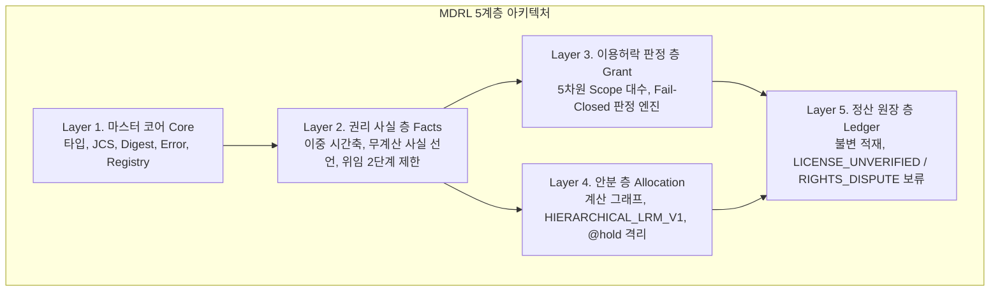

# MDRL (Music Derivative Rights Language) 공식 레퍼런스 북 v1.0
**음악 n차 저작권(권리관계, 이용허락, 수익 배분) 정의 언어 규격 매뉴얼**

> 적용 범위: 1~7장은 공통 언어의 개념·목표 규격을 포함한다. 모든 문법·프로파일 확장이 현재 플랫폼에서 실행되는 것은 아니다. 현재 공개 호출 계약은 8장, 플랫폼 연결의 후속 기준은 Grant·프로파일 통합 설계 베이스라인을 따른다.

---

## 목차 (Table of Contents)

- [1. 개요 및 계층 구조 아키텍처](#1-개요-및-계층-구조-아키텍처)
  - [1.1 언어의 목적 및 핵심 철학](#11-언어의-목적-및-핵심-철학)
  - [1.2 계층 구조 아키텍처 (5개 층)](#12-계층-구조-아키텍처-5개-층)
  - [1.3 텍스트 문법과 중간 표현(IR)의 이중 구조](#13-텍스트-문법과-중간-표현ir의-이중-구조)
- [2. 마스터 코어 (Master Core) 규격](#2-마스터-코어-master-core-규격)
  - [2.1 타입 시스템 (Type System)](#21-타입-시스템-type-system)
  - [2.2 문서 머리부 (Envelope Header)](#22-문서-머리부-envelope-header)
  - [2.3 공개 등급과 커밋먼트 (Visibility & Commitments)](#23-공개-등급과-커밋먼트-visibility--commitments)
  - [2.4 JCS 정규화 및 해시 검증 사슬 (Digest Chain)](#24-jcs-정규화-및-해시-검증-사슬-digest-chain)
  - [2.5 표준 오류 코드 규약 (Error Codes)](#25-표준-오류-코드-규약-error-codes)
  - [2.6 확장점 레지스트리 (Extension Registry)](#26-확장점-레지스트리-extension-registry)
- [3. 권리 사실 층 (Facts Layer)](#3-권리-사실-층-facts-layer)
  - [3.1 추상 모델 및 이중 시간축](#31-추상-모델-및-이중-시간축)
  - [3.2 사실 확인 불변식 (Invariants)](#32-사실-확인-불변식-invariants)
  - [3.3 표면 텍스트 문법 (EBNF)](#33-표면-텍스트-문법-ebnf)
  - [3.4 중간 표현(IR) 스키마 및 예시](#34-중간-표현ir-스키마-및-예시)
- [4. 이용허락 판정 층 (Grant Decision Layer)](#4-이용허락-판정-층-grant-decision-layer)
  - [4.1 5차원 범위 대수 (Scope Algebra)](#41-5차원-범위-대수-scope-algebra)
  - [4.2 불확실 시 거부 원칙 (Fail-Closed Decision)](#42-불확실-시-거부-원칙-fail-closed-decision)
  - [4.3 표면 텍스트 문법 (EBNF)](#43-표면-텍스트-문법-ebnf)
  - [4.4 중간 표현(IR) 스키마 및 판정 출력](#44-중간-표현ir-스키마-및-판정-출력)
- [5. 안분 층 (Allocation Layer)](#5-안분-층-allocation-layer)
  - [5.1 결정적 계층 안분 (HIERARCHICAL_LRM_V1)](#51-결정적-계층-안분-hierarchical_lrm_v1)
  - [5.2 분쟁 시 그룹 보류 (@hold) 및 격리](#52-분쟁-시-그룹-보류-hold-및-격리)
  - [5.3 표면 텍스트 문법 (EBNF)](#53-표면-텍스트-문법-ebnf)
  - [5.4 중간 표현(IR) 스키마 및 평가 계약](#54-중간-표현ir-스키마-및-평가-계약)
- [6. 정산 원장 층 (Ledger Layer)](#6-정산-원장-층-ledger-layer)
  - [6.1 불변 적재 접점 (Ledger Ingestion)](#61-불변-적재-접점-ledger-ingestion)
  - [6.2 보류 사유 및 소급 재계산 워크플로](#62-보류-사유-및-소급-재계산-워크플로)
  - [6.3 역분개 및 차액 (Reversals & Deltas)](#63-역분개-및-차액-reversals--deltas)
- [7. 프로파일 레지스트리 및 예시](#7-프로파일-레지스트리-및-예시)
  - [7.1 프로파일 작성 규칙](#71-프로파일-작성-규칙)
  - [7.2 프로파일 1: 보컬 트랙 조합 (Vocal Combination)](#72-프로파일-1-보컬-트랙-조합-vocal-combination)
  - [7.3 프로파일 2: AI 믹스 & 보이스 (AI Mix & Voice)](#73-프로파일-2-ai-믹스--보이스-ai-mix--voice)
- [8. 레퍼런스 구현체 공개 API 계약](#8-레퍼런스-구현체-공개-api-계약)

---

## 1. 개요 및 계층 구조 아키텍처

### 1.1 언어의 목적 및 핵심 철학
**MDRL(Music Derivative Rights Language)**은 원곡 저작물(Work), 녹음물(Recording), 음성(Voice), 스템(Stem)을 바탕으로 파생되는 n차 창작(리믹스, 샘플링, 보컬 조합, AI 음악 등)에서 발생하는 **복잡한 다자간 권리 관계를 명문화하고, 이용허락을 결정적으로 판정하며, 정산 금액을 1원 오차 없이 배분**하기 위한 독립형 외부 DSL(Standalone External DSL)입니다.

#### 핵심 철학
1. **계산식과 사실의 엄격한 분리**: 사실 문서(Facts)에는 어떠한 정산 공식도 두지 않으며 순수 권리 선언만을 담습니다.
2. **범위의 불가역적 축소 (Narrowing Only)**: 파생 단계가 깊어질수록 허락 범위는 교집합으로만 좁아지며, 무단 확장은 원천 차단됩니다.
3. **결정적 금액 보존 (Conservation of Value)**: 부동소수점을 전면 배제하고 기약 유리수와 계층적 최대 잔여 방식을 통해 분배 총합이 매출 총액과 정확히 일치함을 보장합니다.
4. **암호학적 무결성 검증 사슬**: RFC 8785(JCS) 정규화와 SHA-256 해시를 통해 제3자가 완전히 동일한 결과(`result_digest`)를 재현하여 검증할 수 있습니다.

---

### 1.2 계층 구조 아키텍처 (5개 층)



| 층 (Layer) | 주요 역할 | 정본 형식 | 의존 순위 (MODULE_RANK) |
| :--- | :--- | :--- | :--- |
| **마스터 코어 (Core)** | 공통 타입 시스템, 엔벨로프, JCS, 오류 규약, 확장점 관리 | 규격 정의 | 0 |
| **권리 사실 층 (Facts)** | 당사자, 자산, 기여(Claim), 위임(Mandate) 관계의 불변 기록 | `module: "facts"` | 1 |
| **이용허락 판정 층 (Grant)** | 5차원 Scope 교집합 기반 허락 판정 및 의무 누적 | `module: "grant"` | 2 |
| **안분 층 (Allocation)** | 매출 이벤트를 역할별/당사자별로 결정적 안분 | `module: "allocation"` | 4 |
| **정산 원장 층 (Ledger)** | 불변 라인 적재, 분쟁/미허락 보류 계정 관리, 소급 역분개 | 원장 접점 | - |

---

### 1.3 텍스트 문법과 중간 표현(IR)의 이중 구조
모든 MDRL 문서는 **사람이 읽고 편집하기 쉬운 표면 텍스트 문서(Surface Text)**와 **시스템이 평가하고 해시를 고정하는 정본인 JSON 중간 표현(Intermediate Representation, IR)**의 1:1 대응 관계를 가집니다.


---

## 2. 마스터 코어 (Master Core) 규격

### 2.1 타입 시스템 (Type System)

| 타입 (Type) | 정의 | 표면 텍스트 문법 | 중간 표현(IR) 불변식 |
| :--- | :--- | :--- | :--- |
| `Bps` | 0 이상 10000 이하의 정수 (만분율) | `25%`, `25.5%`, `500bps` | 정수 문자열 (예: `"2500"`) |
| `Ratio` | 기약 유리수 $\frac{n}{d}$ | `1/4`, `40%`, `6000bps` | 기약 유리수 문자열 `"n/d"` (부동소수점 금지) |
| `Money<C>` | 통화 C의 최소 단위 큰 정수 | `10000 KRW` | 최소 단위 정수 문자열 `"10000"` |
| `Instant` | UTC 기준 ISO 8601 타임스탬프 | `2026-01-01T00:00:00.000Z` | 밀리초 정밀도 UTC 문자열 |
| `Interval` | 반열린 시간 구간 $[from, to)$ | `[from, to)`, `[from, )` | `{ from: Instant, to?: Instant }` ($from < to$) |
| `Ref<T>` | 버전 명시 문서/엔티티 참조 | `work-facts-01@1` | `rl:<module>/<id>@<version>` 형식 |
| `PartyVector` | 역할별 당사자 지분 벡터 | `graph(WORK_AUTHOR)` | `Map<PartyId, Ratio>`, 합산은 항상 1 |
| `Scope` | 5차원 이용 허락 경계 | `{ actions, territories, ... }` | 5개 필드 완비 객체 |

---

### 2.2 문서 머리부 (Envelope Header)

모든 MDRL 문서는 최상위에 다음 공통 Envelope 필드를 가집니다:

```json
{
  "mdrl": "1.0",
  "module": "facts | grant | allocation",
  "id": "DOC-IDENTIFIER-01",
  "version": "1",
  "depends_on": [
    {
      "ref": "rl:facts/base-facts-01@1",
      "digest": "mdrl:sha256:c298f06c54947a4874935de562f47bff43aa491d784233f117e80a5eac3fffdd"
    }
  ],
  "visibility_default": "PUBLIC | PARTIES | PRIVATE",
  "body": { ... }
}
```

- **규칙 1 (불변성)**: 발행된 `(id, version)`의 내용은 수정될 수 없으며, 변경 시 버전을 올려야 합니다.
- **규칙 2 (단방향 의존)**: `depends_on`은 항상 의존 순위(`MODULE_RANK`)가 낮은 모듈만 참조할 수 있습니다 (`allocation` $\rightarrow$ `grant` $\rightarrow$ `facts`).

---

### 2.3 공개 등급과 커밋먼트 (Visibility & Commitments)

1. `PUBLIC`: 누구나 원문을 열람 가능 (자산 식별자, 엔티티 존재 등).
2. `PARTIES`: 계약 당사자만 원문을 열람 가능 (비율, 금액, 지분). 비당사자 공개본에는 해시 커밋먼트(`commit`)로 치환.
3. `PRIVATE`: 발행자만 원문 열람 가능. 비공개 당사자는 식별자와 kind만 남기고 커밋먼트 처리.

---

### 2.4 JCS 정규화 및 해시 검증 사슬 (Digest Chain)

해시 요약값은 다음 표준 절차로 산출됩니다:
1. 중간 표현(IR)을 **RFC 8785 (JSON Canonicalization Scheme, JCS)**에 따라 정규화.
2. 정규화된 바이트에 **SHA-256** 해시를 적용.
3. 접두사 `mdrl:sha256:`를 붙인 64자리 16진수 문자열 생성.

$$\text{digest} = \text{"mdrl:sha256:"} + \text{SHA256}(\text{JCS}(\text{IR}))$$

---

### 2.5 표준 오류 코드 규약 (Error Codes)

| 접두사 | 대상 계층 | 주요 오류 코드 |
| :--- | :--- | :--- |
| `CORE_*` | 마스터 코어 | `CORE_TYPE_ERROR`, `CORE_NUMBER_IN_IR`, `CORE_ENUM_UNKNOWN`, `CORE_UNKNOWN_REF`, `CORE_DEP_DIRECTION`, `CORE_DIGEST_MISMATCH`, `CORE_SOD_VIOLATION` |
| `FACTS_*` | 권리 사실 층 | `FACTS_DUPLICATE_ID`, `FACTS_UNKNOWN_ENTITY`, `FACTS_UNKNOWN_PARTY`, `FACTS_EDGE_KIND`, `FACTS_SUM_MISMATCH`, `FACTS_CYCLE`, `FACTS_MANDATE_DEPTH`, `FACTS_DISPUTE_OPEN` |
| `GRANT_*` | 이용허락 판정 층 | `GRANT_SCOPE_WIDENING`, `GRANT_REQUIREMENT_UNMET`, `GRANT_REVOKED`, `GRANT_OBLIGATION_VIOLATED`, `GRANT_CONFLICT`, `GRANT_NO_EVIDENCE`, `GRANT_UNSUPPORTED` |
| `ALLOC_*` | 안분 층 | `ALLOC_SUM_MISMATCH`, `ALLOC_WEIGHT_MISMATCH`, `ALLOC_DUPLICATE_NAME`, `ALLOC_UNCOVERED_CLAIMANT`, `ALLOC_SCOPE_MISMATCH`, `ALLOC_EMPTY_VECTOR`, `ALLOC_ROUNDING_INVARIANT` |
| `REV_*` | 정산 원장/역분개 | `REV_ORIGINAL_DIGEST`, `REV_ORIGINAL_INCONSISTENT`, `REV_UNKNOWN_EVENT`, `REV_CHAIN_BROKEN`, `REV_EXCEEDS_REMAINING`, `REV_AMOUNT` |
| `PARSE_*` | 텍스트 파서 | `PARSE_SYNTAX`, `PARSE_ROLE_REQUIRED`, `PARSE_UNSUPPORTED` |

---

### 2.6 확장점 레지스트리 (Extension Registry)

마스터 코어는 불변으로 유지되며, 응용 도메인은 다음 10개 확장점에 어휘를 등록합니다:
1. `asset_kind`: 자산 종류 (`work`, `recording`, `voice`, `stem`, `mix_session`, `model_run`)
2. `edge_kind`: 관계 종류 (`WRITTEN_BY`, `PERFORMED_BY`, `OWNED_BY`, `CONTROLLED_BY`, `MIXED_BY`)
3. `claimant_role`: 청구권 역할 (`MASTER_OWNER`, `WORK_AUTHOR`, `CMO`, `PERFORMER_FEATURED`, `MIX_ENGINEER`, `MODEL_PROVIDER`)
4. `party_kind`: 당사자 유형 (`LABEL`, `PERFORMER`, `AUTHOR`, `PUBLISHER`, `CMO`, `AI_PROVIDER`, `AGENCY`)
5. `mandate_right`: 위임 권리 종류 (`MASTER`, `WORK`, `PERFORMER`)
6. `usage_metric`: 사용량 측정 지표 (`ASSIGNED_LAYER_MS`, `SESSION_FIXED`, `GAIN_WEIGHTED_MS`)
7. `vector_fn`: 안분 벡터 함수 (`graph`, `contract`, `member_pct`, `performance_pool`, `mix`, `model_share`)
8. `event_type`: 수익 이벤트 유형 (`PRIMARY`, `RESALE`, `TRAFFIC`, `SUBSCRIPTION_SHARE`)
9. `holding_reason`: 보류 사유 (`RIGHTS_DISPUTE`, `LICENSE_UNVERIFIED`, `FRAUD_REVIEW`)
10. `action`: 허락 행위 (`PREVIEW`, `COMBINE`, `COMMERCIAL`, `DOWNLOAD`, `AI_TRAIN`, `AI_GENERATE`)

---

## 3. 권리 사실 층 (Facts Layer)

### 3.1 추상 모델 및 이중 시간축
권리 사실 문서는 누가 어떤 자산에 어떤 자격으로 지분을 가지는지를 선언하는 그래프 모델입니다.
- **효력 시점 (`as_of`)**: 권리가 법적으로 유효한 시점 (`valid: [from, to)`).
- **인지 시점 (`known_at`)**: 시스템에 해당 사실이 등록/기록된 시점 (`recorded_at`).

### 3.2 사실 확인 불변식 (Invariants)
1. **지분 보존 (`FACTS_SUM_MISMATCH`)**: 동일 자산/동일 관계 그룹의 유효 지분 합은 항상 10000bps(100%)여야 합니다.
2. **위임 단계 제한 (`FACTS_MANDATE_DEPTH`)**: 관리 위임은 최대 2단계(2 hops)까지만 허용됩니다 ($A \rightarrow B \rightarrow C$).
3. **위임 순환 금지 (`FACTS_CYCLE`)**: 위임 경로 상 순환이 없어야 합니다.
4. **분쟁 팩 활성화 금지 (`FACTS_DISPUTE_OPEN`)**: 분쟁(`DISPUTED`) 상태의 권리가 포함된 파생 팩은 활성화할 수 없습니다.

### 3.3 표면 텍스트 문법 (EBNF)

```ebnf
program        = "facts" id "version" int "{" { facts_stmt } "}" EOF ;
facts_stmt     = party_stmt | work_stmt | recording_stmt | voice_stmt | stem_stmt | claim_stmt | mandate_stmt ;

party_stmt     = "party" id "{" "kind" ":" ident ";" [ ids_block ] [ visibility_stmt ] "}" ;
work_stmt      = "work" id "{" [ ids_block ] "}" ;
recording_stmt = "recording" id "{" "of" ":" id ";" [ ids_block ] "}" ;
voice_stmt     = "voice" id "{" "kind" ":" ident ";" "}" ;
stem_stmt      = "stem" id "{" "of" ":" id ";" "slot" ":" id ";" "rights_bearing" ":" boolean ";" "}" ;

claim_stmt     = "claim" id ":" id ident id "share" ratio [ "role" ident ] [ "detail" string ] "status" ident "valid" interval "recorded" instant [ "superseded" instant ] [ "evidence" string ] [ "visibility" ident ] ";" ;

mandate_stmt   = "mandate" id ":" id "->" id "right" ident "share" ratio "status" ident "valid" interval "recorded" instant [ "superseded" instant ] [ "visibility" ident ] ";" ;
```

### 3.4 예시: 표면 텍스트 및 컴파일된 IR

#### Surface Text (`work-facts-01.facts`)
```mdrl
facts "work-facts-01" version 1 {
  party pty_author_a { kind: AUTHOR; ids: { KOMCA: "W001" }; }
  party pty_author_b { kind: AUTHOR; }
  party pty_cmo { kind: CMO; }

  work ast_work_1 { ids: { ISWC: "T-000.001-0" }; }

  claim c1: ast_work_1 WRITTEN_BY pty_author_a share 60% status VERIFIED valid [2026-01-01T00:00:00.000Z, ) recorded 2026-01-01T00:00:00.000Z;
  claim c2: ast_work_1 WRITTEN_BY pty_author_b share 40% status VERIFIED valid [2026-01-01T00:00:00.000Z, ) recorded 2026-01-01T00:00:00.000Z;

  mandate m1: pty_author_b -> pty_cmo right WORK share 100% status VERIFIED valid [2026-01-01T00:00:00.000Z, ) recorded 2026-01-01T00:00:00.000Z;
}
```

---

## 4. 이용허락 판정 층 (Grant Decision Layer)

### 4.1 5차원 범위 대수 (Scope Algebra)
범위(Scope)는 $S = (A, R, M, P, U)$의 5개 차원으로 정의됩니다:
- $A$ (`actions`): 행위 집합 (예: `COMBINE`, `COMMERCIAL`, `AI_GENERATE`)
- $R$ (`territories`): 지역 집합 (예: `KR`, `US`, `JP`, `GLOBAL`)
- $M$ (`media`): 매체 집합 (예: `APP`, `STREAM`, `BROADCAST`)
- $P$ (`period`): 유효 기간 반열린 구간 $[from, to)$
- $U$ (`audience`): 대상 청중 집합 (예: `PUBLIC`, `COMMERCIAL`, `PERSONAL`)

#### 범위의 합성 (Meet, $\sqcap$)
두 범위의 합성은 오직 **교집합(Narrowing)** 연산만 허용됩니다:

$$S \sqcap T = (A_S \cap A_T, \; R_S \cap R_T, \; M_S \cap M_T, \; P_S \cap P_T, \; U_S \cap U_T)$$

- **범위 확대 금지 불변식**: 하위 파생 조항이 상위 조항을 초과하는 범위($\text{Child} \not\sqsubseteq \text{Parent}$)를 지정할 경우 즉시 `GRANT_SCOPE_WIDENING` 오류로 판정 거부됩니다.

---

### 4.2 불확실 시 거부 원칙 (Fail-Closed Decision)

이용허락 평가기(`evaluateGrant`)는 다음 4가지 결과 중 하나를 결정적으로 반환합니다:
1. `PERMIT`: 모든 요구사항이 검증된 허락 범위 내에 온전히 포함됨.
2. `PERMIT_WITH_OBLIGATION`: 허락되나 출처 표시(`ATTRIBUTION`) 등의 필수 의무가 수반됨.
3. `DENY`: 요구사항 미충족, 범위 초과(`GRANT_SCOPE_WIDENING`), 증빙 부재(`GRANT_NO_EVIDENCE`), 철회(`GRANT_REVOKED`) 상태.
4. `REVIEW_REQUIRED`: 권리가 분쟁(`DISPUTED`) 상태이거나 상충함.

> [!IMPORTANT]
> 판정 결과가 `DENY` 또는 `REVIEW_REQUIRED`인 이용에 대한 정산 결과는 정산 원장(Ledger)에서 자동으로 **`LICENSE_UNVERIFIED` 보류 계정**으로 전액 격리 적재됩니다.

---

### 4.3 표면 텍스트 문법 (EBNF)

```ebnf
program         = "grant" id "version" int "{" { grant_rule_stmt } "}" EOF ;
grant_rule_stmt = "rule" id "{" 
                    "grantor" ":" id ";" 
                    [ "grantee" ":" id ";" ]
                    "asset" ":" id ";"
                    "right" ":" ident ";"
                    "scope" ":" scope_block ";"
                    [ "obligations" ":" "[" [ ident { "," ident } ] "]" ";" ]
                    "status" ":" ident ";"
                    "valid" ":" interval ";"
                    "recorded" ":" instant ";"
                  "}" ;

scope_block     = "{"
                    "actions" ":" "[" [ ident { "," ident } ] "]" ";"
                    "territories" ":" "[" [ ident { "," ident } ] "]" ";"
                    "media" ":" "[" [ ident { "," ident } ] "]" ";"
                    "period" ":" interval ";"
                    "audience" ":" "[" [ ident { "," ident } ] "]" ";"
                  "}" ;
```

### 4.4 예시: 표면 텍스트 (`license-master-01.grant`)

```mdrl
grant "GRANT-MASTER-01" version 1 {
  rule rule_01 {
    grantor: pty_label_x;
    grantee: pty_platform;
    asset: rcd_01;
    right: MASTER;
    scope: {
      actions: [COMBINE, PREVIEW, DOWNLOAD, COMMERCIAL];
      territories: [KR, US, JP];
      media: [APP, STREAM];
      period: [2026-01-01T00:00:00.000Z, 2027-01-01T00:00:00.000Z);
      audience: [PUBLIC, COMMERCIAL];
    };
    obligations: [ATTRIBUTION];
    status: VERIFIED;
    valid: [2026-01-01T00:00:00.000Z, 2027-01-01T00:00:00.000Z);
    recorded: 2026-01-01T00:00:00.000Z;
  }
}
```

---

## 5. 안분 층 (Allocation Layer)

### 5.1 결정적 계층 안분 (HIERARCHICAL_LRM_V1)
정산 금액 안분 시 부동소수점 오차로 인한 금액 누출을 방지하기 위해 **기약 유리수 기반 계층적 최대 잔여 방식(Hierarchical Largest Remainder Method)**을 사용합니다.
- 각 분할 층(Tier 1, Tier 2)의 몫을 정수 단위로 내림(floor) 계산.
- 남은 잔여 1원들은 소수점 잔여 가중치가 큰 순서(동률 시 `tie` 규칙 적용: `party_id_asc`)대로 1원씩 배분.
- 상위 풀 금액의 합은 1원 단위까지 완벽하게 보존됩니다 ($\sum \text{Allocated} = \text{Total}$).

### 5.2 분쟁 시 그룹 보류 (@hold) 및 격리
권리 주장이나 위임 관계에 `DISPUTED`가 발생하면, 타인의 지분을 재정규화(Renormalization)하여 왜곡하지 않고, **해당 분쟁 그룹의 지분만을 `@hold` 키로 격리**하여 정산 원장의 `RIGHTS_DISPUTE` 보류 계정으로 적재합니다.

---

### 5.3 표면 텍스트 문법 (EBNF)

```ebnf
allocation_doc  = "allocation" id "version" int "{" alloc_body "}" ;
alloc_body      = [ visibility_stmt ] uses_stmt+ scope_stmt bind_stmt layer_stmt+ [ guard_stmt ] [ exceptions_stmt ] rounding_stmt ;

uses_stmt       = "uses" "facts" id "@" int "digest" string ";" ;
scope_stmt      = "scope" "{" scope_field+ "}" ;
bind_stmt       = "bind" "{" "time" ":" ident ";" "}" ;

layer_stmt      = ( "tier1" "{" { ident "=" ratio ";" } "}" )
                | ( "tier2" ident "{" "split" "{" { bucket_stmt } "}" "}" ) ;

bucket_stmt     = ident "=" vector_expr ":" ratio [ "as" ident ] ";" ;
vector_expr     = primary_expr { "|>" ( "cap" "(" ratio ")" | "floor_guarantee" "(" ratio ")" ) } ;
primary_expr    = "graph" "(" ident ")" [ "via" "mandate" ]
                | "contract" "(" id ")"
                | "member_pct" "(" ")"
                | "performance_pool" "(" ident { "," ident ":" ratio } ")"
                | "mix" "(" ratio ":" vector_expr { "," ratio ":" vector_expr } ")"
                | "model_share" "(" [ id ] ")" ;

rounding_stmt   = "rounding" "{" "method" ":" ident ";" "tie" ":" ident ";" "}" ;
```

### 5.4 예시: 표면 텍스트 (`policy-default-01.alloc`)

```mdrl
allocation "ALLOC-DEFAULT-01" version 1 {
  visibility default: PARTIES;
  uses facts "work-facts-01"@1 digest "mdrl:sha256:c298f06c54947a4874935de562f47bff43aa491d784233f117e80a5eac3fffdd";
  
  scope { pack: pack_demo_01; events: [PRIMARY, RESALE]; currency: KRW; }
  bind { time: ISSUE_TIME; }

  tier1 {
    platform = 25%;
    ops = 500bps;
    rights = 70%;
  }

  tier2 rights {
    split {
      master = graph(MASTER_OWNER) : 45%;
      performer = performance_pool(USAGE_WEIGHTED, featured_weight: 70%) : 45%;
      work = graph(WORK_AUTHOR) via mandate : 10%;
    }
  }

  rounding { method: HIERARCHICAL_LRM_V1; tie: party_id_asc; }
}
```

---

## 6. 정산 원장 층 (Ledger Layer)

### 6.1 불변 적재 접점 (Ledger Ingestion)
안분 평가기(`evaluate`)가 출력한 결과 IR은 수정 없이 원장에 적재됩니다:
- **원장 고유 복합 키**: `(run_id, event_id, party_id, role, bucket, line_seq)`
- **무결성 참조 키**: `(run_id, result_digest)`

### 6.2 보류 사유 및 소급 재계산 워크플로
원장에 적재되는 보류 사유(`holding_reason`)는 다음 3가지 표준 값을 가집니다:
1. `RIGHTS_DISPUTE`: 사실 문서 내 지분 분쟁(`DISPUTED`)에 따른 `@hold` 격리 금액.
2. `LICENSE_UNVERIFIED`: 이용허락 판정이 `DENY` 또는 `REVIEW_REQUIRED`인 이용 건에 대한 전액 보류.
3. `FRAUD_REVIEW`: 부정 이용 의심(`integrity = FLAGGED`) 거래에 대한 지급 보류.

새로운 사실 문서 버전(`facts@v+1`)이 등록되면, 기존 원장 기록을 수정하지 않고 **새로운 `run_id`로 재계산한 결과를 추가 적재**하여 이전 결과와의 차액(Delta) 및 역분개 라인을 도출합니다.

---

## 7. 프로파일 레지스트리 및 예시

### 7.1 프로파일 작성 규칙
각 도메인 프로파일은 마스터 코어의 10대 확장점에 값을 바인딩하여 정의됩니다.

### 7.2 프로파일 1: 보컬 트랙 조합 (Vocal Combination)
- **자산**: `work`, `recording`, `voice`, `stem`, `slot`, `pack`
- **역할**: `MASTER_OWNER`, `WORK_AUTHOR`, `CMO`, `PERFORMER_FEATURED`, `PERFORMER_NON_FEATURED`, `AGENCY`, `AI_PROVIDER`
- **함수**: `graph(role)[via mandate]`, `performance_pool(mode, ...)`, `member_pct()`

### 7.3 프로파일 2: AI 믹스 & 보이스 (AI Mix & Voice)
- **자산**: `work`, `recording`, `stem_set`, `mix_session`, `model_run`, `voice`
- **역할**: `MASTER_OWNER`, `WORK_AUTHOR`, `CMO`, `MIX_ENGINEER`, `MODEL_PROVIDER`, `AI_PROVIDER`
- **함수**: `graph`, `contract`, `model_share(run)`
- **행위**: `AI_TRAIN`, `AI_GENERATE`, `MODEL_INFER`

---

## 8. 레퍼런스 구현체 공개 API 계약

- 기준: workspace 패키지 `mdrl@0.1.0`, Node.js 24 이상, ESM.
- 이 장은 현재 실행 계약이다. 앞 장의 범용 언어 설계와 플랫폼 구현 범위는 [기준 관리 원칙](../00_프로젝트_개요/문서_기준과_구현계약.md)으로 구분한다.
- `@rights-dsl/mdrl` 또는 패키지 루트 `mdrl` import는 제공하지 않는다.

| import 경로 | 공개 기능 |
|---|---|
| `mdrl/core` | digest, Scope·시간·기본 타입 검증 |
| `mdrl/facts` | Facts 검증, `projectToIr` |
| `mdrl/text` | Facts·Grant·Allocation parse/compile/format |
| `mdrl/grant` | `evaluateGrant`, Grant 입력·출력 타입, 검증 함수 |
| `mdrl/allocation` | `evaluate`, `verifyAllocationResult`, 결과 타입 |
| `mdrl/profiles` | `ProfileRegistry`, 보컬 조합·AI 믹스 정의 |
| `mdrl/spec/*` | 배포된 문법·스키마 파일 |

### 8.1 입력·출력 규칙

- `compileFacts`, `compileGrant`, `compileAllocation`, `projectToIr`, `evaluate`: `ok`를 검사한 뒤 `value`를 사용한다. 실패 시 `errors`를 처리한다.
- `projectToIr(facts, usage, asOf, knownAt)`: 사용량은 스템 ID별 밀리초 정수 문자열이다.
- `evaluate({ policy, facts, projection, snapshot, events, runId })`: 모든 필드를 전달한다. 시점은 projection에 포함되며 evaluate에 직접 전달하지 않는다.
- `snapshot`: `{ members: { partyId: "n/d" } }` 형식. 합계 등 상세 제약은 검증기를 적용한다.
- RevenueEvent: `id`, `type`, `amount`, `currency`, `integrity` 필수. 금액은 정수 문자열이다.
- `evaluateGrant({ requirements, grants, as_of, known_at })`: 직접 `GrantDecisionOutput`을 반환한다. Allocation Result 래퍼와 혼동하지 않는다.
- Grant의 구조 검증, 수권 근거 확인, grantee 적합성, 공동권리자 커버리지를 호출자가 보장해야 한다. 현재 Grant 평가기만으로 업무 승인을 완결하지 않는다.
- `mdrl/profiles` import는 기본 정의를 등록한다. 등록이 파서·평가기 확장 또는 플랫폼 사용 승인을 의미하지 않는다.
- CLI의 compile/evaluate는 현재 Allocation 중심이다. 라이브러리의 Grant API와 CLI 지원 범위를 동일시하지 않는다.

### 8.2 실행 가능한 예제

[공개 API 예제](../06_MVP/dobedupop/packages/mdrl/samples/public-api.mjs)는 저장소의 적합성 데이터를 사용해 컴파일 → 조합 지분 → 정산 → 재검증을 실행한다. 별도의 Grant 예제는 허락 누락 시 DENY를 확인한다. 이는 독립 API 예제이며 Grant를 통과한 서비스 발행 흐름이 아니다.

```bash
cd 06_MVP/dobedupop
npm run build -w mdrl
node packages/mdrl/samples/public-api.mjs
```

핵심 호출은 다음과 같다. 전체 입력 로딩·오류 처리는 링크된 실행 파일에 포함한다.

```javascript
import { projectToIr } from "mdrl/facts";
import { evaluate } from "mdrl/allocation";
import { evaluateGrant } from "mdrl/grant";
import { ProfileRegistry } from "mdrl/profiles";

// facts·usage·policy·snapshot·events·runId는 호출자가 준비한다.
const projectionResult = projectToIr(facts, usage, asOf, knownAt);
if (!projectionResult.ok) throw new Error(JSON.stringify(projectionResult.errors));
const result = evaluate({ policy, facts, projection: projectionResult.value, snapshot, events, runId });
if (!result.ok) throw new Error(JSON.stringify(result.errors));
console.log(result.value.result_digest);
```

### 8.3 배포 계약 검증

- `npm run smoke -w mdrl`: tarball 설치 후 공개 진입점 import, Grant 누락 거부, 프로파일 조회, 타입 선언 소비, Allocation 결과 digest, CLI verify를 검증한다.
- smoke가 빌드 산출물을 정리하므로 이후 서버 실행 전 `npm run build -w mdrl`을 실행한다.
- Grant·프로파일의 플랫폼 적용은 [통합 설계 베이스라인](02_구현계획/MDRL_Grant_프로파일_통합설계_베이스라인_v1.0.md)을 따른다. 현재 발행·정산에 연결됐다는 의미는 아니다.
