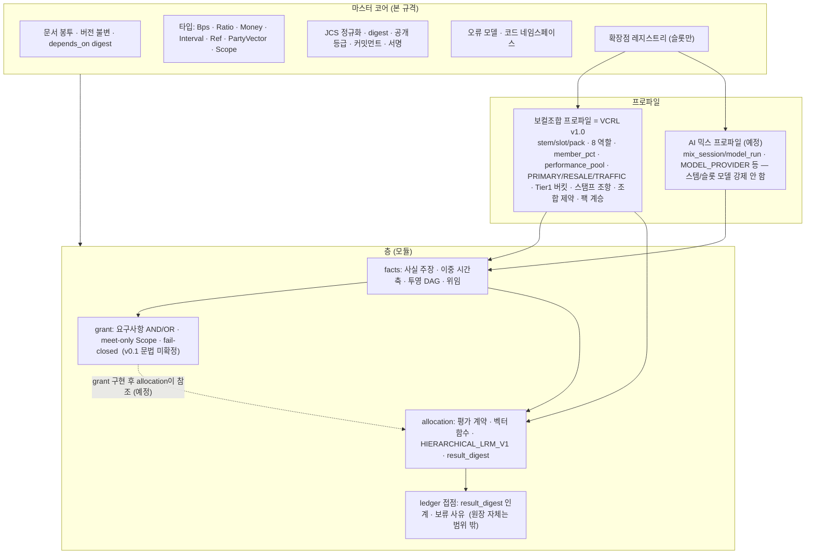

# 2차 이용 권리 관리 언어 마스터 규격

| 항목 | 내용 |
|---|---|
| **문서명** | 2차 이용 권리 관리 언어 마스터 규격 (Secondary-Use Rights Language Master Specification, 영문 약칭 가칭 **SURL** [확인 필요: 명칭 확정]) |
| **버전** | v0.1 (초안) |
| **작성일** | 2026-09-29 |
| **문서 지위** | **마스터 규격**. 1차 음악 저작권·저작인접권 위에서 성립하는 n차 창작 이용의 권리 사실·이용허락·안분·정산 접점을 기술하는 언어 패밀리의 공통 코어와 확장점을 정한다. **VCRL v1.0(Vocal Combination Rights Language)은 본 규격의 첫 응용 프로파일("보컬조합 프로파일")이며, `03_구현문서_코드/vcrl`는 그 레퍼런스 프로토타입이다.** |
| **상위 문서** | 없음(최상위). 사업 배경은 `01_기획문서/보컬조합_사업기획서_v1.15_20260922.docx`를 참조한다. |
| **하위 문서** | (프로파일 규격) `02_설계문서/VCRL_보컬조합권리언어/VCRL_아키텍처_코어규격_설계_v1.0.md` — 보컬조합 프로파일 정본. (구현) `03_구현문서_코드/vcrl` — 프로파일의 레퍼런스 구현과 적합성 스위트. (기획 설계) `02_설계문서/권리정산인프라_20260927/보컬조합_권리관리_정산인프라_기획설계_v1.0.md`. (데이터 모델) `02_설계문서/데이터모델_v2.7.md`. |
| **우선순위 규칙** | ① 마스터 규격(본 문서) > ② 프로파일 규격(VCRL v1.0) > ③ 구현(`03_구현문서_코드/vcrl`) > ④ 기획 설계·데이터모델 > ⑤ 선행 설계 문서(`Stem2Work그래프_정산DSL_설계.md`, `안분정책_AllocationPolicy_설계.md`, `안분정책_Stem2Work그래프_정산DSL_통합요약.md`). 단, **보컬조합 프로파일의 제품 어휘·정본 결정(VCRL §9의 14개 결정)은 프로파일 층에서 유효하며 마스터가 이를 뒤집지 않는다.** 마스터는 프로파일이 채울 수 있는 것과 채울 수 없는 것(코어 불변식)만 정한다. 상세는 4.4절. |
| **규범 표기** | "~해야 한다"(MUST), "~해서는 안 된다"(MUST NOT), "~할 수 있다"(MAY)로 쓴다. 규범 문장은 **[N-번호]** 로 번호를 붙인다. 각 개념에는 **구현 검증됨**(VCRL 프로토타입 `03_구현문서_코드/vcrl`에 코드와 테스트가 있음) 또는 **규격만**(문장은 있으나 구현·테스트가 없음)을 표시한다. |
| **예시 값 규칙** | 본 문서의 모든 비율·금액·식별자는 **예시 값**이며 계약 값·규격 값이 아니다(VCRL §9 결정 12 계승). |
| **범위 밖 표시** | 본 v0.1에서 문법을 확정하지 않은 항목은 "v0.1 범위 밖"으로 표시한다. |

---

## 목차

1. 음악산업의 권리 관리 현황 및 이슈
2. 다양한 n차 창작에서의 권리관리 문제점
3. 2차 이용 권리 관리 언어 규격의 필요성
4. 설계 목표 및 방향
5. 핵심 개념 (특허적 요소)
6. DSL 구조 및 설계
7. 시스템 구현
8. 응용분야 및 권리 문제 해소 효과
- 부록 A. 용어집
- 부록 B. 참조 문서 목록
- 부록 C. 외부 출처 목록
- 부록 D. 변경 이력

---

## 1. 음악산업의 권리 관리 현황 및 이슈

이 장은 본 규격이 전제로 삼는 1차 권리 구조와, 그 위에서 반복적으로 관찰되는 문제를 정리한다. 수치는 1차 출처에서 확인된 것만 쓰고, 확인되지 않은 것은 정성적으로 기술한다.

### 1.1 1차 권리의 구조

한 곡의 음원에는 서로 다른 법적 근거를 가진 권리가 겹친다. 국내 저작권법 기준으로 다음 세 층으로 나눈다.

| 층 | 권리 | 주체 | 비고 |
|---|---|---|---|
| 저작권(작품) | 저작재산권(복제·공연·공중송신·배포·2차적저작물작성 등), 저작인격권(성명표시·동일성유지) | 작사·작곡·편곡자, 음악출판사 | 신탁곡은 신탁관리단체가 재산권을 관리한다 |
| 저작인접권(실연) | 실연자의 복제·배포·전송권 등과 방송·디지털음성송신 보상청구권, 실연자 인격권 | 주실연자(피처드), 부실연자(코러스·세션) | 부실연자는 buy-out 관행과 별개로 인접권이 존속한다 |
| 저작인접권(음반) | 음반제작자의 복제·배포·전송권, 보상청구권 | 음반제작사·레이블(마스터 권리자) | 멀티트랙·스템 파일은 마스터의 구성요소다 |

2차적저작물에 대해서는 저작권법 제5조가 "원저작물을 번역·편곡·변형·각색·영상제작 그 밖의 방법으로 작성한 창작물"을 독자적 저작물로 보호하되 원저작자의 권리에 영향을 미치지 않는다고 정하고, 제22조가 2차적저작물작성권을 원저작자의 권리로 둔다. 제46조는 이용허락을 받은 자가 "허락받은 이용 방법 및 조건의 범위 안에서" 이용하도록 하고, 이용권 양도에도 동의를 요구한다(출처: 국가법령정보센터, 부록 C).

이 구조에서 나오는 결론 세 가지는 본 규격 전체의 전제다.

1. **하나의 결과물 = 여러 권리 층의 동시 이용.** 보컬 스템 하나를 바꾸는 행위도 작품(2차적 이용 가능성), 원 녹음(마스터), 원 실연(실연자), 신규 실연(재녹음자)의 허락을 각각 건드린다.
2. **허락은 범위 안에서만 유효하다.** 허락 범위(행위·지역·매체·기간)의 교집합을 벗어난 이용은 별도 허락이 필요하다.
3. **2차적저작물의 성립은 법적 판단이다.** 파일이 만들어졌다는 사실이 새 저작권을 만들지 않는다. 사업기획서 v1.15 §7.4도 "원저작물의 저작권과 저작인접권은 기존 권리자에게 귀속되며, 팬은 저작권자가 아니라 이용권자"라고 정한다.

### 1.2 집중관리(신탁관리) 체계

국내에서 저작권신탁관리업은 저작권법 제105조에 따라 문화체육관광부장관의 허가를 받아야 하며, 신탁관리업자가 이용자로부터 받는 사용료의 요율·금액은 장관의 승인을 받아 정한다(제105조 제9항). 한국저작권위원회가 공개하는 신탁관리단체 규정 목록에는 음악 분야에서 **한국음악저작권협회(KOMCA)**, **함께하는음악저작인협회(KOSCAP, 약칭 함저협)**, **한국음악실연자연합회(FKMP, 음실련)**, **한국음반산업협회(RIAK)** 가 포함되어 있다. 저작권비즈니스지원센터의 권리별 단체 안내는 음악의 전송권을 위 4개 단체가, 공연권을 KOMCA·KOSCAP·FKMP 및 보상금수령단체가 다룬다고 표시한다(부록 C).

해외에서는 작품의 공연권·기계적복제권을 관리하는 PRO/MRO/CMO(예: ASCAP·BMI·PRS·GEMA·JASRAC)와, 미국의 디지털 기계적복제권 포괄 라이선스를 관리하는 The MLC, 디지털 실연 보상금을 분배하는 SoundExchange가 있다. The MLC는 자신의 범위가 미국 적격 디지털 서비스에 대한 포괄 기계적 라이선스이며 공연·동기화·음반 로열티를 다루지 않는다고 명시한다. SoundExchange가 설명하는 미국 법정 디지털 실연 보상금 분배 구조는 음원 권리자 50%, 주실연자 45%, 비주실연자 기금 5%다(출처: 각 기관 공식 페이지, 부록 C; 이 비율은 특정 제도의 사례이며 본 규격의 기본값이 아니다).

집중관리 체계가 본 규격에 주는 함의는 다음과 같다.

- 권리자와 **수령자가 다를 수 있다.** 저작자의 몫을 단체가 수령·분배한다. 이 관계는 권리 사실이 아니라 **위임(mandate)** 사실이다(5.7절).
- **권리 종류·지역·기간별로 관리 주체가 다르다.** 하나의 Boolean(예: `cmo_managed`)으로는 표현되지 않는다(VCRL §4.2, 기획설계 D05).
- 단체 정산은 **보고→매칭→분배 주기**를 가지며, 미매칭·지연 보고가 정상 운영 상태다(1.4절).

### 1.3 식별자와 메타데이터 표준

| 식별자/표준 | 대상 | 관리 | 확인 출처 |
|---|---|---|---|
| ISWC (ISO 15707:2022) | 음악 작품(무형의 창작물). 녹음·악보 등 실현물은 대상이 아님 | 집중관리단체 계열 | ISO |
| ISRC (ISO 3901:2019) | 음원·뮤직비디오 녹음. 상품·패키지 번호 부여에는 쓰지 않음 | IFPI가 국제 등록기관, 국가별 ISRC 에이전시 | ISO, isrc.ifpi.org |
| ISNI | 창작자·법인 등 공적 정체성 | ISNI 등록 에이전시 | 2차 자료(부록 C) |
| IPI | 권리 단체 체계의 이해관계자(작사·작곡·출판사) 번호 | 권리 단체 체계 | 2차 자료(부록 C) |
| CWR | 출판사↔단체 간 작품 등록·개정 파일 표준 | CISAC | CISAC, The MLC |
| DDEX ERN | 발매·리소스(녹음)·거래 조건 통지(레이블/유통사→DSP) | DDEX | DDEX KB |
| DDEX DSR | DSP→권리자 판매·이용 보고(플랫 파일, 프로파일별) | DDEX | DDEX KB |
| DDEX RIN | 녹음 세션 기여자·역할·악기·구성요소 정보 | DDEX | DDEX KB |
| DDEX MEAD | 마케팅용 부가 메타데이터 | DDEX | DDEX KB |

이 표준들은 **사실과 거래를 운반**한다. 어느 것도 "결과물 하나에 참여한 스템의 사용량과 계약 정책으로 금액을 어떻게 나누는가", "이 조합을 이 채널에서 팔아도 되는가"를 판정하지 않는다. VCRL §1.1은 이를 "DDEX 등 표준은 사실·거래 보고를 운반하지만 조합 제약·안분 정책·승인 규칙을 표현하지 못한다"고 정리했다. 본 규격은 이 표준들을 **어댑터 경계**로 두고(6.6절, VCRL §8), 대체하려 하지 않는다.

### 1.4 알려진 문제

#### 1.4.1 메타데이터 결손과 미매칭(블랙박스) 로열티

이용 보고의 녹음 정보가 작품·권리자와 매칭되지 않으면 금액이 지급되지 못한 채 쌓인다. 미국 사례는 규모를 공개한다. The MLC에 따르면 2021년 21개 DSP가 2007~2020년 이용분의 "historical unmatched royalties"를 이전했고, 그 총액은 최종 요율 기준 약 3억 9,700만 달러였다. The MLC는 이 중 약 3억 1,700만 달러(약 80%)를 등록 작품에 매칭했고 약 2억 2,900만 달러(약 58%)를 분배했으며, 남는 미청구 금액의 시장점유율 기반 분배(market share distribution)는 2027년에 시작할 계획이라고 밝힌다(출처: The MLC, 부록 C. 수치는 해당 페이지 게시 시점 기준).

국내에서도 실연자 크레딧·메타데이터 결손으로 인한 미배분 문제는 사업기획서 v1.15 §2.1이 언급하는 추진 배경이다. 다만 국내 미배분 규모의 공개 통계는 본 문서 작성 시점에 1차 출처로 확인하지 못했으므로 수치를 적지 않는다.

#### 1.4.2 지분(split) 분쟁

작품 지분은 공동 창작자 간 합의로 정해지며 단체마다 등록된 지분이 다를 수 있다. 지분 합이 100%를 넘거나 부족한 상태(초과 청구, 미확인 잔여)는 어느 한쪽이 "옳다"고 시스템이 판단할 수 없고, 정산은 그 몫을 보류해야 한다. 기획설계 v1.0 §16은 "동일 권리 범위 지분 110%"를 분쟁 풀 보류·비례 축소 금지로, "지분 90%, 나머지 미확인"을 미확인분 보류·임의 나눔 금지로 다룬다.

#### 1.4.3 불투명한 정산과 긴 정산 주기

권리자가 받는 명세서는 통상 집계 단위(기간·서비스·국가)로 요약되며, 개별 이용 건에서 자기 금액까지의 계산 경로를 독립적으로 재계산할 수단이 없다. 정산 주기는 보고→매칭→분배 단계를 거치므로 이용 시점과 수령 시점 사이에 지연이 생기고, 그 사이 권리 사실(지분·소유권·위임)이 바뀔 수 있다. 정량적 평균 지연은 서비스·단체·국가마다 달라 여기서 수치를 제시하지 않는다.

#### 1.4.4 UGC·리믹스의 권리 충돌

팬 리믹스·커버·매시업은 원 작품의 2차적 이용, 원 녹음의 복제·변형, 원 실연의 이용을 동시에 수반한다. 플랫폼별로 "허용 범위"가 계약으로 정해지지만, 그 범위가 결과물의 유통 채널(플랫폼 내/외부, 지역, 상업 이용)까지 승계되는지가 불명확한 경우가 많다. 사업기획서 v1.15 §2.4는 2026년 메이저 레이블의 라이선스 리믹스 협업 사례를 "권리자 사전 정의 범위 내 팬 참여 + 추적"이 표준 문법이 되는 신호로 해석한다(개별 사례의 상세 조건은 계약 당사자 공개 범위에 한정되므로 본 문서는 그 사례를 근거로 삼지 않는다).

#### 1.4.5 AI 생성물의 귀속

미국 저작권청은 2025년 1월 29일 발표한 「Copyright and Artificial Intelligence, Part 2: Copyrightability」에서 인간 저작이 저작권의 전제이며, 프롬프트만으로는 출력물에 대한 충분한 통제가 인정되지 않고, 인간이 AI 출력물을 선택·배열·수정한 부분에 한해 보호가 성립할 수 있다고 정리했다(부록 C). IFPI는 2026년 7월 AI 활용 녹음의 공식 차트 적격성 원칙을, 2026년 9월 14일에는 스트리밍 무결성 공동 약속(SII)을 발표했다(기획설계 v1.0 §3에서 원문 확인). 따라서 AI 보이스·AI 믹스가 개입한 결과물에서 "누가 무엇에 기여했고 무엇이 보호 대상인가"는 계산 규칙이 판정할 수 없는 문제이며, 시스템은 **기여 사실과 계약상 대가를 기록·계산**하는 데 그쳐야 한다.

#### 1.4.6 부정 이용과 무결성

스트리밍 조작·도난 결제·자기거래는 사용량 기반 배분을 왜곡한다. IFPI SII는 확인(VERIFY)·검사(VET)·조치(ACT)·공유(SHARE)·측정(MEASURE)의 다섯 의무를 제시했고, 데이터모델 v2.7 §3.10은 이를 `revenue_event.integrity_status`, `unallocated_holding(FRAUD_REVIEW)`로 정산에 연결했다. 계산 규격은 부정 판정을 하지 않지만, **판정 전 격리(보류)를 결정적으로 처리할 수 있어야** 한다(VCRL §12.25).

### 1.5 기존 권리 표현 언어와 그 한계

| 언어 | 성격 | 강점 | 2차 이용 안분에 부족한 점 |
|---|---|---|---|
| **ODRL 2.2** (W3C Recommendation, 2018) | Policy = Permission / Prohibition / Duty + Constraint의 정책 모델. Set·Offer·Agreement 하위 클래스 | 허락·금지·의무의 표현과 평가 의미론(형식 의미론 문서 별도)이 표준화됨 | 금액 안분·지분 벡터·시간축(as_of/known_at)·반올림·금액 보존·결과 digest의 개념이 없다. 정책이 "허용되는가"에 답하고 "얼마를 누구에게"에는 답하지 않는다 |
| **ccREL** (Creative Commons, W3C Member Submission 2008) | RDF 기반 라이선스 메타데이터 | 웹 문서에 라이선스 조건을 기계 가독으로 부착 | 공개 라이선스 조건 표시가 목적. 다당사자 지분·계약·정산 개념이 없다 |
| **MPEG-21 REL** (ISO/IEC 21000-5) | XrML 계열 XML 권리 표현, DRM 지향 | 폐쇄 시스템에서의 허락 발급·검증 | 권리 사실의 시간 변화·분쟁·안분·감사 재계산을 다루지 않는다 |
| **DDEX (ERN/DSR/RIN/MWN)** | 공급망 메시지 표준 | 산업 전반의 상호운용, 식별자 통합 | 사실·거래의 운반이 목적이며 규칙 판정·계산 의미론이 없다(VCRL §1.1) |
| **CWR** | 작품 등록 파일 포맷 | 출판사↔단체 등록 자동화 | 작품 지분 등록에 한정. 녹음·실연·2차 결과물의 사용량 개념이 없다 |

공통점은 **"허락 표현" 또는 "사실 운반"** 중 하나에 특화되어 있고, **n차 결과물에 대한 결정적 금액 계산과 검증 가능한 공개**를 언어 수준에서 다루는 것이 없다는 점이다. 본 규격은 ODRL을 대체하지 않고 이용허락 층의 출력 어댑터로 둔다(VCRL §8: `grant` → ODRL Policy/Permission/Duty, 단방향·손실 항목 명시).

### 1.6 소결

1차 권리 구조는 층이 여러 개이고, 각 층의 관리 주체·수령 주체·시간축이 다르다. 표준은 사실을 운반하고 REL은 허락을 표현하지만, **n차 결과물의 사용량·지분·계약을 결정적으로 계산하고 제3자가 재계산할 수 있게 공개하는 층**은 비어 있다. 2장은 이 빈 층이 n차 창작에서 어떤 구체적 문제로 나타나는지 정리한다.

---

## 2. 다양한 n차 창작에서의 권리관리 문제점

### 2.1 n차 창작의 정의

본 규격에서 **n차 창작(n-th order creation)** 은 다음 연쇄로 정의한다.

- **1차(원저작물·원녹음)**: 작품(Work)과 그 최초 녹음(Recording). 1.1절의 세 권리 층이 성립한다.
- **2차 이용(secondary use)**: 1차 결과물의 구성요소(스템·구간·음성 특성)를 허락 범위 안에서 재사용·재배치·추가하여 새 결과물을 만드는 행위. 예: 보컬 조합, 보컬 스템 추가 녹음, AI 믹스/마스터링, 커버·리믹스, 샘플링.
- **3차 재이용**: 2차 결과물을 다시 재료로 쓰는 행위. 예: 팬 조합 결과물의 재판매, 조합 음원의 외부 유통, 조합 결과물을 다시 리믹스.

여기서 "이용"과 "저작물 성립"을 구분한다. 2차 **이용**은 사실(어떤 재료가 어떤 결과물에 들어갔는가)이고, 2차적**저작물**의 성립과 귀속은 법적 판단이다. 본 규격은 전자만 기록·계산하며 후자를 판정하지 않는다(4.2절 비목표).

### 2.2 창작 모드 스펙트럼

| 창작 모드 | 재료 | 새로 생기는 기여 | 특유의 권리 질문 |
|---|---|---|---|
| 보컬 조합 | 원곡 멀티트랙 보컬 스템, 잠금 스템(MR·코러스) | 팬의 선택(레시피), 빌더 비율 | 팬의 선택은 저작 기여인가 배분 기준 입력인가(사업기획서 v1.15 §8.4: 배분 기준 입력) |
| 보컬 스템 추가 녹음 | 원곡 MR + 신규 실연 | 새 실연, 새 녹음(마스터 귀속 별도) | 새 녹음의 마스터가 원 마스터를 승계하는가(기획설계 §4.2: 자동 승계 금지) |
| AI 믹스/마스터링 | 완성 스템 세트 | 믹스 파라미터, 모델 실행 | 모델 제공자는 청구권자인가, 어떤 계약 대가인가 |
| AI 보이스 실연 | 동의된 원천 음성 + 모델 | 합성 실연 | 원천 음성 제공자·모델 운영자의 각 허락(학습/생성 분리), 인간 실연료와의 동일시 금지(기획설계 §4.2) |
| 커버/리믹스 | 작품(+원 녹음 일부) | 새 실연·편곡·믹스 | 작품 이용 허락 범위(편곡 포함 여부), 원 녹음 사용 여부 |
| 샘플링 | 원 녹음의 구간 | 새 작품·녹음 | 원 녹음과 원 작품 모두의 허락, 곡별 안분 |
| 팬 빌드 팩 | 권리자가 정의한 팩 안의 조합 | 팬 지정 멤버 비율 | 팬 비율이 원저작자 몫을 바꾸지 않아야 함(기획설계 §5.3) |

이 표의 첫 행이 VCRL이 다룬 범위다. 나머지 행은 같은 코어 위에 다른 어휘를 올려야 하며, **보컬 스템/슬롯 모델로 강제 변환하면 안 된다**(4.3절 원칙 7).

### 2.3 문제점

#### P1. 깊이를 가로지르는 권리 연쇄 추적

3차 결과물의 청구권자를 알려면 2차 결과물의 청구권자와 그 재료인 1차의 청구권자를 모두 따라가야 한다. 결과물 수가 늘면 경로 수가 폭증한다(기획설계 §13.3: "조합 수보다 권리 경로 수가 폭증할 수 있다"). 경로를 결과물마다 복제하면 원 사실이 정정될 때 일관성이 깨진다.

#### P2. 깊이별 청구권자 판정

같은 사람이 1차에서는 작곡가, 2차에서는 재녹음 실연자, 3차에서는 결과물 판매자일 수 있다. 역할을 합쳐 한 금액으로 만들면 어느 권리 층의 대가인지 설명할 수 없고, 단체 보고·세무 구분이 불가능해진다(기획설계 §4.1: "동일인은 작곡가·실연자·제작자 역할을 동시에 가질 수 있으므로 역할별 원장 라인을 보존한다").

#### P3. 지분 폭증과 반올림

1차 지분(작곡 60/40) × 2차 사용량 비율(스템 3개) × 3차 계약 비율(Tier 1 70%)을 곱하면 유리수 분모가 커지고, 원 단위로 떨어지지 않는다. 층마다 반올림하면 합계가 상위 금액과 어긋나고, 마지막에 한 번만 반올림하면 중간 층의 금액 보존을 검증할 수 없다. 반올림 규칙이 문서마다 다르면(선행 문서의 `LARGEST_SHARE` vs VCRL의 `HIERARCHICAL_LRM_V1`) 같은 입력에 다른 결과가 나온다.

#### P4. 허락 범위의 승계

1차 허락이 "국내 앱 내 소장·재생"이면, 그 스템을 쓴 2차 결과물을 "일본 숏폼"에 쓸 수 있는가? 상식적으로는 안 되지만, 시스템이 이를 **범위의 교집합**으로 계산하지 않으면 UI 어딘가에서 합집합(검색용 후보 상한)이 실제 허락으로 오용된다(기획설계 D11). 승계 규칙이 "좁히기만 가능"이어야 한다는 원칙은 데이터모델 v2.7 §1(축소 전용 계승, `T2 ⊆ T1 ⊆ T0`)에 이미 있다.

#### P5. 시점: 이용 후에 바뀌는 권리 사실

9월 10일 이용분을 10월에 정산할 때, 9월 20일에 등록된 "9월 1일부터 유효한 권리 이전"을 반영해야 하는가? 두 답이 모두 필요하다. 당시 판단의 재현(감사)과 현재 증빙 기준의 재계산(정정) 모두 요구된다(기획설계 §7.3). 시간축이 하나면 둘 중 하나를 잃는다.

#### P6. 연쇄 중간의 분쟁

2차 결과물에 들어간 스템 하나의 마스터 소유권이 다투어지면, 그 스템 몫만 보류하고 나머지는 지급해야 한다. 이때 남은 사람들에게 보류분을 재분배(재정규화)하면 분쟁 해소 후 역분개가 복잡해지고, 분쟁 당사자 몫이 타인에게 선지급되는 결과가 된다(VCRL §9 결정 10: 자동 재정규화 금지, 그룹 보류).

#### P7. 기존 스키마에 없는 플랫폼 고유 역할

팬 빌더, AI 모델 제공자, 플랫폼 운영 풀은 DDEX·CWR의 역할 어휘에 없다. 이를 기존 역할(예: 실연자)에 억지로 매핑하면 보고와 세무가 왜곡된다. 반대로 코어 어휘에 넣으면 다른 창작 모드에서 불필요한 어휘가 강제된다. 따라서 **역할은 확장점**이어야 한다(6.7절).

#### P8. 안분 결과를 허락으로 오해하는 위험

"금액이 계산되었으니 이용이 정당하다"는 추론은 성립하지 않는다. 허락이 없는 이용의 매출도 계산은 가능하며, 그 계산 결과는 사고 처리 근거일 뿐 이용을 정당화하지 않는다(기획설계 §5.2 마지막 문장, VCRL §6.2 fail-closed). 언어가 이 둘을 한 문서·한 판정으로 섞으면 오해가 구조화된다.

### 2.4 작동 예시 체인

가상 곡 **W001 "별빛"** (기획설계 §5.2의 가정을 계승, 모든 값은 예시)으로 세 깊이를 따라간다.

```
1차  Work W001  ── 작곡가 A 60% / 작사가 B 40% (B는 단체 C에 WORK 권리 위임)
     Recording R001 ── 마스터 L 100%
       stem V1(원곡 보컬, 실연자 V1), stem H(잠금 코러스, 실연자 H), stem MR(rights_bearing)
     허락: V1 스템 KR·JP 앱 재생 / H 스템 KR·JP 앱 + 숏폼 / MR: 제작사 계약에 포함

2차  팬 F가 팩 P에서 V1 + V2(멤버 재녹음, 신규 녹음 R002, 제작사 N) + H + MR 조합 → 조합 VC-0001
     V2 스템 허락: KR 앱만
     허용 범위 = V1 ⊓ V2 ⊓ H ⊓ MR = {KR 앱}      ← JP·숏폼·광고는 불허 (P4)
     발행 시 스냅샷: 사용량 u = {V1: 60000ms, V2: 30000ms, H: 90000ms, MR: 90000ms}(예시)
     매출 e1: 소장권 판매 10,000원(KRW, 예시)

3차  VC-0001 재판매 e2: 20,000원, 계약상 거래 로열티 5% = 1,000원만 권리자 풀 대상(기획설계 §11.2)
     10월: 9월 1일부로 유효한 "L → L2 마스터 이전"이 9월 20일 등록됨 (P5)
     11월: A의 작품 지분에 이의 제기 → WRITTEN_BY 그룹 DISPUTED (P6)
```

이 체인에서 언어가 답해야 하는 질문과 답의 위치는 다음과 같다.

| 질문 | 답하는 층 | 답 |
|---|---|---|
| VC-0001을 JP 앱에 배포할 수 있는가 | grant | `DENY`(V2 범위 밖). 안분 결과와 무관(P8) |
| e1의 권리자 풀 7,000원(예시)을 누가 얼마씩 받는가 | allocation | 정책 버전 × 투영 벡터 × 스냅샷으로 결정적으로 계산, 원 단위 보존 |
| 마스터 몫은 L인가 L2인가 | facts (as_of, known_at) | `as_of = 9/10, known_at = 9/10` → L. `as_of = 9/10, known_at = 10/1` → L2. 두 결과가 모두 재현 가능하며 어느 것을 정산에 쓰는지는 정책의 `bind.time`이 정한다 |
| A 분쟁 중 B와 단체 C의 몫은 | facts + allocation | A가 속한 `WRITTEN_BY` 그룹 전체를 `@hold`. B·C 몫도 그 그룹에 있으므로 함께 보류. 실연·마스터 버킷은 정상 지급 |
| e2에서 원 권리자가 받는 것은 | allocation(RESALE 이벤트) | 1,000원이 정책 scope의 `RESALE` 이벤트로 들어가 같은 Tier 구조로 안분. 판매자 귀속금은 정산 대상이 아님 |
| 위 계산을 L2·A·팬이 각자 검증할 수 있는가 | core(digest, disclosure) | 공개본 IR + 커밋먼트 + 결과 digest 대조. 당사자는 salt로 자기 몫 복원 |

### 2.5 요구사항 도출

| 문제 | 요구사항 | 대응 개념(5장) |
|---|---|---|
| P1 | 사실은 한 곳에, 결과물은 사용량 벡터로 참조 | 5.2 계산식 없는 사실 + 계산 투영 DAG |
| P2 | 역할별 벡터를 끝까지 분리, 지급 단계에서만 합산 | 5.3 역할 분리 당사자 벡터 |
| P3 | 유리수 정확 계산, 층별 금액 보존 반올림, 결과 digest | 5.5 결정적 안분과 금액 보존 |
| P4 | 범위 합성은 교집합만, 확대 금지 | 5.4 교집합만 허용하는 범위 대수 |
| P5 | 효력 시간과 인지 시간의 분리 | 5.1 이중 시간축 권리 사실 |
| P6 | 분쟁 그룹 보류, 재정규화 금지 | 5.6 분쟁 시 그룹 보류 |
| P7 | 역할·자산·이벤트 종류는 프로파일 등록 | 5.10 확장점 레지스트리와 프로파일 바인딩 |
| P8 | 허락 판정과 안분을 별 층·별 문서·별 판정으로 | 5.9 허락 게이트와 안분의 분리 |
| (공통) | 문서 불변, 의존 고정, 정규화 digest, 공개 등급 | 5.8 버전 불변 문서 봉투 |
| (공통) | 위임 연쇄의 유한성 | 5.7 위임 체인 제한 |

---

## 3. 2차 이용 권리 관리 언어 규격의 필요성

### 3.1 왜 "언어"인가

2장의 요구사항은 DB 스키마나 계약서 템플릿으로도 부분적으로 충족된다. 그럼에도 언어(선언적 DSL + 정규 IR)를 택하는 이유는 다음 다섯 가지 성질을 **동시에** 요구하기 때문이다.

| 성질 | 의미 | 왜 스키마/템플릿으로 부족한가 |
|---|---|---|
| **선언적** | 규칙을 "무엇"으로 쓰고 "어떻게"는 평가기가 정한다 | 정산 스크립트는 절차이므로 같은 의미가 여러 코드로 쓰이고, 검토자가 의미를 복원해야 한다 |
| **버전 고정** | `(module, id, version)`은 불변, 수정은 새 버전 | DB 행은 UPDATE되며, 어느 시점에 어떤 규칙이 적용됐는지 복원이 어렵다 |
| **해시 가능** | 정규 직렬화(JCS) 후 digest로 동일성 판정 | 계약서 PDF의 해시는 내용 동일성이 아니라 파일 동일성이다. 공백·순서가 다른 두 규칙이 같은 의미인지 판정할 수 없다 |
| **결정적** | 같은 IR + 같은 입력 → 같은 결과 + 같은 digest | 스크립트는 `now()`, 부동소수, 외부 조회에 의존하기 쉽다 |
| **감사 가능·이식 가능** | 제3자가 레퍼런스 평가기로 재계산해 digest를 대조. 프로파일 간 공통 코어 | DB 스키마는 특정 벤더·특정 제품 모델에 묶인다 |

VCRL §2.1 원칙 1은 "IR이 정본이다. 텍스트 문법, 백오피스 폼, DB 테이블, 설계 문서의 ENUM 표는 모두 IR에서 파생된다"고 정했다. 본 규격은 이를 마스터 원칙으로 승격한다(4.3절).

### 3.2 법적 판단과 계산의 분리

언어는 다음을 **판정하지 않는다**(VCRL §1.3, 기획설계 §10.1).

- 2차적저작물이 법적으로 성립하는가, 누구에게 귀속되는가.
- 어떤 권리 주장이 진실인가(`VERIFIED`는 정해진 검토 절차 통과를 뜻하며 법원 판단이 아니다 — 기획설계 §7.2).
- 요율·비율 협상.
- 세무·원천징수.

언어는 **"승인된 사실과 정책을 입력으로, 결정적으로 계산하고 그 과정을 증명한다"** 에 그친다. 이 분리가 없으면 계산 결과가 법적 판단의 대체물로 오해된다(P8). 분리는 문서 구조(모듈), 판정 구조(grant `Decision` vs allocation `lines/holdings`), 오류 코드 네임스페이스(`GRANT_` vs `ALLOC_`)에서 모두 드러나야 한다.

### 3.3 대안 비교

| 기준 | 계약서 템플릿 | DB 스키마 + CHECK/트리거 | 범용 REL(ODRL 2.2) | 정산 스크립트(코드) | **본 규격(마스터 + 프로파일)** |
|---|---|---|---|---|---|
| 허락 표현 | 자연어, 해석 필요 | 행·컬럼으로 부분 표현 | **강함**(Permission/Prohibition/Duty) | 없음(코드에 산재) | grant 층. ODRL로 출력 가능 |
| 지분·사용량·금액 계산 | 없음 | 저장만, 계산은 앱 | 없음 | **강함**이나 비결정성 위험 | allocation 층, 순수 함수·유리수·LRM |
| 시간축 | 효력 기간만 | 보통 단일 시간 | `Constraint`로 기간 표현 | 구현마다 다름 | `(as_of, known_at)` 코어 |
| 버전 불변·의존 고정 | 개정본 관리 수작업 | 마이그레이션에 의존 | 정책 `uid`만, 의존 digest 없음 | 리포지토리 커밋 | 봉투 `version` + `depends_on.digest` |
| 제3자 재계산 | 불가 | 불가(DB 접근 필요) | 판정은 가능, 금액 불가 | 코드 공개 시 가능하나 입력 정규화 없음 | 공개 번들 + 레퍼런스 평가기 + digest 대조 |
| 공개 등급 | 비공개 | 권한 모델 | 없음 | 없음 | `visibility` + 커밋먼트 |
| 제품 간 이식 | 낮음 | 낮음 | **높음** | 낮음 | 코어 공통, 어휘는 프로파일 |
| 도입 비용 | 낮음 | 중간 | 중간 | 낮음 | 높음(규격·평가기·적합성 스위트) |

본 규격은 도입 비용이 가장 높다. 그 비용이 정당화되는 조건은 **다수 당사자가 같은 계산을 독립적으로 검증해야 하고, 결과물 수가 많고, 권리 사실이 사후 변경되는** 환경이다. 보컬조합은 이 세 조건을 모두 갖는다(기획설계 §13: 발행 조합 10만 건 × 평균 20 StemUse 규모의 용량 예시).

### 3.4 마스터 + 프로파일 구조의 근거

세 가지 대안을 검토했다.

| 대안 | 장점 | 단점 | 판단 |
|---|---|---|---|
| (a) 하나의 큰 DSL에 모든 창작 모드 어휘를 넣는다 | 단일 문법, 단일 파서 | 보컬 스템 어휘가 AI 믹스에 강제된다. 어휘 추가마다 코어 버전이 오른다. 프로파일별 검증 규칙이 조건문으로 얽힌다 | 기각 |
| (b) 제품마다 독립 DSL을 만든다 | 각 제품에 최적 | 시간축·digest·반올림·분쟁 처리가 제품마다 다르게 구현되어 14건 불일치(VCRL §9)가 제품 수만큼 재발한다 | 기각 |
| **(c) 마스터 코어 + 확장점 + 프로파일** | 코어 불변식은 한 번 검증, 어휘는 모드별 등록. 프로파일 간 결과 digest 비교 가능 | 확장점 경계 설계가 어렵다. 프로파일이 코어를 우회할 유혹 | **채택** |

(c)에서 가장 중요한 경계는 **"코어에 넣을 것 = 프로토타입이 이미 검증한 것"** 이다. 검증되지 않은 일반화를 코어에 넣지 않는다(4.3절 원칙 8). 프로파일이 코어 불변식을 약화하는 것은 금지하고(예: 합 10000bps 검사 끄기), 강화·추가만 허용한다.

### 3.5 프로토타입(VCRL)에서 얻은 근거

VCRL v1.0과 그 레퍼런스 구현은 다음을 실증했다(7.2절에 상세).

- core·facts·allocation 모듈이 **런타임 의존성 0의 TypeScript**로 구현되고 `npm test` 기준 247개 테스트가 통과한다(2026-09-29 실행 결과).
- 적합성 벡터(facts 4건, allocation 3건, text 1건)가 `(입력, 기대 결과, 기대 digest)`로 고정되어 외부 구현 검증에 쓸 수 있다.
- 텍스트 → IR → 텍스트 왕복(`parseAllocation(formatAllocation(ir)) = ir`, VCRL §12.40)이 성립한다.
- 분쟁 그룹 `@hold`, 위임 2홉, 계층형 LRM 반올림, 이중 시간축 필터가 코드로 존재하며 오류 코드 전체가 테스트로 단언된다(`test/error-catalog.test.ts`, VCRL §12.43).

반면 constraint·grant·approval은 구현되지 않았고, ledger(역분개·다통화·최소보장)는 설계에 머문다. 마스터 v0.1은 **실증된 부분을 코어로, 실증되지 않은 부분을 "규격만" 또는 "범위 밖"으로** 구분해 적는다.

---

## 4. 설계 목표 및 방향

### 4.1 목표

| # | 목표 | 판정 기준 |
|---|---|---|
| G1 | **결정성** | 동일 IR digest + 동일 입력 digest → 동일 결과 digest. `now()`·난수·외부 I/O 금지(VCRL §2.1 원칙 3) |
| G2 | **금액 보존** | 모든 분할 층에서 `Σ 하위 = 상위`. 위반 시 결과 전체 무효(VCRL §5.5 4항) |
| G3 | **감사 가능성** | 제3자가 공개 번들만으로 구조·불변식·digest 체인을 검증하고, 레퍼런스 평가기로 재계산할 수 있다(VCRL §7.2) |
| G4 | **층 분리** | 권리 사실 / 이용허락 / 안분 정책 / 정산 원장이 별 모듈·별 판정·별 오류 네임스페이스다 |
| G5 | **확장성** | 새 창작 모드는 확장점 등록만으로 추가되고 코어 버전을 올리지 않는다 |
| G6 | **fail-closed 허락** | 판정 불가는 `DENY`다(VCRL §6.2). 안분 결과의 존재가 허락을 대체하지 않는다 |
| G7 | **프로파일 독립성** | 한 프로파일의 어휘(스템·슬롯·팩 등)가 다른 프로파일에 강제되지 않는다 |

### 4.2 비목표

본 규격과 그 구현은 다음을 **하지 않는다**.

1. 2차적저작물의 법적 성립·귀속 판정.
2. 권리 주장의 진실성 판정(검토 절차 통과 상태의 기록만 한다).
3. 요율·비율 협상, 계약 조건 생성.
4. 세무·원천징수·회계 계정 매핑(원장 접점에서 값을 넘기기만 한다).
5. 지급 실행(PSP 호출, 계좌 이체). 계산 API는 지급을 부수효과로 수행하지 않는다(기획설계 §18).
6. 벡터 DB·임베딩·음성 유사도(본 규격의 "벡터"는 역할별 지분 벡터만을 뜻한다 — VCRL §1.3).
7. 블록체인 실행. digest 앵커링은 선택 옵션이며 규격 범위 밖이다.

### 4.3 설계 원칙

1. **IR이 정본이다.** 텍스트 문법·UI 폼·DB 테이블은 IR에서 파생된다. 운영 DB의 규칙성 테이블은 IR 컴파일 결과로만 생성되며 직접 UPDATE를 금지한다(VCRL §2.1 원칙 1).
2. **사실과 정책의 분리.** 사실 문서에는 계산식이 없다. 정책 문서는 사실을 digest로 참조한다.
3. **결정성.** 4.1 G1.
4. **좁히기만 가능.** 범위(Scope)의 합성은 교집합, 계승은 축소 전용. 확대는 컴파일 오류.
5. **보류는 재분배하지 않는다.** 분쟁·부정 의심·미확인 몫은 보류 계정으로 가고 남은 당사자에게 재정규화하지 않는다.
6. **명시 필수, 암묵 기본값 금지.** 실연 풀 모드처럼 계약적 의미가 큰 항목은 생략 시 오류다(VCRL §5.4 `ALLOC_MODE_REQUIRED`, §9 결정 7). 마스터는 프로파일이 "언어 기본값"을 두는 것을 금지하지 않지만, 정산 결과에 영향을 주는 값의 생략을 허용하는 프로파일은 그 사실을 프로파일 규격에 명시해야 한다.
7. **프로파일은 코어를 약화할 수 없다.** 코어 불변식의 비활성화·완화 금지. 추가·강화만 가능.
8. **검증된 것만 코어에 둔다.** 프로토타입에 코드와 테스트가 없는 일반화는 코어가 아니라 "규격만" 또는 "범위 밖"으로 표시한다.
9. **오류는 코드로 말한다.** 모든 판정·검증 결과는 `{ result, reason_codes[], trace }`이고 코드는 `<MODULE>_<CODE>`다(VCRL §3.7).
10. **어댑터는 변환만 한다.** DDEX·ODRL·식별자 어댑터는 규칙을 판정하지 않는다(VCRL §8).

### 4.4 문서 우선순위 규칙

[N-4.1] 마스터 규격(본 문서)과 프로파일 규격이 **코어 불변식**에서 충돌하면 마스터가 우선한다.

[N-4.2] 마스터 규격과 프로파일 규격이 **프로파일 어휘·제품 결정**에서 충돌하면 프로파일이 우선한다. 보컬조합 프로파일에서는 VCRL §9의 14개 정본 결정이 유효하며, 마스터는 이를 재정의하지 않는다.

[N-4.3] 프로파일 규격과 구현이 충돌하면 규격이 우선하고 구현을 고친다. 단, 구현이 규격보다 더 엄격한 검증을 추가한 경우(예: VCRL §12.10 알 수 없는 키 거부)는 충돌이 아니라 강화로 본다.

[N-4.4] 선행 설계 문서(`Stem2Work그래프_정산DSL_설계.md`, `안분정책_AllocationPolicy_설계.md`, `안분정책_Stem2Work그래프_정산DSL_통합요약.md`)와 VCRL 이후 문서가 충돌하는 항목은 **대체된 것으로 본다.** 구체적 대체 목록은 4.6절. 그 밖의 항목은 선행 문서의 결정을 유지한다(VCRL 헤더 "대체 관계").

[N-4.5] 데이터모델 v2.7은 저장 스키마의 정본이지만, v2.7이 규칙으로 기술한 항목(반올림 `LARGEST_SHARE`, `work.cmo_managed`, `allocation_line` 유일키)은 VCRL §9에 따라 개정 대상이며, 개정 전까지 **IR이 우선**한다.

[N-4.6] 이 규칙에 따라 해소되지 않는 충돌은 새 마스터 버전 또는 새 프로파일 버전으로만 해소하며, 문서 본문의 조용한 수정으로 해소하지 않는다.

### 4.5 버전 정책

| 대상 | 표기 | 규칙 |
|---|---|---|
| 마스터 규격 | `v0.x` 초안 → `v1.0` | `v1.0`은 첫 두 프로파일(보컬조합, 두 번째 프로파일)이 코어를 공유함을 실증한 뒤 발행한다(8.3절) |
| 프로파일 규격 | 프로파일 이름 + 버전(예: VCRL v1.0) | 프로파일은 대상 마스터 버전을 선언한다. v0.1 시점에는 VCRL v1.0이 마스터에 선행하므로 "마스터 v0.1은 VCRL v1.0과 호환됨"을 마스터 쪽에서 선언한다 |
| 언어 버전(IR 봉투) | `vcrl: "MAJOR.MINOR"` (VCRL §3.5) | 비호환 변경은 MAJOR. 현재 구현은 `"1.0"`만 받는다(`src/core/envelope.ts` `LANGUAGE_VERSION`) |
| Enum 레지스트리 | `ENUM_REGISTRY_VERSION` (`src/core/enums.ts`, 현재 `"1.0"`) | 값 추가·변경은 레지스트리 버전을 올려서만(VCRL §3.2) |
| 결과 IR 형식 | `format` 태그(`vcrl-projection/1`, `vcrl-allocation-result/1`) | 형식 변경 시 숫자를 올린다. 태그는 digest에 포함된다(VCRL §12.48) |
| 문서 인스턴스 | `(module, id, version)` | 게시 후 불변. 수정은 새 version + `superseded_by`(VCRL §3.5) |

봉투의 `vcrl` 필드 이름이 프로파일 이름을 담고 있다. 마스터 v1.0에서 이 필드를 언어 패밀리 이름으로 바꿀지, 프로파일 식별 필드를 별도로 둘지는 미결이다(8.4절 Q1). v0.1은 현 구현을 그대로 인정한다.

### 4.6 대체 용어표

| 선행 문서 용어 | 대체 용어 | 근거 |
|---|---|---|
| `LARGEST_SHARE`(잔여를 최대 지분자에 가산) | `HIERARCHICAL_LRM_V1` | VCRL §5.5, §9 결정 11. 과거 `LARGEST_SHARE` 결과는 변경하지 않는다(기획설계 §9.3) |
| `ASSIGNED_DURATION` | `ASSIGNED_LAYER_MS` | VCRL §4.4, §9 결정 9 |
| `work.cmo_managed` Boolean | `mandate`(권리·지역·기간·지분별 위임) | VCRL §4.2, 기획설계 D05 |
| `REPRESENTED_BY` 엣지 | `mandate` | VCRL §4.4 |
| `DSL_*`, `GRAPH_*` 오류 코드 | `ALLOC_*`, `FACTS_*`, `CORE_*` | VCRL §3.7, `spec/error-codes.md` 매핑표 |
| 승인 모드 `SPACE` | `REVIEW_REQUIRED` 경로 | VCRL §9 결정 1 |
| 유일성 범위 `CAMPAIGN \| FAN_CAMPAIGN` | `PACK \| FAN_PACK` | VCRL §9 결정 3 |
| 크레딧 결손 시 "제외 후 재정규화" | 그룹 보류, 재정규화 금지 | VCRL §9 결정 10 |
| `allocation_line` 유일키 `(event_id, party_id, line_kind)` | `(run_id, event_id, party_id, role, bucket, line_seq)` | VCRL §9 결정 14 |

---

## 5. 핵심 개념 (특허적 요소)

각 개념은 **개념 정의 → 해결하는 문제 → 기존 방식과의 차이 → 규범 문장(불변식) → 검증 상태** 순으로 적는다. 검증 상태의 "구현 검증됨"은 `03_구현문서_코드/vcrl`에 코드와 테스트가 있음을 뜻한다.

### 5.1 이중 시간축 권리 사실 (as_of / known_at)

**개념 정의.** 모든 권리 사실 레코드(claim, mandate)는 두 시간축을 가진다. **효력 구간** `valid [from, to)` 은 "현실에서 언제 참인가"이고, **기록 구간** `recorded_at / superseded_at` 은 "시스템이 언제부터 언제까지 그렇게 알고 있었는가"다. 질의는 `(as_of, known_at)` 두 시점을 받는다. 레코드는 `recorded_at ≤ known_at < superseded_at` 이고 `as_of ∈ valid` 일 때 계산 대상이 된다(`src/facts/temporal.ts` `isVisible`, `isEffective`).

**해결하는 문제.** P5. 늦게 등록된 소급 권리 이전이 있을 때, "당시 판단의 재현"(`known_at`을 당시로)과 "현재 지식으로 당시 이용을 재계산"(`known_at`을 지금으로)을 같은 사실 문서에서 모두 얻는다. 어느 것을 정산에 쓸지는 정책의 `bind.time`(`ISSUE_TIME | USAGE_TIME | SALE_TIME | REPORT_PERIOD`)이 정하고 호출자가 그 규칙대로 `as_of`를 정한다(VCRL §12.27).

**기존 방식과의 차이.** 이중 시간(bitemporal) 모델 자체는 SQL:2011의 application-time/system-time 테이블로 표준화된 개념이다(부록 C). 차이는 (i) 그것을 **해시 고정된 선언 문서** 안의 각 주장에 두고, (ii) `known_at` 시점의 가시 집합을 **투영 결과 digest에 포함**시켜(`ProjectionIr.as_of / known_at`) 재현 가능성을 검증 대상으로 만들고, (iii) 정적 검증(합 10000bps 등)을 "현재 지식(미대체) 기준으로 모든 유효기간 경계 시점에서" 수행하는 규칙(VCRL §12.9, `temporal.ts` `boundaries`)을 결합한 점이다. 단일 시간축의 스냅샷 원칙(데이터모델 v2.7 §1 "발행 당시 스냅샷만")은 감사 재현은 되지만 소급 정정을 표현할 수 없다(기획설계 D02).

**규범 문장.**

- [N-5.1.1] 모든 권리 사실 레코드는 `valid`(반열린 구간)와 `recorded_at`을 가져야 하며, 대체 시 `superseded_at`을 기록하고 원 레코드를 삭제해서는 안 된다.
- [N-5.1.2] 투영·평가는 `(as_of, known_at)`을 입력으로 받아야 하며, 두 값이 같은 입력은 영구히 같은 결과를 내야 한다(VCRL §4.2).
- [N-5.1.3] 투영 결과 IR은 `as_of`, `known_at`, 사실 문서 digest를 포함해야 하고 이들은 결과 digest에 포함되어야 한다.
- [N-5.1.4] 상태 전이는 `ASSERTED → VERIFIED | DISPUTED`, `* → SUPERSEDED`이며 투영 대상은 `VERIFIED`(및 보류 처리를 위한 `DISPUTED`)만이다(VCRL §4.2, `temporal.ts` `isEffective`).

**검증 상태.** **구현 검증됨** — `src/facts/temporal.ts`, `src/facts/project.ts`, `test/facts/project.test.ts`, 적합성 `conformance/facts/*`.

### 5.2 계산식 없는 사실 주장 + 계산 투영 DAG

**개념 정의.** 사실 문서(facts)는 엔티티(당사자·자산)와 **주장(claim)**·**위임(mandate)** 만을 담고, 계산식·비율 정책·조건문을 담지 않는다(VCRL §2.1 원칙 2). 계산은 별도 단계인 **투영(projection)** 이 한다. 투영은 자산에서 당사자로 가는 역할별 경로를 따라 `w_role[p] = Σ_s u[s] · Π_{e∈path} share(e)/10000` 을 정확한 유리수로 계산하고, 계산에 쓰이는 경로 그래프는 DAG여야 한다(VCRL §4.3 2항, §4.4).

**해결하는 문제.** P1. 결과물 수가 많아도 사실은 한 문서에 있고, 결과물은 **희소 사용량 벡터 `u`** 로만 참조한다. 사실이 정정되면 새 버전의 사실 문서로 재투영하면 되고, 결과물마다 복제된 경로를 고칠 필요가 없다. 또한 사실에 계산식이 없으므로 사실 문서의 공개 등급을 독립적으로 관리할 수 있다(5.8절).

**기존 방식과의 차이.** 권리 그래프 자체는 기획설계 §7의 Stem-to-Work 그래프에서 왔고, 그래프 기반 권리 표현은 새롭지 않다. 차이는 (i) **전체 지식 그래프가 아닌 계산용 투영만 DAG를 요구**하고(기획설계 §7.1 "조직 관계·교차 위임까지 포함한 전체 지식 그래프에 단일 DAG 조건을 강제하지 않는다"), (ii) 투영 결과가 `paths[]`(스템·역할·당사자·가중치·claim id 목록)까지 담아 **어느 주장이 그 가중치를 만들었는지** 추적 가능하며(`src/facts/result.ts` `ProjectionIr.paths`), (iii) 사용량 `u`를 정규화한 `u_digest`를 별도로 기록해 사용량 조작을 탐지할 수 있게 한 점이다.

**규범 문장.**

- [N-5.2.1] 사실 문서에는 계산식·비율 정책·조건 분기를 두어서는 안 된다. 사실 문서의 수치는 지분(`share`, bps 정수)과 시간만이다.
- [N-5.2.2] 지분을 갖는 주장은 `(source, edge, [role 세부])` 그룹으로 묶이며, 동일 시점에 유효한 그룹의 share 합은 정확히 10000bps여야 한다(`FACTS_SUM_MISMATCH`). 구조 관계 엣지는 지분을 갖지 않는다(VCRL §4.3 1항, §12.6).
- [N-5.2.3] 계산용 투영 그래프는 DAG여야 한다(`FACTS_CYCLE`; 구현은 위임 순환을 이 코드로 보고한다 — `spec/error-codes.md`).
- [N-5.2.4] 투영은 `(facts@digest, as_of, known_at, u)`의 순수 함수여야 하며 결과 IR은 `vectors`, `paths`, `facts_digest`, `u_digest`, `digest`를 포함해야 한다(VCRL §4.4, §12.15).
- [N-5.2.5] 참조되는 당사자는 모두 레지스트리에 존재해야 한다(`FACTS_UNKNOWN_PARTY`).

**검증 상태.** **구현 검증됨** — `src/facts/project.ts`, `src/facts/invariants.ts`, `src/facts/result.ts`, `test/facts/*`, `conformance/facts/003-path-missing`.

### 5.3 역할 분리 당사자 벡터 (PartyVector per role)

**개념 정의.** 기여 벡터는 **청구권자 역할(claimant role)별로 독립된** `PartyVector<Role> = Map<PartyRef, Ratio>` 이며 각 벡터의 합은 1이다. 역할 간 사전 합산을 금지한다(VCRL §3.1). 안분 정책의 각 버킷은 하나의 역할을 다루고, 결과 라인은 `(party, role, bucket)`을 키에 포함한다(`src/allocation/types.ts` `AllocationLine`). 지급 단계(원장)에서만 당사자별로 합산한다.

**해결하는 문제.** P2. 같은 사람이 작곡가·실연자로 두 역할에서 받는 금액이 각각 어느 권리의 대가인지 끝까지 남는다. 단체 보고(작품 vs 실연), 세무 구분, 명세서 설명이 가능하다. 위임 수령인의 역할도 규칙으로 정해진다: CMO → `CMO`, AGENCY → `AGENCY`, 그 외 kind는 원래 역할을 유지(예: 작가 몫을 받는 출판사는 `WORK_AUTHOR`, VCRL §12.16).

**기존 방식과의 차이.** 통상의 정산 시스템은 당사자별 합계 금액을 산출한다. 선행 설계 `Stem2Work그래프_정산DSL_설계.md`도 역할별 경로를 정했지만, VCRL은 (i) 역할 분리를 **타입 시스템 불변식**으로 올리고, (ii) 버킷 역할과 벡터 잎 역할의 일치를 정적 검증하며(VCRL §12.32), (iii) 실연 라인의 역할을 정책이 아니라 **투영에서 도출**한다(VCRL §12.34: 주실연/부실연 둘 중 실제 가진 역할). 기획설계 §11.1의 "A 귀속 407원 / P 수령"처럼 귀속과 수령을 같은 라인에 남기는 표현이 가능해진다.

**규범 문장.**

- [N-5.3.1] `PartyVector`는 역할별로 독립이어야 하며, 역할이 다른 벡터를 합산하는 연산은 타입 오류다.
- [N-5.3.2] 안분 결과의 라인 키는 최소 `(event, party, role, bucket, line_seq)`를 포함해야 한다(VCRL §9 결정 14).
- [N-5.3.3] 버킷의 역할과 그 벡터 식이 도달하는 역할은 일치해야 한다(`CORE_TYPE_ERROR`; VCRL §12.32).
- [N-5.3.4] 프로파일은 역할 어휘를 확장점에 등록하며, 마스터는 역할의 개수·이름을 정하지 않는다(6.7절).

**검증 상태.** **구현 검증됨** — `src/allocation/validate.ts`, `src/allocation/evaluate.ts`, `test/allocation/evaluate.test.ts`. 결과 예: `conformance/allocation/001-basic/expected.json`의 `lines[]`에 `pty_komca`가 `role: CMO`, `pty_author_c`가 `role: WORK_AUTHOR`로 같은 버킷 `work`에 분리되어 있다.

### 5.4 교집합만 허용하는 범위 대수 (Scope meet-only)

**개념 정의.** `Scope = { actions, territories, media, period, audience }` 는 격자(lattice)를 이루고, 합성 연산은 **meet(교집합, ⊓)만** 허용한다(VCRL §3.1). 이용허락 판정에서 유효 범위는 `grant ⊓ stamp_clause ⊓ ops` 이고, 부정(deny)이 우선하며, 의무는 합집합, 범위 확대는 `GRANT_SCOPE_WIDENING` 오류다(VCRL §6.2). 템플릿 계승에서도 확대는 `ALLOC_WIDENING`이다(VCRL §5.4).

**해결하는 문제.** P4. n차 결과물의 허락 범위는 재료들의 범위 교집합으로 **기계적으로** 좁아진다. 2.4절 예에서 `V1{KR,JP} ⊓ V2{KR} ⊓ H{KR,JP,숏폼} = {KR 앱}`. 상위 단계(원천 동의 T0 → 이미지 T1 → 팩 T2 → 발행 T3)로 내려갈수록 좁아지기만 하므로(데이터모델 v2.7 §1 "축소 전용 계승", 불변조건 21·43), 하위 문서가 상위 허락을 넘는 일이 문법 수준에서 불가능하다.

**기존 방식과의 차이.** ODRL은 Permission과 Prohibition을 나열하고 충돌 전략(`conflict` 속성)을 정하지만, 정책 간 범위 합성을 격자 연산으로 고정하지 않는다. 기획설계 D11은 "L0 전체 허용 지역의 합집합은 검색용 후보 상한"이며 실제 조합은 요구사항 전부를 충족해야 한다고 구분했다. 마스터는 이 구분을 **연산 금지**로 표현한다: join(합집합)은 표시용 파생값으로만 존재하며 허락 판정 IR에 나타날 수 없다.

**규범 문장.**

- [N-5.4.1] `Scope` 합성은 meet만 허용한다. join을 허락 판정의 입력으로 쓰는 문서는 컴파일 오류다.
- [N-5.4.2] 하위 문서(팩·발행·스탬프 조항)의 범위는 상위 문서 범위의 부분집합이어야 한다. 위반은 `GRANT_SCOPE_WIDENING`(grant) 또는 프로파일이 정한 상응 코드다.
- [N-5.4.3] 스탬프 조항은 행위 코드의 부분집합이어야 한다(`stamp_clause ⊂ action`, VCRL §3.2). 이 불변식은 보컬조합 프로파일의 어휘를 쓰지만, "하위 표지는 상위 허락 행위의 부분집합" 원칙은 마스터다.
- [N-5.4.4] 부정 우선(deny-overrides), 의무 합집합.

**검증 상태.** **규격만** — grant 모듈 미구현(VCRL §11.2). 교집합 원칙의 데이터 층 대응물(축소 전용 계승 `inheritance_rule`)은 데이터모델 v2.7에 정의되어 있으나 언어 구현은 없다. 코어의 `Scope` 타입 자체도 `src/core`에 별도 모듈로 존재하지 않는다 [확인 필요: v0.2에서 `core/scope` 타입과 meet 연산의 구현 여부 결정].

### 5.5 결정적 안분과 금액 보존 (HIERARCHICAL_LRM_V1)

**개념 정의.** 평가기는 순수 함수 `evaluate(policy_IR, vectors_IR, snapshot, revenue_events[]) → { lines[], holdings[], trace, result_digest }` 다(VCRL §5.6). 중간 계산은 BigInt 유리수(`Ratio`)로 정확히 수행하고, 금액은 통화 최소 단위 정수(`Money<C>`)다. 각 분할 층(Tier 1 → 권리자 풀 버킷 → 풀 내부 → 당사자)에서 상위 정수 금액 `R`을 하위 비율 `r_i`로 나눌 때 `a_i = floor(R·r_i)`, 잔여 `Δ = R − Σa_i`를 소수부 내림차순·동률 시 키 오름차순으로 1씩 배분하고, 층마다 `Σa_i = R`을 검증한다(VCRL §5.5, `src/allocation/lrm.ts` `splitLrm`).

**해결하는 문제.** P3. 유리수 분모가 커져도 정확하고, 어느 층에서도 1 최소 단위의 누출·중복이 없으며, 같은 입력은 같은 `result_digest`를 낸다. 공개 검증용 구현과 운영 구현을 분리하지 않으므로(VCRL §5.6 "운영 정산 엔진은 레퍼런스 평가기 라이브러리를 그대로 사용한다") 검증 결과가 실제 지급과 어긋날 여지가 없다.

**기존 방식과의 차이.** 최대 소수잔여법(largest remainder, Hamilton 방법)은 1792년에 제안된 의석 배분 방법으로 잘 알려져 있다(부록 C). 그 자체는 선행 기술이다. 차이는 (i) **계층형** 적용(각 층에서 상위 확정 정수 금액을 다시 분배하고 층마다 보존식을 검증), (ii) 동률 규칙을 **안정 키 순서**로 고정해 결정성을 보장, (iii) 분쟁 보류 키 `@hold`를 배분 대상에 포함시켜 벡터 합 1을 유지하면서 보류 금액도 같은 규칙으로 정수화, (iv) 결과 전체의 `result_digest`와 입력 digest들(`policy_digest`, `projection_digest`, `snapshot_digest`, `events_digest`)을 함께 기록(`src/allocation/types.ts` `AllocationResult`)한 점이다. 선행 문서의 `LARGEST_SHARE`(잔여를 최대 지분자에 가산)는 소액 편향이 커서 대체되었다(VCRL §9 결정 11).

**규범 문장.**

- [N-5.5.1] 평가는 순수 함수여야 한다. `now()`, 난수, 외부 I/O, 부동소수를 사용해서는 안 된다.
- [N-5.5.2] 비율은 정수 bps, 중간 계산은 기약 유리수, 금액은 통화 최소 단위 정수여야 한다. IR에서 JSON number를 사용해서는 안 되며 모든 수치는 문자열이다(VCRL §3.3, `CORE_NUMBER_IN_IR`).
- [N-5.5.3] 모든 분할 층에서 `Σ 하위 = 상위`가 성립해야 하고, 위반 시 결과 전체가 무효다(`ALLOC_ROUNDING_INVARIANT`).
- [N-5.5.4] 반올림 방법은 정책 IR에 이름으로 명시되어야 하며(`rounding.method`), 마스터는 방법 레지스트리에 `HIERARCHICAL_LRM_V1`을 등록한다. 새 방법은 새 이름으로만 추가하고 기존 결과를 바꾸지 않는다.
- [N-5.5.5] 결과 IR은 입력 digest들과 `result_digest`, 형식 태그를 포함해야 한다.
- [N-5.5.6] 통화가 다른 값끼리의 연산은 타입 오류다. 이벤트의 통화·유형은 정책 scope 안이어야 한다(`ALLOC_SCOPE_MISMATCH`).

**검증 상태.** **구현 검증됨** — `src/allocation/lrm.ts`, `src/allocation/evaluate.ts`, `src/allocation/verify.ts`, `test/allocation/lrm.test.ts`, `test/allocation/property.test.ts`(속성 테스트: 금액 보존·결정성), `conformance/allocation/*`. 예: `001-basic`에서 이벤트 1,001원이 Tier 1 `25/5/70%`로 `250/50/701`로 나뉜다(잔여 1원이 소수부가 큰 `rights`에 감).

### 5.6 분쟁 시 그룹 보류·재정규화 금지

**개념 정의.** 지분 그룹 안에 `DISPUTED` 주장이 하나라도 있으면 그 **그룹 전체**를 보류한다. 보류분은 벡터에서 `@hold` 키로 남아 벡터 합 1을 유지하며, 남은 당사자에게 재정규화하지 않는다. 정산 시 `@hold` 몫은 `holding(reason = RIGHTS_DISPUTE)`로 간다(VCRL §4.3 4항, §12.7, §12.25). 분쟁 그룹은 10000bps 합 검사에서 제외한다(§12.13). 분쟁 중인 주장·위임이 권리 경로에 있으면 새 결과물의 활성화를 막는다(`FACTS_DISPUTE_OPEN`, §12.20, §12.29).

**해결하는 문제.** P6. 분쟁 당사자의 몫이 타인에게 선지급되지 않고, 해소 후 보류분만 처리하면 되므로 역분개 범위가 최소화된다. 부정 의심 이벤트(`integrity = FLAGGED`)는 Tier 1은 기록하고 권리자 풀 전액을 `FRAUD_REVIEW`로 보류한다(§12.25).

**기존 방식과의 차이.** 선행 문서는 "제외 후 재정규화 + 보류"였다(VCRL §9 결정 10 기존 상태). 기획설계 §11.3은 "지분 자체 분쟁(그룹 보류)"과 "계좌 확인 지연(개인 보류)"을 같은 코드로 처리하지 않도록 구분했다. 마스터는 그룹 단위 보류를 **벡터 연산 규칙**(`@hold`는 cap·floor·재분배 대상이 아니다, §12.23)으로 고정한다.

**규범 문장.**

- [N-5.6.1] 분쟁 그룹의 몫은 보류 키로 벡터에 남아야 하며 다른 당사자에게 재분배해서는 안 된다.
- [N-5.6.2] 보류 키는 청구권자가 아니며, 상한·최저보장·재분배 연산의 대상이 아니다.
- [N-5.6.3] 보류는 사유 코드(`holding_reason`)와 함께 결과 IR에 기록되어야 한다.
- [N-5.6.4] 분쟁 중인 권리 경로를 쓰는 새 결과물의 활성화는 거부되어야 하며 거부 사유는 분쟁 레코드 id 목록을 포함해야 한다.
- [N-5.6.5] 보류 해제·정정은 원 결과를 수정하지 않고 새 실행(run)으로 처리한다(원장 접점, 6.6절).

**검증 상태.** **구현 검증됨** — `src/facts/project.ts`(`@hold`), `src/facts/activation.ts`(`checkActivation`), `src/allocation/evaluate.ts`(holdings), `conformance/facts/002-disputed-master`, `conformance/facts/004-competing-dispute`, `conformance/allocation/002-disputed-master`, `003-fraud-hold`. 예: `002-disputed-master` 기대 결과에서 `MASTER_OWNER` 벡터는 `{"@hold": "1/1"}`, 안분 결과의 `holdings`에 `bucket: master, reason: RIGHTS_DISPUTE, amount: 3150`(이벤트 10,000원 중 권리자 풀 7,000원의 45%).

### 5.7 위임 체인 제한 (mandate ≤ 2홉)

**개념 정의.** `mandate(from, to, right, share, valid, recorded_at)`는 위임인이 받을 몫 중 수임인이 수령하는 비율을 권리 종류(`MASTER | WORK | PERFORMER`)별로 표현한다. 위임인별·권리별 위임 합은 10000bps 이하다. 위임 연쇄는 최대 2홉이며 3홉 이상은 `FACTS_MANDATE_DEPTH`로 거부한다(VCRL §4.2, §12.8; `src/facts/types.ts` `MAX_MANDATE_HOPS = 2`). 실제 3홉 이상 위임은 등록 단계에서 단일 홉으로 평탄화한다.

**해결하는 문제.** 1.2절의 "권리자 ≠ 수령자" 관계를 사실로 기록하되, 위임 순환·무한 연쇄로 투영이 발산하는 것을 막는다. 순환은 `FACTS_CYCLE`. 위임의 `share`도 이중 시간축·분쟁 상태를 가지므로 위임 자체가 다투어질 때 그 몫이 `@hold`로 간다(§12.8).

**기존 방식과의 차이.** `work.cmo_managed` Boolean(데이터모델 v2.7 §3.3 `claimant.source = CMO`)은 "신탁 여부"만 표현하고 권리 종류·지역·기간·지분별 차이를 잃는다(기획설계 D05). `mandate`는 위임을 지분 그래프의 엣지로 두어 투영에 포함시킨다. 홉 수 상한을 **언어 불변식**으로 두는 것은 실제 위임 구조의 복잡성을 등록 단계로 밀어내는 설계 결정이다.

**규범 문장.**

- [N-5.7.1] 위임은 권리 종류별로 선언되어야 하며, 위임인별·권리별 합은 10000bps를 넘어서는 안 된다(`FACTS_SUM_MISMATCH`).
- [N-5.7.2] 위임 연쇄 깊이는 마스터가 정한 상한(현재 2)을 넘어서는 안 된다(`FACTS_MANDATE_DEPTH`). 프로파일은 상한을 낮출 수 있으나 높일 수 없다.
- [N-5.7.3] 위임 순환은 오류다(`FACTS_CYCLE`).
- [N-5.7.4] 위임 수령인의 라인 역할은 수령인 kind가 CMO·AGENCY면 그 kind, 그 외에는 위임인의 역할이다(§12.16). 이 규칙의 kind 어휘는 프로파일 등록값이다.

**검증 상태.** **구현 검증됨** — `src/facts/mandate.ts`, `test/facts/mandate.test.ts`.

### 5.8 버전 불변 문서 봉투 + depends_on digest 고정 + JCS digest + 공개 등급/커밋먼트

**개념 정의.** 모든 문서는 봉투 `{ vcrl, module, id, version, depends_on[{ref, digest}], visibility_default, body }` 를 가진다(`src/core/envelope.ts`). 게시된 `(module, id, version)`은 불변이다. 의존은 `vc:<module>/<id>@<version>` 참조와 **그 대상의 digest**로 고정된다. 직렬화는 RFC 8785 JCS이고 `digest = "vcrl:sha256:" + hex(sha256(UTF-8(JCS(IR))))`다(VCRL §3.3). 모듈 의존은 낮은 rank로만 허용된다(`MODULE_RANK`: core 0 < facts 1 < constraint·grant 2 < approval 3 < allocation 4; 역방향·동일 rank는 `CORE_DEP_DIRECTION`). 모든 노드는 `visibility ∈ {PUBLIC, PARTIES, PRIVATE}`를 가질 수 있고, 공개본에서 비공개 값은 `{ commit: sha256(salt ‖ JCS(value)) }`로 치환된다. salt는 값마다 32바이트 난수이며 당사자에게만 전달된다(VCRL §3.4).

**해결하는 문제.** 1.4.3의 불투명성. 제3자는 구조·digest 체인·서명·공개된 합 불변식을 검증하고, 당사자는 salt로 자기 값만 열어 재계산까지 한다(VCRL §7.2 3단계 검증). 참조 대상의 새 버전이 나와도 기존 문서의 의미가 변하지 않는다(§3.5). 텍스트의 공백·주석·선언 순서는 digest에 영향을 주지 않는다(§3.3).

**기존 방식과의 차이.** 콘텐츠 해시·머클 체인·JCS 각각은 선행 기술이다(RFC 8785, 부록 C). 차이는 (i) **모듈 rank 방향 제약**으로 의존 그래프를 자동으로 비순환으로 만들고, (ii) 공개 등급 치환 후의 **공개 digest와 원문 digest를 함께** manifest에 기록하며, (iii) 사실 문서의 `share`·`evidence`는 문서 기본값과 무관하게 항목별 `PUBLIC` 명시가 없으면 커밋먼트로 치환하는 **안전 기본값**(§12.11), (iv) 서명 메시지에 `signer, role, over, alg`를 함께 묶어 역할·서명자 바꿔치기를 막는 규칙(§12.12), (v) 결과 IR의 형식 태그를 digest에 포함(§12.48)을 결합한 점이다.

**규범 문장.**

- [N-5.8.1] 봉투 필드는 위 7개이며 알 수 없는 키는 거부한다(§12.10).
- [N-5.8.2] `version`은 양의 정수 문자열이고 게시 후 불변이다. 수정은 새 version과 `superseded_by`로만 한다.
- [N-5.8.3] `depends_on`의 각 항목은 `ref`와 대상 문서의 `digest`를 가져야 하며, 불일치는 `CORE_DIGEST_MISMATCH`, 대상 없음은 `CORE_UNKNOWN_REF`, 허용되지 않는 방향은 `CORE_DEP_DIRECTION`이다.
- [N-5.8.4] 직렬화는 JCS, 수치는 문자열, 순서가 의미 없는 컬렉션은 키 정렬(사실 문서의 엔티티 배열은 id 오름차순, §12.14).
- [N-5.8.5] 공개본 생성 시 `PUBLIC`이 아닌 값은 커밋먼트로 치환하고, 공개 digest와 원문 digest를 함께 기록한다.
- [N-5.8.6] 서명은 `JCS({ctx, signer, role, over, alg})`의 UTF-8 바이트에 대해 이루어져야 한다.

**검증 상태.** **구현 검증됨** — `src/core/envelope.ts`, `jcs.ts`, `digest.ts`, `commit.ts`, `attest.ts`, `src/facts/public.ts`(`validatePublicFacts`), `test/core/*`. 서명 알고리즘은 현재 Ed25519, `node:crypto` 의존(브라우저 구현은 후보 과제, VCRL §11.3).

### 5.9 허락 게이트와 안분의 분리 (fail-closed grant)

**개념 정의.** 이용허락 판정은 `Requirement(asset, right_type, scope)` 집합에 대해 요구사항 간 AND, 동일 요구를 충족하는 대체 허락 간 OR로 평가하고, `PERMIT | PERMIT_WITH_OBLIGATION | DENY | REVIEW_REQUIRED` + `reason_codes` + `trace`를 낸다. **판정 불가는 `DENY`** 다(VCRL §6.2). 안분은 별 모듈(`allocation`)이며 허락을 판정하지 않는다. 안분 정책이 grant에 의존하는 문법(`uses grant …`)은 grant 구현 시 열린다(§12.47).

**해결하는 문제.** P8. 허락 없는 이용의 매출도 계산할 수 있지만 그 결과는 사고 처리 근거일 뿐이다. 두 판정이 별 문서·별 오류 네임스페이스·별 결과 형태이므로 "계산됨 = 허락됨" 추론이 구조적으로 성립하지 않는다. `REVIEW_REQUIRED`는 외부 이용 실행 관점에서 불허다(기획설계 §8.1 7항).

**기존 방식과의 차이.** 데이터모델 v2.7은 `license_grant`(이용)와 `settlement_policy`(정산)를 "같은 계승 메커니즘을 쓰는 서로 다른 객체"로 분리했다(§3.3 정책 소유 매트릭스). 마스터는 이 분리를 **언어 층 분리**로 올리고, ODRL의 access-control 시나리오(활성 Permission이 없으면 거부)와 같은 fail-closed 의미론을 채택하되 금액 계산은 ODRL 밖에 둔다.

**규범 문장.**

- [N-5.9.1] 허락 판정과 안분 계산은 별 모듈이어야 하며, 안분 결과의 존재·금액은 어떤 허락 판정의 입력이 되어서는 안 된다.
- [N-5.9.2] 허락 판정 불가(요구사항 미커버, 범위 확대, 증빙 없음)는 `DENY`여야 한다.
- [N-5.9.3] 허락 판정 결과는 `{ result, reason_codes[], trace }`이며 `trace`는 선택된 허락 경로를 포함해야 한다.
- [N-5.9.4] 횟수 제한 허락은 평가 → 원자적 예약 → 실행 → 소비/해제 순서를 따라야 한다(§6.2). 문법은 v0.1 범위 밖.
- [N-5.9.5] 철회는 `revocation_epoch`로 전파되어야 한다(§6.2). 문법은 v0.1 범위 밖.

**검증 상태.** **규격만** — grant 모듈 미구현. 분리 원칙의 코어 측면(모듈 rank, 오류 네임스페이스, 안분이 facts에만 의존)은 **구현 검증됨**(`src/core/envelope.ts` `MODULE_RANK`, §12.47).

### 5.10 확장점 레지스트리와 프로파일 바인딩

**개념 정의.** 마스터 코어는 **어휘 슬롯(확장점)** 만 정하고 값을 정하지 않는다: 자산 종류, 엣지 종류, 청구권자 역할, 사용량 메트릭, 벡터 함수, 이벤트 종류, 실연 풀 모드, 반올림 방법, 보류 사유. 프로파일은 각 슬롯에 값을 **등록**하고, 코어 검증기는 "등록된 값만 사용"을 강제한다(`CORE_ENUM_UNKNOWN`). 현 구현의 `ENUMS` 레지스트리(`src/core/enums.ts`)는 코어 Enum과 보컬조합 프로파일 등록값이 한 객체에 있다. 마스터는 이를 개념적으로 분리한다(6.7절 표).

**해결하는 문제.** P7. 팬 빌더·AI 제공자·플랫폼 풀처럼 기존 표준에 없는 역할을 코어에 넣지 않고도 등록할 수 있고, AI 믹스 프로파일은 스템·슬롯 없이 자기 자산 종류를 등록한다. 코어 불변식(합 10000bps, DAG, meet-only, LRM 보존)은 어휘와 무관하게 작동한다.

**기존 방식과의 차이.** ODRL의 Profile 메커니즘(`odrl:profile`)과 MPEG-21 RDD의 등록기관 방식도 어휘 확장을 둔다. 차이는 (i) 확장 슬롯이 **계산 의미론과 결합**되어 있다는 점(벡터 함수는 `PartyVector`를 반환해야 하고 합 1을 유지해야 한다 — `ALLOC_WEIGHT_MISMATCH`), (ii) 프로파일이 코어 불변식을 약화할 수 없다는 규칙(4.3 원칙 7), (iii) 프로파일 등록값 변경이 레지스트리 버전을 올려야 하고 그 버전이 IR 검증에 쓰인다는 점이다.

**규범 문장.**

- [N-5.10.1] 마스터 코어는 확장점의 **이름·타입·불변식**을 정하고 값을 정하지 않는다.
- [N-5.10.2] 프로파일은 각 확장점에 값을 등록하며, 등록되지 않은 값은 `CORE_ENUM_UNKNOWN`이다.
- [N-5.10.3] 벡터 함수 확장은 `PartyVector` 반환과 합 1 유지를 보장해야 하며 `@hold`를 재분배해서는 안 된다.
- [N-5.10.4] 프로파일은 코어 불변식을 비활성화·완화할 수 없다. 강화·추가만 가능하다.
- [N-5.10.5] 프로파일 등록값의 변경은 레지스트리 버전을 올려야 한다.

**검증 상태.** 레지스트리 강제와 벡터 함수 합 검사는 **구현 검증됨**(`src/core/enums.ts`, `src/allocation/vectors.ts`, `test/core/enums.test.ts`). 코어/프로파일 레지스트리의 물리적 분리는 **규격만**(현재 단일 `ENUMS` 객체).

### 5.11 개념 간 결합

```
        [5.8 봉투·digest·공개등급]  ← 모든 문서의 외피
                 │
   ┌─────────────┼──────────────────────┐
   ▼             ▼                      ▼
[5.1 이중시간] [5.2 사실/투영 DAG]   [5.10 확장점/프로파일]
   │             │                      │  (어휘 공급)
   └──►[5.3 역할별 벡터]◄───[5.7 위임 ≤2홉]
                 │
        [5.6 분쟁 그룹 @hold]
                 │
        [5.5 결정적 안분·LRM·result_digest]
                 │  (금액만, 허락 아님)
        [5.9 허락 게이트]──[5.4 meet-only Scope]
```

5.1·5.2·5.3·5.6·5.7은 facts 층, 5.5는 allocation 층, 5.4·5.9는 grant 층, 5.8·5.10은 코어에 속한다.

### 5.12 특허 관점 메모

이 절은 설계 지침이며 법률 자문이 아니다. 청구항 작성·선행기술 조사·자유실시 판단은 변리사 검토가 필요하다(기획설계 §3.2 "특허성은 별도 검토").

**단독으로는 선행 기술일 가능성이 높은 요소.**

- 이중 시간축(bitemporal) 모델 — SQL:2011.
- 최대 소수잔여법 반올림 — Hamilton/Hare-Niemeyer.
- 콘텐츠 해시·정규화 직렬화·해시 체인 — RFC 8785, 일반적 머클 구조.
- 허락·금지·의무 정책 언어 — ODRL 2.2, MPEG-21 REL.
- 권리 그래프 표현 — 기획설계 §3.2가 "그래프를 쓴다 또는 규칙 언어를 쓴다만으로 신규성을 주장하지 않는다"고 이미 정리.
- 사용자 보컬 조합 서비스 개념 — 자사 선행 명세(`01_기획문서/PPD21126_…_20210816.docx`)가 있으며, 본 규격은 그 서비스의 **계산·검증 층**을 다룬다.

**결합으로서 방어력이 상대적으로 높다고 보는 후보(시스템/방법 청구 관점).**

1. **n차 파생 결과물에 대한 이중 시간축 권리 사실 + 결정적 계층 안분 + 결과 digest 체인.** "재료 사실 문서(as_of/known_at)의 digest를 고정 참조하는 정책 문서로, 사용량 벡터를 입력받아 역할별 벡터를 투영하고, 계층형 최대 소수잔여 반올림으로 금액을 보존하며, 입력 digest들과 결과 digest를 함께 기록하여 제3자가 재계산으로 검증할 수 있는 방법". 개별 요소는 알려져 있으나 **파생 깊이를 가로지르는 결합**과 **재계산 검증 가능성**이 결합 효과다.
2. **분쟁 그룹 보류 키를 벡터 원소로 유지하는 안분.** `@hold`가 합 1을 유지하면서 cap·floor·재분배에서 제외되고, 정수화 규칙을 동일하게 통과하는 구조. 재정규화 금지가 역분개 범위를 최소화한다는 효과 주장이 가능하다.
3. **범위 격자 meet-only 합성으로 파생 깊이별 허락 범위를 자동 도출하고, 안분 결과와 격리하는 fail-closed 게이트.** 구현 전이므로 실시 가능성 뒷받침은 v0.2 이후.
4. **공개 등급별 커밋먼트 치환 + 공개 digest/원문 digest 동시 기록 + 당사자 salt 부분 공개로, 제3자 검증과 당사자 재계산을 분리하는 공개 방식.**

**주의.**

- 선행 자사 특허와의 관계(명세서 초안의 "n차 저작물" 용어는 발명 설명 용어이며 법적 저작물성 확정이 아님 — 검토대장 §3)를 정리해야 한다.
- 소프트웨어 발명의 성립성 요건(하드웨어 결합·기술적 효과)은 관할별로 다르다.
- 본 문서의 규범 문장은 청구항이 아니다. 청구항 초안은 별도 문서로 작성한다(8.4절 Q6).

---

## 6. DSL 구조 및 설계

### 6.1 계층 아키텍처



의존 방향은 `core ← facts ← {constraint, grant} ← approval ← allocation`(VCRL §3.5)이며 코드에서는 `MODULE_RANK`로 강제된다. `constraint`·`approval`은 보컬조합 프로파일의 모듈이며 마스터 층 목록에는 두지 않는다. 다른 프로파일도 같은 자리에 자기 모듈을 둘 수 있다(rank 2·3).

### 6.2 마스터 코어

#### 6.2.1 문서 봉투

| 필드 | 타입 | 규칙 |
|---|---|---|
| `vcrl` | 문자열 `"MAJOR.MINOR"` | 언어 버전. 현재 `"1.0"`. 필드 이름은 8.4 Q1 |
| `module` | Enum `module` | `core \| facts \| constraint \| grant \| approval \| allocation`. 프로파일이 모듈을 추가할 때는 rank를 함께 등록 |
| `id` | `^[A-Za-z0-9._-]+$` | 프로파일 내 유일 |
| `version` | 양의 정수 **문자열** | 게시 후 불변 |
| `depends_on[]` | `{ ref: "vc:<module>/<id>@<version>", digest }` | 대상 digest 고정, 낮은 rank로만 |
| `visibility_default` | Enum `visibility` | 노드 `visibility` 생략 시 기본값. 단, 사실 문서의 `share`·`evidence`는 항목별 `PUBLIC` 명시가 없으면 `PARTIES`(§12.11) |
| `body` | 모듈별 객체 | 모듈 스키마(`spec/schema/*.json`) |

#### 6.2.2 타입 시스템

VCRL §3.1 표를 마스터 코어로 채택한다. 요약:

| 타입 | 정의 | 불변식 |
|---|---|---|
| `Bps` | 정수 0~10000 | 저장 비율은 항상 정수 bps. `%` 리터럴은 소수 둘째 자리까지(문법 설탕) |
| `Ratio` | 기약 유리수 `"n/d"`(BigInt) | 중간 계산 전용. 부동소수 금지. 정수도 `"1/1"` |
| `Money<C>` | BigInt, 통화 최소 단위 | 통화 혼합 연산은 타입 오류 |
| `DurationMs` | 0 이상 정수 | |
| `Instant` | UTC ISO 8601, ms 정밀도 | |
| `Interval` | `[from, to)`, `to` 생략 = 무기한 | `from < to` |
| `Ref<T>` | `vc:<module>/<id>@<version>` | 버전 없는 참조 금지 |
| `PartyVector<Role>` | `Map<PartyRef, Ratio>` | 합 = 1, 역할 간 사전 합산 금지, `@hold` 키 허용 |
| `Scope` | `{ actions, territories, media, period, audience }` | meet만 허용 (구현 없음, 5.4) |
| `Enum<Name>` | 레지스트리 등록 값 | 레지스트리 한 곳에서만 정의 |

#### 6.2.3 digest 규칙

- JCS(RFC 8785) → UTF-8 → SHA-256 → `"vcrl:sha256:" + hex`.
- 수치는 문자열. JSON 중첩 깊이 256 제한, 모든 문자열은 올바른 UTF-16(고립 서로게이트 거부, §12.18, §12.47).
- 순서가 의미 없는 컬렉션은 정렬. 사실 문서의 7개 엔티티 배열은 id 오름차순(코드 유닛 비교).
- 결과 IR은 `format` 태그를 digest에 포함한다.

#### 6.2.4 공개 등급

| 등급 | 뜻 | 공개본 처리 |
|---|---|---|
| `PUBLIC` | 누구나 원문 | 원문 유지 |
| `PARTIES` | 당사자만 원문 | 커밋먼트로 치환, salt는 당사자에게 |
| `PRIVATE` | 발행자만 | 커밋먼트로 치환(party는 id·kind만 공개, `ids`는 치환 — §12.17) |

모듈별 기본: 사실의 엔티티 존재·식별자 = `PUBLIC`, share·증빙 = `PARTIES`, 안분 비율·결과 금액 = `PARTIES`(VCRL §3.4).

#### 6.2.5 오류 코드 규약

`<MODULE>_<CODE>`. 마스터가 예약하는 접두: `CORE_`, `FACTS_`, `GRANT_`, `ALLOC_`, `PARSE_`. 프로파일 모듈은 자기 접두(`CONSTRAINT_`, `APPROVAL_`)를 등록한다. 현재 구현의 정본 목록은 `spec/error-codes.md`(32개, 모든 코드가 테스트로 단언됨 — §12.43). 마스터 코어에 속하는 코드:

| 코드 | 의미 |
|---|---|
| `CORE_TYPE_ERROR` | 타입·형식 위반(알 수 없는 키 포함) |
| `CORE_NUMBER_IN_IR` | IR에 JSON number |
| `CORE_ENUM_UNKNOWN` | 레지스트리에 없는 값 |
| `CORE_UNKNOWN_REF` | 참조 대상 없음 |
| `CORE_DEP_DIRECTION` | 허용되지 않는 의존 방향(순환 포함) |
| `CORE_DIGEST_MISMATCH` | digest 불일치 |
| `CORE_SIGNATURE_INVALID` | 서명 실패 |
| `CORE_SOD_VIOLATION` | 직무 분리 위반 |

### 6.3 facts 층 — 최소 모델과 불변식

마스터가 정하는 facts의 **추상 모델**은 다음이다. 구체 인코딩은 프로파일이 정한다(보컬조합 프로파일의 인코딩은 `spec/schema/facts.ir.schema.json`).

| 구성요소 | 마스터 정의 | 보컬조합 프로파일 인코딩 |
|---|---|---|
| 당사자 `party` | `{ id, kind ∈ 확장점 party_kind, ids?, visibility? }` | 동일 |
| 자산 `asset` | `{ id, kind ∈ 확장점 asset_kind, of?(상위 자산), ids? }` | `works[]`, `recordings[]{of}`, `voices[]{kind}`, `stems[]{of, slot, rights_bearing}`로 종류별 배열 |
| 주장 `claim` | `{ id, source, edge ∈ 확장점 edge_kind, target, share: Bps, valid, recorded_at, superseded_at?, status, evidence?, visibility?, 세부 역할? }` | 동일 + `performer_role`(PERFORMED_BY 필수), `role_detail` |
| 위임 `mandate` | `{ id, from, to, right ∈ 확장점 mandate_right, share: Bps, valid, recorded_at, superseded_at?, status, visibility? }` | 동일 |
| 사용량 `u` | `Map<asset_id, DurationMs 또는 메트릭 값>` (문서 밖 입력) | 스템별 `ASSIGNED_LAYER_MS` |

**마스터 불변식.**

- [N-6.3.1] 지분 그룹 합 10000bps(동일 시점, 미대체 레코드 기준, 모든 유효기간 경계에서 검사). 분쟁 그룹은 검사 제외·전체 보류.
- [N-6.3.2] 계산 투영 DAG.
- [N-6.3.3] 참조 무결성(당사자·자산·엣지 종류와 source/target 종류의 일치 — `FACTS_EDGE_KIND`).
- [N-6.3.4] 식별자 중복 금지(`FACTS_DUPLICATE_ID`).
- [N-6.3.5] 위임 ≤ 2홉, 순환 금지, 위임인별·권리별 합 ≤ 10000bps.
- [N-6.3.6] 투영은 `(facts@digest, as_of, known_at, u)`의 순수 함수. 사용량이 0인 자산은 `u_digest`에서 제외. 경로가 없는 역할은 `vectors`에 키가 없다(§12.19).
- [N-6.3.7] 커버리지: 사실에서 도출된 청구권자 집합과 결과물이 선언한 청구권자 목록의 차이는 `FACTS_UNCOVERED_CLAIMANT`(선언했으나 도출 안 됨) / `FACTS_CLAIMANT_DRIFT`(도출됐으나 선언 안 됨)로 보고한다.

**프로파일이 정하는 것.** 자산 종류와 구조 관계, 엣지 종류와 허용 source→target 쌍(`src/facts/types.ts` `CLAIM_EDGE_KINDS`), 역할 경로 정의(어느 엣지 연쇄가 어느 역할을 만드는가), 사용량 메트릭의 정의와 정규화(레이어 합 허용 여부 등, 기획설계 §9.1).

### 6.4 grant 층 — 책임과 미결

**마스터가 정하는 책임.**

- 입력: 결과물의 요구사항 집합 `Requirement(asset, right_type, scope)`, 허락 문서들(각각 `Scope`와 의무), 부정·철회 상태.
- 판정: 요구사항 간 AND, 대체 허락 간 OR. 범위 합성 meet-only. 부정 우선. 의무 합집합.
- 출력: `{ result ∈ decision, reason_codes[], trace(선택 경로) }`. 판정 불가 = `DENY`.
- 의존: facts에 의존(자산·당사자 참조). allocation이 grant에 의존할 수 있다(구현 후).

**v0.1 범위 밖(문법 미확정).** 허락 문서의 텍스트 문법과 IR 스키마, 예약·소비·철회 문법, `revocation_epoch` 전파 규칙의 IR 표현, 공동 권리의 지분 커버리지 요건(기획설계 §8.1 4항 "단 한 명의 허락으로 전체가 커버된다고 가정하지 않는다"의 정량 규칙), ODRL 출력 매핑표.

**미결 사항.** 데이터모델 v2.7의 `license_grant`·`grant_action`·`grant_territory`·`grant_part_scope`·`consent_requirement`(T0~T3)를 grant IR로 파생 생성할 때, 동의(`CONSENT`)와 승인(`APPROVAL`)을 grant 층에 둘지 approval 모듈(보컬조합 프로파일)에 둘지 결정해야 한다. 마스터의 제안: **동의의 범위(Scope)는 grant 층 사실**, **승인 절차(서명·SoD)는 프로파일 모듈**.

### 6.5 allocation 층 — 평가 계약

**평가 계약(마스터).**

```
evaluate(policy_IR, projection_IR, snapshot, revenue_events[], run_id)
  → { format, run_id, policy_digest, projection_digest, snapshot_digest, events_digest,
      bind_time, pool_lines[], lines[], holdings[], trace[], result_digest }
```

- 순수 함수. 입력 digest가 같으면 `result_digest`가 같다.
- `policy.depends_on`에 사실 참조와 digest가 있어야 하고 `projection.facts_digest`가 그것과 일치해야 한다(`CORE_DIGEST_MISMATCH`, §12.27).
- 이벤트 배열은 id 엄격 오름차순, 금액은 양의 정수 문자열, 유형·통화는 정책 scope 안(§12.26).
- 출력 순서는 규범적으로 고정된다(§12.31). 0원 line·holding은 만들지 않되 trace에는 남긴다(§12.25).

**벡터 함수 확장점.** 마스터는 벡터 함수의 **시그니처 규약**만 정한다: 입력은 `(projection, snapshot, 인자)`, 출력은 `PartyVector`(합 1, `@hold` 허용), 인자의 비율은 bps 문자열. 합성 연산 `mix`(가중 합, Σw = 10000bps), `cap`, `floor_guarantee`(반복 수위 채우기, `ALLOC_INFEASIBLE`)는 마스터 표준 함수로 둔다. 잎 함수(`graph`, `contract`, `member_pct`, `performance_pool`)는 프로파일 등록값이다. 중첩 깊이 상한 64(§12.47).

**반올림.** `rounding.method`는 필수. 마스터 레지스트리 값: `HIERARCHICAL_LRM_V1`. `tie`는 현재 `party_id_asc`만.

**정적 검증(마스터 최소).** Tier·split·mix 합 10000bps, 커버리지(투영에 권리자가 있는 역할마다 다루는 버킷 존재 — `ALLOC_UNCOVERED_CLAIMANT`), 통화·역할 타입 일치, 파이프 후 합 1, 실현 가능성.

**프로파일이 정하는 것.** Tier 구조(보컬조합: Tier 1 3풀 + Tier 2 split), 잎 벡터 함수의 의미(예: `performance_pool` 모드별 정의 §12.22), 버킷 역할 추론 규칙(§12.38), 실연 커버리지 규칙(§12.33), 라인 역할 도출(§12.34).

### 6.6 ledger 접점

**마스터가 정하는 것.** allocation 결과 IR의 `result_digest`와 `run_id`가 원장 기록의 참조 키다. 원장은 `lines[]`·`holdings[]`를 그대로 적재하며 수정하지 않는다. 보류 사유(`holding_reason`)는 확장점이며 현재 `RIGHTS_DISPUTE | FRAUD_REVIEW`. 정정은 새 `run_id`로 재평가하고 원장이 차액·역분개를 계산한다(계산 규격은 원장 몫).

**마스터가 정하지 않는 것(v0.1 범위 밖).** 역분개(`REVERSAL`)와 `line_seq` 증가 규칙, 지급 지시, 선급금 회수, 최소 보장, 다통화·환율, 세무 공제, 복식 원장 검증식(기획설계 §12.3). 이들은 데이터모델 v2.7 §3.7과 기획설계 §12가 다루며, 언어로 승격할지는 8.4 Q4.

### 6.7 확장점 레지스트리

| 확장점 | 마스터 정의(타입·불변식) | 보컬조합 프로파일 등록값(VCRL v1.0, `src/core/enums.ts`) | AI 믹스 프로파일 예시(설계 스케치, 규격 아님) |
|---|---|---|---|
| `asset_kind` | 자산 종류. 구조 관계 `of`로 상위 자산 참조 | `work`, `recording`, `voice{HUMAN\|AI}`, `stem{of, slot, rights_bearing}` | `work`, `recording`, `stem_set`, `mix_session`, `model_run` |
| `edge_kind` | 지분 엣지의 이름과 허용 (source, target) 종류 | `PERFORMED_BY(stem→voice)`, `OWNED_BY(voice→party)`, `CONTROLLED_BY(recording→party)`, `WRITTEN_BY(work→party)`, `CONTRIBUTED_BY(recording→party)`; 구조 엣지 `IN_SLOT`, `OF_RECORDING`, `PART_OF`, `OF_WORK` | + `MIXED_BY(mix_session→party)`, `MODEL_BY(model_run→party)` |
| `claimant_role` | 역할별 벡터의 키. 개수·이름 미정 | `MASTER_OWNER`, `WORK_AUTHOR`, `CMO`, `PERFORMER_FEATURED`, `PERFORMER_NON_FEATURED`, `AGENCY`, `AI_PROVIDER`, `RECORDING_CONTRIBUTOR` | `MASTER_OWNER`, `WORK_AUTHOR`, `CMO`, `MIX_ENGINEER`, `MODEL_PROVIDER` |
| `party_kind` | 당사자 종류. 위임 수령인 역할 규칙에 사용 | `LABEL`, `PERFORMER`, `AUTHOR`, `PUBLISHER`, `CMO`, `AGENCY`, `AI_PROVIDER`, `SESSION` | + `MODEL_OPERATOR` |
| `mandate_right` | 위임 가능한 권리 종류 | `MASTER`, `WORK`, `PERFORMER` | `MASTER`, `WORK` |
| `usage_metric` | 사용량 `u`의 정의·단위·정규화 | `ASSIGNED_LAYER_MS`(스템별 배정 시간, 레이어 합 허용, Σu = 1로 정규화) | `STEM_GAIN_WEIGHTED_MS` 또는 세션 단위 고정 1 |
| `vector_fn`(잎) | `PartyVector` 반환, 합 1 | `graph(role)[via mandate]`, `contract(party)`, `member_pct()`, `performance_pool(mode,…)` | `graph`, `contract`, `model_share(run)` |
| `vector_fn`(합성, 마스터 표준) | `mix`, `cap`, `floor_guarantee` | 동일 | 동일 |
| `pool_mode` | 프로파일 풀 함수의 모드 | `USAGE_WEIGHTED`, `FIXED`, `HYBRID`, `MEMBER_PCT` | 해당 없음 |
| `event_type` | 수익 이벤트 종류. 정책 scope의 원소 | `PRIMARY`, `RESALE`, `TRAFFIC` | `PRIMARY`, `SUBSCRIPTION_SHARE` |
| `binding_time` | 정산에 쓸 `as_of` 결정 규칙 이름 | `ISSUE_TIME`, `USAGE_TIME`, `SALE_TIME`, `REPORT_PERIOD` | 동일(마스터 후보) |
| `rounding_method` | 층별 보존 반올림 알고리즘 | `HIERARCHICAL_LRM_V1` | 동일(마스터 값) |
| `holding_reason` | 보류 사유 | `RIGHTS_DISPUTE`, `FRAUD_REVIEW` | + `MODEL_LICENSE_PENDING` |
| `action` | 이용 행위 코드(Scope.actions 원소) | 9종 + AI 2종(`AI_TRAIN`, `AI_GENERATE`) | 동일 + `MODEL_INFER` |
| `decision` | 허락 판정 결과 | `PERMIT`, `PERMIT_WITH_OBLIGATION`, `DENY`, `REVIEW_REQUIRED` | 동일(마스터 값) |
| 프로파일 전용 모듈 | rank 2·3에 추가 가능 | `constraint`(조합 제약: `co_occurrence`, `adjacent`, `consecutive_swap`, 유일성 `PACK\|FAN_PACK`, 계승 연산자 `SUBSET\|LE\|GE\|SUPERSET\|WITHIN_RANGE\|LOCK_ONLY_ADD\|EQUAL`), `approval`(승인 체인, SoD, 스탬프 조항 5종, 승인 모드 `AUTO\|LABEL\|AGENCY`) | 없음 또는 `model_policy` |

**마스터 값으로 승격 후보**: `binding_time`, `rounding_method`, `decision`, `visibility`, 마스터 합성 벡터 함수. 이들은 창작 모드와 무관하다. 확정은 두 번째 프로파일 작성 시(8.3절).

**AI 믹스 열에 대한 주의.** 이 열은 "스템/슬롯 모델을 강제하지 않아도 같은 코어로 표현 가능함"을 보이기 위한 스케치다. 실제 AI 믹스 프로파일의 역할·계약 구조는 기획설계 §4.2 "AI 보컬: 학습 데이터·모델·목소리 이용·출력물 각각의 허락"과 사업기획서 v1.15 §9.3의 opt-in·학습/생성 분리 원칙을 따라 별도로 설계한다.

### 6.8 보컬조합 프로파일 바인딩

| VCRL 구성 | 마스터 개념 | 위치 | 비고 |
|---|---|---|---|
| 봉투 `{vcrl, module, id, version, depends_on, visibility_default, body}` | 6.2.1 문서 봉투 | 코어 | 동일 |
| `Bps`·`Ratio`·`Money`·`Interval`·`Ref`·`PartyVector`·`Scope` | 6.2.2 타입 | 코어 | `Scope` 구현 없음 |
| JCS digest, `visibility`, 커밋먼트, Ed25519 attestations | 6.2.3~6.2.4 | 코어 | |
| `party{kind}`, `work`, `recording{of}`, `voice{kind}`, `stem{of, slot, rights_bearing}` | 자산 종류 확장점 | 프로파일 | 마스터의 `asset` 추상을 4개 배열로 인코딩 |
| `claim{source, edge, target, share, valid, recorded_at, status, evidence, performer_role, role_detail}` | 6.3 주장 | 코어 모델 + 프로파일 세부 역할 | `performer_role`은 프로파일 |
| `mandate{from, to, right, share, …}` | 5.7 위임 | 코어 | `right` 값은 프로파일 |
| 투영 `projectToIr` → `vcrl-projection/1` | 5.2 투영 | 코어 계약 | 역할 경로 정의는 프로파일 |
| `checkActivation` → `FACTS_DISPUTE_OPEN` | 5.6 활성화 거부 | 코어 규칙 | "팩 활성화" 용어는 프로파일 |
| `allocation{scope{pack, events, currency}, bind{time}, tier1{buckets, rights}, tier2{split[]}, rounding}` | 6.5 평가 계약 | Tier 구조는 프로파일, 계약은 코어 | `scope.pack`은 프로파일 필드 |
| `graph`, `contract`, `member_pct`, `performance_pool` | 잎 벡터 함수 | 프로파일 | |
| `mix`, `cap`, `floor_guarantee` | 합성 벡터 함수 | 코어 표준 | |
| `HIERARCHICAL_LRM_V1`, `tie: party_id_asc` | 5.5 반올림 | 코어 | |
| `holdings{RIGHTS_DISPUTE, FRAUD_REVIEW}` | 6.6 원장 접점 | 사유 값은 프로파일 등록 | |
| `guard`/`exceptions` 블록 | 엔진 고정 의미의 문서화(IR에 남지 않음) | 프로파일 텍스트 문법 | 마스터는 이 블록을 규정하지 않는다 |
| `constraint`, `approval` 모듈 | 프로파일 전용 모듈 | 프로파일 | |
| VCRL §9 14개 정본 결정 | 프로파일 결정 | 프로파일 | 마스터는 재정의하지 않음([N-4.2]) |
| `spec/error-codes.md`의 `FACTS_*`, `ALLOC_*`, `PARSE_*` | 오류 규약 | 코어 규약 + 프로파일 코드 | |

### 6.9 예시

#### (a) 코어 모델만으로 표현한 최소 사실 주장 (마스터 추상 인코딩, 제품 어휘 없음 — **규격만**)

이 예시는 마스터의 추상 모델을 그대로 JSON으로 적은 것이다. **현 구현은 이 인코딩을 받지 않는다**(보컬조합 프로파일 인코딩만 받는다). 마스터 수준 인코딩을 코어에 둘지는 8.4 Q2.

```json
{
  "vcrl": "1.0",
  "module": "facts",
  "id": "example-core-only",
  "version": "1",
  "depends_on": [],
  "visibility_default": "PARTIES",
  "body": {
    "parties": [
      { "id": "pty_a", "kind": "AUTHOR" },
      { "id": "pty_b", "kind": "AUTHOR" },
      { "id": "pty_c", "kind": "CMO" }
    ],
    "assets": [
      { "id": "ast_work_1", "kind": "work" }
    ],
    "claims": [
      { "id": "c1", "source": "ast_work_1", "edge": "WRITTEN_BY", "target": "pty_a",
        "share": "6000", "status": "VERIFIED",
        "valid": { "from": "2026-01-01T00:00:00.000Z" },
        "recorded_at": "2026-01-01T00:00:00.000Z" },
      { "id": "c2", "source": "ast_work_1", "edge": "WRITTEN_BY", "target": "pty_b",
        "share": "4000", "status": "VERIFIED",
        "valid": { "from": "2026-01-01T00:00:00.000Z" },
        "recorded_at": "2026-01-01T00:00:00.000Z" }
    ],
    "mandates": [
      { "id": "m1", "from": "pty_b", "to": "pty_c", "right": "WORK", "share": "10000",
        "status": "VERIFIED",
        "valid": { "from": "2026-01-01T00:00:00.000Z" },
        "recorded_at": "2026-01-01T00:00:00.000Z" }
    ]
  }
}
```

(모든 값은 예시 값이다.) 이 문서는 "작품 하나에 두 저작자가 60/40이고, B의 몫은 단체 C가 수령한다"만 말한다. 계산식·정책·제품 개념이 없다. 여기에 `(as_of, known_at)`과 `u = {ast_work_1: 1}`을 주면 `WORK_AUTHOR` 벡터 `{pty_a: 3/5, pty_b: 2/5}`가, `via mandate` 라우팅 후에는 `{pty_a: 3/5, pty_c: 2/5}`(pty_c의 라인 역할은 `CMO`)가 나온다.

#### (b) 보컬조합 프로파일의 안분 정책 (VCRL 표면 문법, **프로파일 수준**, 구현 검증됨)

`03_구현문서_코드/vcrl/conformance/text/001-basic.vcrl`를 그대로 인용한다. 모든 비율은 예시 값이다.

```vcrl
// conformance/allocation/001-basic의 정책을 텍스트로 쓴 것. 컴파일 결과는 그 IR과 같아야 한다.
allocation "VC-ALLOC-NOVA-02" version 1 {
  uses facts "nova-debut-01"@1 digest "vcrl:sha256:4c8fc5573e79e0da0e23eee13566d4af8c5aa5fd319319f7b2684a78077ca6f4";
  scope { pack: pak_nova_summer_02; events: [PRIMARY, RESALE]; currency: KRW; }
  bind { time: ISSUE_TIME; }
  tier1 {
    platform = 25%;
    ops = 500bps;
    rights = 70%;
  }
  tier2 rights {
    split {
      master = graph(MASTER_OWNER) : 45%;
      performer = performance_pool(HYBRID, fixed: 40%, usage: 60%, featured_weight: 70%) : 45%;
      work = graph(WORK_AUTHOR) via mandate : 10%;
    }
  }
  guard { require covered(all_claimants); require sum(split) == 100%; }
  exceptions { on DISPUTED -> hold(DISPUTED_SHARE); on FRAUD_FLAG -> hold(RIGHTS_POOL); }
  rounding { method: HIERARCHICAL_LRM_V1; tie: party_id_asc; }
}
```

프로파일 어휘: `pack`, `PRIMARY`/`RESALE`, `tier1`/`tier2`, `graph`, `performance_pool(HYBRID, …)`, `member_pct`(미사용), `MASTER_OWNER`/`WORK_AUTHOR`. 코어 어휘: `uses … digest`, `bind.time`, `%`/`bps`, `via mandate`, `rounding.method`, `guard`/`exceptions`는 엔진 고정 의미의 문서화이며 IR에 남지 않는다(VCRL §12.39). 문법 정본은 `spec/grammar/allocation.ebnf`.

#### (c) 위 (b)의 JSON IR (구현 검증됨)

`conformance/allocation/001-basic/input.json`의 `policy` 부분이다.

```json
{
  "vcrl": "1.0",
  "module": "allocation",
  "id": "VC-ALLOC-NOVA-02",
  "version": "1",
  "depends_on": [
    { "ref": "vc:facts/nova-debut-01@1",
      "digest": "vcrl:sha256:4c8fc5573e79e0da0e23eee13566d4af8c5aa5fd319319f7b2684a78077ca6f4" }
  ],
  "visibility_default": "PARTIES",
  "body": {
    "scope": { "pack": "pak_nova_summer_02", "events": ["PRIMARY", "RESALE"], "currency": "KRW" },
    "bind": { "time": "ISSUE_TIME" },
    "tier1": {
      "buckets": [
        { "name": "platform", "bps": "2500" },
        { "name": "ops", "bps": "500" },
        { "name": "rights", "bps": "7000" }
      ],
      "rights": "rights"
    },
    "tier2": {
      "split": [
        { "name": "master", "bps": "4500", "role": "MASTER_OWNER",
          "vector": { "fn": "graph", "role": "MASTER_OWNER" } },
        { "name": "performer", "bps": "4500", "role": "PERFORMER_FEATURED",
          "vector": { "fn": "performance_pool", "mode": "HYBRID",
                      "fixed": "4000", "usage": "6000", "featured_weight": "7000" } },
        { "name": "work", "bps": "1000", "role": "WORK_AUTHOR",
          "vector": { "fn": "graph", "role": "WORK_AUTHOR", "via_mandate": true } }
      ]
    },
    "rounding": { "method": "HIERARCHICAL_LRM_V1", "tie": "party_id_asc" }
  }
}
```

같은 입력에 대한 기대 결과(`expected.json`)는 `format: "vcrl-allocation-result/1"`, Tier 1 pool_lines(10,000원 → 2,500/500/7,000; 1,001원 → 250/50/701), 역할별 lines, `result_digest`를 담는다. 참고: VCRL §12.48 본문은 형식 태그를 `vcrl-alloc-result/1`로 적고 있으나 구현·스키마·적합성 기대값은 `vcrl-allocation-result/1`이다 [확인 필요: VCRL §12.48 문구를 구현에 맞춰 정정].

#### (d) 투영 결과 IR의 모양 (구현 검증됨)

`conformance/facts/002-disputed-master/expected.json` 발췌. 마스터 주장이 `DISPUTED`인 경우다.

```json
{
  "format": "vcrl-projection/1",
  "vectors": {
    "MASTER_OWNER": { "@hold": "1/1" },
    "PERFORMER_FEATURED": { "pty_member_a": "2/3", "pty_member_b": "1/3" },
    "WORK_AUTHOR": { "pty_author_b": "3/5", "pty_author_c": "2/5" }
  },
  "paths": [
    { "stem": "stm_v1", "role": "PERFORMER_FEATURED", "party": "pty_member_a",
      "weight": "1/1", "claims": ["c1", "c3"] }
  ],
  "digest": "vcrl:sha256:a6139dcd…"
}
```

(`facts_digest`, `as_of`, `known_at`, `u_digest`, 나머지 `paths`는 생략.) `MASTER_OWNER` 벡터 전체가 `@hold`이고 다른 역할은 영향받지 않는다(5.6).

### 6.10 프로파일 작성 규칙

새 프로파일 문서는 다음을 포함해야 한다.

1. 대상 마스터 버전.
2. 확장점별 등록값과 각 값의 정의(6.7 표의 자기 열).
3. 자산 인코딩(마스터 추상 모델 → 구체 배열/필드)과 JSON Schema.
4. 역할 경로 정의(엣지 연쇄 → 역할).
5. 사용량 메트릭 정의와 정규화 규칙.
6. Tier 구조와 잎 벡터 함수의 의미.
7. 프로파일 전용 모듈(있다면)과 그 rank, 오류 코드 접두.
8. 코어 불변식에 대한 **강화** 목록(완화는 불가).
9. 적합성 벡터(입력·기대 결과·기대 digest) 최소 1세트/모듈.
10. 정본 결정 표(선행 문서와의 충돌 해소).

보컬조합 프로파일(VCRL v1.0)은 1을 제외한 항목을 이미 갖고 있다. 1은 본 문서가 역으로 "마스터 v0.1은 VCRL v1.0과 호환"으로 선언한다(4.5절).

---

## 7. 시스템 구현

### 7.1 참조 아키텍처

```
 텍스트(.vcrl) ──parse──► AST ──resolve/typecheck──► 정규 IR(JSON, JCS)
                                                      │  digest = sha256(JCS(IR))
                                                      ▼
                                      validator (봉투 · 모듈 스키마 · 불변식 · 의존 digest)
                                                      │
              ┌───────────────────────────────────────┼─────────────────────────┐
              ▼                                       ▼                         ▼
   facts 투영기 projectToIr                 grant 판정기 (미구현)        allocation 평가기 evaluate
   (as_of, known_at, u) → projection IR      → Decision                 (policy, projection, snapshot, events)
              │                                                                 → result IR
              └───────────────► result_digest / projection digest ◄─────────────┘
                                                      │
                                                      ▼
                          ledger 인계 (run_id, result_digest, lines, holdings)   ← 범위 밖
                                                      │
                                                      ▼
                          공개 번들 manifest (공개본 IR + 커밋먼트 + digest + attestations)
                                                      │
                                       외부 검증자: verify / verifyAllocationResult 재계산 → digest 대조
```

구현 선택(VCRL §10.1, §12.1): TypeScript(ESM), 런타임 의존성 0, 네이티브 BigInt, 단일 패키지 `vcrl`에 subpath export(`vcrl/core`, `vcrl/facts`, `vcrl/allocation`, `vcrl/text`). 같은 코드가 브라우저(백오피스)·CLI·운영 정산 엔진에서 동작하는 것이 목표이며, 현재 해시·서명은 `node:crypto` 의존이다(브라우저 구현은 개선 후보).

CLI(`bin/vcrl`, VCRL §12.41): `compile`·`fmt`·`check`·`project`·`evaluate`·`verify`·`activate`·`help`. 결과 JSON은 stdout, 진단은 stderr에 `<CODE> <path> <message>` 한 줄씩, 종료 코드 0/1/2. `evaluate`·`verify`는 제공된 투영을 받지 않고 입력으로 다시 계산한다.

### 7.2 구현 현황 (2026-09-29, `03_구현문서_코드/vcrl`)

| 모듈/영역 | 상태 | 주요 파일 | 테스트 |
|---|---|---|---|
| core: 타입(Bps·Ratio·Money·Instant·Interval·Ref), Enum 레지스트리, JCS, digest, 커밋먼트, Ed25519 서명 검증, 오류 모델, 봉투·의존 검증, SoD 내장 2규칙 | **구현** | `src/core/*.ts` (13 파일) | `test/core/*.test.ts` (10 파일) |
| facts: 구조 검증, 이중 시간축 필터, 지분 합·위임 불변식, 그래프 투영·기여 벡터, 위임 라우팅, 분쟁 `@hold`, 활성화 판정, 공개본 검증, 투영 IR | **구현** | `src/facts/*.ts` (10 파일) | `test/facts/*.test.ts` (6 파일), `conformance/facts/` 4건 |
| allocation: 정적 검증, 벡터 함수 7종, 평가기, `HIERARCHICAL_LRM_V1`, 결과 검증 API | **구현** | `src/allocation/*.ts` (8 파일) | `test/allocation/*.test.ts` (7 파일, 속성 테스트 포함), `conformance/allocation/` 3건 |
| text: 어휘 분석, allocation 파서, 포매터(왕복), facts 표시 포매터, 역할 추론 | **구현**(allocation 입력만; facts는 표시 전용) | `src/text/*.ts` (6 파일), `spec/grammar/allocation.ebnf` | `test/text/*.test.ts` (4 파일), `conformance/text/001-basic.vcrl` |
| CLI | **구현** | `src/cli/main.ts`, `bin/` | `test/cli.test.ts` |
| 스키마 | **구현** | `spec/schema/envelope`, `facts.ir`, `allocation.ir`, `projection.ir`, `allocation.result` (JSON Schema 2020-12) | `test/schema.test.ts` |
| 오류 코드 정본 | **구현** | `spec/error-codes.md` (32 코드) | `test/error-catalog.test.ts` (전 코드 단언) |
| 배포 빌드·패키지 스모크 | **구현**(계획 1-D) | `tsconfig.build.json`, `scripts/smoke-pack.ts` | `test/package.test.ts`, `npm run smoke` |
| constraint 모듈 | **미구현** | — | — |
| grant 모듈 | **미구현** | — | — |
| approval 모듈 | **미구현**(SoD 2규칙만 코어에 내장) | — | — |
| facts 텍스트 입력 문법 | **미구현** | — | — |
| legacy-v1 변환기, `diff` 명령 | **미구현**(사용자 결정으로 연기) | — | — |
| 템플릿 계승(`ALLOC_WIDENING`), 역분개, 다통화, 섀도 시뮬레이션 | **미구현** | — | — |
| Rights Manifest 공개 번들 포털·API, DDEX/ODRL 어댑터 | **미구현**(서브프로젝트 4) | — | — |

테스트 실행 결과(2026-09-29, `npm test`): **247 tests, 247 pass, 0 fail**. 패키지 버전 `0.1.0`, `private: true`, Node ≥ 24.

### 7.3 적합성 수준 (향후 구현을 위한 제안)

| 수준 | 포함 | 통과 조건 |
|---|---|---|
| **Level 0 — core + facts** | 봉투·타입·JCS digest·레지스트리·오류 모델 · 사실 검증·이중 시간축·투영·위임·`@hold`·활성화 판정·공개본 검증 | `conformance/facts/*` 전건에서 투영 IR과 `digest` 일치. 오류 코드 `CORE_*`, `FACTS_*` 전건 재현 |
| **Level 1 — + allocation** | 정적 검증·벡터 함수·평가기·LRM·결과 검증 | `conformance/allocation/*` 전건에서 `result_digest` 일치. 속성 테스트(금액 보존·결정성) 통과. `conformance/text/*` 컴파일 결과가 IR과 동일 |
| **Level 2 — + grant** | 요구사항 AND/OR, meet-only Scope, fail-closed, 철회 epoch | (v0.2에서 벡터 정의) |
| **Level 3 — + 공개 번들 검증** | manifest 3단계 검증(구조·불변식·재계산) | (서브프로젝트 4에서 정의) |

프로파일 적합성은 수준과 별개로 "프로파일 X의 적합성 벡터 통과"로 표시한다. 현재 레퍼런스 구현은 **보컬조합 프로파일 Level 1**이다.

### 7.4 테스트 벡터와 골든 digest

- 적합성 벡터의 형식: `input.json`(사실·정책·스냅샷·이벤트·시점·선언 청구권자), `expected.json`(투영 IR 또는 결과 IR 전체, digest 포함).
- 기대값은 **평가기 결과 자체**이므로 형식 태그 도입처럼 digest만 바뀌는 변경에서도 금액·라인·보류가 그대로임을 대조할 수 있다(§12.48).
- 속성 테스트(`test/allocation/property.test.ts`, `test/prop.ts`): 무작위 변형 입력에 대해 `Σ amount = R`, 벡터 합 1, 같은 입력 → 같은 digest, 공백·선언 순서 불변성.
- 오류 테스트: 모든 오류 코드별 최소 재현(`test/error-catalog.test.ts`가 누락을 실패로 만든다). 도달 불가 방어 코드 `ALLOC_ROUNDING_INVARIANT`만 이유와 함께 예외.
- 회귀: 선행 설계 문서의 계산 예시를 골든 케이스로 편입하고, 예시가 틀리면 문서를 정정한다(VCRL §10.3). `samples/VC-ALLOC-DEFAULT-V1.vcrl`, `VC-ALLOC-HYBRID-V2.vcrl`이 선행 VC-DSL v1 예제의 VCRL 재작성이다.

새 프로파일은 최소 모듈당 1세트의 적합성 벡터를 제출해야 한다(6.10 규칙 9).

### 7.5 백오피스·데이터모델 v2.7 통합점

| 통합점 | 데이터모델 v2.7 | 언어 측 | 방향 |
|---|---|---|---|
| 동의 계층 T0~T3(`consent_agreement`, `consent_requirement`) | §3.3 | grant 층 입력(범위·등급·유효기간) + approval 모듈(승인·SoD) | DB → IR(사실 등록) — grant 구현 후 |
| `license_grant`, `grant_action`, `grant_territory`, `grant_part_scope`, `stamp_eligibility_rule` | §3.3 | grant IR로 파생. `stamp_clause ⊂ action` 코어 불변식 | IR → DB(컴파일 산출) — grant 구현 후 |
| `rights_image_party`, `claimant`(도출) | §3.3, 불변조건 29·30·32 | facts 투영의 청구권자 도출·커버리지(`FACTS_UNCOVERED_CLAIMANT`, `FACTS_CLAIMANT_DRIFT`) | IR → DB(파생 행) |
| `work_credit`, `recording_credit`, `stem_credit`, `right_claim`, `mandate` | §3.2~3.3, 기획설계 §17 | facts IR 컴파일 시 파생 생성, 기존 행 UPDATE 금지·새 버전 행 추가(VCRL §4.5) | IR → DB |
| `settlement_policy`, `settlement_rule`(Tier 1), `allocation_policy`·`share_bucket`·`performance_pool_setting`(Tier 2) | §3.3~3.4 | allocation IR 하나로 통합(VCRL §5.1). DB 규칙성 테이블은 IR 컴파일 결과로만 생성 | IR → DB |
| `rights_snapshot`, `snapshot_member_pct`, `snapshot_stem_assignment` | §3.6 | 평가기 입력 `snapshot.members`, 사용량 `u`(`ASSIGNED_LAYER_MS`) | DB → 평가기 입력 |
| `revenue_event.integrity_status` | §3.7, §3.10 | `RevenueEvent.integrity ∈ {CLEAR, FLAGGED}` → `FRAUD_REVIEW` 보류 | DB → 평가기 입력 |
| `pool_line`, `allocation_line`, `unallocated_holding` | §3.7 | 결과 IR `pool_lines`, `lines`, `holdings` 적재. 유일키 `(run_id, event_id, party_id, role, bucket, line_seq)` | 평가기 → DB |
| 정책 상태머신 `DRAFT→COMPILED→APPROVED→ACTIVE→SUPERSEDED\|TERMINATED` | §4(개정 대상) | VCRL §5.7 거버넌스 흐름, attestations(EDITOR·WORK_APPROVER·ACTIVATOR), SoD | 양방향 |
| 반올림 `LARGEST_SHARE`(§1 3항, 불변조건 15) | 개정 대상 | `HIERARCHICAL_LRM_V1` | [N-4.5] IR 우선 |
| `work.cmo_managed` | 개정 대상(화면 캐시로 축소, 기획설계 §17) | `mandate` | [N-4.5] |
| 백오피스 폼/슬라이더 → VCRL 텍스트 생성, 관리자 모드 직접 편집 | 백오피스 구성방안 v1.8, UI 가이드 v1.6 | `formatAllocation`/`parseAllocation` 왕복, `PARSE_*` 진단 `@줄:열` | UI ↔ 텍스트 ↔ IR |
| 인스펙터 읽기 모델 `v_settlement_trace` | §3.9 | 결과 IR `trace[]`(층별 금액·적용 벡터·잔여 배분 순서)가 `base_breakdown_json`을 대체(VCRL §5.6) | 평가기 → 읽기 모델 |

### 7.6 운영 고려사항

**늦게 도착한 사실의 재계산.** 새 사실 버전(`facts@v+1`)이 게시되면 영향 결과물을 역방향 인덱스로 찾아(기획설계 §8.2 `revocation_epoch` 패턴) 정책의 `bind.time` 규칙대로 `(as_of, known_at)`을 정해 재투영·재평가한다. 결과는 새 `run_id`이며 원 결과는 그대로 남는다. 차액·역분개는 원장이 계산한다(6.6). 어떤 이벤트를 재계산 대상으로 삼을지(발행 시점 고정 vs 이용 시점 기준)는 정책이 `bind.time`으로 선언하며 언어 기본값은 없다.

**감사 추적.** 결과 IR의 `trace[]`와 `paths[]`가 라인마다 "어느 주장(claim id) → 어느 벡터 → 어느 층에서 얼마"를 남긴다. manifest에는 각 부분의 `(module, id, version, digest, public_digest)`와 `attestations[]`가 있다(VCRL §7.1). 5년 감사로그(데이터모델 v2.7 §3.8)는 이 digest들을 참조 키로 쓴다.

**공개.** 공개본은 `PUBLIC`이 아닌 값을 커밋먼트로 치환한다. salt 전달·키 관리 방식은 미결(VCRL §11.1 4번). 파트너 포털 `GET /manifests/{id}`, `GET /manifests/{id}/verify`는 서브프로젝트 4.

**성능.** 투영은 역할별 행렬 `W_role = u · M_role`이며 사실 문서가 같으면 `M_role`을 재사용할 수 있다(기획설계 §13.3). 성능 목표(게이트 p95 등)는 기획설계 §13.4의 제안값이며 측정되지 않았다. 규격은 성능을 규정하지 않는다.

**보안.** id는 `^[A-Za-z0-9._-]+$`, `__proto__` 금지, 소유 속성만 조회(§12.36), JSON 깊이 256, 알 수 없는 키 거부, 텍스트 표시 시 제어·양방향 문자 이스케이프(§12.47).

### 7.7 구현됨 vs 계획 요약

**구현됨(레퍼런스 구현에 코드·테스트 존재):** 코어 전부(Scope 타입 제외), facts 전부(텍스트 입력 제외), allocation(템플릿 계승·역분개·다통화 제외), allocation 텍스트 문법·포매터, CLI, 스키마, 적합성 벡터 8건, 오류 코드 32개, 배포 빌드.

**계획(규격만 또는 범위 밖):** grant·constraint·approval 모듈, Scope meet 연산, facts 텍스트 문법, 공개 번들 포털·salt 전달, DDEX/ODRL 어댑터, 원장(역분개·다통화·MG·회수), 블록체인 앵커링, 마스터 수준 추상 인코딩, 코어/프로파일 레지스트리 분리, 두 번째 프로파일.

---

## 8. 응용분야 및 권리 문제 해소 효과

### 8.1 창작 모드별 응용

| 창작 모드 | 프로파일이 등록할 어휘(예시) | 공통(마스터 코어·표준 함수) | 특유의 불변식 후보 |
|---|---|---|---|
| **보컬 조합**(VCRL v1.0) | `stem/slot/pack`, 8 역할, `ASSIGNED_LAYER_MS`, `member_pct`, `performance_pool` 4 모드, `PRIMARY/RESALE/TRAFFIC`, Tier 1 3풀, 스탬프 5조항, 조합 제약, 팩 계승 연산자 | 봉투·digest·이중 시간축·투영·`@hold`·LRM·역할별 라인 | 팬 비율은 실연 풀 안에서만(원저작자 몫 불변), 잠금 스템 포함, 분쟁 시 팩 활성화 금지 |
| **보컬 스템 추가 녹음** | `recording{of: work, derived_from?: recording}`, `NEW_MASTER_OWNER` 역할 또는 `MASTER_OWNER` + 녹음별 분리, 신규 실연 계약 벡터 `contract` | 동일 | 새 녹음 마스터는 원 마스터를 승계하지 않음(기획설계 §4.2) → 별 `CONTROLLED_BY` 그룹 |
| **AI 믹스/마스터링** | `mix_session`, `model_run`, `MIX_ENGINEER`, `MODEL_PROVIDER`, 세션 단위 사용량 | 동일 | 모델 대가는 계약 벡터로만(사용량 기반 실연료와 동일시 금지), `AI_GENERATE` 행위 허락 필수 |
| **AI 보이스 실연** | `voice{kind: AI, source_voice}`, `AI_PROVIDER`(이미 등록), `MODEL_OPERATOR`, `AI_TRAIN`/`AI_GENERATE` 분리 | 동일 | 원천 음성 제공자·모델 운영자 각각 허락, 철회 시 신규 생성 차단(`revocation_epoch`), 생성물 표시 의무(Duty) |
| **커버/리믹스** | `work` 중심, `arrangement` 자산, `ARRANGER` 역할, 원 녹음 사용 유무 플래그 | 동일 | 작품 허락 범위에 편곡 포함 여부(Scope.actions), 원 녹음 미사용 시 마스터 경로 없음 |
| **샘플링** | `sample_use{of: recording, from_ms, to_ms}`, 곡별 안분 `mix(...)` | 동일 | 원 녹음 + 원 작품 모두 허락 AND, 곡별 벡터 `mix` 가중치 승인 |
| **팬 빌드 팩** | 보컬조합 프로파일의 `FAN_PACK` 유일성 범위, `member_pct` | 동일 | 팬 지정 비율은 승인된 실연 풀 안에서만(기획설계 §5.3) |

모든 행이 공유하는 것은 코어(5.1·5.2·5.3·5.5·5.6·5.7·5.8)와 표준 합성 함수다. 행마다 다른 것은 자산·역할·잎 함수·이벤트 어휘다. 어느 행도 "스템/슬롯"을 강제받지 않는다.

### 8.2 문제 → 효과 매핑

| 1·2장의 문제 | 규격 요소 | 기대 효과 | 검증 상태 |
|---|---|---|---|
| 미매칭·늦은 정산(1.4.1, 1.4.3, P5) | 이중 시간축 + 새 사실 버전 재투영 + `bind.time` | 늦게 매칭된 사실을 소급 재계산하되 원 결과도 재현. "당시 왜 그렇게 계산했나"와 "지금 기준 얼마가 맞나"를 둘 다 답함 | 구현 검증됨(재계산 워크플로는 운영 설계) |
| 지분 분쟁(1.4.2, P6) | 그룹 `@hold`, 재정규화 금지, `FACTS_DISPUTE_OPEN` | 분쟁 몫만 보류, 타인 몫 불변, 분쟁 중 새 결과물 활성화 차단 | 구현 검증됨 |
| 허락 범위 불명(1.4.4, P4) | meet-only Scope, 축소 전용 계승, `GRANT_SCOPE_WIDENING` | n차 결과물의 허용 범위가 재료 범위의 교집합으로 자동 도출, 확대 불가 | 규격만(데이터 층은 v2.7에 존재) |
| 불투명 정산(1.4.3) | JCS digest 체인, 공개 등급·커밋먼트, 레퍼런스 평가기 재계산 | 제3자는 구조·불변식·digest, 당사자는 자기 몫 재계산. 운영 엔진 = 레퍼런스 엔진 | 구현 검증됨(포털·salt 전달은 계획) |
| 역할 혼동·세무 구분(P2) | 역할별 벡터·라인 | 같은 사람의 작곡·실연 몫이 끝까지 분리, 위임 수령도 "귀속/수령" 분리 | 구현 검증됨 |
| 반올림 불일치·소액 누출(P3) | `HIERARCHICAL_LRM_V1`, 층별 보존 검증, 방법 이름 고정 | 1 최소 단위까지 보존, 문서 간 방법 불일치 재발 방지 | 구현 검증됨 |
| 위임 구조 복잡성(1.2) | `mandate` ≤ 2홉, 권리 종류별 | `cmo_managed` Boolean이 잃던 종류·기간·지분 차이를 표현 | 구현 검증됨 |
| 플랫폼 고유 역할(P7) | 확장점 레지스트리 | 팬 빌더·AI 제공자를 코어 변경 없이 등록 | 구현 검증됨(레지스트리 강제), 규격만(코어/프로파일 분리) |
| 안분 = 허락 오해(P8, 1.4.4) | 층 분리, fail-closed, 별 오류 네임스페이스 | 계산 결과가 허락을 대체할 수 없음이 구조화 | 코어 측면 구현 검증됨, grant 판정은 규격만 |
| AI 귀속 불확실(1.4.5) | 언어는 귀속을 판정하지 않음(비목표) + `AI_PROVIDER`·`AI_TRAIN/GENERATE` 어휘 | 기여 사실과 계약 대가만 기록·계산, 법적 판단은 밖에 둠 | 어휘는 등록됨, AI 프로파일은 계획 |
| 부정 이용(1.4.6) | `integrity = FLAGGED` → `FRAUD_REVIEW` 보류(Tier 1은 기록) | 판정 전 격리를 결정적으로 처리, 확정 시 원장이 역분개 | 구현 검증됨 |
| 문서 간 14건 불일치(VCRL §9) | 우선순위 규칙(4.4), 대체 용어표(4.6), 프로파일 정본 결정 존중 | 재발 시 해소 경로가 문서화됨 | 규격만(문서 규칙) |

### 8.3 단계별 로드맵

| 단계 | 산출물 | 완료 기준 |
|---|---|---|
| **v0.1 (본 문서)** | 마스터 초안: 코어 경계, 확장점 표, 보컬조합 프로파일 바인딩, 개념·특허 메모 | 사용자 검토. [확인 필요] 항목 해소 |
| **v0.2** | grant 층 문법·IR 스키마·오류 코드(`GRANT_*`), `core/scope` 타입과 meet 연산, Level 2 적합성 벡터 정의. 코어/프로파일 레지스트리 물리 분리 설계 | grant 판정기 레퍼런스 구현이 `conformance/grant/*` 통과. VCRL §6.2 의미론과 데이터모델 v2.7 §3.3 `license_grant`·`consent_requirement` 매핑표 확정 |
| **v0.3** | 두 번째 프로파일(후보: AI 믹스 또는 보컬 스템 추가 녹음) 초안. 마스터 승격 후보(`binding_time`, `rounding_method`, `decision`, 합성 함수) 확정. 마스터 수준 자산 인코딩 결정(Q2) | 두 프로파일이 같은 코어 라이브러리로 Level 1 통과 |
| **v1.0** | 첫 두 프로파일 발행, 원장 접점 문법 결정(Q4), 공개 번들 manifest 규격, 적합성 스위트 공개 | 외부 구현 1개 이상이 Level 1 적합성 통과. 변리사 검토 결과 반영(Q6) |

### 8.4 미결 질문

| # | 질문 | 영향 | 결정 시점 |
|---|---|---|---|
| Q1 | 봉투의 `vcrl` 필드를 언어 패밀리 이름으로 바꾸는가, 프로파일 식별 필드(`profile: "vocal-combination/1.0"`)를 추가하는가 | 모든 IR digest가 바뀜(MAJOR) | v1.0 |
| Q2 | 마스터 수준 추상 자산 인코딩(6.9(a))을 코어가 받는가, 프로파일 인코딩만 존재하고 마스터는 추상 모델 문장으로만 남는가 | 코어 검증기 범위, 프로파일 간 사실 문서 이식성 | v0.3 |
| Q3 | 동의(`CONSENT`)의 범위를 grant 층에, 승인(`APPROVAL`)을 프로파일 모듈에 두는 6.4의 제안을 채택하는가 | grant IR 스키마, v2.7 `consent_agreement.nature` 매핑 | v0.2 |
| Q4 | 원장 문법(역분개·`line_seq`·최소보장·회수·다통화)을 언어로 승격하는가, 원장 구현에 맡기는가 | 층 수, 적합성 수준 | v1.0 |
| Q5 | 위임 홉 상한 2를 마스터 상수로 고정하는가, 프로파일 파라미터(상한 ≤ 마스터 최대)로 두는가 | `FACTS_MANDATE_DEPTH` 의미 | v0.2 |
| Q6 | 5.12 결합 후보에 대한 선행기술 조사·청구항 초안 | 특허 출원 여부 | 사업 결정 |
| Q7 | `guard`/`exceptions` 블록을 마스터가 규정하는가(현재 프로파일 텍스트 문법, IR에 없음) | 텍스트 문법 이식성 | v0.3 |
| Q8 | 서명·해시의 브라우저 구현(현재 `node:crypto`) | 백오피스에서의 로컬 검증 가능 여부 | 구현 계획 |
| Q9 | `AI_TRAIN`/`AI_GENERATE`를 마스터 `action` 값으로 승격하는가 | AI 계열 프로파일 공통성 | v0.3 |
| Q10 | 기획설계 §20.2 "첫 계약에서 확정할 7개 항목"의 데이터 확보 책임자 | 상용 정책 활성화의 입력 조건(개발로 종결 불가) | 사업 결정 |

---

## 부록 A. 용어집

| 한국어 | English | 정의 |
|---|---|---|
| n차 창작 | n-th order creation | 1차 원저작물·원녹음 → 2차 이용 → 3차 재이용의 연쇄(2.1) |
| 2차 이용 | secondary use | 1차 결과물의 구성요소를 허락 범위 안에서 재사용해 새 결과물을 만드는 행위. 저작물 성립 판단과 구분 |
| 마스터 규격 | master specification | 언어 패밀리의 공통 코어와 확장점을 정하는 최상위 문서(본 문서) |
| 프로파일 | profile | 확장점에 값을 등록하고 자산 인코딩·Tier 구조를 정하는 응용 규격. 첫 프로파일 = VCRL v1.0 |
| 코어 | core | 프로파일과 무관한 타입·봉투·digest·오류 모델·불변식 |
| 확장점 | extension point | 마스터가 이름·타입·불변식만 정하고 값은 프로파일이 등록하는 슬롯(6.7) |
| 권리 사실 | rights fact | 계산식 없는 주장(claim)·위임(mandate) 선언. facts 층 |
| 주장 | claim | `(source, edge, target, share, valid, recorded_at, status)`의 지분 엣지 |
| 위임 | mandate | 위임인이 받을 몫 중 수임인이 수령하는 비율. 권리 종류별, ≤ 2홉 |
| 이중 시간축 | dual time axis / bitemporal | 효력 구간 `valid`와 기록 구간 `recorded_at/superseded_at`. 질의 `(as_of, known_at)` |
| 투영 | projection | 사실 문서와 사용량 벡터로 역할별 `PartyVector`를 계산하는 순수 함수 |
| 기여 벡터 / 당사자 벡터 | contribution vector / PartyVector | 역할별 `Map<PartyRef, Ratio>`, 합 1. 벡터 DB의 임베딩 벡터와 무관 |
| 청구권자 역할 | claimant role | 벡터의 역할 키(프로파일 등록값) |
| 보류 키 | hold key (`@hold`) | 분쟁 그룹 몫이 벡터에 남는 특수 키. 청구권자 아님 |
| 이용허락 / 게이트 | grant / gate | 요구사항 AND·대체 허락 OR로 `PERMIT/…/DENY`를 내는 층. fail-closed |
| 범위 | Scope | `{actions, territories, media, period, audience}` 격자. meet만 허용 |
| meet / join | meet / join | 격자의 교집합 / 합집합. 허락 판정에는 meet만 |
| 안분 정책 | allocation policy | Tier 구조·버킷·벡터 식·반올림을 선언한 문서 |
| 평가기 | evaluator | `evaluate(policy, projection, snapshot, events) → result`의 순수 함수 |
| 계층형 최대 소수잔여 | HIERARCHICAL_LRM_V1 | 층마다 floor 후 잔여를 소수부 내림차순·키 오름차순으로 배분, 층별 보존 검증 |
| 금액 보존 | money conservation | 모든 분할 층에서 Σ 하위 = 상위 |
| 결과 digest | result_digest | 결과 IR(형식 태그 포함)의 JCS digest |
| 문서 봉투 | envelope | `{vcrl, module, id, version, depends_on, visibility_default, body}` |
| 의존 고정 | dependency pinning | `depends_on[].digest`로 참조 대상의 내용을 고정 |
| JCS | JSON Canonicalization Scheme (RFC 8785) | 결정적 JSON 직렬화 |
| 공개 등급 | visibility | `PUBLIC \| PARTIES \| PRIVATE` |
| 커밋먼트 | commitment | `sha256(salt ‖ JCS(value))`. 비공개 값의 공개본 치환 |
| 증명 서명 | attestation | `{signer, role, over, alg, sig}`. 서명 메시지에 역할·서명자 포함 |
| 직무 분리 | SoD (separation of duties) | `distinct(EDITOR, ACTIVATOR)` 등 |
| 적합성 수준 | conformance level | Level 0~3(7.3) |
| 골든 digest | golden digest | 적합성 벡터의 기대 digest |
| 사용량 벡터 | usage vector (`u`) | 결과물별 자산 사용량. 프로파일 메트릭(보컬조합: `ASSIGNED_LAYER_MS`) |
| 스냅샷 | snapshot | 발행 시 동결된 정산 입력(멤버 비율 등). 프로파일 개념 |
| 스템 / 슬롯 / 팩 | stem / slot / pack | 보컬조합 프로파일 어휘. 마스터 어휘 아님 |
| Tier 1 / Tier 2 | | 보컬조합 프로파일의 2계층 배분(순매출 → 3풀 / 권리자 풀 내부) |
| 정본 결정 | canonical decision | VCRL §9의 14개 결정. 프로파일 층에서 유효 |
| fail-closed | | 판정 불가 = 거부 |

## 부록 B. 참조 문서 목록 (내부, 경로 기준)

| 문서 | 경로 | 본 문서에서의 역할 |
|---|---|---|
| VCRL 아키텍처·코어 규격 설계 v1.0 | `02_설계문서/VCRL_보컬조합권리언어/VCRL_아키텍처_코어규격_설계_v1.0.md` | 보컬조합 프로파일 정본. §1~6, §9, §11, §12 인용 |
| VCRL 레퍼런스 구현 | `03_구현문서_코드/vcrl/` (`src/`, `spec/`, `conformance/`, `test/`, `samples/`) | 구현 사실의 근거. `spec/grammar/allocation.ebnf`, `spec/error-codes.md`, `spec/schema/*.json`, `src/core/enums.ts`, `src/core/envelope.ts`, `src/facts/types.ts`, `src/facts/temporal.ts`, `src/facts/result.ts`, `src/allocation/types.ts`, `src/allocation/lrm.ts` |
| 보컬조합 권리관리 및 정산 인프라 기획 설계 v1.0 | `02_설계문서/권리정산인프라_20260927/보컬조합_권리관리_정산인프라_기획설계_v1.0.md` | D01~D12, §4·§5·§7~§13·§16~§20 인용 |
| 참조문서 리서치 및 검토 대장 | `02_설계문서/권리정산인프라_20260927/참조문서_리서치_검토대장.md` | 외부 출처 재사용, 검토 경계 |
| 데이터모델 v2.7 | `02_설계문서/데이터모델_v2.7.md` | 층 분리, `license_grant`, T0~T3, 불변조건, 개정 대상 항목 |
| 사업기획서 v1.15 | `01_기획문서/보컬조합_사업기획서_v1.15_20260922.docx` | 2차 창작 사업 프레이밍, 4종 보컬 소스, 권리구조·2계층 배분, 팬 = 이용권자 |
| 백오피스 구성방안 v1.8 | `02_설계문서/보컬조합_백오피스_구성방안_v1.8_20260922.docx` | 저작 계층 통합점 |
| 백오피스 UI 설계가이드 v1.6 | `02_설계문서/백오피스_UI설계가이드_작품슬롯스템_팩관리_v1.6.md` | 저작 계층 통합점 |
| Stem2Work 그래프·정산 DSL 설계 | `02_설계문서/Stem2Work그래프_정산DSL_설계.md` | 선행 문서(대체 용어 4.6) |
| 안분정책 AllocationPolicy 설계 | `02_설계문서/안분정책_AllocationPolicy_설계.md` | 선행 문서(대체 용어 4.6) |
| 안분정책·Stem2Work·정산 DSL 통합요약 | `02_설계문서/안분정책_Stem2Work그래프_정산DSL_통합요약.md` | 선행 문서(대체 용어 4.6) |
| 정책게이팅엔진 설계 | `02_설계문서/정책게이팅엔진_설계.md` | grant 층 선행 설계 |
| 검증·승인·권리스탬프 설계 | `02_설계문서/검증_승인_권리스탬프_설계.md` | approval 모듈 선행 설계 |
| 조합제약·유일키 설계 | `02_설계문서/조합제약_유일키_설계.md` | constraint 모듈 선행 설계 |
| 특허 명세서 초안(2021) | `01_기획문서/PPD21126_사용자에 의한 복수의 보컬 조합을 이용한 음악 콘텐츠 재생성 및 유통 방법 및 이를 위한 시스템_명세서초안송부본_20210816.docx` | 5.12 자사 선행 |

## 부록 C. 외부 출처 목록 (2026-09-29 확인)

| 주제 | 출처 | URL |
|---|---|---|
| 2차적저작물(제5조) | 국가법령정보센터 | https://law.go.kr/lsLinkCommonInfo.do?lsJoLnkSeq=1021872399 |
| 2차적저작물작성권(제22조) | 국가법령정보센터 | https://www.law.go.kr/lsLinkCommonInfo.do?chrClsCd=010202&lsJoLnkSeq=1033063597 |
| 이용허락(제46조) | 국가법령정보센터 | https://www.law.go.kr/LSW/lsLinkCommonInfo.do?chrClsCd=010202&lsJoLnkSeq=1029423517 |
| 저작권위탁관리업 허가(제105조) | 국가법령정보센터 | https://www.law.go.kr/lsLawLinkInfo.do?chrClsCd=010202&lsJoLnkSeq=1000979131 |
| 신탁관리단체 규정 목록(KOMCA·KOSCAP·FKMP·RIAK 포함) | 한국저작권위원회 | https://www.copyright.or.kr/information-materials/trust-management/list.do |
| 음악 권리별 신탁관리단체 안내 | 저작권비즈니스지원센터 | https://findcopyright.or.kr/user/guide/srvicInfo/info.do |
| ISWC — ISO 15707:2022 | ISO | https://www.iso.org/standard/83125.html |
| ISRC — ISO 3901:2019 | ISO | https://www.iso.org/standard/64817.html |
| ISRC 표준·등록기관 | IFPI ISRC | https://isrc.ifpi.org/isrc-standard |
| ISRC Handbook(동일 녹음·새 코드 기준) | IFPI | https://isrc.ifpi.org/images/downloads/ISRC_Handbook.pdf |
| ISNI·IPI 개요(2차 자료) | Session Help Center | https://support.sessionstudio.com/en/articles/7053006-music-industry-identifiers |
| CWR 개요 | CISAC | https://www.cisac.org/formats |
| CWR 사용 안내 | The MLC | https://help.themlc.com/en/support/what-is-cwr |
| DDEX 표준 개요(ERN·MEAD·DSR·RIN) | DDEX Knowledge Base | https://kb.ddex.net/about-ddex-standards/ddex-standards/ |
| DDEX 표준 목록 | DDEX | https://new.ddex.net/standards/ |
| DDEX RIN FAQ | DDEX | https://kb.ddex.net/implementing-each-standard/recording-information-notification-%28rin%29/rin-faq/ |
| DDEX MWN | DDEX | https://service.ddex.net/doc/Standards/MWN-P1-131/MWDR-3218%20-%20MWN%20Part%201%20Messages%20v1.3.1.pdf |
| The MLC 라이선스 범위 | The MLC | https://blog.themlc.com/resources/what-types-of-licenses-does-the-mlc-administer |
| The MLC 미매칭·시장점유율 분배(역사적 미매칭 약 $397M, 매칭 >$317M, 분배 >$229M, 2027 시작 계획) | The MLC | https://www.themlc.com/marketshare |
| The MLC Historical Royalties("black box") | The MLC | https://www.themlc.com/historical-royalties |
| The MLC Blanket Royalties | The MLC | https://www.themlc.com/blanket-royalties |
| SoundExchange 디지털 실연 분배 구조 | SoundExchange | https://www.soundexchange.com/digital-performance-royalties/ |
| IFPI 스트리밍 무결성 공동 약속(2026-09-14) | IFPI | https://www.ifpi.org/music-companies-unite-in-new-commitment-to-combat-streaming-fraud-in-order-to-protect-artists-songwriters-and-fans/ |
| IFPI AI 차트 적격성 원칙(2026-07) | IFPI | https://www.ifpi.org/ifpi-rolls-out-global-principles-for-the-eligibility-of-recordings-developed-using-ai-in-official-music-charts-worldwide/ |
| 미국 저작권청 AI 보고서 Part 2(2025-01-29) | U.S. Copyright Office | https://www.copyright.gov/newsnet/2025/1060.html |
| ODRL Information Model 2.2 | W3C | https://www.w3.org/TR/odrl-model/ |
| ODRL Vocabulary & Expression 2.2 | W3C | https://www.w3.org/TR/odrl-vocab/ |
| ODRL Formal Semantics | W3C ODRL CG | https://w3c.github.io/odrl/formal-semantics/ |
| ccREL(W3C Member Submission, 2008) | W3C | https://www.w3.org/submissions/2008/02/ |
| MPEG-21 REL(ISO/IEC 21000-5 CD 텍스트) | ISO/IEC JTC1/SC29 via coverpages | https://xml.coverpages.org/MPEG-REL-CD4942.pdf |
| RFC 8785 JCS | IETF | https://www.rfc-editor.org/rfc/rfc8785.html |
| SQL:2011 temporal features(bitemporal) | SIGMOD Record 2012 | https://sigmodrecord.org/publications/sigmodRecord/1209/pdfs/07.industry.kulkarni.pdf |
| Temporal database(valid/transaction time) | Wikipedia | https://en.wikipedia.org/wiki/Temporal_database |
| Largest remainder / Hamilton method | Wikipedia | https://en.wikipedia.org/wiki/Largest_remainder_method |
| Revelator 계약·요율 가이드(비교용) | Revelator | https://docs.revelator.com/pro/getting-started/onboarding-to-revelator/ingesting-your-rights |
| SoundCloud Fan-powered Royalties(비교용) | SoundCloud | https://help.soundcloud.com/hc/en-us/articles/1260801306810-Fan-powered-Royalties |

출처 사용 원칙: 법령은 조문 링크, 표준은 공식 페이지, 수치는 공식 게시 페이지의 게시 시점 값. 2차 자료(Session Help Center, Wikipedia)는 개념 정의 확인용으로만 썼고 수치 근거로 쓰지 않았다. 사업기획서 v1.15에 인용된 국내 전송사용료 배분율·시장 규모 수치는 본 문서 작성 시 1차 출처를 직접 확인하지 않았으므로 본문에 싣지 않았다.

## 부록 D. 변경 이력

| 버전 | 일자 | 변경 |
|---|---|---|
| v0.1 | 2026-09-29 | 초안 작성. VCRL v1.0을 보컬조합 프로파일로 위치시키고 마스터 코어·확장점·우선순위 규칙·핵심 개념 10개·구현 현황·로드맵을 정리 |

### [확인 필요] 항목 모음

1. 헤더: 영문 약칭 "SURL"은 가칭. 명칭 확정 필요.
2. 5.4: `core/scope` 타입과 meet 연산의 구현 여부·시점(v0.2 제안).
3. 6.9(c): VCRL §12.48 본문의 형식 태그 `vcrl-alloc-result/1`와 구현·스키마·적합성 기대값의 `vcrl-allocation-result/1` 불일치. 구현에 맞춰 VCRL 문구 정정 제안.
