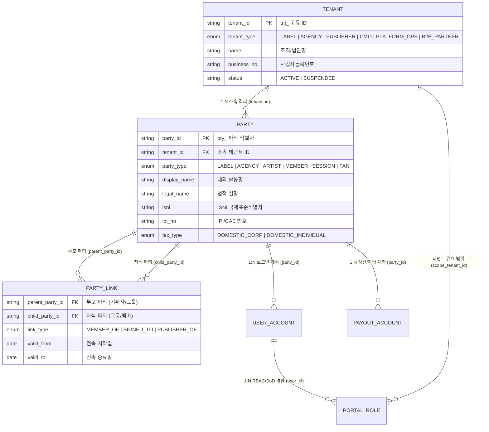
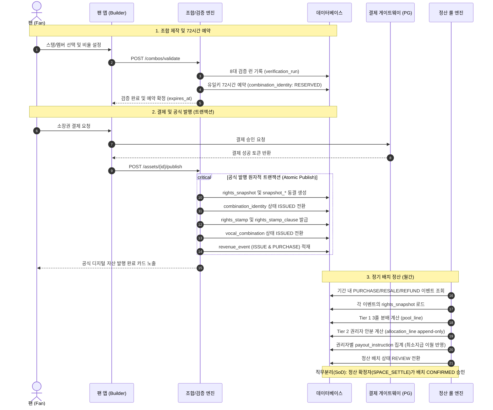

# dobedopop 보컬조합 통합 데이터 모델 (Data Model Specification)

- **문서 상태**: 설계 확정 (v2.1)
- **적용 대상**: dobedopop 보컬조합 플랫폼, 백오피스, 권리자 콘솔, 실연자 포털, 정산 룰 엔진
- **기준 정책 문서**: `보컬조합_사업기획서_v1.13_20260918.docx`, `보컬조합_백오피스_구성방안_v1.2_20260918.docx`
- **v2.1 변경 요약 (2026-09-20)**:
  1. 3.2 자산 계층 재구성: `part_slot`(구간) / `stem`(녹음 파일) 분리, `pack_stem`이 `stem_voice`·`vocal_pack.locked_stem_ids`를 대체, `work_credit`·`recording_credit` 신설, `part_type`을 `section`+`layer`로 분리, QC 상태는 스템 단위로 일원화
  2. 3.3 `grant_consent` 링크 신설(동의 커버리지 검증 근거), `consent_agreement.target_recording_id` 추가
  3. 3.4 `combination_constraint_party` 정의 추가, 제약 접두어 `ccn_`, `issuance_rule` 캠페인 오버라이드(강화만), `campaign.uniqueness_scope_override`, 캠페인–그랜트 팩 일치 CHECK
  4. 3.5/3.6 `combination_assignment`·`snapshot_stem_assignment`에 `slot_id` 추가, 배정의 `party_id`/`rights_bearing`은 스템에서 파생
  5. 불변조건 2 수정, 17~20 추가; 인덱스/DDEX 매핑 보강

---

## 1. 설계 원칙 및 핵심 규격

1. **스냅샷 불변 원칙 (Immutable Snapshot)**:
   - 조합 발행(ISSUED) 시점의 이용 그랜트, 라이센스 정책, 2계층 안분 룰, 스템 사용량(`StemUsage`), 참여 멤버 비율(`MEMBER_PCT`), 계약 버킷(`CONTRACT`)을 `rights_snapshot`에 동결한다.
   - 정산 엔진은 오직 **발행 당시 스냅샷**과 **원장 이벤트**만을 읽고 계산하며, 이후의 정책 수정은 기존 조합 정산에 소급되지 않는다.
2. **원장 추가 전용 원칙 (Append-Only Ledger)**:
   - `revenue_event`, `allocation_line`, `audit_log`, `point_entry`는 INSERT만 허용된다.
   - 결제 취소/환불은 기존 행을 수정하지 않고 `REVERSAL` 음수 라인으로 역분개하여 차기 배치에서 차감/상계한다.
3. **금액 및 비율 표준 (Numeric Standards)**:
   - **금액**: 원화 기준 정수 `BIGINT` (KRW, 음수 허용).
   - **선언/계약 비율**: 베이시스 포인트 `bps` (`INT`, 10000 bps = 100.00%).
   - **계산 비중/가중치**: 고정밀도 실수 `NUMERIC(16, 12)`.
   - **반올림 원칙**: 원 단위 절사(Floor) 후 잔여 금액은 최대 지분자(`LARGEST_SHARE`)에 가산하며, 동률 시 `party_id` 오름차순으로 배정하여 총액 일치를 강제한다.
4. **직무 분리 통제 (Separation of Duties, SoD)**:
   - 정책 편집자(`SPACE_EDITOR`)와 정책 활성화 확정자(`SPACE_LEGAL` / `AGENCY_ADMIN`)는 동일 계정일 수 없다.
   - 정산 배치 실행자(`SPACE_SETTLE_OPERATOR`)와 배치 확정자(`SPACE_SETTLE_CONFIRMER`)는 분리된다.
   - 위반 시도는 DB 트리거 및 앱 가드에서 즉시 차단되고 감사로그에 기록된다.
5. **ID 접두어 체계 (Prefix Standard)**:
   - `tnt_` (테넌트), `pty_` (파티/권리주체), `usr_` (사용자계정), `acc_` (지급계좌), `wrk_` (저작물), `rcd_` (음원버전), `wcr_` (저작물크레딧), `rcr_` (녹음크레딧), `slt_` (파트슬롯), `stm_` (스템파일), `crd_` (스템크레딧), `pak_` (보컬팩), `vo_` (보이스), `cst_` (동의), `grn_` (이용그랜트), `rul_` (발행규칙), `ccn_` (조합제약), `alp_` (안분정책), `srl_` (정산규칙), `cmp_` (캠페인), `vc_` (조합음원), `cid_` (유일키), `vrn_` (검증런), `irq_` (발행요청), `stp_` (권리스탬프), `snp_` (스냅샷), `evt_` (매출이벤트), `bat_` (정산배치), `aln_` (안분라인), `pay_` (지급지시), `unh_` (미배분보류), `dsp_` (분쟁), `ksw_` (킬스위치), `aud_` (감사로그), `pnt_` (포인트).

---

## 2. 8대 바운디드 컨텍스트 (Bounded Contexts)

| 컨텍스트 | 핵심 책임 | 주요 산출 엔티티 | 타 컨텍스트 제공 데이터 |
| :--- | :--- | :--- | :--- |
| **1. Identity & Organization** | 다중 테넌트, 권리 주체(Party), 포털 계정, 역할/권한(SoD), 지급/세무 정보 | `tenant`, `party`, `user_account`, `portal_role`, `payout_account` | `tenant_id`, `party_id` |
| **2. Asset Pipeline & Catalog** | 저작물/녹음 크레딧, 음원 버전, 파트 슬롯(구간), 스템 파일(QC), DDEX RIN 크레딧, 보컬팩, 팩 스템(선택 가능/잠금), 보이스 에셋 | `work`, `work_credit`, `recording_version`, `recording_credit`, `part_slot`, `stem`, `stem_credit`, `vocal_pack`, `voice_asset`, `pack_stem` | `pack_id`, `slot_id`, `stem_id` |
| **3. Rights & Consent Vault** | C1~C7 7대 계약/동의, 이용 그랜트, 그랜트–동의 링크(커버리지), 지역/행위/파트 범위, 스탬프 적격 규칙, 청구권자 | `consent_agreement`, `license_grant`, `grant_consent`, `grant_action`, `stamp_eligibility_rule`, `claimant` | `grant_id`, `consent_id` |
| **4. Rules & Policy Engine** | Tier 1(3풀) 규칙, Tier 2 안분 정책(4대 실연 풀 모드), 발행 비율 룰, 조합 제약(3종), 캠페인 | `settlement_rule`, `allocation_policy`, `alloc_layer`, `combination_constraint`, `campaign` | `settlement_rule_id`, `allocation_policy_id` |
| **5. Combination & Digital Asset** | STEM/CUBE 빌더 조합, 유일키(72h 예약), 8대 검증 런, 72h 발행 승인 큐, 권리 스탬프 조항 | `vocal_combination`, `combination_assignment`, `combination_identity`, `verification_run`, `rights_stamp` | `vc_id`, `stamp_id` |
| **6. Snapshot (불변)** | 조합 발행 시점의 권리·동의·안분 입력값 불변 복제본, 재현 레시피 JSON | `rights_snapshot`, `snapshot_member_pct`, `snapshot_stem_assignment`, `snapshot_bucket` | `snapshot_id` (정산의 유일 입력) |
| **7. Ledger & Settlement Engine** | 매출/환불 원장, 배치 실행/확정, 3풀 분배, Tier 2 권리자 안분 라인, 지급 지시, 미배분 보류 | `revenue_event`, `settlement_batch`, `pool_line`, `allocation_line`, `payout_instruction`, `unallocated_holding` | 정산/지급 원장 데이터 |
| **8. Governance & Monitoring** | 긴급 킬 스위치(사후 처리), 분쟁/이의제기(3단계 에스컬레이션), 팬 인센티브 포인트, 5년 감사로그 | `kill_switch_event`, `dispute`, `point_entry`, `audit_log` | 보호/감사/보상 데이터 |

---

## 3. 컨텍스트별 세부 데이터 모델

### 3.1 Identity & Organization

#### 1. 테넌트(Tenant) 및 권리주체(Party) 계층 구조 및 관계 정의

`dobedopop` 플랫폼은 엔터프라이즈 다중 테넌트 격리(`tenant`)와 복합적인 음악 권리 주체(`party`)를 분리하여 관리합니다.



> **구조적 핵심 원칙**:
> 1. **테넌트(Tenant)**: 권한 및 데이터 격리 단위 (예: `tnt_star` 스타엔터테인먼트, `tnt_dobedop` 두비덥레이블, `tnt_komca` 음저협).
> 2. **파티(Party)**: 권리 정산 및 크레딧의 귀속 주체 (예: 기획사 법인 `pty_star_corp`, 소속 그룹 `pty_nova_group`, 개별 멤버 `pty_nova_lead`, `pty_nova_sub`).
> 3. **파티 링크(party_link)**: 그룹-멤버(`MEMBER_OF`), 기획사-아티스트(`SIGNED_TO`) 관계를 시간 축(`valid_from` ~ `valid_to`)으로 관리하여 멤버 탈퇴나 이적 시에도 과거 정산 스냅샷의 불변성을 보장.
> 4. **팬/개인 크리에이터**: 기본 플랫폼 테넌트(`tnt_platform_default`)에 소속된 `party_type = FAN`으로 자동 프로비저닝.

---

#### tenant
다중 테넌트 격리 및 엔터티 조직 관리.

| 컬럼 | 타입 | 제약 | 비즈니스 설명 |
| :--- | :--- | :--- | :--- |
| `tenant_id` | TEXT | PK (`tnt_`) | 테넌트 고유 ID |
| `tenant_type` | ENUM | NOT NULL | `LABEL \| AGENCY \| PUBLISHER \| CMO \| PLATFORM_OPS \| B2B_PARTNER` |
| `name` | TEXT | NOT NULL | 조직/법인명 |
| `business_no` | TEXT | | 사업자등록번호 (법인) |
| `country_code` | CHAR(2) | NOT NULL DEFAULT 'KR' | ISO 국가 코드 |
| `status` | ENUM | NOT NULL DEFAULT 'ACTIVE' | `ACTIVE \| SUSPENDED \| TERMINATED` |
| `created_at` | TIMESTAMPTZ | NOT NULL | 생성 일시 |

#### party
권리 주체, 기획사, 실연자, AI 원천 제공자, 팬, 플랫폼의 마스터 엔티티.

| 컬럼 | 타입 | 제약 | 비즈니스 설명 |
| :--- | :--- | :--- | :--- |
| `party_id` | TEXT | PK (`pty_`) | 파티 고유 식별자 |
| `tenant_id` | TEXT | FK `tenant` | 소속 테넌트 (팬/개인은 플랫폼 기본 테넌트) |
| `party_type` | ENUM | NOT NULL | `LABEL \| AGENCY \| PUBLISHER \| CMO \| ARTIST \| MEMBER \| SESSION \| AI_PROVIDER \| FAN \| PLATFORM` |
| `display_name` | TEXT | NOT NULL | 대외 노출 활동명/회사명 |
| `legal_name` | TEXT | | 법적 실명 (세무/계약용) |
| `isni` | CHAR(16) | | ISNI (국제표준성명식별자) |
| `ipi_no` | VARCHAR(11) | | IPI/CAE 번호 (작사/작곡/출판사) |
| `tax_type` | ENUM | NOT NULL DEFAULT 'DOMESTIC_CORP' | `DOMESTIC_CORP \| DOMESTIC_INDIVIDUAL \| FOREIGN \| EXEMPT` |
| `cmo_affiliated` | BOOL | NOT NULL DEFAULT FALSE | 신탁단체(음실련/음저협 등) 위탁 여부 |
| `status` | ENUM | NOT NULL DEFAULT 'ACTIVE' | `ACTIVE \| SUSPENDED \| PENDING_VERIFICATION` |
| `created_at` | TIMESTAMPTZ | NOT NULL | 생성 일시 |

#### party_link
그룹-멤버, 기획사-아티스트 간의 계층 및 전속 관계.

| 컬럼 | 타입 | 제약 | 비즈니스 설명 |
| :--- | :--- | :--- | :--- |
| `parent_party_id` | TEXT | FK `party` NOT NULL | 부모 파티 (그룹, 레이블, 기획사) |
| `child_party_id` | TEXT | FK `party` NOT NULL | 자식 파티 (멤버, 소속 아티스트) |
| `link_type` | ENUM | NOT NULL | `MEMBER_OF \| SIGNED_TO \| PUBLISHER_OF \| SUB_AFFILIATE` |
| `valid_from` | DATE | NOT NULL | 전속/소속 시작일 |
| `valid_to` | DATE | | 전속/소속 종료일 (NULL=유효) |
| **PK** | | `(parent_party_id, child_party_id, link_type)` | |

#### user_account
포털 로그인 계정 및 인증 정보.

| 컬럼 | 타입 | 제약 | 비즈니스 설명 |
| :--- | :--- | :--- | :--- |
| `user_id` | TEXT | PK (`usr_`) | 사용자 계정 고유 ID |
| `party_id` | TEXT | FK `party` NULLABLE | 연결된 권리자/팬 Party (내부 운영자는 NULL 가능) |
| `email` | TEXT | UNIQUE NOT NULL | 로그인 이메일 |
| `auth_provider` | ENUM | NOT NULL DEFAULT 'LOCAL' | `LOCAL \| GOOGLE \| KAKAO \| APPLE` |
| `two_factor_enabled`| BOOL | NOT NULL DEFAULT FALSE | 2단계 인증 활성화 여부 (관리자 필수) |
| `status` | ENUM | NOT NULL DEFAULT 'ACTIVE' | `ACTIVE \| DISABLED \| LOCKED` |
| `last_login_at` | TIMESTAMPTZ | | 최종 로그인 일시 |

#### portal_role
포털 사용자별 RBAC 역할 및 직무 분리(SoD) 통제.

| 컬럼 | 타입 | 제약 | 비즈니스 설명 |
| :--- | :--- | :--- | :--- |
| `user_id` | TEXT | FK `user_account` NOT NULL | 사용자 ID |
| `role` | ENUM | NOT NULL | `MASTER_OWNER \| AGENCY_ADMIN \| WORK_RIGHTS \| PERFORMER \| AI_PROVIDER \| B2B_PARTNER \| SPACE_OPS \| SPACE_EDITOR \| SPACE_SETTLE \| SPACE_LEGAL \| SPACE_AUDITOR \| FAN` |
| `scope_tenant_id`| TEXT | FK `tenant` NULLABLE | 역할 유효 테넌트 범위 |
| `scope_party_id` | TEXT | FK `party` NULLABLE | 특정 파티 한정 역할 (실연자 본인 데이터 한정 등) |
| **PK** | | `(user_id, role, scope_tenant_id)` | |

> **직무 분리(SoD) 가드**: 동일 `user_id`에 `SPACE_EDITOR`(정책 편집)와 `SPACE_LEGAL`/`AGENCY_ADMIN`(정책 활성화), 또는 `SPACE_OPS`(배치 실행)와 `SPACE_SETTLE`(배치 확정)을 동시 부여할 수 없다.

#### payout_account
실명 인증된 원천징수/지급 계좌 및 세무 증빙 정보 (토큰화 및 암호화).

| 컬럼 | 타입 | 제약 | 비즈니스 설명 |
| :--- | :--- | :--- | :--- |
| `payout_account_id`| TEXT | PK (`acc_`) | 지급 계좌 고유 식별자 |
| `party_id` | TEXT | FK `party` NOT NULL | 계좌 소유 권리 주체 |
| `bank_code` | VARCHAR(10) | NOT NULL | 금융기관 코드 (예: `004` 국민, `088` 신한, `003` 기업) |
| `account_holder` | TEXT | NOT NULL | 예금주명 (본인 실명 검증 필수) |
| `encrypted_account_no` | TEXT | NOT NULL | AES-256 암호화 계좌번호 |
| `external_vault_token` | TEXT | | PG/정산 모듈 토큰 핸들 (KFTC 오픈뱅킹) |
| `currency` | CHAR(3) | NOT NULL DEFAULT 'KRW' | 지급 통화 |
| `is_primary` | BOOL | NOT NULL DEFAULT TRUE | 기본 정산 계좌 여부 |
| `verification_method` | ENUM | NOT NULL DEFAULT '1WON_TRANSFER' | `1WON_TRANSFER \| EXTERNAL_API \| MANUAL_REVIEW` |
| `verification_code_hash`| TEXT | | 1원 송금 시 입금자명 4자리 인증코드 해시 |
| `verified_at` | TIMESTAMPTZ | | 실명 및 1원 계좌 인증 완료 일시 |
| `tax_id_type` | ENUM | NOT NULL DEFAULT 'RRN_DOMESTIC' | `RRN_DOMESTIC \| BRN_CORP \| FOREIGN_TIN \| PASSPORT` |
| `encrypted_tax_id` | TEXT | | AES-256 암호화된 주민번호/외국인등록번호/사업자번호 |
| `tax_id_verified` | BOOL | NOT NULL DEFAULT FALSE | 국세청/홈택스 실명·세무 식별자 검증 완료 여부 |
| `requested_by_party_id`| TEXT | FK `party` NULLABLE | 계좌 등록/변경을 요청한 기획사/레이블 Party ID |
| `requested_at` | TIMESTAMPTZ | | 기획사 정산계좌 등록 요청 발송 일시 |
| `rejection_reason` | TEXT | | 1원 인증 실패 또는 관리자 반려 사유 |
| `status` | ENUM | NOT NULL DEFAULT 'PENDING_VERIFICATION'| `PENDING_VERIFICATION \| ACTIVE \| INVALID \| SUSPENDED` |
| `created_at` | TIMESTAMPTZ | NOT NULL | 계좌 등록 일시 |

---

### 3.2 Asset Pipeline & Catalog (DDEX RIN 준용)

```
[work] 1 ──< [work_credit]                       (작사/작곡/편곡 — 저작권 풀 청구권자 원천)
  │
  └──< [recording_version] 1 ──< [recording_credit]   (프로듀서/세션/MR — 녹음 단위 크레딧)
             │
             ├──< [part_slot] 1 ──< [stem] 1 ──< [stem_credit]   (슬롯 = 구간, 스템 = 녹음 파일, 크레딧 = 가창자)
             │
             └──< [vocal_pack] 1 ──< [voice_asset]     (팩 안의 선택 가능 멤버)
                        │
                        └──< [pack_stem]               (팩에서 선택 가능한 스템 / 잠금 / 기본 선택)
```

> **계층 의미**: 권리는 `work`/`recording_version`/`stem` 계층(누가 무엇을 만들고 불렀나)에 붙고, 허용/제한/정산 규칙은 `vocal_pack` 계층(채널/상품 단위 포장)에 붙는다. 같은 녹음으로 팩을 여러 개 만들어도 크레딧/동의는 한 번만 관리된다.
>
> **슬롯/스템 분리 원칙**: `part_slot`은 곡 구조상의 구간(섹션 × 레이어 × 타임코드)이고, `stem`은 그 슬롯을 특정 멤버가 부른 **오디오 파일 1개**다. 4명이 같은 후렴을 각각 녹음하면 `part_slot` 1행 아래 `stem` 4행이 생기며, 파일 URL/해시/QC는 스템마다 따로 관리된다.

#### work
음악 저작물(작품) 마스터.

| 컬럼 | 타입 | 제약 | 비즈니스 설명 |
| :--- | :--- | :--- | :--- |
| `work_id` | TEXT | PK (`wrk_`) | 저작물 고유 ID |
| `title` | TEXT | NOT NULL | 저작물 공식 제목 |
| `iswc` | CHAR(11) | UNIQUE NULLABLE | ISWC (국제표준음악저작물코드 T-NNNNNNNNN-C) |
| `original_publisher_id`| TEXT | FK `party` | 원출판사 / 저작권 대행사 |
| `cmo_managed` | BOOL | NOT NULL DEFAULT FALSE | 신탁단체(음저협 등) 관리곡 여부 |
| `status` | ENUM | NOT NULL DEFAULT 'ACTIVE' | `DRAFT \| ACTIVE \| ARCHIVED` |
| `created_at` | TIMESTAMPTZ | NOT NULL | 등록 일시 |

#### work_credit
저작물 단위 저작자 크레딧 (저작권 풀 `WORK_AUTHOR` 청구권자의 원천, DDEX RIN `WorkContributor` 준용).

| 컬럼 | 타입 | 제약 | 비즈니스 설명 |
| :--- | :--- | :--- | :--- |
| `work_credit_id` | TEXT | PK (`wcr_`) | 크레딧 ID |
| `work_id` | TEXT | FK `work` NOT NULL | 저작물 |
| `party_id` | TEXT | FK `party` NOT NULL | 저작자(작사/작곡/편곡) 또는 신탁단체 |
| `role` | ENUM | NOT NULL | `COMPOSER \| LYRICIST \| ARRANGER \| PUBLISHER` |
| `share_bps` | INT | CHECK (share_bps >= 0) | 저작권 풀 내부 지분(bps). NULL이면 협회 기본 배분 기준 적용 |
| `ipi_no` | VARCHAR(16) | | 저작자 IPI |
| **UNIQUE** | | `(work_id, party_id, role)` | |

> 동일 `work_id` 내 `share_bps`가 하나라도 입력되면 전체 합계 10000 bps를 저장 시점에 검증한다.

#### recording_version
녹음 음원 마스터 및 버전 계층 (정규, 리패키지, 리믹스 등).

| 컬럼 | 타입 | 제약 | 비즈니스 설명 |
| :--- | :--- | :--- | :--- |
| `recording_id` | TEXT | PK (`rcd_`) | 음원 버전 고유 ID |
| `work_id` | TEXT | FK `work` NOT NULL | 원저작물 ID |
| `master_owner_party_id` | TEXT | FK `party` NOT NULL | 음반제작자/레이블(마스터 권리자) |
| `isrc` | CHAR(12) | UNIQUE NULLABLE | ISRC (국제표준녹음코드 CC-XXX-YY-NNNNN) |
| `version_title` | TEXT | NOT NULL | 버전명 (예: "Original Ver.", "Acoustic Ver.") |
| `duration_ms` | INT | NOT NULL CHECK (duration_ms > 0) | 음원 총 재생시간 (ms) |
| `bpm` | NUMERIC(5,2) | NOT NULL | 템포 (BPM) |
| `musical_key` | VARCHAR(10) | NOT NULL | 음정 키 (예: "C# Major") |
| `loudness_lufs` | NUMERIC(4,2) | | 측정 라우드니스 (LUFS) |
| `distribution_flags` | TEXT[] | NOT NULL DEFAULT '{}' | 유통 제약 플래그 (예: `EXCLUSIVE_DSP`, `NO_REMIX`) |
| `status` | ENUM | NOT NULL DEFAULT 'DRAFT' | `DRAFT \| ACTIVE \| ARCHIVED` (QC는 스템 단위에서만 관리) |

#### recording_credit
녹음 단위 참여자 크레딧 (프로듀서/세션/엔지니어 등 스템에 귀속되지 않는 역할).

| 컬럼 | 타입 | 제약 | 비즈니스 설명 |
| :--- | :--- | :--- | :--- |
| `recording_credit_id` | TEXT | PK (`rcr_`) | 크레딧 ID |
| `recording_id` | TEXT | FK `recording_version` NOT NULL | 녹음 |
| `party_id` | TEXT | FK `party` NOT NULL | 참여자 |
| `role` | ENUM | NOT NULL | `PRODUCER \| ARRANGER \| SESSION_MUSICIAN \| ENGINEER \| MIXER` |
| `performer_type` | ENUM | NOT NULL DEFAULT 'NON_FEATURED' | `FEATURED \| NON_FEATURED` |
| **UNIQUE** | | `(recording_id, party_id, role)` | |

#### part_slot
곡 구조상의 파트 구간 (섹션 × 레이어 × 타임코드). 빌더의 교체 단위이자 조합 제약/잠금의 기준 단위.

| 컬럼 | 타입 | 제약 | 비즈니스 설명 |
| :--- | :--- | :--- | :--- |
| `slot_id` | TEXT | PK (`slt_`) | 슬롯 고유 ID |
| `recording_id` | TEXT | FK `recording_version` NOT NULL | 소속 녹음 버전 |
| `section` | ENUM | NOT NULL | `INTRO \| VERSE \| PRE_CHORUS \| CHORUS \| BRIDGE \| OUTRO \| FULL` (`FULL`=곡 전체, MR 등) |
| `section_seq` | INT | NOT NULL DEFAULT 1 | 동일 섹션 반복 순번 (VERSE 1, VERSE 2) |
| `layer` | ENUM | NOT NULL DEFAULT 'MAIN' | `MAIN \| HARMONY \| CHORUS \| ADLIB \| FX \| MR` |
| `start_ms` | INT | NOT NULL CHECK (start_ms >= 0) | 구간 시작 타임코드 (ms) |
| `end_ms` | INT | NOT NULL CHECK (end_ms > start_ms) | 구간 종료 타임코드 (ms) |
| `duration_ms` | INT | GENERATED ALWAYS AS (end_ms - start_ms) STORED | 구간 길이 |
| `sort_order` | INT | NOT NULL | 타임라인/연속성 판정 순서 (연속 교체 금지 제약의 기준) |
| `swappable` | BOOL | NOT NULL DEFAULT TRUE | 팬 교체 가능 슬롯 여부 (MR/FX는 FALSE) |
| **UNIQUE** | | `(recording_id, section, section_seq, layer)` | |
| **UNIQUE** | | `(recording_id, sort_order)` | |

#### stem
슬롯을 특정 멤버가 녹음한 **오디오 파일 1개**. 파일 메타데이터/QC/권리 상태의 단위.

| 컬럼 | 타입 | 제약 | 비즈니스 설명 |
| :--- | :--- | :--- | :--- |
| `stem_id` | TEXT | PK (`stm_`) | 스템 파일 고유 ID |
| `slot_id` | TEXT | FK `part_slot` NOT NULL | 소속 파트 슬롯 (구간/레이어는 슬롯에서 상속) |
| `recording_id` | TEXT | FK `recording_version` NOT NULL | 녹음 버전 (슬롯과 일치, 조회 가속용 비정규화) |
| `performer_party_id` | TEXT | FK `party` NULLABLE | 주 가창자 (MR/FX는 NULL). `stem_credit`의 FEATURED 행과 일치해야 함 |
| `source_type` | ENUM | NOT NULL | `ORIGINAL_MULTI \| RE_RECORDED \| COLLAB_NEW \| AI_VIRTUAL` |
| `take_version` | INT | NOT NULL DEFAULT 1 | 동일 멤버 재녹음/재업로드 버전 |
| `audio_file_url` | TEXT | NOT NULL | 내부 보안 오브젝트 스토리지 S3 URI |
| `file_checksum_sha256`| CHAR(64) | NOT NULL | 스템 원본 오디오 파일 무결성 해시 |
| `audio_format` | VARCHAR(10) | NOT NULL DEFAULT 'WAV' | 포맷 (`WAV \| FLAC`) |
| `sample_rate_hz` | INT | NOT NULL | 샘플레이트 (예: 48000) |
| `bit_depth` | INT | NOT NULL | 비트 심도 (예: 24) |
| `loudness_lufs` | NUMERIC(4,2) | | 스템 라우드니스 (정합 보정 기준) |
| `qc_status` | ENUM | NOT NULL DEFAULT 'PENDING' | `PENDING \| PASSED \| REJECTED` |
| `qc_fail_code` | VARCHAR(32) | | QC 실패 사유 코드 (클리핑/무음/포맷 등) |
| `rights_bearing` | BOOL | NOT NULL DEFAULT TRUE | 정산 대상 스템 여부 (MR/FX는 FALSE) |
| `status` | ENUM | NOT NULL DEFAULT 'UPLOADED' | `UPLOADED \| QC_PENDING \| LABELED \| RIGHTS_BOUND \| READY \| BLOCKED` |
| **UNIQUE** | | `(slot_id, performer_party_id, take_version)` | 슬롯당 멤버별 테이크 유일 |

> **부분 고유 인덱스**: `(slot_id, performer_party_id) WHERE status = 'READY'` (슬롯당 멤버별 READY 스템은 1개). 타임코드(`start_ms/end_ms`)는 스템에 두지 않고 `part_slot`에서 상속한다.

#### stem_credit
DDEX RIN 표준 준용 스템 참여자 크레딧 (실연 풀 청구권자의 원천, 미배분 방지 필수 입력).

| 컬럼 | 타입 | 제약 | 비즈니스 설명 |
| :--- | :--- | :--- | :--- |
| `credit_id` | TEXT | PK (`crd_`) | 크레딧 고유 ID |
| `stem_id` | TEXT | FK `stem` NOT NULL | 해당 스템 파일 |
| `party_id` | TEXT | FK `party` NOT NULL | 참여 실연자 |
| `role` | ENUM | NOT NULL | `MAIN_VOCAL \| LEAD_VOCAL \| SUB_VOCAL \| CHORUS \| BACKGROUND_VOCAL \| ADLIB \| AI_VOICE_SOURCE` |
| `performer_type` | ENUM | NOT NULL DEFAULT 'FEATURED' | `FEATURED`(주실연자) \| `NON_FEATURED`(부실연자/코러스) |
| `isni` | CHAR(16) | | 실연자 ISNI |
| **UNIQUE** | | `(stem_id, party_id, role)` | |

> `rights_bearing = TRUE`인 스템은 `stem_credit`이 1행 이상 있어야 `LABELED` → `RIGHTS_BOUND` 전이가 가능하다(크레딧 결손 = `BLOCKED`). 프로듀서/세션 등 녹음 단위 역할은 `recording_credit`에 기록한다.

#### vocal_pack
팬 조합용 공식 IP 단위 패키지 (목업의 `CB-2026-A01`). 채널/상품별로 같은 녹음에서 여러 팩을 만들 수 있으며, 그랜트/정산 룰/안분 정책/발행 룰/조합 제약/캠페인은 모두 팩에 귀속된다.

| 컬럼 | 타입 | 제약 | 비즈니스 설명 |
| :--- | :--- | :--- | :--- |
| `pack_id` | TEXT | PK (`pak_`) | 보컬팩 고유 ID |
| `pack_code` | VARCHAR(32) | UNIQUE NOT NULL | IP 고유 코드 (`CB-2026-A01`) |
| `recording_id` | TEXT | FK `recording_version` NOT NULL | 대상 음원 버전 |
| `owner_party_id` | TEXT | FK `party` NOT NULL | 마스터 권리자 (LABEL / IP 보유사) |
| `agency_party_id` | TEXT | FK `party` NULLABLE | IP 운영 대표 기획사 (AGENCY). NULL이면 마스터 권리자가 활성화 권한 겸임 |
| `channel_code` | VARCHAR(32) | NOT NULL DEFAULT 'DEFAULT' | 배포 채널 구분 (예: `FANCLUB`, `PARTNER_SHORTFORM`) |
| `title` | TEXT | NOT NULL | 보컬팩 공식 명칭 |
| `cover_image_url`| TEXT | | 공식 커버/아티스트 이미지 URI |
| `uniqueness_scope`| ENUM | NOT NULL DEFAULT 'CAMPAIGN' | `PACK \| CAMPAIGN \| FAN_CAMPAIGN` (캠페인에서 오버라이드 가능) |
| `status` | ENUM | NOT NULL DEFAULT 'DRAFT' | `DRAFT \| ACTIVE \| PAUSED \| ARCHIVED` |
| `created_at` | TIMESTAMPTZ | NOT NULL | 생성 일시 |

> 잠금 스템은 `locked_stem_ids` 배열 대신 `pack_stem.locked`로 관리한다(FK 무결성/슬롯 단일 선택 규칙 적용).

#### voice_asset
보컬팩에 참여하는 멤버/아티스트별 가용 음성 프로필 (팩의 멤버 목록).

| 컬럼 | 타입 | 제약 | 비즈니스 설명 |
| :--- | :--- | :--- | :--- |
| `voice_asset_id` | TEXT | PK (`vo_`) | 보이스 에셋 고유 ID |
| `pack_id` | TEXT | FK `vocal_pack` NOT NULL | 보컬팩 ID |
| `party_id` | TEXT | FK `party` NOT NULL | 멤버/아티스트 Party ID |
| `display_name` | TEXT | NOT NULL | 빌더 표시명 |
| `color_code` | VARCHAR(7) | NOT NULL DEFAULT '#000000' | 빌더 UI 표시 고유 컬러 HEX |
| `avatar_url` | TEXT | | 멤버 프로필 썸네일 |
| `status` | ENUM | NOT NULL DEFAULT 'ACTIVE' | `ACTIVE \| WITHDRAWN` (동의 철회 시 WITHDRAWN) |
| **UNIQUE** | | `(pack_id, party_id)` | 팩당 멤버 유일성 |

#### pack_stem
팩에서 선택 가능한 스템 파일과 잠금/기본 선택 설정 (구 `stem_voice` 대체). 팩의 **상품 범위**를 정의하며, 권리 범위(`grant_part_scope`)와의 교집합이 실제 조합 가능 범위다.

| 컬럼 | 타입 | 제약 | 비즈니스 설명 |
| :--- | :--- | :--- | :--- |
| `pack_id` | TEXT | FK `vocal_pack` NOT NULL | 보컬팩 |
| `stem_id` | TEXT | FK `stem` NOT NULL | 스템 파일 |
| `slot_id` | TEXT | FK `part_slot` NOT NULL | 스템의 슬롯 (비정규화, `stem.slot_id`와 일치 강제) |
| `selectable` | BOOL | NOT NULL DEFAULT TRUE | 팬이 선택 가능한지 |
| `locked` | BOOL | NOT NULL DEFAULT FALSE | 잠금 스템 (해당 슬롯은 이 스템으로 고정, 원곡 특성 보존) |
| `default_selected`| BOOL | NOT NULL DEFAULT FALSE | 빌더 초기 선택(원곡 기본) |
| **PK** | | `(pack_id, stem_id)` | |

> **정합 규칙 (트리거)**:
> 1. `stem.performer_party_id`는 `voice_asset(pack_id, party_id)`에 존재해야 한다(팩 멤버가 아닌 스템 등록 불가).
> 2. `locked = TRUE`인 행이 있는 슬롯은 같은 팩에서 `selectable = TRUE`인 스템이 그 1개뿐이어야 한다.
> 3. 슬롯당 `default_selected = TRUE`는 1개.
> 4. `stem.status = 'READY'`가 아닌 스템은 `selectable = TRUE`로 저장할 수 없다.

---

### 3.3 Rights & Consent Vault (C1~C7 동의 체계)

```
[party] 1 ──< [consent_agreement] (C1~C7, 대상: 녹음/스템/팩)
                        │
                        └──< [grant_consent] >── 1 [license_grant]   (그랜트가 근거로 삼는 동의 링크 = 커버리지 검증)
[vocal_pack] 1 ──< [license_grant] 1 ──< [claimant]
                       │
                       ├──< [grant_territory]
                       ├──< [grant_action]
                       ├──< [grant_part_scope]
                       └──< [stamp_eligibility_rule]
```

#### consent_agreement
7대 계약/동의 유형 체계 관리 (Consent Vault).

| 컬럼 | 타입 | 제약 | 비즈니스 설명 |
| :--- | :--- | :--- | :--- |
| `consent_id` | TEXT | PK (`cst_`) | 동의 고유 식별자 |
| `party_id` | TEXT | FK `party` NOT NULL | 동의 주체 (실연자, 저작권자, 기획사 등) |
| `target_recording_id` | TEXT | FK `recording_version` NULLABLE | 녹음 단위 동의 (C2 마스터, C3 실연자 기본 단위) |
| `target_stem_id` | TEXT | FK `stem` NULLABLE | 특정 스템 파일 한정 시 (C3/C4 세부 한정) |
| `target_pack_id` | TEXT | FK `vocal_pack` NULLABLE | 특정 보컬팩/채널 한정 시 (C5 퍼블리시티, C7 팬 약관) |
| `consent_type` | ENUM | NOT NULL | `C1_WORK_COMBINATION \| C2_MASTER_STEM_USE \| C3_PERFORMER_COMBINATION \| C4_NEW_COLLAB_PERFORMANCE \| C5_AGENCY_PUBLICITY \| C6_AI_VOICE_USAGE \| C7_FAN_TERMS` |
| `version` | INT | NOT NULL DEFAULT 1 | 동의 약관/계약 버전 |
| `scope_actions` | TEXT[] | NOT NULL | 허용 행위 목록 (`COMBINE`, `PREVIEW`, `HOLD`, `DISTRIBUTE`, `COMMERCIAL`) |
| `personality_clause_safe` | BOOL | NOT NULL DEFAULT TRUE | 인격권/성명권 보호 조항 준수 여부 |
| `ai_train_allowed` | BOOL | NOT NULL DEFAULT FALSE | C6: AI 모델 학습 허용 (기본 거부) |
| `ai_generate_allowed`| BOOL | NOT NULL DEFAULT FALSE | C6: AI 보컬 생성 허용 (기본 거부) |
| `status` | ENUM | NOT NULL DEFAULT 'PENDING' | `PENDING \| SIGNED \| REVOKED \| EXPIRED` |
| `signed_at` | TIMESTAMPTZ | | 서명/동의 완료 일시 |
| `revoked_at` | TIMESTAMPTZ | | 동의 철회 일시 |
| `revocation_grace_days` | INT | NOT NULL DEFAULT 30 | 철회 후 기존 조합 서비스 유지 유예기간 (일) |
| `source_contract_uri` | TEXT | | 전자계약서 원문 PDF 해시/URI |

> **대상 규칙**: `target_recording_id`, `target_stem_id`, `target_pack_id` 중 최소 1개는 NOT NULL. 실연자 동의(C3)는 원칙적으로 녹음 단위로 1회 서명하고, 채널별 허용 행위 차이는 `scope_actions`와 `grant_consent`로 표현한다(팩마다 재서명하지 않음).

#### license_grant
보컬팩 단위 이용 허락 라이센스 그랜트.

| 컬럼 | 타입 | 제약 | 비즈니스 설명 |
| :--- | :--- | :--- | :--- |
| `grant_id` | TEXT | PK (`grn_`) | 그랜트 고유 ID |
| `pack_id` | TEXT | FK `vocal_pack` NOT NULL | 대상 보컬팩 |
| `version` | INT | NOT NULL DEFAULT 1 | 그랜트 버전 |
| `status` | ENUM | NOT NULL DEFAULT 'DRAFT' | `DRAFT \| REVIEW \| APPROVED \| ACTIVE \| RESTRICTED \| EXPIRED \| REVOKED \| DISPUTE_HOLD` |
| `valid_from` | TIMESTAMPTZ | NOT NULL | 효력 시작 일시 |
| `valid_to` | TIMESTAMPTZ | | 효력 만료 일시 (NULL=영구) |
| `superseded_by` | TEXT | FK `license_grant` | 개정 후속 그랜트 ID |
| **UNIQUE** | | `(pack_id, version)` | |

> **부분 고유 인덱스**: `(pack_id) WHERE status = 'ACTIVE'` (팩당 유효 그랜트는 오직 1개).

#### grant_consent
그랜트가 근거로 삼는 동의 링크. 팩의 모든 `rights_bearing` 스템(`pack_stem.selectable = TRUE`)에 대해 가창자의 `SIGNED` C3/C4(또는 C6) 동의가 이 링크로 연결되어야 그랜트가 `ACTIVE`가 될 수 있다(동의 커버리지 100% 게이트).

| 컬럼 | 타입 | 제약 | 비즈니스 설명 |
| :--- | :--- | :--- | :--- |
| `grant_id` | TEXT | FK `license_grant` NOT NULL | 그랜트 |
| `consent_id` | TEXT | FK `consent_agreement` NOT NULL | 근거 동의 |
| `coverage_role` | ENUM | NOT NULL | `WORK(C1) \| MASTER(C2) \| PERFORMER(C3/C4) \| AGENCY(C5) \| AI_SOURCE(C6)` |
| **PK** | | `(grant_id, consent_id)` | |

> **커버리지 검증 (트리거/검증 리포트)**: 그랜트 활성화 시 `pack_stem`의 선택 가능 스템 × `stem_credit.party_id` 조합마다 `consent_type IN ('C3','C4','C6') AND status = 'SIGNED'`인 동의가 `grant_consent`에 연결되어 있어야 한다. 동의가 `REVOKED`되면 해당 멤버의 `voice_asset.status = 'WITHDRAWN'`, 관련 `pack_stem.selectable = FALSE`로 전환되고 그랜트는 `RESTRICTED`가 된다.

#### grant_territory / grant_action / grant_part_scope
그랜트의 지역, 행위, 파트별 세부 허용 범위.

- **`grant_territory`**: `(grant_id, region_code)` PK. (예: `KR`, `JP`, `GLOBAL_FANCLUB`)
- **`grant_action`**: `(grant_id, action_code)` PK, `allowed BOOL`.
  - 행위 코드: `PREVIEW`, `COMBINE`, `PERSONAL_HOLD`, `SHARE_LINK`, `PLATFORM_DISTRIBUTE`, `RESALE`, `COMMERCIAL`, `DOWNLOAD`
- **`grant_part_scope`**: `(grant_id, stem_id)` PK, `allowed BOOL`. (누락 시 팩 전체 허용)

#### stamp_eligibility_rule
그랜트/캠페인에서 발급 가능한 권리 스탬프 조항 사전 정의.

| 컬럼 | 타입 | 제약 | 비즈니스 설명 |
| :--- | :--- | :--- | :--- |
| `rule_id` | TEXT | PK | 스탬프 적격 규칙 ID |
| `grant_id` | TEXT | FK `license_grant` NOT NULL | 기준 라이센스 그랜트 |
| `campaign_id` | TEXT | FK `campaign` NULLABLE | 캠페인별 오버라이드 |
| `clause_type` | ENUM | NOT NULL | `PERSONAL_HOLD \| PLATFORM_DISTRIBUTE \| LIMITED_USE \| COMMERCIAL \| DOWNLOAD` |
| `issuable` | BOOL | NOT NULL DEFAULT TRUE | 발급 가능 여부 |
| `approval_mode` | ENUM | NOT NULL DEFAULT 'AUTO' | `AUTO`(자동) \| `LABEL`(레이블 승인) \| `AGENCY`(기획사 승인) \| `SPACE`(플랫폼 승인) |
| `allowed_limit_kinds`| TEXT[] | NOT NULL | `TIME_BOUND \| ONE_SHOT \| COUNT \| CAMPAIGN_WINDOW` |
| `max_valid_days` | INT | | 최대 유효 기간 (일) |

#### claimant
라이센스 수익 배분 청구권자 마스터 (커버리지 가드 검사 대상).

| 컬럼 | 타입 | 제약 | 비즈니스 설명 |
| :--- | :--- | :--- | :--- |
| `grant_id` | TEXT | FK `license_grant` NOT NULL | 해당 그랜트 |
| `party_id` | TEXT | FK `party` NOT NULL | 권리 청구 주체 |
| `claimant_role` | ENUM | NOT NULL | `MASTER_OWNER \| WORK_AUTHOR \| PERFORMER_FEATURED \| PERFORMER_NON_FEATURED \| AGENCY \| AI_PROVIDER` |
| **PK** | | `(grant_id, party_id, claimant_role)` | |

---

### 3.4 Rules & Policy Engine

```
[vocal_pack] 1 ──< [settlement_rule] (Tier 1)
       │
       ├──< [allocation_policy] (Tier 2) 1 ──< [alloc_layer]
       │           │
       │           ├──< [share_bucket] 1 ──< [share_bucket_member]
       │           └──< [performance_pool_setting]
       │
       ├──< [issuance_rule]
       ├──< [combination_constraint] 1 ──< [combination_constraint_party]
       └──< [campaign]
```

#### settlement_rule (Tier 1 플랫폼 순매출 배분)
순매출 = 결제금액 − PG수수료 − 환불금액 − 부가세 − (캠페인비용).

| 컬럼 | 타입 | 제약 | 비즈니스 설명 |
| :--- | :--- | :--- | :--- |
| `rule_id` | TEXT | PK (`srl_`) | 정산 룰 ID |
| `pack_id` | TEXT | FK `vocal_pack` NOT NULL | 대상 보컬팩 |
| `event_type` | ENUM | NOT NULL DEFAULT 'PRIMARY' | `PRIMARY`(1차소장/생성) \| `RESALE`(2차양도) \| `TRAFFIC`(재생/광고) |
| `version` | INT | NOT NULL DEFAULT 1 | 룰 버전 |
| `rights_pool_bps` | INT | NOT NULL CHECK (rights_pool_bps >= 0) | 권리자 풀 비율 (예: 7000 = 70.00%) |
| `platform_bps` | INT | NOT NULL CHECK (platform_bps >= 0) | 플랫폼 수수료 비율 (예: 2000 = 20.00%) |
| `fan_incentive_bps`| INT | NOT NULL CHECK (fan_incentive_bps >= 0)| 팬 인센티브 풀 비율 (예: 1000 = 10.00%) |
| `pg_fee_deduction` | ENUM | NOT NULL DEFAULT 'GROSS_DEDUCT'| `GROSS_DEDUCT \| PLATFORM_ABSORB` |
| `min_payout_krw` | BIGINT | NOT NULL DEFAULT 10000 | 최소 지급 기준액 (미달 시 이월) |
| `status` | ENUM | NOT NULL DEFAULT 'DRAFT' | `DRAFT \| REVIEW \| ACTIVE \| SUPERSEDED` |
| `effective_from` | TIMESTAMPTZ | NOT NULL | 발효 일시 |
| **CHECK** | | `rights_pool_bps + platform_bps + fan_incentive_bps = 10000` | Tier 1 3풀 합 100% 강제 |

#### allocation_policy (Tier 2 권리자 풀 내부 안분)
권리자 풀 안분 정책 마스터 (기본 템플릿: `VC-ALLOC-DEFAULT-V1`).

| 컬럼 | 타입 | 제약 | 비즈니스 설명 |
| :--- | :--- | :--- | :--- |
| `policy_id` | TEXT | PK (`alp_`) | 안분 정책 ID |
| `pack_id` | TEXT | FK `vocal_pack` NOT NULL | 대상 보컬팩 |
| `version` | INT | NOT NULL DEFAULT 1 | 정책 버전 |
| `event_type` | ENUM | NOT NULL DEFAULT 'PRIMARY' | `PRIMARY \| RESALE \| TRAFFIC` |
| `mode` | ENUM | NOT NULL DEFAULT 'MIX' | `SINGLE \| MIX` |
| `mix_kind` | ENUM | NOT NULL DEFAULT 'LAYERED' | `LAYERED`(계층형, 기본) \| `WEIGHTED`(가중치 혼합) |
| `performance_mode`| ENUM | NOT NULL DEFAULT 'USAGE_WEIGHTED'| `USAGE_WEIGHTED \| FIXED \| HYBRID \| MEMBER_PCT` |
| `weight_stem_bps` | INT | DEFAULT 0 | WEIGHTED 시 STEM_TIME 가중치 (bps) |
| `weight_member_bps`| INT | DEFAULT 0 | WEIGHTED 시 MEMBER_PCT 가중치 (bps) |
| `weight_contract_bps`| INT| DEFAULT 0 | WEIGHTED 시 CONTRACT 가중치 (bps) |
| `require_all_claimants_covered` | BOOL | NOT NULL DEFAULT TRUE | 청구권자 전원 커버리지 가드 활성화 |
| `rounding_rule` | ENUM | NOT NULL DEFAULT 'LARGEST_SHARE'| `LARGEST_SHARE \| PARTY_ID_ASC` |
| `status` | ENUM | NOT NULL DEFAULT 'DRAFT' | `DRAFT \| REVIEW \| APPROVED \| ACTIVE \| PAUSED \| EXPIRED \| TERMINATED` |
| `effective_from` | TIMESTAMPTZ | NOT NULL | 발효 일시 |

#### alloc_layer & share_bucket
계층형(LAYERED) 분배 층위 및 계약 버킷.

- **`alloc_layer`**: `(policy_id, version, layer_order)` PK.
  - `layer_order=1`: `CONTRACT` (마스터 45%, 저작권 25%, 실연 25%, 기획사 5% 등).
  - `layer_order=2`: `PERFORMANCE` (실연 풀 내부 분배).
- **`share_bucket`**: `(policy_id, version, bucket_id)` PK.
  - `bucket_id`: `MASTER_OWNER`, `WORK_COPYRIGHT`, `PERFORMER_POOL`, `AGENCY_MGMT`, `AI_PROVIDER_POOL`.
  - `kind`: `PARTY` (특정 파티 직분배) | `POOL` (2차 안분 풀).
  - `pct_bps`: 1층 내 지분율 (동일 정책 버전 내 합계 = 10000 bps 강제).

#### performance_pool_setting (4대 실연 풀 모드 상세)
실연 풀 내부 분배 규칙.

| 컬럼 | 타입 | 제약 | 비즈니스 설명 |
| :--- | :--- | :--- | :--- |
| `setting_id` | TEXT | PK | 설정 ID |
| `policy_id` | TEXT | FK `allocation_policy` | 안분 정책 ID |
| `version` | INT | NOT NULL | 정책 버전 |
| `featured_weight_bps` | INT | NOT NULL DEFAULT 6000 | 주실연자 가중치 (예: 60.00%) |
| `non_featured_weight_bps`| INT | NOT NULL DEFAULT 4000 | 부실연자/코러스/세션 가중치 (예: 40.00%) |
| `hybrid_fixed_bps` | INT | NOT NULL DEFAULT 0 | HYBRID 모드 시 고정 균등 배분 비율 (예: 5000 = 50%) |
| `hybrid_usage_bps` | INT | NOT NULL DEFAULT 0 | HYBRID 모드 시 사용량 비례 배분 비율 (예: 5000 = 50%) |
| `floor_guarantee_bps` | INT | NOT NULL DEFAULT 0 | 미선택 멤버 최저 보장 풀 비율 (Floor bps) |
| `cap_limit_bps` | INT | NOT NULL DEFAULT 10000 | 특정 1인 최대 독식 방지 상한 (Cap bps) |

#### issuance_rule
조합 발행 시 팬 입력 비율 및 유일키 규칙.

| 컬럼 | 타입 | 제약 | 비즈니스 설명 |
| :--- | :--- | :--- | :--- |
| `issuance_rule_id` | TEXT | PK (`rul_`) | 발행 규칙 ID |
| `pack_id` | TEXT | FK `vocal_pack` NOT NULL | 보컬팩 ID |
| `campaign_id` | TEXT | FK `campaign` NULLABLE | NULL = 팩 기본 룰, 값 있음 = 캠페인 오버라이드(강화만: 상한↓, 최소 인원/비율↑) |
| `max_single_member_bps` | INT | NOT NULL DEFAULT 9000 | 1인 최대 지분 상한 (90%) |
| `min_member_count` | INT | NOT NULL DEFAULT 2 | 최소 참여 멤버 수 |
| `min_member_bps` | INT | NOT NULL DEFAULT 1000 | 참여 멤버당 최소 지분 (10%) |
| `require_sum_bps` | INT | NOT NULL DEFAULT 10000 | 멤버 지분 합계 (100% 필수) |
| `identity_reserve_seconds` | INT | NOT NULL DEFAULT 259200 | 유일키 예약 유지 시간 (초, 72시간) |
| **UNIQUE** | | `(pack_id, campaign_id)` (NULLS NOT DISTINCT) | 팩 기본 1개 + 캠페인별 최대 1개 |

> 검증 엔진은 캠페인 룰이 있으면 팩 룰과 병합하되 항상 더 엄격한 값을 적용한다.

#### combination_constraint & combination_constraint_party
음악적/기획적 조합 금지 제약 (3대 패턴).

| 컬럼 | 타입 | 제약 | 비즈니스 설명 |
| :--- | :--- | :--- | :--- |
| `constraint_id` | TEXT | PK (`ccn_`) | 제약 ID |
| `pack_id` | TEXT | FK `vocal_pack` NOT NULL | 보컬팩 ID |
| `campaign_id` | TEXT | FK `campaign` NULLABLE | 캠페인 한정 제약 (강화만 가능) |
| `constraint_type` | ENUM | NOT NULL | `FORBIDDEN_CO_OCCURRENCE \| FORBIDDEN_ADJACENT \| FORBIDDEN_CONSECUTIVE_SWAP` |
| `severity` | ENUM | NOT NULL DEFAULT 'BLOCK' | `BLOCK`(발행불가) \| `WARN`(경고 후 허용) |
| `directed` | BOOL | NOT NULL DEFAULT FALSE | 방향성 존재 여부 (A 다음 B 금지) |
| `swap_mode` | ENUM | NOT NULL DEFAULT 'NO_SWAP' | `NO_SWAP \| NO_DISTINCT` |
| `apply_to` | ENUM | NOT NULL DEFAULT 'LISTED_PAIRS' | `LISTED_PAIRS \| ALL_PERFORMER_PAIRS` |
| `slot_scope` | ENUM | NOT NULL DEFAULT 'ALL_SLOTS' | `ALL_SLOTS \| LISTED_SLOTS` (연속 교체 금지 등 특정 슬롯 구간에만 적용 시) |
| `message_code` | VARCHAR(64) | NOT NULL | 팬 앱 노출 안내 코드 |
| `status` | ENUM | NOT NULL DEFAULT 'ACTIVE' | `ACTIVE \| INACTIVE` |

**combination_constraint_party** — 제약이 적용되는 대상(멤버/스템/슬롯) 목록.

| 컬럼 | 타입 | 제약 | 비즈니스 설명 |
| :--- | :--- | :--- | :--- |
| `constraint_id` | TEXT | FK `combination_constraint` NOT NULL | 제약 |
| `seq` | INT | NOT NULL | 대상 순번 |
| `position` | ENUM | NOT NULL DEFAULT 'ANY' | `ANY \| FROM \| TO` (`directed = TRUE`인 인접 금지에서 선행/후행 구분) |
| `party_id` | TEXT | FK `party` NULLABLE | 대상 멤버 (voice_asset 멤버) |
| `stem_id` | TEXT | FK `stem` NULLABLE | 대상 스템 파일 (특정 테이크 한정 시) |
| `slot_id` | TEXT | FK `part_slot` NULLABLE | 대상 슬롯 (`slot_scope = 'LISTED_SLOTS'` 시) |
| **PK** | | `(constraint_id, seq)` | |
| **CHECK** | | `party_id`/`stem_id`/`slot_id` 중 1개 이상 NOT NULL | |

> **평가 규칙**: 공존 금지 = 배정된 스템의 가창자 집합에 FROM/TO(또는 ANY) 대상이 동시에 존재하면 위반. 인접 금지 = `part_slot.sort_order`상 연속한 두 슬롯의 가창자가 (FROM → TO) 순서로 배치되면 위반. 연속 교체 금지 = 연속 슬롯에서 `NO_SWAP`은 가창자 변경 시, `NO_DISTINCT`는 가창자가 서로 다를 때 위반. 캠페인 제약(`campaign_id` 있음)은 팩 제약에 추가만 가능하며(불변조건 13), 팩 제약을 비활성화할 수 없다.

#### campaign
시즌/이벤트/에디션 캠페인 마스터.

| 컬럼 | 타입 | 제약 | 비즈니스 설명 |
| :--- | :--- | :--- | :--- |
| `campaign_id` | TEXT | PK (`cmp_`) | 캠페인 고유 ID |
| `pack_id` | TEXT | FK `vocal_pack` NOT NULL | 대상 보컬팩 |
| `grant_id` | TEXT | FK `license_grant` NOT NULL | 기준 라이센스 그랜트 (CHECK: `license_grant.pack_id = campaign.pack_id`) |
| `name` | TEXT | NOT NULL | 캠페인 명칭 |
| `channel_code` | VARCHAR(32) | | 채널 (NULL이면 팩의 `channel_code` 상속) |
| `uniqueness_scope_override` | ENUM | NULLABLE | `PACK \| CAMPAIGN \| FAN_CAMPAIGN` (NULL이면 `vocal_pack.uniqueness_scope` 상속) |
| `edition_type` | ENUM | NOT NULL DEFAULT 'LIMITED' | `STANDARD \| LIMITED \| OFFICIAL_EDITION` |
| `max_issuance_count`| INT | | 최대 발행 한도 (NULL=무제한) |
| `current_issued_count`| INT | NOT NULL DEFAULT 0 | 현재 발행 완료 수 |
| `price_krw` | BIGINT | NOT NULL DEFAULT 10000 | 소장권/발행 가격 |
| `starts_at` | TIMESTAMPTZ | NOT NULL | 캠페인 오픈 일시 |
| `ends_at` | TIMESTAMPTZ | NOT NULL | 캠페인 종료 일시 |
| `status` | ENUM | NOT NULL DEFAULT 'PLANNED' | `PLANNED \| APPROVAL \| SCHEDULED \| LIVE \| CLOSED \| HALTED` |

> **그랜트 개정 시**: 그랜트가 `superseded_by`로 개정되면 `LIVE`가 아닌 캠페인은 새 그랜트로 재지정(승인 재요청), `LIVE` 캠페인은 종료 시까지 기존 그랜트를 유지한다. 발행된 조합은 스냅샷의 `grant_id`를 따르므로 영향이 없다.

---

### 3.5 Combination & Digital Asset

```
[vocal_pack] 1 ──< [vocal_combination] 1 ──< [combination_member]
                         │
                         ├──< [combination_assignment]
                         ├──< [combination_identity] (유일키)
                         ├──< [verification_run] 1 ──< [verification_check] (8대 검증)
                         ├──< [issue_request] (72h 승인 큐)
                         └──< [rights_stamp] 1 ──< [rights_stamp_clause]
```

#### vocal_combination
팬이 생성한 조합 음원 마스터 및 디지털 자산 본체.

| 컬럼 | 타입 | 제약 | 비즈니스 설명 |
| :--- | :--- | :--- | :--- |
| `vc_id` | TEXT | PK (`vc_`, 대외: `VC-YYYYMMDD-nnnn`) | 조합 고유 식별자 |
| `pack_id` | TEXT | FK `vocal_pack` NOT NULL | 대상 보컬팩 |
| `campaign_id` | TEXT | FK `campaign` NOT NULL | 발행 캠페인 |
| `fan_party_id` | TEXT | FK `party` NOT NULL | 생성 팬 Party ID |
| `title` | TEXT | NOT NULL | 조합 음원 제목 |
| `mix_mode` | ENUM | NOT NULL DEFAULT 'STEM' | `STEM`(타임라인) \| `CUBE`(그리드) |
| `fingerprint_hash`| CHAR(64) | NOT NULL | 정규 오디오 지문 (SHA-256) |
| `render_url` | TEXT | | 합성 마스터 음원 URI (DRM/워터마크) |
| `preview_url` | TEXT | | 5초 프리뷰 스트리밍 Signed URL |
| `status` | ENUM | NOT NULL DEFAULT 'DRAFT' | `DRAFT \| VALIDATED \| RESERVED \| SUBMITTED \| ISSUED \| FLAGGED \| HIDDEN \| VOID` |
| `snapshot_id` | TEXT | UNIQUE NULLABLE | ISSUED 시 연결되는 불변 스냅샷 FK |
| `identity_id` | TEXT | FK `combination_identity` | 고유 유일키 FK |
| `stamp_id` | TEXT | FK `rights_stamp` | 공식 권리 스탬프 FK |
| `issued_at` | TIMESTAMPTZ | | 공식 발행 완료 일시 |
| `created_at` | TIMESTAMPTZ | NOT NULL | 초안 생성 일시 |

#### combination_member
팬이 빌더에서 직접 조정한 멤버별 기여 비율 입력값 (`MEMBER_PCT`).

| 컬럼 | 타입 | 제약 | 비즈니스 설명 |
| :--- | :--- | :--- | :--- |
| `vc_id` | TEXT | FK `vocal_combination` NOT NULL | 조합 ID |
| `party_id` | TEXT | FK `party` NOT NULL | 멤버 Party ID |
| `pct_bps` | INT | NOT NULL CHECK (pct_bps >= 0) | 팬 지정 비율 (bps, 합계 10000) |
| **PK** | | `(vc_id, party_id)` | |

#### combination_assignment
각 파트 슬롯에 실제 배치된 스템 배정 정보 (`STEM_TIME` / `StemUsage` 산출 근거). 슬롯당 스템 1개.

| 컬럼 | 타입 | 제약 | 비즈니스 설명 |
| :--- | :--- | :--- | :--- |
| `assignment_id` | TEXT | PK | 배정 고유 ID |
| `vc_id` | TEXT | FK `vocal_combination` NOT NULL | 조합 ID |
| `slot_id` | TEXT | FK `part_slot` NOT NULL | 배정 대상 슬롯 |
| `stem_id` | TEXT | FK `stem` NOT NULL | 선택된 스템 파일 (CHECK: `stem.slot_id = slot_id`, 해당 팩의 `pack_stem.selectable = TRUE`) |
| `party_id` | TEXT | FK `party` NOT NULL | 가창 멤버 — 입력값이 아니라 `stem.performer_party_id`에서 복사(트리거), 불일치 시 거부 |
| `start_ms` | INT | NOT NULL | 시작 타임코드 (`part_slot`에서 복사) |
| `end_ms` | INT | NOT NULL CHECK (end_ms > start_ms) | 종료 타임코드 (`part_slot`에서 복사) |
| `duration_ms` | INT | GENERATED ALWAYS AS (end_ms - start_ms) STORED | 구간 길이 (STEM_TIME 입력) |
| `locked` | BOOL | NOT NULL DEFAULT FALSE | 잠금 스템 여부 (`pack_stem.locked`에서 복사; STEM_TIME 산정에 포함) |
| `rights_bearing` | BOOL | NOT NULL DEFAULT TRUE | 정산 대상 여부 (`stem.rights_bearing`에서 복사) |
| **UNIQUE** | | `(vc_id, slot_id)` | 슬롯당 배정 1개 |

> 팩의 `swappable = TRUE`이고 `locked` 스템이 있는 슬롯은 배정이 잠금 스템으로 자동 생성된다. 유일키 `canonical_json`은 `(slot_id → stem_id)` 배정 목록 + `members` + `mix_mode` + `pack_id`로 정규화한다.

#### combination_identity (유일키 및 72시간 예약)
동일 조합 중복 발행 방지 및 예약 관리.

| 컬럼 | 타입 | 제약 | 비즈니스 설명 |
| :--- | :--- | :--- | :--- |
| `identity_id` | TEXT | PK (`cid_`) | 유일키 ID |
| `uniqueness_scope`| ENUM | NOT NULL | `PACK \| CAMPAIGN \| FAN_CAMPAIGN` (예약 시 `campaign.uniqueness_scope_override` → `vocal_pack.uniqueness_scope` 순으로 결정, 이후 불변) |
| `pack_id` | TEXT | FK `vocal_pack` NOT NULL | 보컬팩 ID |
| `campaign_id` | TEXT | FK `campaign` NULLABLE | 캠페인 스코프 시 필수 |
| `fan_party_id` | TEXT | FK `party` NULLABLE | 팬_캠페인 스코프 시 필수 |
| `fingerprint_hash`| CHAR(64) | NOT NULL | 조합 지문 해시 |
| `canonical_json` | TEXT | NOT NULL | 정규화된 조합 구성 JSON |
| `vc_id` | TEXT | UNIQUE NULLABLE | ISSUED 시 연결되는 조합 ID |
| `status` | ENUM | NOT NULL DEFAULT 'RESERVED' | `RESERVED \| ISSUED \| RELEASED` |
| `reserved_until` | TIMESTAMPTZ | NOT NULL | 예약 만료 일시 (최대 72시간) |
| `created_at` | TIMESTAMPTZ | NOT NULL | 예약 생성 일시 |

> **부분 고유 인덱스 (3종 스코프 유일성 강제)**:
> 1. `CAMPAIGN`: `UNIQUE (campaign_id, fingerprint_hash) WHERE status IN ('RESERVED', 'ISSUED')`
> 2. `PACK`: `UNIQUE (pack_id, fingerprint_hash) WHERE status IN ('RESERVED', 'ISSUED')`
> 3. `FAN_CAMPAIGN`: `UNIQUE (campaign_id, fan_party_id, fingerprint_hash) WHERE status IN ('RESERVED', 'ISSUED')`

#### verification_run & verification_check (8대 검증 엔진)
공식 발행 전 실행되는 시스템 검증 및 이력 보존.

- **`verification_run`**: `(run_id PK vrn_, vc_id, fingerprint_hash, result ENUM('PASS','FAIL','RUNNING'), eligible_clauses_json, started_at, completed_at)`
- **`verification_check`**: `(run_id, check_code)` PK.
  - **8대 체크 코드**:
    1. `GRANT_TERRITORY`: 지역 제한 검증
    2. `GRANT_ACTION`: 행위 허용 검증
    3. `GRANT_PART`: 파트 범위 검증
    4. `ISSUANCE_RATIO`: 발행 비율 룰 (1인 상한/최소 인원/합 100%)
    5. `CONSTRAINT`: 조합 제약 (공존/인접/연속교체 금지)
    6. `UNIQUENESS`: 유일키 충돌 검증
    7. `STAMP_ELIGIBILITY`: 권리 스탬프 조항 적격성 검증
    8. `RENDER_INTEGRITY`: 렌더링 오디오 무결성 검증

#### issue_request (발행 요청 승인 큐)
캠페인 사전 허용 범위 밖의 조항(배포, 상업, 다운로드 등) 요청에 대한 승인 라우팅 (72시간 SLA).

| 컬럼 | 타입 | 제약 | 비즈니스 설명 |
| :--- | :--- | :--- | :--- |
| `request_id` | TEXT | PK (`irq_`) | 요청 ID |
| `vc_id` | TEXT | FK `vocal_combination` NOT NULL | 대상 조합 |
| `run_id` | TEXT | FK `verification_run` NOT NULL | 통과한 검증 런 |
| `requested_clauses_json`| TEXT | NOT NULL | 팬이 요청한 스탬프 조항 집합 |
| `required_approval_mode`| ENUM | NOT NULL | `AUTO \| LABEL \| AGENCY \| SPACE` |
| `status` | ENUM | NOT NULL DEFAULT 'PENDING' | `PENDING \| APPROVED \| REJECTED \| EXPIRED` |
| `expires_at` | TIMESTAMPTZ | NOT NULL | 승인 대기 만료 (72시간) |
| `decided_by` | TEXT | FK `user_account` | 승인/반려 처리자 |
| `decided_at` | TIMESTAMPTZ | | 승인/반려 일시 |
| `granted_clauses_json` | TEXT | | 최종 승인된 스탬프 조항 (축소 승인 가능) |

#### rights_stamp & rights_stamp_clause
공식 발행 디지털 자산에 부여되는 권리 인증 스탬프.

- **`rights_stamp`**: `(stamp_id PK stp_, vc_id UNIQUE, snapshot_id, run_id, request_id, fingerprint_hash, status ENUM('ACTIVE','REVOKED','EXPIRED'), issued_at)`
- **`rights_stamp_clause`**: `(stamp_id, clause_seq)` PK.
  - `clause_type`: `PERSONAL_HOLD \| PLATFORM_DISTRIBUTE \| LIMITED_USE \| COMMERCIAL \| DOWNLOAD`
  - `limit_kind`: `TIME_BOUND \| ONE_SHOT \| COUNT \| CAMPAIGN_WINDOW`
  - `valid_from`, `valid_to`: 유효 기간
  - `max_uses`, `uses_consumed`: 사용 횟수 한도 및 소진 카운트
  - `status`: `ACTIVE \| EXHAUSTED \| EXPIRED`

---

### 3.6 Snapshot (불변 동결 영역)

```
[vocal_combination] 1 ──|| [rights_snapshot] (불변)
                                 │
                                 ├──< [snapshot_member_pct]
                                 ├──< [snapshot_stem_assignment]
                                 ├──< [snapshot_bucket] 1 ──< [snapshot_bucket_member]
                                 ├──< [snapshot_layer]
                                 └──< [snapshot_claimant]
```

> **불변 원칙**: `rights_snapshot` 및 모든 `snapshot_*` 하위 테이블은 발행 트랜잭션에서 INSERT된 후 어떠한 UPDATE 및 DELETE도 허용되지 않는다 (DB Role 상한 격리). 정산 엔진은 오직 이 테이블들만 조회한다.

#### rights_snapshot
발행 당시의 모든 권리/정책/배분 입력 불변 사본.

| 컬럼 | 타입 | 제약 | 비즈니스 설명 |
| :--- | :--- | :--- | :--- |
| `snapshot_id` | TEXT | PK (`snp_`) | 스냅샷 고유 ID |
| `vc_id` | TEXT | UNIQUE NOT NULL | 대상 조합 ID |
| `pack_id` | TEXT | NOT NULL | 보컬팩 ID |
| `campaign_id` | TEXT | NOT NULL | 캠페인 ID |
| `grant_id` | TEXT | NOT NULL | 당시 라이센스 그랜트 ID |
| `settlement_rule_id` | TEXT | NOT NULL | 당시 Tier 1 정산 룰 ID |
| `settlement_rule_version`| INT | NOT NULL | 당시 Tier 1 버전 |
| `allocation_policy_id` | TEXT | NOT NULL | 당시 Tier 2 안분 정책 ID |
| `allocation_policy_version`| INT| NOT NULL | 당시 Tier 2 버전 |
| `recipe_json` | TEXT | NOT NULL | 정책/동의/3풀/안분 스키마 전문 바이트 재현 JSON |
| `fingerprint_hash` | CHAR(64) | NOT NULL | 유일키 해시와 동일 SHA-256 |
| `identity_id` | TEXT | NOT NULL | 유일키 ID |
| `stamp_id` | TEXT | NOT NULL | 권리 스탬프 ID |
| `granted_clauses_json` | TEXT | NOT NULL | 확정된 권리 조항 스냅샷 |
| `created_at` | TIMESTAMPTZ | NOT NULL | 스냅샷 생성(동결) 일시 |

#### snapshot_member_pct / snapshot_stem_assignment / snapshot_claimant
정규화된 스냅샷 하위 테이블 (감사/정산 쿼리 가속).

- **`snapshot_member_pct`**: `(snapshot_id, party_id)` PK, `pct_bps INT` (합계 10000).
- **`snapshot_stem_assignment`**: `(snapshot_id, slot_id)` PK, `stem_id`, `party_id`, `start_ms`, `end_ms`, `duration_ms`, `locked`, `rights_bearing`.
- **`snapshot_claimant`**: `(snapshot_id, party_id, claimant_role)` PK.
- **`snapshot_bucket` / `snapshot_bucket_member` / `snapshot_layer`**: 당시 Tier 2 계약 버킷 지분율 및 층위 구조의 완전 복제본.

---

### 3.7 Ledger & Settlement Engine (Append-Only)

```
[revenue_event] 1 ──< [settlement_batch] 1 ──< [pool_line] (Tier 1)
                            │
                            ├──< [allocation_line] (Tier 2 권리자 안분)
                            ├──< [payout_instruction] (지급 지시)
                            └──< [unallocated_holding] (미배분 보류)
```

#### revenue_event
결제, 구매, 환불, 2차 거래 매출 원장.

| 컬럼 | 타입 | 제약 | 비즈니스 설명 |
| :--- | :--- | :--- | :--- |
| `event_id` | TEXT | PK (`evt_`) | 매출 이벤트 ID |
| `event_type` | ENUM | NOT NULL | `ISSUE \| PURCHASE \| RESALE \| REFUND_REQUEST \| REFUND_APPROVED \| ADJUSTMENT \| CARRY` |
| `vc_id` | TEXT | FK `vocal_combination` NULLABLE | 대상 조합 ID (`ISSUE`는 금액 0 스냅샷 확인용) |
| `pack_id` | TEXT | FK `vocal_pack` NOT NULL | 대상 보컬팩 |
| `actor_party_id` | TEXT | FK `party` NOT NULL | 결제/구매/환불 팬 Party |
| `gross_amount_krw` | BIGINT | NOT NULL | 총 결제 금액 (원, 환불 시 음수) |
| `pg_fee_krw` | BIGINT | NOT NULL DEFAULT 0 | 공제 PG 수수료 |
| `vat_krw` | BIGINT | NOT NULL DEFAULT 0 | 공제 부가세 |
| `net_amount_krw` | BIGINT | GENERATED ALWAYS AS (gross_amount_krw - pg_fee_krw - vat_krw) STORED | 정산 대상 순매출 |
| `status` | ENUM | NOT NULL DEFAULT 'RECORDED' | `RECORDED \| PENDING \| SETTLED \| HELD \| EXCLUDED` |
| `batch_id` | TEXT | FK `settlement_batch` NULLABLE | 배정된 정산 배치 ID |
| `related_event_id` | TEXT | FK `revenue_event` NULLABLE | 환불 시 원구매 이벤트 ID |
| `idempotency_key` | TEXT | UNIQUE NOT NULL | 중복 결제 방지 멱등키 |
| `occurred_at` | TIMESTAMPTZ | NOT NULL | 결제 발생 일시 |

#### settlement_batch
정기/수시 정산 배치 마스터 (실행자≠확정자 SoD 적용).

| 컬럼 | 타입 | 제약 | 비즈니스 설명 |
| :--- | :--- | :--- | :--- |
| `batch_id` | TEXT | PK (`bat_`) | 배치 ID |
| `period_type` | ENUM | NOT NULL DEFAULT 'MONTHLY' | `DAILY \| WEEKLY \| MONTHLY \| CAMPAIGN_TRIGGER` |
| `period_start` | DATE | NOT NULL | 정산 대상 시작일 |
| `period_end` | DATE | NOT NULL | 정산 대상 종료일 |
| `status` | ENUM | NOT NULL DEFAULT 'PENDING' | `PENDING \| RUNNING \| CALCULATED \| REVIEW \| CONFIRMED \| PAID \| FAILED` |
| `executed_by` | TEXT | FK `user_account` | 배치 실행자 (`SPACE_OPS`) |
| `executed_at` | TIMESTAMPTZ | | 배치 실행 일시 |
| `confirmed_by` | TEXT | FK `user_account` | 배치 확정자 (`SPACE_SETTLE`, 실행자와 달라야 함) |
| `confirmed_at` | TIMESTAMPTZ | | 배치 확정 일시 |

#### pool_line (Tier 1 배치 결과)
이벤트별 플랫폼 순매출 3풀 분배 라인.

| 컬럼 | 타입 | 제약 | 비즈니스 설명 |
| :--- | :--- | :--- | :--- |
| `batch_id` | TEXT | FK `settlement_batch` NOT NULL | 배치 ID |
| `event_id` | TEXT | FK `revenue_event` NOT NULL | 매출 이벤트 ID |
| `net_amount_krw` | BIGINT | NOT NULL | 순매출 |
| `rights_pool_krw` | BIGINT | NOT NULL | 권리자 풀 금액 |
| `platform_krw` | BIGINT | NOT NULL | 플랫폼 수수료 금액 |
| `fan_incentive_krw`| BIGINT | NOT NULL | 팬 인센티브 적립 금액 |
| `snapshot_id` | TEXT | FK `rights_snapshot` NOT NULL | 적용 스냅샷 |
| **PK** | | `(batch_id, event_id)` | |
| **CHECK** | | `rights_pool_krw + platform_krw + fan_incentive_krw = net_amount_krw` | |

#### allocation_line (Tier 2 권리자 안분 원장, Append-Only)
권리 주체별 최종 정산 분배 라인 (설명 가능성 확보).

| 컬럼 | 타입 | 제약 | 비즈니스 설명 |
| :--- | :--- | :--- | :--- |
| `line_id` | TEXT | PK (`aln_`) | 안분 라인 ID |
| `batch_id` | TEXT | FK `settlement_batch` NOT NULL | 배치 ID |
| `event_id` | TEXT | FK `revenue_event` NOT NULL | 매출 이벤트 ID |
| `snapshot_id` | TEXT | FK `rights_snapshot` NOT NULL | 적용 스냅샷 ID |
| `party_id` | TEXT | FK `party` NOT NULL | 귀속 권리자 Party ID |
| `line_kind` | ENUM | NOT NULL DEFAULT 'SETTLE' | `SETTLE`(정상정산) \| `REVERSAL`(환불역분개) \| `ADJUSTMENT`(보정) |
| `share_ratio` | NUMERIC(16,12)| NOT NULL | 권리자 풀 내 최종 계산 지분율 |
| `amount_krw` | BIGINT | NOT NULL | 최종 정산액 (원, REVERSAL은 음수) |
| `base_breakdown_json`| TEXT | NOT NULL | `{ stemTimeAmount, memberPctAmount, contractAmount, path }` |
| `reversal_of_line_id`| TEXT | FK `allocation_line` | 환불 시 원 안분 라인 ID |
| **UNIQUE** | | `(event_id, party_id, line_kind)` | 중복 안분 방지 |

#### payout_instruction
월별 권리자별 실지급 집계 및 최소지급 이월 관리.

| 컬럼 | 타입 | 제약 | 비즈니스 설명 |
| :--- | :--- | :--- | :--- |
| `payout_id` | TEXT | PK (`pay_`) | 지급 지시 ID |
| `batch_id` | TEXT | FK `settlement_batch` NOT NULL | 정산 배치 ID |
| `party_id` | TEXT | FK `party` NOT NULL | 수취 권리자 Party |
| `total_settle_krw`| BIGINT | NOT NULL | 해당 배치 발생 정산액 합계 |
| `carry_in_krw` | BIGINT | NOT NULL DEFAULT 0 | 전월 이월액 |
| `withholding_tax_krw`| BIGINT| NOT NULL DEFAULT 0 | 원천징수 세금 (3.3% 등) |
| `net_payout_krw` | BIGINT | NOT NULL | 실지급 대상액 |
| `payout_account_id`| TEXT | FK `payout_account` | 지급 대상 계좌 |
| `status` | ENUM | NOT NULL DEFAULT 'PENDING' | `PENDING \| CARRIED \| PAID \| HELD \| FAILED` |
| `paid_at` | TIMESTAMPTZ | | 지급 이체 완료 일시 |
| **UNIQUE** | | `(batch_id, party_id)` | 배치당 파티별 유일 |

#### unallocated_holding
크레딧 결손, 동의 미비, 정책 미설정 IP의 미배분 보류 원장 (KPI 추적 대상).

| 컬럼 | 타입 | 제약 | 비즈니스 설명 |
| :--- | :--- | :--- | :--- |
| `holding_id` | TEXT | PK (`unh_`) | 보류 ID |
| `event_id` | TEXT | FK `revenue_event` NOT NULL | 대상 이벤트 |
| `pack_id` | TEXT | FK `vocal_pack` NOT NULL | 대상 보컬팩 |
| `amount_krw` | BIGINT | NOT NULL | 보류 금액 |
| `reason_code` | ENUM | NOT NULL | `NO_ACTIVE_POLICY \| MISSING_CREDIT \| CONSENT_REVOKED \| COVERAGE_GUARD_FAIL` |
| `status` | ENUM | NOT NULL DEFAULT 'HELD' | `HELD \| RELEASED \| EXPIRED_TO_ESCROW` |
| `resolved_at` | TIMESTAMPTZ | | 결손 해소 및 정산 배정 일시 |

---

### 3.8 Governance & Monitoring

```
[dispute] ─── (보류 연동) ───> [revenue_event] / [payout_instruction]
[kill_switch_event] ────────> [vocal_pack] / [campaign] / [vocal_combination]
[point_entry] (팬 인센티브 원장 - 현금과 엄격 분리)
[audit_log] (전체 변경 감사로그 - Append-Only)
```

#### dispute
권리 침해, 배분율 이의제기 및 3단계 분쟁 조정.

| 컬럼 | 타입 | 제약 | 비즈니스 설명 |
| :--- | :--- | :--- | :--- |
| `dispute_id` | TEXT | PK (`dsp_`) | 분쟁 ID |
| `target_type` | ENUM | NOT NULL | `COMBINATION \| VOCAL_PACK \| SETTLEMENT \| CONSENT` |
| `target_id` | TEXT | NOT NULL | 분쟁 대상 ID (`vc_id`, `pack_id`, `batch_id` 등) |
| `complainant_party_id`| TEXT | FK `party` NOT NULL | 이의 제기자 Party |
| `dispute_reason` | TEXT | NOT NULL | 분쟁 사유 |
| `escalation_stage` | ENUM | NOT NULL DEFAULT 'STAGE1_PLATFORM'| `STAGE1_PLATFORM \| STAGE2_DIRECT_AGREEMENT \| STAGE3_COPYRIGHT_COMMISSION` |
| `status` | ENUM | NOT NULL DEFAULT 'OPEN' | `OPEN \| INVESTIGATING \| HELD \| RESOLVED \| CLOSED` |
| `opened_at` | TIMESTAMPTZ | NOT NULL | 접수 일시 |
| `closed_at` | TIMESTAMPTZ | | 종결 일시 |

#### kill_switch_event
권리자/플랫폼에 의한 긴급 중단 킬 스위치 실행 이력.

| 컬럼 | 타입 | 제약 | 비즈니스 설명 |
| :--- | :--- | :--- | :--- |
| `kswitch_id` | TEXT | PK (`ksw_`) | 킬 스위치 실행 ID |
| `target_type` | ENUM | NOT NULL | `COMBINATION \| CAMPAIGN \| VOCAL_PACK \| STEM \| PARTY` |
| `target_id` | TEXT | NOT NULL | 중단 대상 식별자 |
| `executed_by` | TEXT | FK `user_account` NOT NULL | 실행자 계정 |
| `reason_code` | VARCHAR(64) | NOT NULL | 긴급 중단 사유 코드 |
| `post_action` | ENUM | NOT NULL DEFAULT 'HIDE' | `HIDE`(비노출/감상유지) \| `KEEP_HOLD`(완전동결) \| `REFUND`(전액환불) |
| `executed_at` | TIMESTAMPTZ | NOT NULL | 실행 일시 |

#### point_entry (팬 인센티브 포인트 원장)
팬 인센티브 적립/사용 원장 (현금 배분 라인과 물리적/논리적 엄격 분리).

| 컬럼 | 타입 | 제약 | 비즈니스 설명 |
| :--- | :--- | :--- | :--- |
| `point_id` | TEXT | PK (`pnt_`) | 포인트 항목 ID |
| `fan_party_id` | TEXT | FK `party` NOT NULL | 팬 Party ID |
| `campaign_id` | TEXT | FK `campaign` NULLABLE | 연계 캠페인 |
| `event_id` | TEXT | FK `revenue_event` NULLABLE | 연계 매출 이벤트 |
| `points` | INT | NOT NULL | 적립/차감 포인트 (부호 있음) |
| `reason` | ENUM | NOT NULL | `ISSUE_REWARD \| MISSION_COMPLETE \| RANKING_REWARD \| POINT_SPENT \| CLAWBACK` |
| `created_at` | TIMESTAMPTZ | NOT NULL | 발생 일시 |

#### audit_log
전 시스템 감사로그 (5년 법정 보존, 수정 불가).

| 컬럼 | 타입 | 제약 | 비즈니스 설명 |
| :--- | :--- | :--- | :--- |
| `audit_id` | TEXT | PK (`aud_`) | 감사로그 고유 ID |
| `occurred_at` | TIMESTAMPTZ | NOT NULL | 발생 일시 |
| `actor_user_id` | TEXT | FK `user_account` NOT NULL | 행위자 사용자 ID |
| `action_name` | VARCHAR(64) | NOT NULL | 작업명 (예: `POLICY_ACTIVATED`, `BATCH_CONFIRMED`) |
| `entity_type` | VARCHAR(64) | NOT NULL | 대상 엔티티 (예: `allocation_policy`, `settlement_batch`) |
| `entity_id` | TEXT | NOT NULL | 대상 엔티티 PK |
| `ip_address` | VARCHAR(45) | NOT NULL | 접속 IP |
| `before_json` | TEXT | | 변경 전 스냅샷 JSON |
| `after_json` | TEXT | | 변경 후 스냅샷 JSON |

---

## 4. 상태머신 및 전이 규칙 (State Machines)

```
[소스/스템]
UPLOADED ──> QC_PENDING ──> LABELED ──> RIGHTS_BOUND ──> READY
    │                                                   │
    └──(QC 실패 / 크레딧 결손 / 동의 미비)────────────────> BLOCKED

[정책 버전]
DRAFT ──> REVIEW ──> APPROVED ──> ACTIVE ──> PAUSED ──> EXPIRED / TERMINATED

[캠페인/에디션]
PLANNED ──> APPROVAL ──> SCHEDULED ──> LIVE ──> CLOSED / HALTED

[조합 결과물]
DRAFT ──> VALIDATED ──> RESERVED ──> SUBMITTED ──> ISSUED ──> FLAGGED ──> HIDDEN / VOID
```

| 대상 도메인 | 상태 전이 경로 | 전이 조건 및 규칙 |
| :--- | :--- | :--- |
| **소스 (스템 파일)** | `UPLOADED` → `QC_PENDING` → `LABELED` → `RIGHTS_BOUND` → `READY` | 오디오 QC 통과(`qc_status = PASSED`) + 슬롯 매핑(`slot_id`) 완료 + `stem_credit` 입력(rights_bearing 스템) + 가창자 C3/C4 동의 `SIGNED` 시 `READY`. 하나라도 미비 시 `BLOCKED` 및 `pack_stem.selectable` 불가. |
| **정책/배분 스키마** | `DRAFT` → `REVIEW` → `APPROVED` → `ACTIVE` → `PAUSED` → `EXPIRED` | 마스터 권리자/기획사 작성 → 권리자 승인 → 플랫폼 검증 리포트 통과 → 기획사 활성화 확정 시 `ACTIVE`. 변경은 새 버전으로만 가능(소급 불가). |
| **캠페인** | `PLANNED` → `APPROVAL` → `SCHEDULED` → `LIVE` → `CLOSED` | 기획사(연출/스탬프) + 마스터 권리자(수량/가격) 승인 → 플랫폼 검증 → 기획사 `LIVE` 확정. 중단 시 `HALTED`. |
| **조합 음원** | `DRAFT` → `VALIDATED` → `RESERVED` → `SUBMITTED` → `ISSUED` | 8대 검증 PASS 시 72시간 `RESERVED` → 결제 완료 시 `ISSUED` 동결. 승인 대기 만료/예약 만료 시 `VOID`. 신고 접수 시 `FLAGGED`/`HIDDEN`. |
| **정산 배치** | `PENDING` → `RUNNING` → `CALCULATED` → `REVIEW` → `CONFIRMED` → `PAID` | 기간 필터 → 순매출/3풀/Tier 2 안분 계산 → 운영자 검토 → 정산 확정자(`SPACE_SETTLE`) 승인 확정 → 지급 모듈 이체. |

---

## 5. 핵심 불변조건 (Invariants)

1. **조합 멤버 지분 합계**: `combination_member.pct_bps`의 합은 `ISSUED` 상태의 조합에서 항상 **10000 bps (100.00%)**여야 한다.
2. **단일 활성 정책**: 동일 `pack_id`에 대해 `ACTIVE` 상태인 `license_grant`는 1개, 동일 `(pack_id, event_type)`에 대해 `ACTIVE` 상태인 `settlement_rule`, `allocation_policy`는 각각 **오직 1개**만 존재한다.
3. **Tier 1 3풀 합계**: `settlement_rule`의 `rights_pool_bps + platform_bps + fan_incentive_bps = 10000 bps`.
4. **Tier 2 계약 버킷 합계**: `allocation_policy` 1층의 모든 `share_bucket.pct_bps`의 합은 항상 **10000 bps**.
5. **전원 청구자 커버리지 가드**: `require_all_claimants_covered = TRUE`일 때, 라이센스 그랜트의 `claimant` 목록 중 1명이라도 안분 정책에서 누락되거나 지분이 0이면 정책 저장을 거부한다.
6. **스냅샷 불변성**: `rights_snapshot` 및 모든 `snapshot_*` 하위 테이블은 발행 트랜잭션 종료 후 어떠한 UPDATE/DELETE도 불가능하다.
7. **원장 추가 전용 (Append-Only)**: `revenue_event`, `allocation_line`, `audit_log`, `point_entry`는 INSERT만 허용되며, 환불은 `REVERSAL` 음수 라인으로 역분개한다.
8. **배치 정산 무오류성**: 확정된 배치 내 모든 `allocation_line.amount_krw` (SETTLE + REVERSAL)의 합은 해당 배치의 `pool_line.rights_pool_krw` 합계와 **1원 단위까지 일치**한다.
9. **직무 분리(SoD) 강제**: 정책 편집자는 정책을 활성화할 수 없고, 배치 실행자는 배치를 확정할 수 없다.
10. **독립된 포인트 원장**: 팬 인센티브 포인트 테이블(`point_entry`)과 권리자 현금 배분 라인(`allocation_line`)은 동일 원장/잔액으로 합산되지 않는다.
11. **StemUsage 기반 정산**: 실연 풀 `USAGE_WEIGHTED` 모드의 시간 입력은 청취 스트리밍 로그가 아니라 스냅샷에 고정된 `snapshot_stem_assignment.duration_ms`(슬롯 길이, 잠금 스템 포함, `rights_bearing = TRUE`만) 합계만을 입력으로 사용한다.
12. **유일키 유일성 및 스탬프 결합**: `ISSUED` 상태의 조합은 활성 `combination_identity`와 활성 `rights_stamp`를 각 1개씩 보유하며, 지문 해시는 스냅샷의 해시와 완전히 동일하다.
13. **조합 제약 상속/강화 원칙**: 캠페인은 팩의 활성 `combination_constraint`를 비활성화하거나 완화할 수 없으며, 오직 추가/강화만 가능하다.
14. **스탬프 조항 축소 허용 원칙**: 권리 스탬프에 부여되는 조항은 `eligible_clauses` ∩ `승인 확정 조항`의 부분집합이어야 하며, 그랜트가 거부한 조항을 캠페인이나 승인자가 임의 추가할 수 없다.
15. **반올림 잔여금 귀속**: 원 단위 절사 후 발생하는 잔여 금액은 최대 지분 수취인(`LARGEST_SHARE`)에게 배정하고, 동률 시 `party_id` 오름차순으로 귀속하여 정산 총액 보존을 보장한다.
16. **미배분 보류 계정 분리**: 크레딧 누락, 동의 철회, 정책 미설정 IP의 매출은 `unallocated_holding`으로 격리하여 정상 정산 배치와 분리한다.
17. **슬롯–스템–팩 정합**: `combination_assignment.stem_id`의 `stem.slot_id`는 `assignment.slot_id`와 같아야 하고, 해당 스템은 조합 팩의 `pack_stem`에 `selectable = TRUE`로 존재해야 한다. `assignment.party_id`/`rights_bearing`/`locked`/타임코드는 입력값이 아니라 `stem`/`pack_stem`/`part_slot`에서 복사된다.
18. **잠금 슬롯 단일 선택**: 팩 내 `pack_stem.locked = TRUE`인 슬롯은 `selectable = TRUE`인 스템이 정확히 1개이며, 모든 조합의 해당 슬롯 배정은 그 스템이다.
19. **팩 멤버 정합**: `pack_stem`에 등록되는 스템의 `performer_party_id`는 같은 팩의 `voice_asset`에 존재해야 하며, `voice_asset.status = 'WITHDRAWN'`이면 해당 멤버의 `pack_stem.selectable`은 모두 FALSE다.
20. **동의 커버리지 게이트**: `license_grant`가 `ACTIVE`로 전이하려면 팩의 선택 가능한 `rights_bearing` 스템의 모든 `stem_credit.party_id`에 대해 `SIGNED` 상태의 실연 동의(C3/C4/C6)가 `grant_consent`로 연결되어 있어야 한다.

---

## 6. 필수 조회 인덱스 (Index Strategy)

```sql
-- 자산 계층 (슬롯/스템/팩)
CREATE INDEX idx_slot_recording_order ON part_slot (recording_id, sort_order);
CREATE INDEX idx_stem_slot_party ON stem (slot_id, performer_party_id);
CREATE UNIQUE INDEX uq_stem_slot_party_ready ON stem (slot_id, performer_party_id) WHERE status = 'READY';
CREATE INDEX idx_pack_stem_slot ON pack_stem (pack_id, slot_id) WHERE selectable = TRUE;
CREATE INDEX idx_grant_consent_consent ON grant_consent (consent_id);

-- 조합 및 팬 컬렉션 조회
CREATE INDEX idx_vc_fan_issued ON vocal_combination (fan_party_id, issued_at DESC);
CREATE INDEX idx_vc_pack_status ON vocal_combination (pack_id, status);

-- 유일키 스코프별 부분 고유 인덱스
CREATE UNIQUE INDEX uq_cid_campaign ON combination_identity (campaign_id, fingerprint_hash) WHERE status IN ('RESERVED', 'ISSUED');
CREATE UNIQUE INDEX uq_cid_pack ON combination_identity (pack_id, fingerprint_hash) WHERE status IN ('RESERVED', 'ISSUED');
CREATE UNIQUE INDEX uq_cid_fan_campaign ON combination_identity (campaign_id, fan_party_id, fingerprint_hash) WHERE status IN ('RESERVED', 'ISSUED');

-- 원장 및 정산 가속
CREATE INDEX idx_revenue_event_pack_time ON revenue_event (pack_id, occurred_at);
CREATE INDEX idx_revenue_event_vc_type ON revenue_event (vc_id, event_type);
CREATE INDEX idx_alloc_line_party_batch ON allocation_line (party_id, batch_id);
CREATE INDEX idx_alloc_line_event ON allocation_line (event_id);

-- 스냅샷 및 스템 이력 조회
CREATE INDEX idx_snap_stem_party ON snapshot_stem_assignment (party_id);
CREATE INDEX idx_snap_member_party ON snapshot_member_pct (party_id);

-- 권리 및 거버넌스
CREATE UNIQUE INDEX uq_stamp_vc_active ON rights_stamp (vc_id) WHERE status = 'ACTIVE';
CREATE INDEX idx_issue_req_status_mode ON issue_request (status, required_approval_mode);
CREATE INDEX idx_dispute_target ON dispute (target_type, target_id, status);
CREATE INDEX idx_audit_log_entity_time ON audit_log (entity_type, entity_id, occurred_at DESC);
```

---

## 7. 트랜잭션 경계 및 데이터 흐름 (Transaction Boundaries)



---

## 8. 외부 표준 메타데이터 연동 규격

1. **DDEX RIN (Recording Information Notification)**:
   - 저작자 크레딧(`work_credit`)은 RIN의 `WorkContributor`, 녹음 단위 크레딧(`recording_credit`)은 `ResourceContributor`(Producer/Engineer/Session), 스템 가창 크레딧(`stem_credit`)은 `ResourceContributorRole`(Vocalist 계열)·`PartyList`와 매핑되어 크레딧 결손을 원천 차단한다. `part_slot`은 RIN `SoundRecording`의 구간(Segment) 정보에 대응한다.
2. **ISRC / ISWC 코드 체계**:
   - `work.iswc`: 국제 표준 음악 저작물 코드 (음저협/해외 CMO 연동).
   - `recording_version.isrc`: 국제 표준 녹음 음원 코드 (음반제작자 마스터 추적).
   - `party.isni` / `party.ipi_no`: 실연자 및 저작자 글로벌 식별자.
3. **오디오 핑거프린트 & 워터마크**:
   - `vocal_combination.fingerprint_hash`: 조합 음원의 파트별 스템 조합 구성 기반 SHA-256 고유 해시.
   - 마스터 렌더 시 비가청 워터마크(Inaudible Watermark) 삽입을 통해 외부 무단 유통 탐지 시 원천 조합 ID(`vc_id`) 및 발행 스냅샷 역추적 지원.
