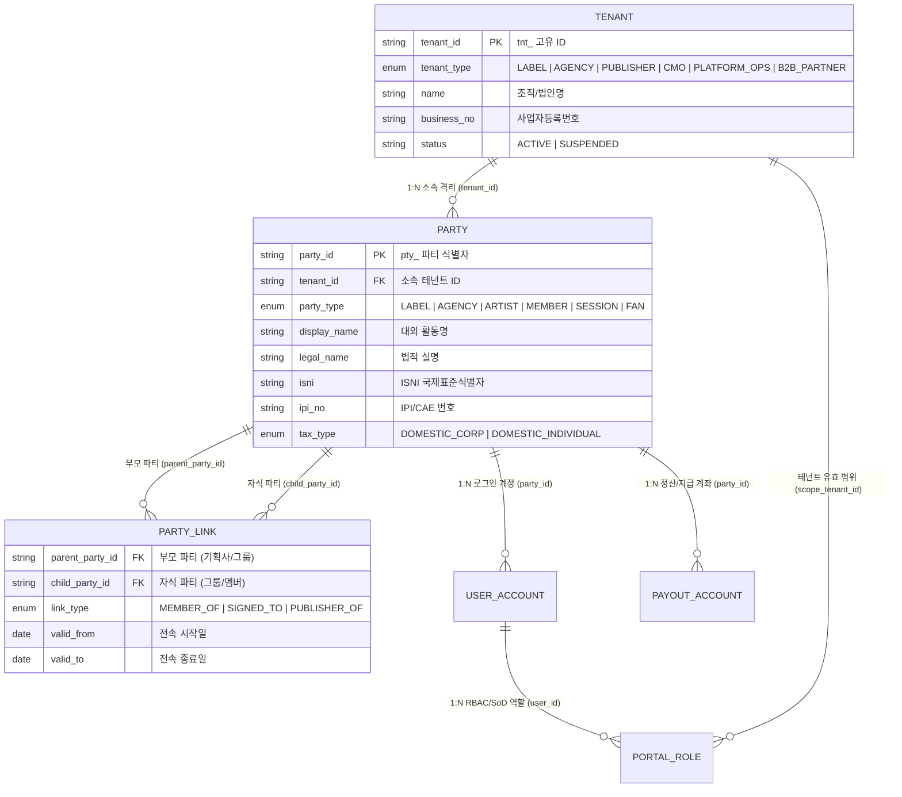
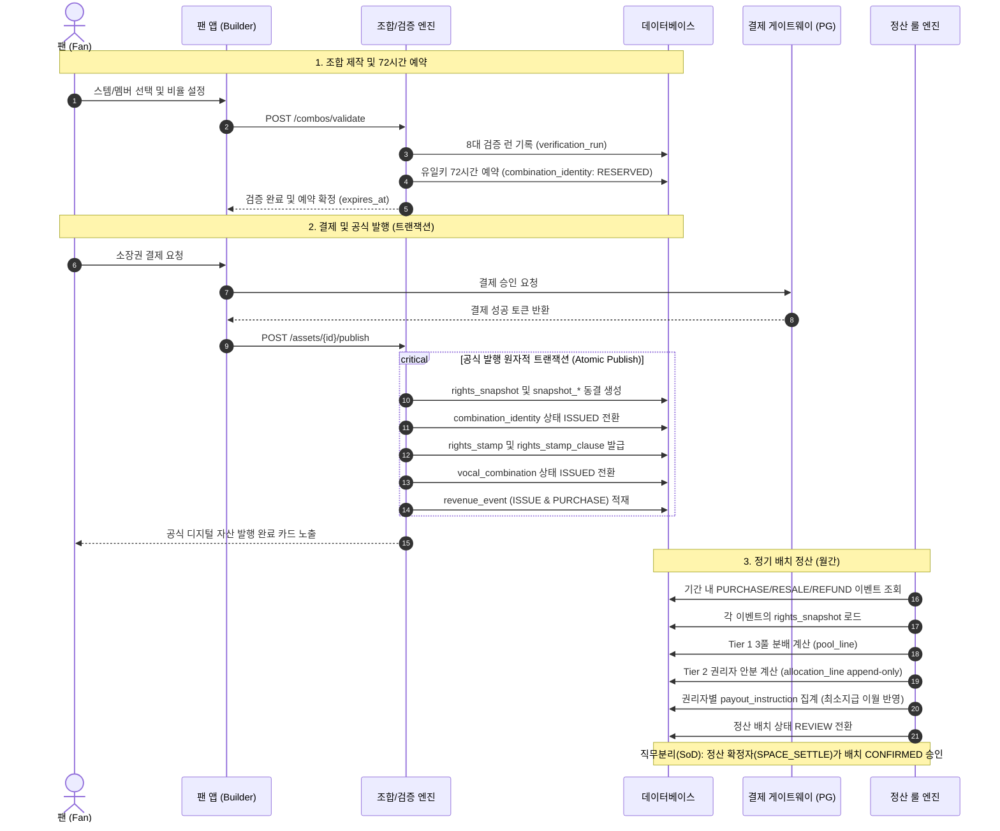

# dobedopop 보컬조합 통합 데이터 모델 (Data Model Specification)

- **문서 상태**: 설계 확정 (v2.6)
- **적용 대상**: dobedopop 보컬조합 플랫폼, 백오피스, 권리자 콘솔, 실연자 포털, 정산 룰 엔진
- **기준 정책 문서**: `보컬조합_사업기획서_v1.13_20260918.docx`, `보컬조합_백오피스_구성방안_v1.2_20260918.docx`
- **v2.6 변경 요약 (2026-09-22)** — 무결성·부정 방지(IFPI Streaming Integrity 5원칙 준용):
  1. **3.10 Integrity & Anti-Fraud** 신설: 위협 모델(팬 인센티브 풀 파밍·도난 결제/자금세탁·자기거래·유일키 선점·타인 녹음/목소리 무단 등록·외부 무단 유통), `verification_record`(VERIFY: KYB/KYC 등급 게이트), `source_integrity_check`(VET: 핑거프린트·AI 생성·음성 유사도·메타데이터), `fraud_signal`/`fraud_case`/`enforcement_action`(ACT), `integrity_share_record`(SHARE: 고신뢰 해시 지표만), `v_integrity_kpi`(MEASURE)
  2. 정산 연동: `revenue_event.integrity_status`/`fraud_case_id`, `unallocated_holding.reason_code = FRAUD_REVIEW`, `payout_instruction.release_after`(초기 지급 보류), 부정 의심 이벤트는 배치·팬 인센티브·랭킹·히트맵·공동 최소 보장 산정에서 제외
  3. `tenant`/`party.verification_level`, `stem.integrity_status`, `rights_stamp.export_watermark_id`/`fingerprint_ref`, 인스펙터 무결성 배지 확장, 상태머신·불변조건 38~42·인덱스·검증 코드 추가
- **v2.5 변경 요약 (2026-09-21)** — 플랫폼 권리 구조 통합 인스펙터(조회 전용):
  1. **3.9 Rights Inspection Read Model** 신설: `v_rights_structure_tree`(테넌트→파티→작품→원본 이미지→팩 계층 트리), `v_party_participation`(파티 × 작품 × 이미지 × 팩 참여 매트릭스), `v_pack_policy_diff`(팩 정책 필드별 원본값/팩값/연산자/검증 결과), `v_settlement_trace`(정산 라인 → 스냅샷 → 정책 버전 → 원장 행 → 파티 → 지급 역추적) — 모두 읽기 전용 파생 뷰, CRUD 경로 없음
  2. `inspection_audit_log` 신설: 플랫폼 운영자의 열람 감사(PII 마스킹 해제는 `PLATFORM_FINANCE` + 사유 필수), 권한 규칙 3항
  3. 불변조건 36~37(인스펙터 쓰기 금지, PII 열람 기록), 인덱스 추가
- **v2.4 변경 요약 (2026-09-21)** — L0 권리 원장·정책 객체 분리:
  1. **L0 권리 원장 `rights_image_party`** 신설: 파티별 권리 매핑(역할/원천/동의 링크/**개인별 지역·행위·조항 상한**/기본 지분/지급 경로). 이미지 총량 상한은 원장 합집합으로 자동 계산. 팩 `claimant`는 원장에서 도출(`image_party_id`), 팩 그랜트는 party 상한 교집합 안에서만 유효(`party_scope_mode`)
  2. **정책 객체 분리**: L0 `license_policy_baseline`(이용 정책 기본값·상한, 마스터 권리자+기획사 관리) / `settlement_policy_baseline`(정산 정책 기본값·하한, 마스터 권리자 관리, `platform_contract` 범위 내) — 팩 `license_policy`(기획사 설정) / `settlement_policy`(마스터 권리자 편집) 버전 객체로 기존 그랜트·발행 룰·제약·조항 / Tier 1·Tier 2 테이블을 묶음. 정책 소유 매트릭스 명시
  3. `platform_contract` 신설(Tier 1 허용 구간의 계약 근거, 플랫폼은 범위 검증만), 불변조건 32~35, 검증 코드 `PARTY_CEILING_EXCEEDED`, `CONTRACT_RANGE_VIOLATION`
- **v2.3 변경 요약 (2026-09-21)** — 권리 주체·청구권자·정산 연결 명확화:
  1. **파티 계층(G-1~G-6)**: `party_link`에 `link_id` PK·`role_in_group`·`sort_order`·`status`(재합류 이력 허용), `recording_artist`(녹음의 활동 주체) 신설, `voice_asset.member_link_id`(팩 생성 시 유효 소속 검증), `party.payout_route`/`payout_via_party_id`(기획사 일괄 수령), C5 주체 판정 규칙
  2. **청구권자 도출(S-1~S-3)**: `claimant.source`/`source_ref_id` — 그랜트 활성화 시 원천(마스터 권리자/저작자 크레딧/스템 크레딧/기획사/AI 원천/녹음 크레딧)에서 자동 도출·물질화, 권리자는 추가만. `share_bucket.member_source`(EXPLICIT/WORK_CREDIT/STEM_USAGE/RECORDING_CREDIT/CMO)로 버킷 멤버 도출 방식 명시. 커버리지 가드 = 모든 청구권자가 버킷에 귀속
  3. **스템 없는 권리자 정산(S-4~S-5)**: `recording_credit.settlement_eligible`/`claimant_role`, 신탁곡(`work.cmo_managed`)은 CMO party 1행으로 저작권 버킷 수령
  4. **미확정 party(S-6)**: `PENDING_VERIFICATION` party로 크레딧·배분 라인은 생성, 지급만 `unallocated_holding(PARTY_UNVERIFIED)`
  5. **테넌트 비정산(S-7)**: 불변조건 28~31 추가
- **v2.2 변경 요약 (2026-09-20)** — 2계층 이미지 모델:
  1. **원본 권리 이미지(`rights_image`)** 신설: 작품–슬롯–스템–크레딧 템플릿 + 권리 베이스라인(지역/행위/조항 상한, 지분 상·하한, 정산 비율 하한, 가격 구간)을 버전 단위 불변 객체로 관리
  2. **팩 이미지 = `vocal_pack`**: 채널·캠페인·에디션을 팩 하나로 통합(`campaign` 테이블 폐지). 팩은 이미지 버전에 핀 고정되고 **차분만 저장**(NULL/행 없음 = 상속)
  3. **축소 전용 계승**: `inheritance_rule` 격자(SUBSET/LE/GE/SUPERSET/WITHIN_RANGE/LOCK_ONLY_ADD)로 팩 저장·활성화 시 검증(`INHERITANCE_VIOLATION`), 원본 개정 시 `BASE_IMAGE_STALE`
  4. **발행 시 평탄화**: `pack_effective_policy`(팩 버전별 유효 정책 캐시, 해시) → `rights_snapshot.recipe_json`으로 동결
  5. 유일 스코프 `PACK \| FAN_PACK`, 조합 제약 `owner_type(IMAGE\|PACK)`, 캠페인 참조 컬럼 전부 팩 참조로 치환, 상태머신·불변조건(21~25)·인덱스 갱신
  7. **플랫폼 = 검증자·집행자 원칙**: `tenant.ops_delegation`(위임 업무 목록), `audit_log.acting_on_behalf_of`(대행 기록), `content_report`(신고 접수·사유 분류 `RIGHTS|PLATFORM_POLICY`) 신설, `kill_switch_event.reason_class`, `dispute.reason_class`, 승인 모드에서 플랫폼(`SPACE`)은 위임 시에만 유효, 불변조건 26~27
  6. **깊이 2 고정 + 팩 복제 운영**: 채널 계층·팩 간 상속 없음. 시즌/이벤트 반복은 `팩 복제 → 설정(기간/이름/조건) 변경`으로 운영(`cloned_from_pack_id`, 복제 규칙 명시)
- **v2.1 변경 요약 (2026-09-20)**:
  1. 3.2 자산 계층 재구성: `part_slot`(구간) / `stem`(녹음 파일) 분리, `pack_stem`이 `stem_voice`·`vocal_pack.locked_stem_ids`를 대체, `work_credit`·`recording_credit` 신설, `part_type`을 `section`+`layer`로 분리, QC 상태는 스템 단위로 일원화
  2. 3.3 `grant_consent` 링크 신설(동의 커버리지 검증 근거), `consent_agreement.target_recording_id` 추가
  3. 3.4 `combination_constraint_party` 정의 추가, 제약 접두어 `ccn_`, `issuance_rule` 캠페인 오버라이드(강화만), `campaign.uniqueness_scope_override`, 캠페인–그랜트 팩 일치 CHECK
  4. 3.5/3.6 `combination_assignment`·`snapshot_stem_assignment`에 `slot_id` 추가, 배정의 `party_id`/`rights_bearing`은 스템에서 파생
  5. 불변조건 2 수정, 17~20 추가; 인덱스/DDEX 매핑 보강

---

## 1. 설계 원칙 및 핵심 규격

1. **스냅샷 불변 원칙 (Immutable Snapshot)**:
   - 조합 발행(ISSUED) 시점의 이용 그랜트, 라이센스 정책, 2계층 안분 룰, 스템 사용량(`StemUsage`), 참여 멤버 비율(`MEMBER_PCT`), 계약 버킷(`CONTRACT`)을 `rights_snapshot`에 동결한다.
   - 정산 엔진은 오직 **발행 당시 스냅샷**과 **원장 이벤트**만을 읽고 계산하며, 이후의 정책 수정은 기존 조합 정산에 소급되지 않는다.
2. **원장 추가 전용 원칙 (Append-Only Ledger)**:
   - `revenue_event`, `allocation_line`, `audit_log`, `point_entry`는 INSERT만 허용된다.
   - 결제 취소/환불은 기존 행을 수정하지 않고 `REVERSAL` 음수 라인으로 역분개하여 차기 배치에서 차감/상계한다.
3. **금액 및 비율 표준 (Numeric Standards)**:
   - **금액**: 원화 기준 정수 `BIGINT` (KRW, 음수 허용).
   - **선언/계약 비율**: 베이시스 포인트 `bps` (`INT`, 10000 bps = 100.00%).
   - **계산 비중/가중치**: 고정밀도 실수 `NUMERIC(16, 12)`.
   - **반올림 원칙**: 원 단위 절사(Floor) 후 잔여 금액은 최대 지분자(`LARGEST_SHARE`)에 가산하며, 동률 시 `party_id` 오름차순으로 배정하여 총액 일치를 강제한다.
4. **직무 분리 통제 (Separation of Duties, SoD)**:
   - 정책 편집자(`SPACE_EDITOR`)와 정책 활성화 확정자(`SPACE_LEGAL` / `AGENCY_ADMIN`)는 동일 계정일 수 없다.
   - 정산 배치 실행자(`SPACE_SETTLE_OPERATOR`)와 배치 확정자(`SPACE_SETTLE_CONFIRMER`)는 분리된다.
   - 위반 시도는 DB 트리거 및 앱 가드에서 즉시 차단되고 감사로그에 기록된다.
5. **2계층 이미지 모델 (Two-Layer Image Model)**:
   - **L0 원본 권리 이미지**(`rights_image`): 녹음 버전의 슬롯/스템/크레딧 템플릿과 권리 베이스라인. 버전 단위 불변, 개정은 새 버전.
   - **L1 팩 이미지**(`vocal_pack`): 채널·캠페인·에디션을 하나로 보는 퍼블리싱 단위. 특정 원본 이미지 버전에 핀 고정되며 **차분만 저장**한다(컬럼 NULL 또는 행 없음 = 원본 상속).
   - **축소 전용 계승**: 팩은 원본의 허용 범위를 좁힐 수만 있다. 필드별 연산은 `inheritance_rule` 격자로 정의하고 팩 저장/활성화 시 검증한다.
   - **발행 시 평탄화**: 팩 버전별 유효 정책(`pack_effective_policy`)을 미리 계산해 두고, 조합 발행 시 그 값을 `rights_snapshot`에 동결한다. 검증 엔진과 정산 엔진은 평탄화된 값만 읽는다.
   - **하드 전파 예외**: 동의 철회·킬 스위치·그랜트 폐지는 핀 고정과 무관하게 모든 파생 팩에 즉시 전파된다.
   - **플랫폼 = 검증자·집행자**: 플랫폼 운영자는 무결성 검증(QC/정합/계승/커버리지/렌더/유일키)과 플랫폼 정책·법규 판단, 정산·지급 집행만 수행한다. 권리 판단(슬롯/크레딧 확정, 허용 범위, 발행 요청 승인, 권리 침해 신고 판정, 정책/팩 활성화)은 권리자만 하며, 플랫폼이 이를 수행하는 유일한 경로는 `tenant.ops_delegation`에 명시된 위임 업무를 해당 테넌트 권한으로 대행하는 경우다(감사로그 `acting_on_behalf_of` 필수).
   - **플랫폼 조회는 전 계층, 쓰기는 없음**: 플랫폼 운영자는 테넌트 → 파티 계층 → 작품 → 원본 권리 이미지(권리 원장·정책 기본값) → 팩(정책 차분·청구권자) → 정산 라인까지 연계 조회할 수 있어야 하며(3.9 인스펙터 뷰), 이 경로에서 어떤 관리 정보도 생성·수정·삭제하지 않는다. 열람은 `inspection_audit_log`로 감사한다.
   - **두 관문의 무결성 (IFPI 5원칙)**: 권리자 스템 등록(유입)과 스탬프 외부 반출(유출)은 유통사와 같은 관문이다. 확인 등급(KYB/KYC) 없이 등록·지급하지 않고, 소스 무결성 검사(핑거프린트·AI 생성·음성 유사도)를 통과하지 않은 스템은 READY가 될 수 없으며, 부정 의심 매출은 판정 전까지 정산·보상 산정에서 격리한다. 부정 이용 판정은 권리 판단이 아니라 플랫폼 정책 판단이므로 플랫폼(Trust & Safety)이 직권 수행한다(3.10).
   - **L0 = 권리 원장 + 기본 정책**: 원본 이미지는 템플릿뿐 아니라 파티별 권리 원장(`rights_image_party`: 누가 어떤 권리·동의를 갖고 어디까지 허용했나)과 두 정책 베이스라인(`license_policy_baseline` 이용 정책, `settlement_policy_baseline` 정산 정책)을 가진다. 팩은 원장에서 청구권자를 도출하고, 두 베이스라인을 상속(NULL)하거나 범위 안에서 좁힌 **이용 정책·정산 정책 버전 객체**를 가진다. 두 정책은 같은 계승 메커니즘을 쓰는 다른 객체이며 관리·적용·승인 주체가 다르다.
   - **깊이 2 고정**: 원본 이미지 → 팩 이미지 두 단계만 존재한다. 채널 이미지·팩 간 상속·캠페인 오버레이는 두지 않는다. 같은 채널의 반복 캠페인은 **기존 팩을 복제한 뒤 기간/이름/조건을 수정**하는 운영 기능으로 처리한다(복제는 차분 행의 복사이며 상속 관계를 만들지 않는다).
6. **ID 접두어 체계 (Prefix Standard)**:
   - `tnt_` (테넌트), `pty_` (파티/권리주체), `plk_` (파티링크), `usr_` (사용자계정), `acc_` (지급계좌), `wrk_` (저작물), `rcd_` (음원버전), `wcr_` (저작물크레딧), `rcr_` (녹음크레딧), `slt_` (파트슬롯), `stm_` (스템파일), `crd_` (스템크레딧), `rim_` (권리이미지), `rip_` (권리원장행), `pcn_` (플랫폼계약), `lpo_` (이용정책), `spo_` (정산정책), `pak_` (보컬팩=팩이미지), `vo_` (보이스), `cst_` (동의), `grn_` (이용그랜트), `rul_` (발행규칙), `ccn_` (조합제약), `alp_` (안분정책), `srl_` (정산규칙), `irl_` (계승규칙), `pep_` (유효정책캐시), `vc_` (조합음원), `cid_` (유일키), `vrn_` (검증런), `irq_` (발행요청), `stp_` (권리스탬프), `snp_` (스냅샷), `evt_` (매출이벤트), `bat_` (정산배치), `aln_` (안분라인), `pay_` (지급지시), `unh_` (미배분보류), `dsp_` (분쟁), `ksw_` (킬스위치), `aud_` (감사로그), `pnt_` (포인트), `rpt_` (신고)., `vrf_` (확인 기록), `sic_` (소스 무결성 검사), `fsg_` (부정 신호), `fcs_` (부정 케이스), `enf_` (집행), `shr_` (지표 공유)

---

## 2. 8대 바운디드 컨텍스트 (Bounded Contexts)

| 컨텍스트 | 핵심 책임 | 주요 산출 엔티티 | 타 컨텍스트 제공 데이터 |
| :--- | :--- | :--- | :--- |
| **1. Identity & Organization** | 다중 테넌트, 권리 주체(Party), 포털 계정, 역할/권한(SoD), 지급/세무 정보 | `tenant`, `party`, `user_account`, `portal_role`, `payout_account` | `tenant_id`, `party_id` |
| **2. Asset Pipeline & Catalog** | 저작물/녹음 크레딧, 음원 버전, 파트 슬롯(구간), 스템 파일(QC), DDEX RIN 크레딧, **원본 권리 이미지(L0)**, **팩 이미지(L1: 채널·캠페인·에디션 통합)**, 팩 스템 차분, 보이스 에셋 | `work`, `work_credit`, `recording_version`, `recording_credit`, `part_slot`, `stem`, `stem_credit`, `rights_image`, `rights_image_item`, `vocal_pack`, `voice_asset`, `pack_stem` | `image_id`, `pack_id`, `slot_id`, `stem_id` |
| **3. Rights & Consent Vault** | C1~C7 7대 계약/동의, **L0 권리 원장(파티별 권리·상한)**, 플랫폼 계약, 팩 이용 정책(버전 객체: 이용 그랜트·지역/행위/파트·스탬프 적격 규칙), 청구권자(원장 도출) | `consent_agreement`, `rights_image_party`, `platform_contract`, `license_policy`, `license_grant`, `grant_consent`, `grant_action`, `stamp_eligibility_rule`, `claimant` | `grant_id`, `consent_id` |
| **4. Rules & Policy Engine** | L0 정책 베이스라인(이용/정산), 팩 정산 정책(버전 객체: Tier 1 3풀, Tier 2 안분·4대 실연 풀 모드), 발행 비율 룰, 조합 제약(3종, 원본/팩 소유), 계승 규칙 격자, 팩 유효 정책 캐시 | `license_policy_baseline`, `settlement_policy_baseline`, `settlement_policy`, `settlement_rule`, `allocation_policy`, `alloc_layer`, `combination_constraint`, `inheritance_rule`, `pack_effective_policy` | `settlement_rule_id`, `allocation_policy_id`, `effective_hash` |
| **5. Combination & Digital Asset** | STEM/CUBE 빌더 조합, 유일키(72h 예약), 8대 검증 런, 72h 발행 승인 큐, 권리 스탬프 조항 | `vocal_combination`, `combination_assignment`, `combination_identity`, `verification_run`, `rights_stamp` | `vc_id`, `stamp_id` |
| **6. Snapshot (불변)** | 조합 발행 시점의 권리·동의·안분 입력값 불변 복제본, 재현 레시피 JSON | `rights_snapshot`, `snapshot_member_pct`, `snapshot_stem_assignment`, `snapshot_bucket` | `snapshot_id` (정산의 유일 입력) |
| **7. Ledger & Settlement Engine** | 매출/환불 원장, 배치 실행/확정, 3풀 분배, Tier 2 권리자 안분 라인, 지급 지시, 미배분 보류 | `revenue_event`, `settlement_batch`, `pool_line`, `allocation_line`, `payout_instruction`, `unallocated_holding` | 정산/지급 원장 데이터 |
| **8. Governance & Monitoring** | 긴급 킬 스위치(사후 처리), 분쟁/이의제기(3단계 에스컬레이션), 팬 인센티브 포인트, 5년 감사로그, 플랫폼 권리 구조 인스펙터(읽기 모델·열람 감사), 무결성·부정 방지(확인 등급·소스 무결성·부정 케이스·지표 공유) | `kill_switch_event`, `dispute`, `point_entry`, `audit_log`, `v_*`(3.9), `inspection_audit_log`, `verification_record`, `source_integrity_check`, `fraud_case`, `integrity_share_record` | 보호/감사/보상 데이터 |

---

## 3. 컨텍스트별 세부 데이터 모델

### 3.1 Identity & Organization

#### 1. 테넌트(Tenant) 및 권리주체(Party) 계층 구조 및 관계 정의

`dobedopop` 플랫폼은 엔터프라이즈 다중 테넌트 격리(`tenant`)와 복합적인 음악 권리 주체(`party`)를 분리하여 관리합니다.



> **구조적 핵심 원칙**:
> 1. **테넌트(Tenant)**: 권한 및 데이터 격리 단위 (예: `tnt_star` 스타엔터테인먼트, `tnt_dobedop` 두비덥레이블, `tnt_komca` 음저협).
> 2. **파티(Party)**: 권리 정산 및 크레딧의 귀속 주체 (예: 기획사 법인 `pty_star_corp`, 소속 그룹 `pty_nova_group`, 개별 멤버 `pty_nova_lead`, `pty_nova_sub`).
> 3. **파티 링크(party_link)**: 그룹-멤버(`MEMBER_OF`), 기획사-아티스트(`SIGNED_TO`) 관계를 시간 축(`valid_from` ~ `valid_to`)으로 관리하여 멤버 탈퇴나 이적 시에도 과거 정산 스냅샷의 불변성을 보장. 재합류는 새 링크 행(기간 겹침 불가)으로 기록한다.
> 5. **정산 주체는 오직 party**: 테넌트는 격리·권한 단위이며 금액을 갖지 않는다. 그룹 party(`ARTIST`)도 정산 라인의 대상이 아니라 멤버 도출(`recording_artist`→`voice_asset`)과 지급 합산 경로(`payout_route`)에만 쓰인다. 배분 라인은 항상 개인 멤버·법인·CMO 등 **청구권자 party**로 내려간다.
> 6. **세 층의 분리**: 권리 사실(`work_credit`/`recording_version.master_owner`/`recording_credit`/`stem_credit`, 자산 계층에 1회) → 권리 허락(`consent_agreement`=party, `license_grant`+`claimant`=팩) → 정산 규칙(`settlement_rule`/`allocation_policy`/`share_bucket`=팩). 청구권자는 권리 사실에서 **도출**되고, 버킷은 청구권자를 **원천별로** 수용한다.
> 4. **팬/개인 크리에이터**: 기본 플랫폼 테넌트(`tnt_platform_default`)에 소속된 `party_type = FAN`으로 자동 프로비저닝.

---

#### tenant
다중 테넌트 격리 및 엔터티 조직 관리.

| 컬럼 | 타입 | 제약 | 비즈니스 설명 |
| :--- | :--- | :--- | :--- |
| `tenant_id` | TEXT | PK (`tnt_`) | 테넌트 고유 ID |
| `tenant_type` | ENUM | NOT NULL | `LABEL \| AGENCY \| PUBLISHER \| CMO \| PLATFORM_OPS \| B2B_PARTNER` |
| `name` | TEXT | NOT NULL | 조직/법인명 |
| `business_no` | TEXT | | 사업자등록번호 (법인) |
| `country_code` | CHAR(2) | NOT NULL DEFAULT 'KR' | ISO 국가 코드 |
| `ops_delegation` | TEXT[] | NOT NULL DEFAULT '{}' | 플랫폼에 위임한 업무 목록: `SLOT_LABELING \| STEM_CREDIT \| ISSUE_REQUEST_APPROVAL \| RIGHTS_REVIEW`. 비어 있으면 플랫폼은 해당 테넌트의 권리 판단을 수행할 수 없음 |
| `delegation_contract_uri` | TEXT | | 위임 근거 계약/동의 문서 URI (위임 항목이 있으면 NOT NULL) |
| `status` | ENUM | NOT NULL DEFAULT 'ACTIVE' | `ACTIVE \| SUSPENDED \| TERMINATED` |
| `verification_level` | ENUM | NOT NULL DEFAULT 'NONE' | `NONE \| KYB_BASIC \| KYB_FULL` — 최신 PASSED `verification_record` 기준 캐시. `KYB_FULL` 전에는 스템 업로드·이미지 ACTIVE·팩 LIVE 불가(`KYB_REQUIRED`, 3.10) |
| `created_at` | TIMESTAMPTZ | NOT NULL | 생성 일시 |

#### party
권리 주체, 기획사, 실연자, AI 원천 제공자, 팬, 플랫폼의 마스터 엔티티.

| 컬럼 | 타입 | 제약 | 비즈니스 설명 |
| :--- | :--- | :--- | :--- |
| `party_id` | TEXT | PK (`pty_`) | 파티 고유 식별자 |
| `tenant_id` | TEXT | FK `tenant` | 소속 테넌트 (팬/개인은 플랫폼 기본 테넌트) |
| `party_type` | ENUM | NOT NULL | `LABEL \| AGENCY \| PUBLISHER \| CMO \| ARTIST \| MEMBER \| SESSION \| AI_PROVIDER \| FAN \| PLATFORM` |
| `display_name` | TEXT | NOT NULL | 대외 노출 활동명/회사명 |
| `legal_name` | TEXT | | 법적 실명 (세무/계약용) |
| `isni` | CHAR(16) | | ISNI (국제표준성명식별자) |
| `ipi_no` | VARCHAR(11) | | IPI/CAE 번호 (작사/작곡/출판사) |
| `tax_type` | ENUM | NOT NULL DEFAULT 'DOMESTIC_CORP' | `DOMESTIC_CORP \| DOMESTIC_INDIVIDUAL \| FOREIGN \| EXEMPT` |
| `cmo_affiliated` | BOOL | NOT NULL DEFAULT FALSE | 신탁단체(음실련/음저협 등) 위탁 여부 |
| `payout_route` | ENUM | NOT NULL DEFAULT 'SELF' | `SELF`(본인 계좌) \| `VIA_PARENT`(지정 상위 party가 일괄 수령 후 내부 분배; 배분 라인·명세는 본인 기준 유지) |
| `payout_via_party_id` | TEXT | FK `party` NULLABLE | `VIA_PARENT` 시 수령 party (유효한 `SIGNED_TO` 부모여야 함) |
| `status` | ENUM | NOT NULL DEFAULT 'ACTIVE' | `ACTIVE \| SUSPENDED \| PENDING_VERIFICATION` (`PENDING_VERIFICATION`: 크레딧·배분 라인 생성 가능, 지급은 보류) |
| `verification_level` | ENUM | NOT NULL DEFAULT 'NONE' | `NONE \| KYC_ID \| KYC_BANK \| KYC_ENHANCED` — 최신 PASSED `verification_record` 기준 캐시. 권리자/실연자는 `KYC_BANK` 이상이어야 지급, 팬은 상업·다운로드 스탬프·고액 결제·2차 판매 시 `KYC_ENHANCED` 필요(`KYC_TIER_REQUIRED`) |
| `created_at` | TIMESTAMPTZ | NOT NULL | 생성 일시 |

#### party_link
그룹-멤버, 기획사-아티스트 간의 계층 및 전속 관계.

| 컬럼 | 타입 | 제약 | 비즈니스 설명 |
| :--- | :--- | :--- | :--- |
| `link_id` | TEXT | PK (`plk_`) | 링크 ID (재합류·재계약은 새 행) |
| `parent_party_id` | TEXT | FK `party` NOT NULL | 부모 파티 (그룹, 레이블, 기획사) |
| `child_party_id` | TEXT | FK `party` NOT NULL | 자식 파티 (멤버, 소속 아티스트) |
| `link_type` | ENUM | NOT NULL | `MEMBER_OF \| SIGNED_TO \| PUBLISHER_OF \| SUB_AFFILIATE` |
| `role_in_group` | ENUM | NULLABLE | `MEMBER_OF` 전용: `LEADER \| MAIN_VOCAL \| LEAD_VOCAL \| SUB_VOCAL \| RAPPER \| DANCER \| MEMBER` (빌더 기본 가중치·표시 참고) |
| `sort_order` | INT | NULLABLE | 그룹 내 표시 순서 (빌더 멤버 열 순서) |
| `status` | ENUM | NOT NULL DEFAULT 'ACTIVE' | `ACTIVE \| HIATUS \| LEFT \| GRADUATED \| TERMINATED` (`LEFT/GRADUATED/TERMINATED` 시 `valid_to` NOT NULL) |
| `valid_from` | DATE | NOT NULL | 전속/소속 시작일 |
| `valid_to` | DATE | | 전속/소속 종료일 (NULL=유효) |
| **UNIQUE** | | `(parent_party_id, child_party_id, link_type, valid_from)` | 재합류 이력 허용 |
| **EXCLUDE** | | 동일 `(parent, child, link_type)`의 기간 겹침 금지 (daterange &&) | |

> **C5 퍼블리시티 주체 판정**: 멤버의 C5 동의 요청·연서 주체는 해당 시점에 유효한 `SIGNED_TO` 링크의 기획사 party다. 그룹의 기획사와 멤버의 기획사가 다르면 **멤버 기준**을 따른다(커버리지 검증 규칙).

#### user_account
포털 로그인 계정 및 인증 정보.

| 컬럼 | 타입 | 제약 | 비즈니스 설명 |
| :--- | :--- | :--- | :--- |
| `user_id` | TEXT | PK (`usr_`) | 사용자 계정 고유 ID |
| `party_id` | TEXT | FK `party` NULLABLE | 연결된 권리자/팬 Party (내부 운영자는 NULL 가능) |
| `email` | TEXT | UNIQUE NOT NULL | 로그인 이메일 |
| `auth_provider` | ENUM | NOT NULL DEFAULT 'LOCAL' | `LOCAL \| GOOGLE \| KAKAO \| APPLE` |
| `two_factor_enabled`| BOOL | NOT NULL DEFAULT FALSE | 2단계 인증 활성화 여부 (관리자 필수) |
| `status` | ENUM | NOT NULL DEFAULT 'ACTIVE' | `ACTIVE \| DISABLED \| LOCKED` |
| `last_login_at` | TIMESTAMPTZ | | 최종 로그인 일시 |

#### portal_role
포털 사용자별 RBAC 역할 및 직무 분리(SoD) 통제.

| 컬럼 | 타입 | 제약 | 비즈니스 설명 |
| :--- | :--- | :--- | :--- |
| `user_id` | TEXT | FK `user_account` NOT NULL | 사용자 ID |
| `role` | ENUM | NOT NULL | `MASTER_OWNER \| AGENCY_ADMIN \| WORK_RIGHTS \| PERFORMER \| AI_PROVIDER \| B2B_PARTNER \| SPACE_OPS \| SPACE_EDITOR \| SPACE_SETTLE \| SPACE_LEGAL \| SPACE_AUDITOR \| FAN` |
| `scope_tenant_id`| TEXT | FK `tenant` NULLABLE | 역할 유효 테넌트 범위 |
| `scope_party_id` | TEXT | FK `party` NULLABLE | 특정 파티 한정 역할 (실연자 본인 데이터 한정 등) |
| **PK** | | `(user_id, role, scope_tenant_id)` | |

> **직무 분리(SoD) 가드**: 동일 `user_id`에 `SPACE_EDITOR`(정책 편집)와 `SPACE_LEGAL`/`AGENCY_ADMIN`(정책 활성화), 또는 `SPACE_OPS`(배치 실행)와 `SPACE_SETTLE`(배치 확정)을 동시 부여할 수 없다.

#### payout_account
실명 인증된 원천징수/지급 계좌 및 세무 증빙 정보 (토큰화 및 암호화).

| 컬럼 | 타입 | 제약 | 비즈니스 설명 |
| :--- | :--- | :--- | :--- |
| `payout_account_id`| TEXT | PK (`acc_`) | 지급 계좌 고유 식별자 |
| `party_id` | TEXT | FK `party` NOT NULL | 계좌 소유 권리 주체 |
| `bank_code` | VARCHAR(10) | NOT NULL | 금융기관 코드 (예: `004` 국민, `088` 신한, `003` 기업) |
| `account_holder` | TEXT | NOT NULL | 예금주명 (본인 실명 검증 필수) |
| `encrypted_account_no` | TEXT | NOT NULL | AES-256 암호화 계좌번호 |
| `external_vault_token` | TEXT | | PG/정산 모듈 토큰 핸들 (KFTC 오픈뱅킹) |
| `currency` | CHAR(3) | NOT NULL DEFAULT 'KRW' | 지급 통화 |
| `is_primary` | BOOL | NOT NULL DEFAULT TRUE | 기본 정산 계좌 여부 |
| `verification_method` | ENUM | NOT NULL DEFAULT '1WON_TRANSFER' | `1WON_TRANSFER \| EXTERNAL_API \| MANUAL_REVIEW` |
| `verification_code_hash`| TEXT | | 1원 송금 시 입금자명 4자리 인증코드 해시 |
| `verified_at` | TIMESTAMPTZ | | 실명 및 1원 계좌 인증 완료 일시 |
| `tax_id_type` | ENUM | NOT NULL DEFAULT 'RRN_DOMESTIC' | `RRN_DOMESTIC \| BRN_CORP \| FOREIGN_TIN \| PASSPORT` |
| `encrypted_tax_id` | TEXT | | AES-256 암호화된 주민번호/외국인등록번호/사업자번호 |
| `tax_id_verified` | BOOL | NOT NULL DEFAULT FALSE | 국세청/홈택스 실명·세무 식별자 검증 완료 여부 |
| `requested_by_party_id`| TEXT | FK `party` NULLABLE | 계좌 등록/변경을 요청한 기획사/레이블 Party ID |
| `requested_at` | TIMESTAMPTZ | | 기획사 정산계좌 등록 요청 발송 일시 |
| `rejection_reason` | TEXT | | 1원 인증 실패 또는 관리자 반려 사유 |
| `status` | ENUM | NOT NULL DEFAULT 'PENDING_VERIFICATION'| `PENDING_VERIFICATION \| ACTIVE \| INVALID \| SUSPENDED` |
| `created_at` | TIMESTAMPTZ | NOT NULL | 계좌 등록 일시 |

---

### 3.2 Asset Pipeline & Catalog (DDEX RIN 준용)

```
[work] 1 ──< [work_credit]                       (작사/작곡/편곡 — 저작권 풀 청구권자 원천)
  │
  └──< [recording_version] 1 ──< [recording_credit]   (프로듀서/세션/MR — 녹음 단위 크레딧)
             │
             ├──< [part_slot] 1 ──< [stem] 1 ──< [stem_credit]   (슬롯 = 구간, 스템 = 녹음 파일, 크레딧 = 가창자)
             │
             └──< [rights_image] (L0 원본 권리 이미지, 버전 불변) 1 ──< [rights_image_item] (템플릿 항목: 슬롯/스템/필수 잠금)
                        ├──< [rights_image_party]        (권리 원장: 파티별 역할/동의/개인 상한/기본 지분)
                        ├──|| [license_policy_baseline]  (이용 정책 기본값·상한)
                        └──|| [settlement_policy_baseline] (정산 정책 기본값·하한, platform_contract 범위)
                        │
                        └──< [vocal_pack] (L1 팩 이미지 = 채널·캠페인·에디션, 원본 버전에 핀 고정, 차분만 저장)
                                   ├──< [voice_asset]   (팩 안의 선택 가능 멤버)
                                   └──< [pack_stem]     (원본 템플릿 대비 선택 가능/잠금/기본 선택 차분)
```

> **계층 의미**: 권리는 `work`/`recording_version`/`stem` 계층(누가 무엇을 만들고 불렀나)에 붙고, 이를 버전으로 묶은 것이 **원본 권리 이미지(L0)**다. 허용/제한/정산 규칙은 **팩 이미지(L1)**에 붙되, 팩은 원본 이미지의 베이스라인을 좁힐 수만 있고 차분만 저장한다. 채널·캠페인·에디션은 별도 계층이 아니라 팩 하나로 본다. 같은 녹음으로 팩을 여러 개 만들어도 크레딧/동의/템플릿은 원본 이미지에 한 번만 존재한다.
>
> **슬롯/스템 분리 원칙**: `part_slot`은 곡 구조상의 구간(섹션 × 레이어 × 타임코드)이고, `stem`은 그 슬롯을 특정 멤버가 부른 **오디오 파일 1개**다. 4명이 같은 후렴을 각각 녹음하면 `part_slot` 1행 아래 `stem` 4행이 생기며, 파일 URL/해시/QC는 스템마다 따로 관리된다.

#### work
음악 저작물(작품) 마스터.

| 컬럼 | 타입 | 제약 | 비즈니스 설명 |
| :--- | :--- | :--- | :--- |
| `work_id` | TEXT | PK (`wrk_`) | 저작물 고유 ID |
| `title` | TEXT | NOT NULL | 저작물 공식 제목 |
| `iswc` | CHAR(11) | UNIQUE NULLABLE | ISWC (국제표준음악저작물코드 T-NNNNNNNNN-C) |
| `original_publisher_id`| TEXT | FK `party` | 원출판사 / 저작권 대행사 |
| `cmo_managed` | BOOL | NOT NULL DEFAULT FALSE | 신탁단체(음저협 등) 관리곡 여부 |
| `status` | ENUM | NOT NULL DEFAULT 'ACTIVE' | `DRAFT \| ACTIVE \| ARCHIVED` |
| `created_at` | TIMESTAMPTZ | NOT NULL | 등록 일시 |

#### work_credit
저작물 단위 저작자 크레딧 (저작권 풀 `WORK_AUTHOR` 청구권자의 원천, DDEX RIN `WorkContributor` 준용).

| 컬럼 | 타입 | 제약 | 비즈니스 설명 |
| :--- | :--- | :--- | :--- |
| `work_credit_id` | TEXT | PK (`wcr_`) | 크레딧 ID |
| `work_id` | TEXT | FK `work` NOT NULL | 저작물 |
| `party_id` | TEXT | FK `party` NOT NULL | 저작자(작사/작곡/편곡) 또는 신탁단체 |
| `role` | ENUM | NOT NULL | `COMPOSER \| LYRICIST \| ARRANGER \| PUBLISHER` |
| `share_bps` | INT | CHECK (share_bps >= 0) | 저작권 풀 내부 지분(bps). NULL이면 협회 기본 배분 기준 적용 |
| `ipi_no` | VARCHAR(16) | | 저작자 IPI |
| **UNIQUE** | | `(work_id, party_id, role)` | |

> 동일 `work_id` 내 `share_bps`가 하나라도 입력되면 전체 합계 10000 bps를 저장 시점에 검증한다.

#### recording_version
녹음 음원 마스터 및 버전 계층 (정규, 리패키지, 리믹스 등).

| 컬럼 | 타입 | 제약 | 비즈니스 설명 |
| :--- | :--- | :--- | :--- |
| `recording_id` | TEXT | PK (`rcd_`) | 음원 버전 고유 ID |
| `work_id` | TEXT | FK `work` NOT NULL | 원저작물 ID |
| `master_owner_party_id` | TEXT | FK `party` NOT NULL | 음반제작자/레이블(마스터 권리자) |
| `isrc` | CHAR(12) | UNIQUE NULLABLE | ISRC (국제표준녹음코드 CC-XXX-YY-NNNNN) |
| `version_title` | TEXT | NOT NULL | 버전명 (예: "Original Ver.", "Acoustic Ver.") |
| `duration_ms` | INT | NOT NULL CHECK (duration_ms > 0) | 음원 총 재생시간 (ms) |
| `bpm` | NUMERIC(5,2) | NOT NULL | 템포 (BPM) |
| `musical_key` | VARCHAR(10) | NOT NULL | 음정 키 (예: "C# Major") |
| `loudness_lufs` | NUMERIC(4,2) | | 측정 라우드니스 (LUFS) |
| `distribution_flags` | TEXT[] | NOT NULL DEFAULT '{}' | 유통 제약 플래그 (예: `EXCLUSIVE_DSP`, `NO_REMIX`) |
| `status` | ENUM | NOT NULL DEFAULT 'DRAFT' | `DRAFT \| ACTIVE \| ARCHIVED` (QC는 스템 단위에서만 관리) |

#### recording_artist
녹음의 활동 주체(그룹/솔로/유닛). 원본 이미지의 멤버 열 자동 제안과 팩 `voice_asset` 후보의 원천.

| 컬럼 | 타입 | 제약 | 비즈니스 설명 |
| :--- | :--- | :--- | :--- |
| `recording_id` | TEXT | FK `recording_version` NOT NULL | 녹음 |
| `party_id` | TEXT | FK `party` NOT NULL | 활동 주체 party (`ARTIST` 그룹/솔로) |
| `role` | ENUM | NOT NULL DEFAULT 'PRIMARY' | `PRIMARY \| FEATURED` |
| **PK** | | `(recording_id, party_id)` | |

> 멤버 후보 = `recording_artist(PRIMARY)`의 `party_link(MEMBER_OF, 녹음일 기준 유효)` 자식 ∪ `stem_credit` 가창자. 정산 대상은 항상 개인 멤버이며 그룹 party는 라인을 갖지 않는다.

#### recording_credit
녹음 단위 참여자 크레딧 (프로듀서/세션/엔지니어 등 스템에 귀속되지 않는 역할). 기본은 정산 제외(마스터 권리자가 자체 정산)이며, 포인트 계약 등으로 참여시킬 때만 `settlement_eligible=TRUE`.

| 컬럼 | 타입 | 제약 | 비즈니스 설명 |
| :--- | :--- | :--- | :--- |
| `recording_credit_id` | TEXT | PK (`rcr_`) | 크레딧 ID |
| `recording_id` | TEXT | FK `recording_version` NOT NULL | 녹음 |
| `party_id` | TEXT | FK `party` NOT NULL | 참여자 |
| `role` | ENUM | NOT NULL | `PRODUCER \| ARRANGER \| SESSION_MUSICIAN \| ENGINEER \| MIXER` |
| `performer_type` | ENUM | NOT NULL DEFAULT 'NON_FEATURED' | `FEATURED \| NON_FEATURED` |
| `settlement_eligible` | BOOL | NOT NULL DEFAULT FALSE | TRUE면 청구권자(`RECORDING_CONTRIBUTOR`)로 도출되어 `RECORDING_CONTRIB` 버킷에서 정산 |
| `share_bps` | INT | NULLABLE CHECK (share_bps >= 0) | `settlement_eligible` 시 버킷 내 지분(bps). NULL이면 균등 |
| **UNIQUE** | | `(recording_id, party_id, role)` | |

#### part_slot
곡 구조상의 파트 구간 (섹션 × 레이어 × 타임코드). 빌더의 교체 단위이자 조합 제약/잠금의 기준 단위.

| 컬럼 | 타입 | 제약 | 비즈니스 설명 |
| :--- | :--- | :--- | :--- |
| `slot_id` | TEXT | PK (`slt_`) | 슬롯 고유 ID |
| `recording_id` | TEXT | FK `recording_version` NOT NULL | 소속 녹음 버전 |
| `section` | ENUM | NOT NULL | `INTRO \| VERSE \| PRE_CHORUS \| CHORUS \| BRIDGE \| OUTRO \| FULL` (`FULL`=곡 전체, MR 등) |
| `section_seq` | INT | NOT NULL DEFAULT 1 | 동일 섹션 반복 순번 (VERSE 1, VERSE 2) |
| `layer` | ENUM | NOT NULL DEFAULT 'MAIN' | `MAIN \| HARMONY \| CHORUS \| ADLIB \| FX \| MR` |
| `start_ms` | INT | NOT NULL CHECK (start_ms >= 0) | 구간 시작 타임코드 (ms) |
| `end_ms` | INT | NOT NULL CHECK (end_ms > start_ms) | 구간 종료 타임코드 (ms) |
| `duration_ms` | INT | GENERATED ALWAYS AS (end_ms - start_ms) STORED | 구간 길이 |
| `sort_order` | INT | NOT NULL | 타임라인/연속성 판정 순서 (연속 교체 금지 제약의 기준) |
| `swappable` | BOOL | NOT NULL DEFAULT TRUE | 팬 교체 가능 슬롯 여부 (MR/FX는 FALSE) |
| **UNIQUE** | | `(recording_id, section, section_seq, layer)` | |
| **UNIQUE** | | `(recording_id, sort_order)` | |

#### stem
슬롯을 특정 멤버가 녹음한 **오디오 파일 1개**. 파일 메타데이터/QC/권리 상태의 단위.

| 컬럼 | 타입 | 제약 | 비즈니스 설명 |
| :--- | :--- | :--- | :--- |
| `stem_id` | TEXT | PK (`stm_`) | 스템 파일 고유 ID |
| `slot_id` | TEXT | FK `part_slot` NOT NULL | 소속 파트 슬롯 (구간/레이어는 슬롯에서 상속) |
| `recording_id` | TEXT | FK `recording_version` NOT NULL | 녹음 버전 (슬롯과 일치, 조회 가속용 비정규화) |
| `performer_party_id` | TEXT | FK `party` NULLABLE | 주 가창자 (MR/FX는 NULL). `stem_credit`의 FEATURED 행과 일치해야 함 |
| `source_type` | ENUM | NOT NULL | `ORIGINAL_MULTI \| RE_RECORDED \| COLLAB_NEW \| AI_VIRTUAL` |
| `take_version` | INT | NOT NULL DEFAULT 1 | 동일 멤버 재녹음/재업로드 버전 |
| `audio_file_url` | TEXT | NOT NULL | 내부 보안 오브젝트 스토리지 S3 URI |
| `file_checksum_sha256`| CHAR(64) | NOT NULL | 스템 원본 오디오 파일 무결성 해시 |
| `audio_format` | VARCHAR(10) | NOT NULL DEFAULT 'WAV' | 포맷 (`WAV \| FLAC`) |
| `sample_rate_hz` | INT | NOT NULL | 샘플레이트 (예: 48000) |
| `bit_depth` | INT | NOT NULL | 비트 심도 (예: 24) |
| `loudness_lufs` | NUMERIC(4,2) | | 스템 라우드니스 (정합 보정 기준) |
| `qc_status` | ENUM | NOT NULL DEFAULT 'PENDING' | `PENDING \| PASSED \| REJECTED` |
| `qc_fail_code` | VARCHAR(32) | | QC 실패 사유 코드 (클리핑/무음/포맷 등) |
| `integrity_status` | ENUM | NOT NULL DEFAULT 'PENDING' | `PENDING \| PASSED \| REVIEW \| BLOCKED` — `source_integrity_check` 합산 결과(3.10). `PASSED`가 아니면 `READY` 전이 불가 |
| `rights_bearing` | BOOL | NOT NULL DEFAULT TRUE | 정산 대상 스템 여부 (MR/FX는 FALSE) |
| `status` | ENUM | NOT NULL DEFAULT 'UPLOADED' | `UPLOADED \| QC_PENDING \| LABELED \| RIGHTS_BOUND \| READY \| BLOCKED` |
| **UNIQUE** | | `(slot_id, performer_party_id, take_version)` | 슬롯당 멤버별 테이크 유일 |

> **부분 고유 인덱스**: `(slot_id, performer_party_id) WHERE status = 'READY'` (슬롯당 멤버별 READY 스템은 1개). 타임코드(`start_ms/end_ms`)는 스템에 두지 않고 `part_slot`에서 상속한다.

#### stem_credit
DDEX RIN 표준 준용 스템 참여자 크레딧 (실연 풀 청구권자의 원천, 미배분 방지 필수 입력).

| 컬럼 | 타입 | 제약 | 비즈니스 설명 |
| :--- | :--- | :--- | :--- |
| `credit_id` | TEXT | PK (`crd_`) | 크레딧 고유 ID |
| `stem_id` | TEXT | FK `stem` NOT NULL | 해당 스템 파일 |
| `party_id` | TEXT | FK `party` NOT NULL | 참여 실연자 |
| `role` | ENUM | NOT NULL | `MAIN_VOCAL \| LEAD_VOCAL \| SUB_VOCAL \| CHORUS \| BACKGROUND_VOCAL \| ADLIB \| AI_VOICE_SOURCE` |
| `performer_type` | ENUM | NOT NULL DEFAULT 'FEATURED' | `FEATURED`(주실연자) \| `NON_FEATURED`(부실연자/코러스) |
| `isni` | CHAR(16) | | 실연자 ISNI |
| **UNIQUE** | | `(stem_id, party_id, role)` | |

> `rights_bearing = TRUE`인 스템은 `stem_credit`이 1행 이상 있어야 `LABELED` → `RIGHTS_BOUND` 전이가 가능하다(크레딧 결손 = `BLOCKED`). 프로듀서/세션 등 녹음 단위 역할은 `recording_credit`에 기록한다.

#### rights_image (L0 원본 권리 이미지)
녹음 버전의 작품–슬롯–스템–크레딧 템플릿과 권리 베이스라인을 **버전 단위 불변 객체**로 묶은 것. 모든 팩은 특정 이미지 버전에 핀 고정되어 파생된다.

| 컬럼 | 타입 | 제약 | 비즈니스 설명 |
| :--- | :--- | :--- | :--- |
| `image_id` | TEXT | PK (`rim_`) | 권리 이미지 ID |
| `recording_id` | TEXT | FK `recording_version` NOT NULL | 대상 녹음 버전 |
| `version` | INT | NOT NULL DEFAULT 1 | 이미지 버전 (개정 = 새 버전, 기존 버전 불변) |
| `owner_party_id` | TEXT | FK `party` NOT NULL | 마스터 권리자 |
| `agency_party_id` | TEXT | FK `party` NULLABLE | IP 운영 대표 기획사 (NULL = 마스터 권리자 겸임) |
| `territories_ceiling` | TEXT[] | NOT NULL (계산) | 허용 지역 총량 상한 = `rights_image_party.territories_ceiling`의 합집합 (자동 계산, 수기 불가) |
| `actions_ceiling` | TEXT[] | NOT NULL (계산) | 허용 행위 총량 상한 = 원장 행 합집합 (자동 계산) |
| `clause_types_ceiling` | TEXT[] | NOT NULL (계산) | 발급 가능 조항 총량 상한 = 원장 행 합집합 (자동 계산) |
| `max_single_member_bps_ceiling` | INT | NOT NULL DEFAULT 9000 | 1인 지분 상한의 상한 (팩은 ≤) |
| `min_member_count_floor` | INT | NOT NULL DEFAULT 2 | 최소 참여 인원의 하한 (팩은 ≥) |
| `rights_pool_bps_floor` | INT | NOT NULL DEFAULT 6000 | Tier 1 권리자 풀 비율 하한 (팩은 ≥) |
| `performer_bucket_bps_floor` | INT | NOT NULL DEFAULT 2000 | Tier 2 실연 풀 버킷 비율 하한 (팩은 ≥) |
| `price_krw_range` | INT4RANGE | | 허용 가격 구간 (NULL = 제한 없음) |
| `baseline_json` | TEXT | NOT NULL | 위 항목 + 기타 베이스라인의 정규화 JSON (평탄화 입력) |
| `baseline_hash` | CHAR(64) | NOT NULL | `baseline_json` + 템플릿 항목의 SHA-256 |
| `status` | ENUM | NOT NULL DEFAULT 'DRAFT' | `DRAFT \| ACTIVE \| SUPERSEDED \| REVOKED` |
| `superseded_by` | TEXT | FK `rights_image` | 개정 후속 이미지 |
| `created_at` | TIMESTAMPTZ | NOT NULL | 생성 일시 |
| **UNIQUE** | | `(recording_id, version)` | |

> **부분 고유 인덱스**: `(recording_id) WHERE status = 'ACTIVE'` (녹음당 활성 이미지 1개).
> **개정 트리거**: 슬롯/스템 추가·제거, 크레딧 변경, 동의 철회, 베이스라인 변경은 새 이미지 버전을 만든다. 단 **동의 철회·킬 스위치는 하드 전파**로, 핀 고정된 모든 파생 팩에 즉시 적용된다(불변조건 22).

#### rights_image_item
이미지 버전에 포함된 슬롯/스템 템플릿 항목 (템플릿 멤버십의 버전 고정).

| 컬럼 | 타입 | 제약 | 비즈니스 설명 |
| :--- | :--- | :--- | :--- |
| `image_id` | TEXT | FK `rights_image` NOT NULL | 이미지 |
| `slot_id` | TEXT | FK `part_slot` NOT NULL | 슬롯 |
| `stem_id` | TEXT | FK `stem` NOT NULL | 스템 파일 (`READY`만 포함 가능) |
| `required_locked` | BOOL | NOT NULL DEFAULT FALSE | 원본이 요구하는 필수 잠금 (팩은 해제 불가, 추가만 가능) |
| `default_selected` | BOOL | NOT NULL DEFAULT FALSE | 원곡 기본 선택 (슬롯당 1개) |
| **PK** | | `(image_id, stem_id)` | |

#### rights_image_constraint
원본 이미지가 정의하는 기본 조합 제약(팩은 비활성화·완화 불가, 추가만 가능). 컬럼 구조는 `combination_constraint`와 동일하며 `owner_type = 'IMAGE'`로 같은 테이블에 저장한다(아래 3.4 참조).

#### rights_image_party (L0 권리 원장 — 파티별 권리 매핑)
원본 이미지 버전에 **어느 party가 어떤 권리·동의를 갖고 어디까지 허용했는지**를 기록하는 권리 원장. 팩의 `claimant`·그랜트는 이 원장에서 도출되며, 원장에 없는 party는 어떤 팩에서도 정산·허락의 대상이 될 수 없다.

| 컬럼 | 타입 | 제약 | 비즈니스 설명 |
| :--- | :--- | :--- | :--- |
| `image_party_id` | TEXT | PK (`rip_`) | 원장 행 ID |
| `image_id` | TEXT | FK `rights_image` NOT NULL | 원본 이미지 버전 |
| `party_id` | TEXT | FK `party` NOT NULL | 권리 주체 (테넌트·그룹 party 불가) |
| `claimant_role` | ENUM | NOT NULL | `MASTER_OWNER \| WORK_AUTHOR \| CMO \| PERFORMER_FEATURED \| PERFORMER_NON_FEATURED \| AGENCY \| AI_PROVIDER \| RECORDING_CONTRIBUTOR` |
| `source` | ENUM | NOT NULL | 권리 사실 근거: `MASTER_OWNER \| WORK_CREDIT \| CMO \| STEM_CREDIT \| AGENCY \| AI_SOURCE \| RECORDING_CREDIT \| MANUAL` |
| `source_ref_ids` | TEXT[] | NOT NULL DEFAULT '{}' | 근거 크레딧/스템 ID 목록 |
| `consent_ids` | TEXT[] | NOT NULL DEFAULT '{}' | 연결된 동의(`consent_agreement`) — 이 party의 허용 범위 근거 |
| `territories_ceiling` | TEXT[] | NOT NULL | **개인별 지역 상한** (동의서 범위와 1:1) |
| `actions_ceiling` | TEXT[] | NOT NULL | **개인별 행위 상한** (`PREVIEW`…`DOWNLOAD`) |
| `clause_types_ceiling` | TEXT[] | NOT NULL | 개인별 스탬프 조항 상한 |
| `part_scope` | TEXT[] | NULLABLE | 허용 슬롯/스템 범위 (NULL = 본인 크레딧 전체) |
| `baseline_share_bps` | INT | NULLABLE | 소속 버킷 내 기본 지분 힌트 (`work_credit.share_bps` 등에서 복사) |
| `payout_route` | ENUM | NOT NULL DEFAULT 'INHERIT' | `INHERIT`(party 설정) \| `SELF` \| `VIA_PARENT` — 이미지 단위 오버라이드 |
| `status` | ENUM | NOT NULL DEFAULT 'ACTIVE' | `ACTIVE \| WITHDRAWN \| PENDING_CONSENT` (동의 미체결) |
| **UNIQUE** | | `(image_id, party_id, claimant_role)` | |

> **도출·관리 규칙**: 이미지 초안 생성 시 권리 사실(마스터 권리자/저작자 크레딧/스템 크레딧/기획사/AI 원천/정산 참여 녹음 크레딧)에서 자동 도출하고, 각 party의 상한은 연결 동의(`consent_ids`)의 `scope_actions`·지역에서 채운다. 마스터 권리자(마스터·저작권 행), 기획사(멤버·퍼블리시티 행), 실연자 본인(동의 서명)이 각자의 행을 관리하며, 플랫폼은 정합만 검증한다. 이미지 총량 상한(`rights_image.territories_ceiling` 등)은 원장 행 상한의 **합집합으로 자동 계산**된다(수기 입력 아님).
> **팩 적용 규칙**: 팩 그랜트 값은 각 party 상한의 교집합 안에서만 유효하다. 팩 값이 특정 party 상한을 벗어나면 `party_scope_mode`에 따라 그 party(및 스템)를 팩에서 자동 제외(`EXCLUDE_PARTY`, 기본)하거나 계승 위반(`VIOLATION`)으로 처리한다.

#### license_policy_baseline (L0 이용 정책 기본값·상한)
팬에게 **무엇을 허용하나**의 기본값과 허용 범위. 관리 주체 = 마스터 권리자(그랜트 상한) + 기획사(제약·발행 룰·스탬프 조항). 팩 `license_policy`는 이 값을 상속(NULL)하거나 범위 안에서 좁힌다.

| 컬럼 | 타입 | 제약 | 비즈니스 설명 |
| :--- | :--- | :--- | :--- |
| `image_id` | TEXT | PK, FK `rights_image` | 원본 이미지 버전 (1:1) |
| `default_territories` | TEXT[] | NOT NULL | 기본 허용 지역 (⊆ 원장 합집합) |
| `default_actions` | TEXT[] | NOT NULL | 기본 허용 행위 |
| `default_clause_types` | TEXT[] | NOT NULL | 기본 발급 가능 조항 |
| `default_clause_approval` | JSONB | NOT NULL | 조항별 기본 승인 모드 (`PERSONAL_HOLD: AUTO`, `PLATFORM_DISTRIBUTE: AGENCY` …) |
| `max_single_member_bps_default` / `_ceiling` | INT / INT | NOT NULL | 1인 지분 상한 기본값 / 팩 허용 최대값 |
| `min_member_count_default` / `_floor` | INT / INT | NOT NULL | 최소 인원 기본값 / 팩 허용 최소값 |
| `min_member_bps_default` | INT | NOT NULL DEFAULT 1000 | 멤버당 최소 지분 기본값 |
| `uniqueness_scope_default` | ENUM | NOT NULL DEFAULT 'PACK' | `PACK \| FAN_PACK` |
| `identity_reserve_seconds_default` | INT | NOT NULL DEFAULT 259200 | 예약 유지 기본값 |
| `party_scope_mode` | ENUM | NOT NULL DEFAULT 'EXCLUDE_PARTY' | 팩 값이 party 상한을 벗어날 때 `EXCLUDE_PARTY \| VIOLATION` |
| `managed_by_master_party_id` | TEXT | FK `party` NOT NULL | 그랜트 상한 관리 주체 |
| `managed_by_agency_party_id` | TEXT | FK `party` NULLABLE | 제약·발행 룰·조항 관리 주체 |

> 원본 기본 제약은 `combination_constraint(owner_type=IMAGE)`로 이 베이스라인에 속한다.

#### settlement_policy_baseline (L0 정산 정책 기본값·하한)
**어떻게 나누나**의 기본값과 허용 범위. 관리 주체 = 마스터 권리자(계약 당사자), 저작권 버킷은 저작권자 승인. Tier 1 기본값은 **플랫폼–마스터 권리자 계약(`platform_contract`)** 의 조건을 반영하며 플랫폼은 계약 범위 검증만 한다.

| 컬럼 | 타입 | 제약 | 비즈니스 설명 |
| :--- | :--- | :--- | :--- |
| `image_id` | TEXT | PK, FK `rights_image` | 원본 이미지 버전 (1:1) |
| `platform_contract_id` | TEXT | FK `platform_contract` NOT NULL | 플랫폼–마스터 권리자 계약 (Tier 1 허용 구간의 근거) |
| `tier1_default` | JSONB | NOT NULL | `{rights_pool_bps, platform_bps, fan_incentive_bps}` 기본값 (합 10000) |
| `rights_pool_bps_floor` | INT | NOT NULL | 권리자 풀 하한 (계약 범위 내) |
| `bucket_defaults` | JSONB | NOT NULL | 버킷별 `{pct_bps, member_source}` 기본값 (합 10000) |
| `performer_bucket_bps_floor` | INT | NOT NULL | 실연 풀 버킷 하한 |
| `performance_mode_default` | ENUM | NOT NULL DEFAULT 'USAGE_WEIGHTED' | 실연 풀 기본 모드 |
| `performer_weights_default` | JSONB | NOT NULL | 주/부실연 가중치, floor/cap 기본값 |
| `rounding_rule` | ENUM | NOT NULL DEFAULT 'LARGEST_SHARE' | 반올림 규칙 |
| `price_krw_range` | INT4RANGE | | 허용 가격 구간 |
| `managed_by_master_party_id` | TEXT | FK `party` NOT NULL | 관리 주체 (마스터 권리자) |
| `work_bucket_approver_party_id` | TEXT | FK `party` NULLABLE | 저작권 버킷 승인 주체 (저작권자/CMO) |

#### platform_contract
플랫폼–마스터 권리자 간 계약 조건 (Tier 1 허용 구간, 수수료, 지급 조건). 플랫폼이 등록하고 마스터 권리자가 서명; 정산 정책 베이스라인은 이 범위 안에서만 설정된다.

| 컬럼 | 타입 | 제약 | 비즈니스 설명 |
| :--- | :--- | :--- | :--- |
| `contract_id` | TEXT | PK (`pcn_`) | 계약 ID |
| `master_party_id` | TEXT | FK `party` NOT NULL | 마스터 권리자 |
| `rights_pool_bps_min` / `_max` | INT / INT | NOT NULL | 권리자 풀 허용 구간 |
| `platform_bps_min` / `_max` | INT / INT | NOT NULL | 플랫폼 수수료 구간 |
| `fan_incentive_bps_max` | INT | NOT NULL | 팬 인센티브 상한 |
| `min_payout_krw` | BIGINT | NOT NULL DEFAULT 10000 | 최소 지급 기준 |
| `valid_from` / `valid_to` | DATE | | 계약 기간 |
| `status` | ENUM | NOT NULL DEFAULT 'ACTIVE' | `DRAFT \| ACTIVE \| EXPIRED` |

#### vocal_pack (L1 팩 이미지)
팬 조합용 퍼블리싱 단위. **채널 = 캠페인 = 에디션 = 팩**으로 본다. 특정 `rights_image` 버전에 핀 고정되며, 그랜트/정산 룰/안분 정책/발행 룰/조합 제약/스탬프 조항은 원본 베이스라인에 대한 **차분**으로 팩에 귀속된다.

| 컬럼 | 타입 | 제약 | 비즈니스 설명 |
| :--- | :--- | :--- | :--- |
| `pack_id` | TEXT | PK (`pak_`) | 팩 이미지 ID |
| `pack_code` | VARCHAR(32) | UNIQUE NOT NULL | 팩 코드 (`CB-2026-A01`) |
| `base_image_id` | TEXT | FK `rights_image` NOT NULL | 핀 고정된 원본 권리 이미지 |
| `base_image_version` | INT | NOT NULL | 핀 고정 버전 (원본 개정 시 자동 승격 없음, 명시적 마이그레이션) |
| `pack_version` | INT | NOT NULL DEFAULT 1 | 팩 정책 버전 (차분 변경 = 새 버전, 발행 조합은 스냅샷 유지) |
| `channel_code` | VARCHAR(32) | NOT NULL | 배포 채널 (예: `FANCLUB_A`, `PARTNER_SHORTFORM`) |
| `partner_party_id` | TEXT | FK `party` NULLABLE | B2B 파트너/팬덤 사이트 운영 주체 |
| `cloned_from_pack_id` | TEXT | FK `vocal_pack` NULLABLE | 복제 원본 팩 (이력 추적용. 상속 관계 아님, 이후 원본 팩 변경은 전파되지 않음) |
| `title` | TEXT | NOT NULL | 팩/캠페인 공식 명칭 |
| `cover_image_url`| TEXT | | 공식 커버/아티스트 이미지 URI |
| `edition_type` | ENUM | NOT NULL DEFAULT 'LIMITED' | `STANDARD \| LIMITED \| OFFICIAL_EDITION` |
| `max_issuance_count`| INT | | 최대 발행 한도 (NULL = 무제한) |
| `current_issued_count`| INT | NOT NULL DEFAULT 0 | 현재 발행 완료 수 |
| `price_krw` | BIGINT | NOT NULL | 소장권/발행 가격 (원본 `price_krw_range` 안) |
| `starts_at` | TIMESTAMPTZ | NOT NULL | 오픈 일시 |
| `ends_at` | TIMESTAMPTZ | | 종료 일시 (NULL = 상시) |
| `uniqueness_scope`| ENUM | NOT NULL DEFAULT 'PACK' | `PACK \| FAN_PACK` |
| `effective_hash` | CHAR(64) | | 현재 `pack_version`의 평탄화 결과 해시 (`pack_effective_policy` 참조) |
| `status` | ENUM | NOT NULL DEFAULT 'DRAFT' | `DRAFT \| REVIEW \| APPROVED \| SCHEDULED \| LIVE \| PAUSED \| CLOSED \| HALTED` |
| `created_at` | TIMESTAMPTZ | NOT NULL | 생성 일시 |

> **차분 저장 원칙**: 팩의 규칙은 두 버전 객체 — `license_policy`(이용 정책: 그랜트·발행 룰·제약·스탬프 조항, 기획사 설정)와 `settlement_policy`(정산 정책: Tier 1·Tier 2, 마스터 권리자 편집) — 로 묶이며, 값이 NULL이거나 행이 없으면 각각 `license_policy_baseline`/`settlement_policy_baseline`을 상속한다. 평탄화(`pack_effective_policy`)가 상속을 해소한다.
> **잠금 스템**: 원본의 `rights_image_item.required_locked`는 팩이 해제할 수 없고, `pack_stem.locked`로 추가만 가능하다.
> **마스터 권리자/기획사**: `rights_image.owner_party_id`/`agency_party_id`를 상속한다(팩 컬럼 없음).
> **팩 복제 규칙 (Clone)**: 운영 기능 `팩 복제 → 설정 변경`의 데이터 동작.
> 1. 복사: `channel_code`, `partner_party_id`, `edition_type`, `uniqueness_scope`, `price_krw`와 팩 소유 차분 행 전부(`pack_stem`, `license_grant`(+territory/action/part_scope/consent 링크/claimant/stamp 규칙), `issuance_rule`, `settlement_rule`, `allocation_policy`(+layer/bucket/pool 설정), `combination_constraint(owner_type=PACK)`(+party)).
> 2. 초기화: `pack_id`/`pack_code` 신규, `status = DRAFT`, `pack_version = 1`, `current_issued_count = 0`, `starts_at`/`ends_at`/`title` 재입력 필수, `effective_hash` NULL, 복사된 그랜트/정책은 `DRAFT`.
> 3. 원본 이미지 핀: 기본은 복제 원본 팩과 동일한 `base_image_version`. 활성 원본 이미지가 더 최신이면 복제 시점에 마이그레이션 여부를 선택하고, 선택 시 계승 검증을 다시 통과해야 한다.
> 4. 복제본은 원본 팩과 독립이며(`cloned_from_pack_id`는 이력용), 승인·활성화 절차를 새로 거친다. 복제 이벤트는 `audit_log`에 `PACK_CLONED`로 기록한다.

#### voice_asset
보컬팩에 참여하는 멤버/아티스트별 가용 음성 프로필 (팩의 멤버 목록).

| 컬럼 | 타입 | 제약 | 비즈니스 설명 |
| :--- | :--- | :--- | :--- |
| `voice_asset_id` | TEXT | PK (`vo_`) | 보이스 에셋 고유 ID |
| `pack_id` | TEXT | FK `vocal_pack` NOT NULL | 보컬팩 ID |
| `party_id` | TEXT | FK `party` NOT NULL | 멤버/아티스트 Party ID (개인) |
| `member_link_id` | TEXT | FK `party_link` NULLABLE | 팩 생성 시점에 유효한 `MEMBER_OF` 링크 (그룹 IP인 경우 필수; 솔로/협업 멤버는 NULL). 이후 탈퇴해도 팩·스냅샷은 불변 |
| `display_name` | TEXT | NOT NULL | 빌더 표시명 |
| `color_code` | VARCHAR(7) | NOT NULL DEFAULT '#000000' | 빌더 UI 표시 고유 컬러 HEX |
| `avatar_url` | TEXT | | 멤버 프로필 썸네일 |
| `status` | ENUM | NOT NULL DEFAULT 'ACTIVE' | `ACTIVE \| WITHDRAWN` (동의 철회 시 WITHDRAWN) |
| **UNIQUE** | | `(pack_id, party_id)` | 팩당 멤버 유일성 |

> **소속 검증(트리거)**: `member_link_id`가 있으면 `party_link.child_party_id = party_id`, `status IN ('ACTIVE','HIATUS')`, 팩 생성일이 `valid_from~valid_to` 안이어야 한다. 그룹 IP(`recording_artist` 존재)에서 링크 없는 멤버는 `COLLAB_NEW` 소스의 협업 멤버로만 허용한다.

#### pack_stem
원본 이미지 템플릿(`rights_image_item`) 대비 팩의 **차분**: 행이 없는 스템은 원본 값을 상속한다(선택 가능, 원본 필수 잠금 유지). 팩의 상품 범위를 정의하며, 권리 범위(`grant_part_scope`)와의 교집합이 실제 조합 가능 범위다.

| 컬럼 | 타입 | 제약 | 비즈니스 설명 |
| :--- | :--- | :--- | :--- |
| `pack_id` | TEXT | FK `vocal_pack` NOT NULL | 보컬팩 |
| `stem_id` | TEXT | FK `stem` NOT NULL | 스템 파일 (핀 고정 이미지의 `rights_image_item`에 존재해야 함) |
| `slot_id` | TEXT | FK `part_slot` NOT NULL | 스템의 슬롯 (비정규화, `stem.slot_id`와 일치 강제) |
| `selectable` | BOOL | NULLABLE | NULL = 상속(TRUE). FALSE = 이 팩에서 제외 (축소만 가능) |
| `locked` | BOOL | NULLABLE | NULL = 상속(`required_locked`). TRUE = 추가 잠금. 원본 필수 잠금을 FALSE로 덮을 수 없음 |
| `default_selected`| BOOL | NULLABLE | NULL = 상속. 빌더 초기 선택 오버라이드 |
| **PK** | | `(pack_id, stem_id)` | |

> **정합 규칙 (트리거)**:
> 1. `stem.performer_party_id`는 `voice_asset(pack_id, party_id)`에 존재해야 한다(팩 멤버가 아닌 스템 등록 불가).
> 2. `locked = TRUE`인 행이 있는 슬롯은 같은 팩에서 유효 정책상 선택 가능한 스템이 그 1개뿐이어야 한다(원본 `required_locked` 포함).
> 3. 슬롯당 `default_selected = TRUE`는 1개.
> 4. `stem.status = 'READY'`가 아닌 스템은 `selectable = TRUE`로 저장할 수 없다.

---

### 3.3 Rights & Consent Vault (C1~C7 동의 체계)

```
[party] 1 ──< [consent_agreement] (C1~C7, 대상: 녹음/스템/팩)
                        │
                        └──< [grant_consent] >── 1 [license_grant]   (그랜트가 근거로 삼는 동의 링크 = 커버리지 검증)
[vocal_pack] 1 ──< [license_grant] 1 ──< [claimant]
                       │
                       ├──< [grant_territory]
                       ├──< [grant_action]
                       ├──< [grant_part_scope]
                       └──< [stamp_eligibility_rule]
```

#### consent_agreement
7대 계약/동의 유형 체계 관리 (Consent Vault).

| 컬럼 | 타입 | 제약 | 비즈니스 설명 |
| :--- | :--- | :--- | :--- |
| `consent_id` | TEXT | PK (`cst_`) | 동의 고유 식별자 |
| `party_id` | TEXT | FK `party` NOT NULL | 동의 주체 (실연자, 저작권자, 기획사 등) |
| `target_recording_id` | TEXT | FK `recording_version` NULLABLE | 녹음 단위 동의 (C2 마스터, C3 실연자 기본 단위) |
| `target_stem_id` | TEXT | FK `stem` NULLABLE | 특정 스템 파일 한정 시 (C3/C4 세부 한정) |
| `target_pack_id` | TEXT | FK `vocal_pack` NULLABLE | 특정 보컬팩/채널 한정 시 (C5 퍼블리시티, C7 팬 약관) |
| `consent_type` | ENUM | NOT NULL | `C1_WORK_COMBINATION \| C2_MASTER_STEM_USE \| C3_PERFORMER_COMBINATION \| C4_NEW_COLLAB_PERFORMANCE \| C5_AGENCY_PUBLICITY \| C6_AI_VOICE_USAGE \| C7_FAN_TERMS` |
| `version` | INT | NOT NULL DEFAULT 1 | 동의 약관/계약 버전 |
| `scope_actions` | TEXT[] | NOT NULL | 허용 행위 목록 (`COMBINE`, `PREVIEW`, `HOLD`, `DISTRIBUTE`, `COMMERCIAL`) |
| `personality_clause_safe` | BOOL | NOT NULL DEFAULT TRUE | 인격권/성명권 보호 조항 준수 여부 |
| `ai_train_allowed` | BOOL | NOT NULL DEFAULT FALSE | C6: AI 모델 학습 허용 (기본 거부) |
| `ai_generate_allowed`| BOOL | NOT NULL DEFAULT FALSE | C6: AI 보컬 생성 허용 (기본 거부) |
| `status` | ENUM | NOT NULL DEFAULT 'PENDING' | `PENDING \| SIGNED \| REVOKED \| EXPIRED` |
| `signed_at` | TIMESTAMPTZ | | 서명/동의 완료 일시 |
| `revoked_at` | TIMESTAMPTZ | | 동의 철회 일시 |
| `revocation_grace_days` | INT | NOT NULL DEFAULT 30 | 철회 후 기존 조합 서비스 유지 유예기간 (일) |
| `source_contract_uri` | TEXT | | 전자계약서 원문 PDF 해시/URI |

> **대상 규칙**: `target_recording_id`, `target_stem_id`, `target_pack_id` 중 최소 1개는 NOT NULL. 실연자 동의(C3)는 원칙적으로 녹음 단위로 1회 서명하고, 채널별 허용 행위 차이는 `scope_actions`와 `grant_consent`로 표현한다(팩마다 재서명하지 않음).

#### license_policy (팩 이용 정책 — 버전 객체)
팩에서 **팬에게 무엇을 허용하나**를 하나의 버전 객체로 묶는다. `license_grant`(+territory/action/part), `issuance_rule`, `combination_constraint(PACK)`, `stamp_eligibility_rule`은 모두 이 객체에 속하며 함께 버전·승인·활성화된다. 값이 NULL/행 없음이면 `license_policy_baseline`을 상속한다.

| 컬럼 | 타입 | 제약 | 비즈니스 설명 |
| :--- | :--- | :--- | :--- |
| `license_policy_id` | TEXT | PK (`lpo_`) | 이용 정책 ID |
| `pack_id` | TEXT | FK `vocal_pack` NOT NULL | 팩 |
| `version` | INT | NOT NULL DEFAULT 1 | 버전 (차분 변경 = 새 버전) |
| `base_image_id` / `base_image_version` | TEXT / INT | NOT NULL | 상속 원본 |
| `editor_party_id` | TEXT | FK `party` NOT NULL | 설정 주체 (기획사) |
| `grant_approver_party_id` | TEXT | FK `party` NOT NULL | 그랜트 승인 주체 (마스터 권리자) |
| `status` | ENUM | NOT NULL DEFAULT 'DRAFT' | `DRAFT \| REVIEW \| APPROVED \| ACTIVE \| SUPERSEDED` |
| `inheritance_result` | ENUM | | `PASS \| WARN \| FAIL` (저장 시 계승 검증) |
| `effective_from` | TIMESTAMPTZ | | 발효 일시 |

> `license_grant.license_policy_id`, `issuance_rule.license_policy_id`, `combination_constraint.license_policy_id`(PACK), `stamp_eligibility_rule.license_policy_id` FK를 추가하고, 팩당 `ACTIVE` 이용 정책은 1개다.

#### settlement_policy (팩 정산 정책 — 버전 객체)
팩에서 **어떻게 나누나**를 하나의 버전 객체로 묶는다. `settlement_rule`(Tier 1)과 `allocation_policy`(Tier 2: 버킷·실연 풀)가 여기에 속한다. NULL/행 없음이면 `settlement_policy_baseline`을 상속한다.

| 컬럼 | 타입 | 제약 | 비즈니스 설명 |
| :--- | :--- | :--- | :--- |
| `settlement_policy_id` | TEXT | PK (`spo_`) | 정산 정책 ID |
| `pack_id` | TEXT | FK `vocal_pack` NOT NULL | 팩 |
| `version` | INT | NOT NULL DEFAULT 1 | 버전 |
| `base_image_id` / `base_image_version` | TEXT / INT | NOT NULL | 상속 원본 |
| `editor_party_id` | TEXT | FK `party` NOT NULL | 편집 주체 (마스터 권리자) |
| `work_bucket_approver_party_id` | TEXT | FK `party` NULLABLE | 저작권 버킷 승인 주체 |
| `activator_party_id` | TEXT | FK `party` NULLABLE | 활성화 확정 주체 (기획사; 편집자와 다른 계정) |
| `status` | ENUM | NOT NULL DEFAULT 'DRAFT' | `DRAFT \| REVIEW \| APPROVED \| ACTIVE \| PAUSED \| SUPERSEDED` |
| `coverage_result` | ENUM | | `PASS \| WARN \| FAIL` (커버리지 가드) |
| `effective_from` | TIMESTAMPTZ | | 발효 일시 (다음 정산 주기부터) |

> `settlement_rule.settlement_policy_id`, `allocation_policy.settlement_policy_id` FK를 추가하고, 팩당 `(event_type)`별 `ACTIVE` 정산 정책은 1개다. 이용 정책과 정산 정책은 **같은 계승 메커니즘을 쓰는 서로 다른 객체**이며, 화면·권한·승인 경로가 분리된다.

#### 정책 소유 매트릭스

| 객체 | 질문 | L0 관리(정의·개정) | 팩 적용(설정) | 승인 | 활성화 | 플랫폼 검증 |
| :--- | :--- | :--- | :--- | :--- | :--- | :--- |
| 권리 원장 `rights_image_party` + 동의 | 누가 무엇을 가졌고 어디까지 허용했나 | 마스터 권리자(마스터·저작권 행), 기획사(멤버·퍼블리시티 행), 실연자 본인(동의) | 적용 대상 아님(사실) | — | 이미지 ACTIVE | 정합·동의 커버리지 |
| 이용 정책 `license_policy` | 팬에게 무엇을 허용하나 | 마스터 권리자(그랜트 상한) + 기획사(제약·발행 룰·조항) | **기획사** | 마스터 권리자(그랜트) | 기획사 | 계승 검증 |
| 정산 정책 `settlement_policy` | 어떻게 나누나 | **마스터 권리자**(계약 당사자, `platform_contract` 범위 내) + 저작권자 승인 | 마스터 권리자(차분 편집) | 저작권자(저작권 버킷), 기획사 | 기획사(편집자와 분리) | 커버리지 가드·하한·계약 범위 |

#### license_grant
팩 단위 이용 허락 라이센스 그랜트 (`license_policy` 소속). `grant_territory`/`grant_action`/`grant_part_scope` 행이 없으면 원본 이미지의 상한(`territories_ceiling`/`actions_ceiling`/템플릿 전체)을 상속하고, 행이 있으면 그 상한의 부분집합이어야 한다(SUBSET 계승).

| 컬럼 | 타입 | 제약 | 비즈니스 설명 |
| :--- | :--- | :--- | :--- |
| `grant_id` | TEXT | PK (`grn_`) | 그랜트 고유 ID |
| `license_policy_id` | TEXT | FK `license_policy` NOT NULL | 소속 이용 정책 버전 |
| `pack_id` | TEXT | FK `vocal_pack` NOT NULL | 대상 보컬팩 |
| `version` | INT | NOT NULL DEFAULT 1 | 그랜트 버전 |
| `status` | ENUM | NOT NULL DEFAULT 'DRAFT' | `DRAFT \| REVIEW \| APPROVED \| ACTIVE \| RESTRICTED \| EXPIRED \| REVOKED \| DISPUTE_HOLD` |
| `valid_from` | TIMESTAMPTZ | NOT NULL | 효력 시작 일시 |
| `valid_to` | TIMESTAMPTZ | | 효력 만료 일시 (NULL=영구) |
| `superseded_by` | TEXT | FK `license_grant` | 개정 후속 그랜트 ID |
| **UNIQUE** | | `(pack_id, version)` | |

> **부분 고유 인덱스**: `(pack_id) WHERE status = 'ACTIVE'` (팩당 유효 그랜트는 오직 1개).

#### grant_consent
그랜트가 근거로 삼는 동의 링크. 팩의 모든 `rights_bearing` 스템(유효 정책상 선택 가능)에 대해 가창자의 `SIGNED` C3/C4(또는 C6) 동의가 이 링크로 연결되어야 그랜트가 `ACTIVE`가 될 수 있다(동의 커버리지 100% 게이트).

| 컬럼 | 타입 | 제약 | 비즈니스 설명 |
| :--- | :--- | :--- | :--- |
| `grant_id` | TEXT | FK `license_grant` NOT NULL | 그랜트 |
| `consent_id` | TEXT | FK `consent_agreement` NOT NULL | 근거 동의 |
| `coverage_role` | ENUM | NOT NULL | `WORK(C1) \| MASTER(C2) \| PERFORMER(C3/C4) \| AGENCY(C5) \| AI_SOURCE(C6)` |
| **PK** | | `(grant_id, consent_id)` | |

> **커버리지 검증 (트리거/검증 리포트)**: 그랜트 활성화 시 유효 정책상 선택 가능한 스템 × `stem_credit.party_id` 조합마다 `consent_type IN ('C3','C4','C6') AND status = 'SIGNED'`인 동의가 `grant_consent`에 연결되어 있어야 한다. 동의가 `REVOKED`되면 해당 멤버의 `voice_asset.status = 'WITHDRAWN'`, 관련 `pack_stem.selectable = FALSE`로 전환되고 그랜트는 `RESTRICTED`가 된다.

#### grant_territory / grant_action / grant_part_scope
그랜트의 지역, 행위, 파트별 세부 허용 범위.

- **`grant_territory`**: `(grant_id, region_code)` PK. (예: `KR`, `JP`, `GLOBAL_FANCLUB`)
- **`grant_action`**: `(grant_id, action_code)` PK, `allowed BOOL`.
  - 행위 코드: `PREVIEW`, `COMBINE`, `PERSONAL_HOLD`, `SHARE_LINK`, `PLATFORM_DISTRIBUTE`, `RESALE`, `COMMERCIAL`, `DOWNLOAD`
- **`grant_part_scope`**: `(grant_id, stem_id)` PK, `allowed BOOL`. (누락 시 팩 전체 허용)

#### stamp_eligibility_rule
그랜트(팩)에서 발급 가능한 권리 스탬프 조항 사전 정의. 원본 이미지의 `clause_types_ceiling` 밖의 조항은 `issuable = TRUE`로 저장할 수 없다.

| 컬럼 | 타입 | 제약 | 비즈니스 설명 |
| :--- | :--- | :--- | :--- |
| `rule_id` | TEXT | PK | 스탬프 적격 규칙 ID |
| `license_policy_id` | TEXT | FK `license_policy` NOT NULL | 소속 이용 정책 버전 |
| `grant_id` | TEXT | FK `license_grant` NOT NULL | 기준 라이센스 그랜트 |
| `clause_type` | ENUM | NOT NULL | `PERSONAL_HOLD \| PLATFORM_DISTRIBUTE \| LIMITED_USE \| COMMERCIAL \| DOWNLOAD` |
| `issuable` | BOOL | NOT NULL DEFAULT TRUE | 발급 가능 여부 |
| `approval_mode` | ENUM | NOT NULL DEFAULT 'AUTO' | `AUTO`(자동) \| `LABEL`(레이블 승인) \| `AGENCY`(기획사 승인). `SPACE`는 저장 불가 — 플랫폼은 승인 주체가 아니며, 위임 테넌트의 대행은 `AGENCY`/`LABEL` 모드 건을 `acting_on_behalf_of`로 처리 |
| `allowed_limit_kinds`| TEXT[] | NOT NULL | `TIME_BOUND \| ONE_SHOT \| COUNT \| PACK_WINDOW` |
| `max_valid_days` | INT | | 최대 유효 기간 (일) |

#### claimant
라이센스 수익 배분 청구권자 목록 (커버리지 가드 검사 대상). **수기 등록이 아니라 권리 사실에서 도출·물질화**되며, 권리자는 추가만 할 수 있다(도출 행 삭제 불가).

| 컬럼 | 타입 | 제약 | 비즈니스 설명 |
| :--- | :--- | :--- | :--- |
| `grant_id` | TEXT | FK `license_grant` NOT NULL | 해당 그랜트 |
| `party_id` | TEXT | FK `party` NOT NULL | 권리 청구 주체 (테넌트 불가, 그룹 party 불가) |
| `claimant_role` | ENUM | NOT NULL | `MASTER_OWNER \| WORK_AUTHOR \| CMO \| PERFORMER_FEATURED \| PERFORMER_NON_FEATURED \| AGENCY \| AI_PROVIDER \| RECORDING_CONTRIBUTOR` |
| `source` | ENUM | NOT NULL | `MASTER_OWNER`(recording_version.master_owner_party_id) \| `WORK_CREDIT` \| `CMO`(work.cmo_managed) \| `STEM_CREDIT`(팩 선택 가능 스템의 가창자) \| `AGENCY`(rights_image.agency_party_id) \| `AI_SOURCE`(AI 스템 원천) \| `RECORDING_CREDIT`(settlement_eligible) \| `MANUAL`(권리자 추가) |
| `image_party_id` | TEXT | FK `rights_image_party` NULLABLE | 도출 원천 원장 행 (`MANUAL` 추가 행만 NULL) |
| `source_ref_id` | TEXT | NULLABLE | 원천 행 ID (credit_id/stem_id 등). `MANUAL`은 NULL |
| `share_hint_bps` | INT | NULLABLE | 원천이 제공하는 지분 힌트 (`work_credit.share_bps`, `recording_credit.share_bps`) |
| **PK** | | `(grant_id, party_id, claimant_role)` | |

> **도출 규칙(그랜트 활성화 시 재계산)**: 청구권자는 핀 고정된 원본 이미지의 **권리 원장(`rights_image_party`, status ACTIVE)** 에서 도출하며, 팩의 유효 스템 범위에 가창 스템이 없는 실연자 행만 제외된다. 원장 자체의 도출 규칙: ① `MASTER_OWNER` ← 녹음의 마스터 권리자 ② `WORK_AUTHOR` ← `work_credit` 전원(단, `work.cmo_managed=TRUE`면 `CMO` 1행으로 대체하고 저작자는 `share_hint`만 보존) ③ `PERFORMER_*` ← 유효 정책상 선택 가능한 `rights_bearing` 스템의 `stem_credit` ④ `AGENCY` ← 원본 이미지 기획사(없으면 생략) ⑤ `AI_PROVIDER` ← `source_type=AI_VIRTUAL` 스템의 `AI_VOICE_SOURCE` 크레딧 ⑥ `RECORDING_CONTRIBUTOR` ← `recording_credit.settlement_eligible=TRUE`. 도출 결과와 기존 목록의 차이는 검증 리포트에 `CLAIMANT_DRIFT`로 표시된다.

---

### 3.4 Rules & Policy Engine

```
[rights_image] 1 ──|| [license_policy_baseline] / [settlement_policy_baseline]   (L0 기본값·범위)
[vocal_pack] 1 ──< [license_policy] (기획사 설정) ──< grant / issuance_rule / constraint(PACK) / stamp_eligibility_rule
[vocal_pack] 1 ──< [settlement_policy] (마스터 권리자 편집) ──< settlement_rule (Tier 1) / allocation_policy (Tier 2)
[vocal_pack] 1 ──< [settlement_rule] (Tier 1)
       │
       ├──< [allocation_policy] (Tier 2) 1 ──< [alloc_layer]
       │           │
       │           ├──< [share_bucket] 1 ──< [share_bucket_member]
       │           └──< [performance_pool_setting]
       │
       ├──< [issuance_rule]
       └──< [combination_constraint] (owner_type = PACK) 1 ──< [combination_constraint_party]
[rights_image] 1 ──< [combination_constraint] (owner_type = IMAGE)
[inheritance_rule]  (필드별 계승 격자 레지스트리)
[vocal_pack] 1 ──< [pack_effective_policy] (팩 버전별 평탄화 캐시)
```

> **차분/계승**: 이 절의 팩 소유 규칙은 모두 원본 이미지 베이스라인에 대한 차분이다. `settlement_rule.rights_pool_bps ≥ rights_image.rights_pool_bps_floor`, 실연 풀 버킷 `pct_bps ≥ performer_bucket_bps_floor`, `issuance_rule.max_single_member_bps ≤ ceiling`, `min_member_count ≥ floor` 등 계승 검증은 `inheritance_rule`에 따라 팩 저장/활성화 시 수행된다.

#### settlement_rule (Tier 1 플랫폼 순매출 배분)
순매출 = 결제금액 − PG수수료 − 환불금액 − 부가세 − (캠페인비용).

| 컬럼 | 타입 | 제약 | 비즈니스 설명 |
| :--- | :--- | :--- | :--- |
| `rule_id` | TEXT | PK (`srl_`) | 정산 룰 ID |
| `settlement_policy_id` | TEXT | FK `settlement_policy` NOT NULL | 소속 정산 정책 버전 |
| `pack_id` | TEXT | FK `vocal_pack` NOT NULL | 대상 보컬팩 |
| `event_type` | ENUM | NOT NULL DEFAULT 'PRIMARY' | `PRIMARY`(1차소장/생성) \| `RESALE`(2차양도) \| `TRAFFIC`(재생/광고) |
| `version` | INT | NOT NULL DEFAULT 1 | 룰 버전 |
| `rights_pool_bps` | INT | NOT NULL CHECK (rights_pool_bps >= 0) | 권리자 풀 비율 (예: 7000 = 70.00%) |
| `platform_bps` | INT | NOT NULL CHECK (platform_bps >= 0) | 플랫폼 수수료 비율 (예: 2000 = 20.00%) |
| `fan_incentive_bps`| INT | NOT NULL CHECK (fan_incentive_bps >= 0)| 팬 인센티브 풀 비율 (예: 1000 = 10.00%) |
| `pg_fee_deduction` | ENUM | NOT NULL DEFAULT 'GROSS_DEDUCT'| `GROSS_DEDUCT \| PLATFORM_ABSORB` |
| `min_payout_krw` | BIGINT | NOT NULL DEFAULT 10000 | 최소 지급 기준액 (미달 시 이월) |
| `status` | ENUM | NOT NULL DEFAULT 'DRAFT' | `DRAFT \| REVIEW \| ACTIVE \| SUPERSEDED` |
| `effective_from` | TIMESTAMPTZ | NOT NULL | 발효 일시 |
| **CHECK** | | `rights_pool_bps + platform_bps + fan_incentive_bps = 10000` | Tier 1 3풀 합 100% 강제 |

#### allocation_policy (Tier 2 권리자 풀 내부 안분)
권리자 풀 안분 정책 마스터 (기본 템플릿: `VC-ALLOC-DEFAULT-V1`).

| 컬럼 | 타입 | 제약 | 비즈니스 설명 |
| :--- | :--- | :--- | :--- |
| `policy_id` | TEXT | PK (`alp_`) | 안분 정책 ID |
| `settlement_policy_id` | TEXT | FK `settlement_policy` NOT NULL | 소속 정산 정책 버전 |
| `pack_id` | TEXT | FK `vocal_pack` NOT NULL | 대상 보컬팩 |
| `version` | INT | NOT NULL DEFAULT 1 | 정책 버전 |
| `event_type` | ENUM | NOT NULL DEFAULT 'PRIMARY' | `PRIMARY \| RESALE \| TRAFFIC` |
| `mode` | ENUM | NOT NULL DEFAULT 'MIX' | `SINGLE \| MIX` |
| `mix_kind` | ENUM | NOT NULL DEFAULT 'LAYERED' | `LAYERED`(계층형, 기본) \| `WEIGHTED`(가중치 혼합) |
| `performance_mode`| ENUM | NOT NULL DEFAULT 'USAGE_WEIGHTED'| `USAGE_WEIGHTED \| FIXED \| HYBRID \| MEMBER_PCT` |
| `weight_stem_bps` | INT | DEFAULT 0 | WEIGHTED 시 STEM_TIME 가중치 (bps) |
| `weight_member_bps`| INT | DEFAULT 0 | WEIGHTED 시 MEMBER_PCT 가중치 (bps) |
| `weight_contract_bps`| INT| DEFAULT 0 | WEIGHTED 시 CONTRACT 가중치 (bps) |
| `require_all_claimants_covered` | BOOL | NOT NULL DEFAULT TRUE | 커버리지 가드: 모든 `claimant`가 (a) `EXPLICIT` 버킷 멤버이거나 (b) 도출형 버킷의 원천에 포함되어야 저장/활성화 가능. 역방향(정책에 있으나 청구권자가 아닌 party)은 `WARN` |
| `rounding_rule` | ENUM | NOT NULL DEFAULT 'LARGEST_SHARE'| `LARGEST_SHARE \| PARTY_ID_ASC` |
| `status` | ENUM | NOT NULL DEFAULT 'DRAFT' | `DRAFT \| REVIEW \| APPROVED \| ACTIVE \| PAUSED \| EXPIRED \| TERMINATED` |
| `effective_from` | TIMESTAMPTZ | NOT NULL | 발효 일시 |

#### alloc_layer & share_bucket
계층형(LAYERED) 분배 층위 및 계약 버킷.

- **`alloc_layer`**: `(policy_id, version, layer_order)` PK.
  - `layer_order=1`: `CONTRACT` (마스터 45%, 저작권 25%, 실연 25%, 기획사 5% 등).
  - `layer_order=2`: `PERFORMANCE` (실연 풀 내부 분배).
- **`share_bucket`**: `(policy_id, version, bucket_id)` PK.
  - `bucket_id`: `MASTER_OWNER`, `WORK_COPYRIGHT`, `PERFORMER_POOL`, `AGENCY_MGMT`, `AI_PROVIDER_POOL`, `RECORDING_CONTRIB`(선택).
  - `kind`: `PARTY` (특정 파티 직분배) | `POOL` (2차 안분 풀).
  - `pct_bps`: 1층 내 지분율 (동일 정책 버전 내 합계 = 10000 bps 강제).
  - `member_source`: 버킷 멤버(수취 party)와 내부 비율의 도출 방식.
    | member_source | 멤버 원천 | 내부 비율 | 적용 버킷 |
    | :--- | :--- | :--- | :--- |
    | `EXPLICIT` | `share_bucket_member` 수기 (party_id, pct_bps 합 10000) | 수기 | MASTER_OWNER, AGENCY_MGMT, 필요 시 어떤 버킷이든 |
    | `WORK_CREDIT` | `work_credit` (claimant WORK_AUTHOR) | `share_bps`; NULL이면 협회 기본 배분 기준 | WORK_COPYRIGHT |
    | `CMO` | 신탁단체 party 1행 (claimant CMO) | 100% | WORK_COPYRIGHT (`work.cmo_managed`) |
    | `STEM_USAGE` | 스냅샷 `snapshot_stem_assignment`의 가창자 (claimant PERFORMER_*) | `performance_pool_setting` 모드(STEM_TIME 기본) | PERFORMER_POOL, AI_PROVIDER_POOL |
    | `RECORDING_CREDIT` | `recording_credit.settlement_eligible` (claimant RECORDING_CONTRIBUTOR) | `share_bps`; NULL이면 균등 | RECORDING_CONTRIB |
  - 청구권자 역할과 버킷의 매핑은 정책 버전에 고정되며, 스템 사용량은 `STEM_USAGE` 버킷 내부에서만 쓰인다. 스템이 없는 권리자(저작자·마스터 권리자·기획사·CMO·녹음 참여자)는 조합 내용과 무관하게 버킷 비율로 정산된다.
- **`share_bucket_member`**: `(policy_id, version, bucket_id, party_id)` PK, `pct_bps` — `member_source = EXPLICIT`일 때만 사용. 도출형 버킷은 저장하지 않고 배치 시 계산한다(스냅샷에는 계산 결과를 `snapshot_bucket_member`로 동결).

#### performance_pool_setting (4대 실연 풀 모드 상세)
실연 풀 내부 분배 규칙.

| 컬럼 | 타입 | 제약 | 비즈니스 설명 |
| :--- | :--- | :--- | :--- |
| `setting_id` | TEXT | PK | 설정 ID |
| `policy_id` | TEXT | FK `allocation_policy` | 안분 정책 ID |
| `version` | INT | NOT NULL | 정책 버전 |
| `featured_weight_bps` | INT | NOT NULL DEFAULT 6000 | 주실연자 가중치 (예: 60.00%) |
| `non_featured_weight_bps`| INT | NOT NULL DEFAULT 4000 | 부실연자/코러스/세션 가중치 (예: 40.00%) |
| `hybrid_fixed_bps` | INT | NOT NULL DEFAULT 0 | HYBRID 모드 시 고정 균등 배분 비율 (예: 5000 = 50%) |
| `hybrid_usage_bps` | INT | NOT NULL DEFAULT 0 | HYBRID 모드 시 사용량 비례 배분 비율 (예: 5000 = 50%) |
| `floor_guarantee_bps` | INT | NOT NULL DEFAULT 0 | 미선택 멤버 최저 보장 풀 비율 (Floor bps) |
| `cap_limit_bps` | INT | NOT NULL DEFAULT 10000 | 특정 1인 최대 독식 방지 상한 (Cap bps) |

#### issuance_rule
조합 발행 시 팬 입력 비율 및 유일키 규칙.

| 컬럼 | 타입 | 제약 | 비즈니스 설명 |
| :--- | :--- | :--- | :--- |
| `issuance_rule_id` | TEXT | PK (`rul_`) | 발행 규칙 ID |
| `license_policy_id` | TEXT | FK `license_policy` NOT NULL | 소속 이용 정책 버전 |
| `pack_id` | TEXT | FK `vocal_pack` NOT NULL | 팩 ID (정책 버전당 1행, 차분) |
| `max_single_member_bps` | INT | NULLABLE | 1인 최대 지분 상한. NULL = 원본 `max_single_member_bps_ceiling` 상속, 값은 ≤ ceiling |
| `min_member_count` | INT | NULLABLE | 최소 참여 멤버 수. NULL = 원본 `min_member_count_floor` 상속, 값은 ≥ floor |
| `min_member_bps` | INT | NULLABLE | 참여 멤버당 최소 지분. NULL = 1000 |
| `require_sum_bps` | INT | NOT NULL DEFAULT 10000 | 멤버 지분 합계 (100% 필수) |
| `identity_reserve_seconds` | INT | NOT NULL DEFAULT 259200 | 유일키 예약 유지 시간 (초, 72시간) |

#### combination_constraint & combination_constraint_party
음악적/기획적 조합 금지 제약 (3대 패턴).

| 컬럼 | 타입 | 제약 | 비즈니스 설명 |
| :--- | :--- | :--- | :--- |
| `constraint_id` | TEXT | PK (`ccn_`) | 제약 ID |
| `owner_type` | ENUM | NOT NULL | `IMAGE`(원본 이미지 기본 제약) \| `PACK`(팩 추가 제약) |
| `image_id` | TEXT | FK `rights_image` NULLABLE | `owner_type = IMAGE` 시 필수 (`license_policy_baseline` 소속) |
| `pack_id` | TEXT | FK `vocal_pack` NULLABLE | `owner_type = PACK` 시 필수 |
| `license_policy_id` | TEXT | FK `license_policy` NULLABLE | `owner_type = PACK` 시 소속 이용 정책 버전 |
| `constraint_type` | ENUM | NOT NULL | `FORBIDDEN_CO_OCCURRENCE \| FORBIDDEN_ADJACENT \| FORBIDDEN_CONSECUTIVE_SWAP` |
| `severity` | ENUM | NOT NULL DEFAULT 'BLOCK' | `BLOCK`(발행불가) \| `WARN`(경고 후 허용) |
| `directed` | BOOL | NOT NULL DEFAULT FALSE | 방향성 존재 여부 (A 다음 B 금지) |
| `swap_mode` | ENUM | NOT NULL DEFAULT 'NO_SWAP' | `NO_SWAP \| NO_DISTINCT` |
| `apply_to` | ENUM | NOT NULL DEFAULT 'LISTED_PAIRS' | `LISTED_PAIRS \| ALL_PERFORMER_PAIRS` |
| `slot_scope` | ENUM | NOT NULL DEFAULT 'ALL_SLOTS' | `ALL_SLOTS \| LISTED_SLOTS` (연속 교체 금지 등 특정 슬롯 구간에만 적용 시) |
| `message_code` | VARCHAR(64) | NOT NULL | 팬 앱 노출 안내 코드 |
| `status` | ENUM | NOT NULL DEFAULT 'ACTIVE' | `ACTIVE \| INACTIVE` |

**combination_constraint_party** — 제약이 적용되는 대상(멤버/스템/슬롯) 목록.

| 컬럼 | 타입 | 제약 | 비즈니스 설명 |
| :--- | :--- | :--- | :--- |
| `constraint_id` | TEXT | FK `combination_constraint` NOT NULL | 제약 |
| `seq` | INT | NOT NULL | 대상 순번 |
| `position` | ENUM | NOT NULL DEFAULT 'ANY' | `ANY \| FROM \| TO` (`directed = TRUE`인 인접 금지에서 선행/후행 구분) |
| `party_id` | TEXT | FK `party` NULLABLE | 대상 멤버 (voice_asset 멤버) |
| `stem_id` | TEXT | FK `stem` NULLABLE | 대상 스템 파일 (특정 테이크 한정 시) |
| `slot_id` | TEXT | FK `part_slot` NULLABLE | 대상 슬롯 (`slot_scope = 'LISTED_SLOTS'` 시) |
| **PK** | | `(constraint_id, seq)` | |
| **CHECK** | | `party_id`/`stem_id`/`slot_id` 중 1개 이상 NOT NULL | |

> **평가 규칙**: 공존 금지 = 배정된 스템의 가창자 집합에 FROM/TO(또는 ANY) 대상이 동시에 존재하면 위반. 인접 금지 = `part_slot.sort_order`상 연속한 두 슬롯의 가창자가 (FROM → TO) 순서로 배치되면 위반. 연속 교체 금지 = 연속 슬롯에서 `NO_SWAP`은 가창자 변경 시, `NO_DISTINCT`는 가창자가 서로 다를 때 위반. 팩 제약(`owner_type = PACK`)은 원본 이미지 제약에 추가만 가능하며(불변조건 13), 원본 제약을 비활성화하거나 완화(BLOCK→WARN)할 수 없다.

#### inheritance_rule
원본 이미지 → 팩 이미지 계승 격자 레지스트리. 팩 저장/활성화 시 모든 활성 규칙을 평가하며, 하나라도 위반하면 `INHERITANCE_VIOLATION`으로 저장을 거부한다.

| 컬럼 | 타입 | 제약 | 비즈니스 설명 |
| :--- | :--- | :--- | :--- |
| `rule_id` | TEXT | PK (`irl_`) | 규칙 ID |
| `field_path` | TEXT | UNIQUE NOT NULL | 대상 필드 (예: `grant.territories`, `issuance.max_single_member_bps`, `settlement.rights_pool_bps`, `pack_stem.locked`, `constraint.set`) |
| `op` | ENUM | NOT NULL | `SUBSET`(집합 축소만) \| `LE`(상한 이하) \| `GE`(하한 이상) \| `SUPERSET`(추가만) \| `WITHIN_RANGE`(구간 내) \| `LOCK_ONLY_ADD`(잠금 추가만) \| `EQUAL`(변경 불가) |
| `baseline_path` | TEXT | NOT NULL | 비교 대상 원본 베이스라인 필드 (예: `image.territories_ceiling`) |
| `severity` | ENUM | NOT NULL DEFAULT 'BLOCK' | `BLOCK \| WARN` |
| `status` | ENUM | NOT NULL DEFAULT 'ACTIVE' | `ACTIVE \| INACTIVE` |

> **기본 등록 규칙**: 지역/행위/스탬프 조항 = `SUBSET`(이미지 총량 상한) **및 party별** `SUBSET`(`rights_image_party` 상한; 벗어나면 `party_scope_mode`에 따라 해당 party 제외 또는 위반); 선택 가능 스템·멤버 = `SUBSET`; Tier 1 = `WITHIN_RANGE`(`platform_contract`); 1인 지분 상한·최대 유효기간 = `LE`; 최소 인원/최소 비율·권리자 풀 비율·실연 풀 버킷 = `GE`; 조합 제약 집합 = `SUPERSET`; 잠금 = `LOCK_ONLY_ADD`; 가격 = `WITHIN_RANGE`; 청구권자 집합·마스터 권리자 = `EQUAL`.

#### pack_effective_policy
팩 버전별 평탄화 결과(원본 베이스라인 ⊕ 팩 차분). 검증 엔진·빌더·정산 엔진은 이 캐시만 읽고, 조합 발행 시 `effective_json`을 `rights_snapshot.recipe_json`에 그대로 동결한다.

| 컬럼 | 타입 | 제약 | 비즈니스 설명 |
| :--- | :--- | :--- | :--- |
| `effective_id` | TEXT | PK (`pep_`) | 캐시 ID |
| `pack_id` | TEXT | FK `vocal_pack` NOT NULL | 팩 |
| `pack_version` | INT | NOT NULL | 팩 정책 버전 |
| `base_image_id` | TEXT | FK `rights_image` NOT NULL | 평탄화에 사용된 원본 이미지 |
| `base_image_version` | INT | NOT NULL | 원본 버전 |
| `effective_json` | TEXT | NOT NULL | 유효 정책 전문 (그랜트 범위, 선택 가능 슬롯→스템, 잠금, 제약, 발행 룰, Tier 1/2, 스탬프 적격) |
| `effective_hash` | CHAR(64) | NOT NULL | `effective_json`의 SHA-256 |
| `inheritance_result` | ENUM | NOT NULL | `PASS \| WARN \| FAIL` |
| `stale` | BOOL | NOT NULL DEFAULT FALSE | 원본이 개정되어(`SUPERSEDED`) 마이그레이션 대기 중이면 TRUE (`BASE_IMAGE_STALE`) |
| `computed_at` | TIMESTAMPTZ | NOT NULL | 계산 일시 |
| **UNIQUE** | | `(pack_id, pack_version)` | |

> `inheritance_result = FAIL`인 팩 버전은 `APPROVED` 이상으로 전이할 수 없다. `stale = TRUE`는 경고이며, 동의 철회/킬 스위치 하드 전파는 캐시 재계산 없이 즉시 적용된다.

---

### 3.5 Combination & Digital Asset

```
[vocal_pack] 1 ──< [vocal_combination] 1 ──< [combination_member]
                         │
                         ├──< [combination_assignment]
                         ├──< [combination_identity] (유일키)
                         ├──< [verification_run] 1 ──< [verification_check] (8대 검증)
                         ├──< [issue_request] (72h 승인 큐)
                         └──< [rights_stamp] 1 ──< [rights_stamp_clause]
```

#### vocal_combination
팬이 생성한 조합 음원 마스터 및 디지털 자산 본체.

| 컬럼 | 타입 | 제약 | 비즈니스 설명 |
| :--- | :--- | :--- | :--- |
| `vc_id` | TEXT | PK (`vc_`, 대외: `VC-YYYYMMDD-nnnn`) | 조합 고유 식별자 |
| `pack_id` | TEXT | FK `vocal_pack` NOT NULL | 대상 보컬팩 |
| `pack_version` | INT | NOT NULL | 조합 생성 시점의 팩 정책 버전 (평탄화 캐시 키) |
| `fan_party_id` | TEXT | FK `party` NOT NULL | 생성 팬 Party ID |
| `title` | TEXT | NOT NULL | 조합 음원 제목 |
| `mix_mode` | ENUM | NOT NULL DEFAULT 'STEM' | `STEM`(타임라인) \| `CUBE`(그리드) |
| `fingerprint_hash`| CHAR(64) | NOT NULL | 정규 오디오 지문 (SHA-256) |
| `render_url` | TEXT | | 합성 마스터 음원 URI (DRM/워터마크) |
| `preview_url` | TEXT | | 5초 프리뷰 스트리밍 Signed URL |
| `status` | ENUM | NOT NULL DEFAULT 'DRAFT' | `DRAFT \| VALIDATED \| RESERVED \| SUBMITTED \| ISSUED \| FLAGGED \| HIDDEN \| VOID` |
| `snapshot_id` | TEXT | UNIQUE NULLABLE | ISSUED 시 연결되는 불변 스냅샷 FK |
| `identity_id` | TEXT | FK `combination_identity` | 고유 유일키 FK |
| `stamp_id` | TEXT | FK `rights_stamp` | 공식 권리 스탬프 FK |
| `issued_at` | TIMESTAMPTZ | | 공식 발행 완료 일시 |
| `created_at` | TIMESTAMPTZ | NOT NULL | 초안 생성 일시 |

#### combination_member
팬이 빌더에서 직접 조정한 멤버별 기여 비율 입력값 (`MEMBER_PCT`).

| 컬럼 | 타입 | 제약 | 비즈니스 설명 |
| :--- | :--- | :--- | :--- |
| `vc_id` | TEXT | FK `vocal_combination` NOT NULL | 조합 ID |
| `party_id` | TEXT | FK `party` NOT NULL | 멤버 Party ID |
| `pct_bps` | INT | NOT NULL CHECK (pct_bps >= 0) | 팬 지정 비율 (bps, 합계 10000) |
| **PK** | | `(vc_id, party_id)` | |

#### combination_assignment
각 파트 슬롯에 실제 배치된 스템 배정 정보 (`STEM_TIME` / `StemUsage` 산출 근거). 슬롯당 스템 1개.

| 컬럼 | 타입 | 제약 | 비즈니스 설명 |
| :--- | :--- | :--- | :--- |
| `assignment_id` | TEXT | PK | 배정 고유 ID |
| `vc_id` | TEXT | FK `vocal_combination` NOT NULL | 조합 ID |
| `slot_id` | TEXT | FK `part_slot` NOT NULL | 배정 대상 슬롯 |
| `stem_id` | TEXT | FK `stem` NOT NULL | 선택된 스템 파일 (CHECK: `stem.slot_id = slot_id`, 해당 팩의 유효 정책(`pack_effective_policy`)에서 선택 가능) |
| `party_id` | TEXT | FK `party` NOT NULL | 가창 멤버 — 입력값이 아니라 `stem.performer_party_id`에서 복사(트리거), 불일치 시 거부 |
| `start_ms` | INT | NOT NULL | 시작 타임코드 (`part_slot`에서 복사) |
| `end_ms` | INT | NOT NULL CHECK (end_ms > start_ms) | 종료 타임코드 (`part_slot`에서 복사) |
| `duration_ms` | INT | GENERATED ALWAYS AS (end_ms - start_ms) STORED | 구간 길이 (STEM_TIME 입력) |
| `locked` | BOOL | NOT NULL DEFAULT FALSE | 잠금 스템 여부 (`pack_stem.locked`에서 복사; STEM_TIME 산정에 포함) |
| `rights_bearing` | BOOL | NOT NULL DEFAULT TRUE | 정산 대상 여부 (`stem.rights_bearing`에서 복사) |
| **UNIQUE** | | `(vc_id, slot_id)` | 슬롯당 배정 1개 |

> 팩의 `swappable = TRUE`이고 `locked` 스템이 있는 슬롯은 배정이 잠금 스템으로 자동 생성된다. 유일키 `canonical_json`은 `(slot_id → stem_id)` 배정 목록 + `members` + `mix_mode` + `pack_id`로 정규화한다.

#### combination_identity (유일키 및 72시간 예약)
동일 조합 중복 발행 방지 및 예약 관리.

| 컬럼 | 타입 | 제약 | 비즈니스 설명 |
| :--- | :--- | :--- | :--- |
| `identity_id` | TEXT | PK (`cid_`) | 유일키 ID |
| `uniqueness_scope`| ENUM | NOT NULL | `PACK \| FAN_PACK` (예약 시 `vocal_pack.uniqueness_scope`에서 복사, 이후 불변) |
| `pack_id` | TEXT | FK `vocal_pack` NOT NULL | 팩 ID (팩 = 채널·캠페인) |
| `fan_party_id` | TEXT | FK `party` NULLABLE | `FAN_PACK` 스코프 시 필수 |
| `fingerprint_hash`| CHAR(64) | NOT NULL | 조합 지문 해시 |
| `canonical_json` | TEXT | NOT NULL | 정규화된 조합 구성 JSON |
| `vc_id` | TEXT | UNIQUE NULLABLE | ISSUED 시 연결되는 조합 ID |
| `status` | ENUM | NOT NULL DEFAULT 'RESERVED' | `RESERVED \| ISSUED \| RELEASED` |
| `reserved_until` | TIMESTAMPTZ | NOT NULL | 예약 만료 일시 (최대 72시간) |
| `created_at` | TIMESTAMPTZ | NOT NULL | 예약 생성 일시 |

> **부분 고유 인덱스 (2종 스코프 유일성 강제)**:
> 1. `PACK`: `UNIQUE (pack_id, fingerprint_hash) WHERE status IN ('RESERVED', 'ISSUED')`
> 2. `FAN_PACK`: `UNIQUE (pack_id, fan_party_id, fingerprint_hash) WHERE status IN ('RESERVED', 'ISSUED')`
>
> 같은 원본 이미지에서 파생된 서로 다른 팩(채널)에서는 동일 구성이 각각 발행될 수 있다(`canonical_json`에 `pack_id` 포함).

#### verification_run & verification_check (8대 검증 엔진)
공식 발행 전 실행되는 시스템 검증 및 이력 보존.

- **`verification_run`**: `(run_id PK vrn_, vc_id, fingerprint_hash, result ENUM('PASS','FAIL','RUNNING'), eligible_clauses_json, started_at, completed_at)`
- **`verification_check`**: `(run_id, check_code)` PK.
  - **8대 체크 코드**:
    1. `GRANT_TERRITORY`: 지역 제한 검증
    2. `GRANT_ACTION`: 행위 허용 검증
    3. `GRANT_PART`: 파트 범위 검증
    4. `ISSUANCE_RATIO`: 발행 비율 룰 (1인 상한/최소 인원/합 100%)
    5. `CONSTRAINT`: 조합 제약 (공존/인접/연속교체 금지)
    6. `UNIQUENESS`: 유일키 충돌 검증
    7. `STAMP_ELIGIBILITY`: 권리 스탬프 조항 적격성 검증
    8. `RENDER_INTEGRITY`: 렌더링 오디오 무결성 검증
  - **팩/그랜트 검증 리포트 전용 코드**: `INHERITANCE_VIOLATION`, `BASE_IMAGE_STALE`, `CLAIMANT_DRIFT`(도출 청구권자와 저장 목록 불일치), `COVERAGE_GUARD_FAIL`, `MEMBER_LINK_INVALID`(voice_asset 소속 무효), `PARTY_CEILING_EXCEEDED`(팩 그랜트가 특정 party 개인 상한 초과 — EXCLUDE_PARTY면 WARN, VIOLATION이면 FAIL), `CONTRACT_RANGE_VIOLATION`(Tier 1이 플랫폼 계약 구간 밖)
  - **무결성 게이트 코드 (3.10)**: `KYB_REQUIRED`(테넌트 확인 미완료), `KYC_TIER_REQUIRED`(팬 확인 등급 부족, 팬 안내 대상), `SOURCE_FINGERPRINT_CONFLICT`, `AI_UNDECLARED`, `VOICE_LIKENESS_MISMATCH`, `METADATA_INCONSISTENT`(소스 무결성), `FRAUD_REVIEW`(부정 의심 보류, 팬 안내는 "결제 확인 중")

#### issue_request (발행 요청 승인 큐)
팩 사전 허용 범위 밖의 조항(배포, 상업, 다운로드 등) 요청에 대한 승인 라우팅 (72시간 SLA).

| 컬럼 | 타입 | 제약 | 비즈니스 설명 |
| :--- | :--- | :--- | :--- |
| `request_id` | TEXT | PK (`irq_`) | 요청 ID |
| `vc_id` | TEXT | FK `vocal_combination` NOT NULL | 대상 조합 |
| `run_id` | TEXT | FK `verification_run` NOT NULL | 통과한 검증 런 |
| `requested_clauses_json`| TEXT | NOT NULL | 팬이 요청한 스탬프 조항 집합 |
| `required_approval_mode`| ENUM | NOT NULL | `AUTO \| LABEL \| AGENCY` (플랫폼 에스컬레이션 없음. 기한 내 미결 시 `EXPIRED`→VOID) |
| `status` | ENUM | NOT NULL DEFAULT 'PENDING' | `PENDING \| APPROVED \| REJECTED \| EXPIRED` |
| `expires_at` | TIMESTAMPTZ | NOT NULL | 승인 대기 만료 (72시간) |
| `decided_by` | TEXT | FK `user_account` | 승인/반려 처리자 |
| `decided_at` | TIMESTAMPTZ | | 승인/반려 일시 |
| `granted_clauses_json` | TEXT | | 최종 승인된 스탬프 조항 (축소 승인 가능) |

#### rights_stamp & rights_stamp_clause
공식 발행 디지털 자산에 부여되는 권리 인증 스탬프.

- **`rights_stamp`**: `(stamp_id PK stp_, vc_id UNIQUE, snapshot_id, run_id, request_id, fingerprint_hash, export_watermark_id, fingerprint_ref, status ENUM('ACTIVE','REVOKED','EXPIRED'), issued_at)`
  - `export_watermark_id` / `fingerprint_ref`: `DOWNLOAD`/`COMMERCIAL` 조항이 있는 스탬프에 필수. 외부 반출본의 역추적·외부 공유(`integrity_share_record`) 근거 (3.10 유출 관문)
- **`rights_stamp_clause`**: `(stamp_id, clause_seq)` PK.
  - `clause_type`: `PERSONAL_HOLD \| PLATFORM_DISTRIBUTE \| LIMITED_USE \| COMMERCIAL \| DOWNLOAD`
  - `limit_kind`: `TIME_BOUND \| ONE_SHOT \| COUNT \| PACK_WINDOW`
  - `valid_from`, `valid_to`: 유효 기간
  - `max_uses`, `uses_consumed`: 사용 횟수 한도 및 소진 카운트
  - `status`: `ACTIVE \| EXHAUSTED \| EXPIRED`

---

### 3.6 Snapshot (불변 동결 영역)

```
[vocal_combination] 1 ──|| [rights_snapshot] (불변)
                                 │
                                 ├──< [snapshot_member_pct]
                                 ├──< [snapshot_stem_assignment]
                                 ├──< [snapshot_bucket] 1 ──< [snapshot_bucket_member]
                                 ├──< [snapshot_layer]
                                 └──< [snapshot_claimant]
```

> **불변 원칙**: `rights_snapshot` 및 모든 `snapshot_*` 하위 테이블은 발행 트랜잭션에서 INSERT된 후 어떠한 UPDATE 및 DELETE도 허용되지 않는다 (DB Role 상한 격리). 정산 엔진은 오직 이 테이블들만 조회한다.

#### rights_snapshot
발행 당시의 모든 권리/정책/배분 입력 불변 사본.

| 컬럼 | 타입 | 제약 | 비즈니스 설명 |
| :--- | :--- | :--- | :--- |
| `snapshot_id` | TEXT | PK (`snp_`) | 스냅샷 고유 ID |
| `vc_id` | TEXT | UNIQUE NOT NULL | 대상 조합 ID |
| `pack_id` | TEXT | NOT NULL | 팩 ID |
| `pack_version` | INT | NOT NULL | 당시 팩 정책 버전 |
| `base_image_id` | TEXT | NOT NULL | 당시 원본 권리 이미지 ID |
| `base_image_version` | INT | NOT NULL | 당시 원본 이미지 버전 |
| `effective_hash` | CHAR(64) | NOT NULL | 당시 `pack_effective_policy.effective_hash` (recipe_json과 일치) |
| `grant_id` | TEXT | NOT NULL | 당시 라이센스 그랜트 ID |
| `settlement_rule_id` | TEXT | NOT NULL | 당시 Tier 1 정산 룰 ID |
| `settlement_rule_version`| INT | NOT NULL | 당시 Tier 1 버전 |
| `allocation_policy_id` | TEXT | NOT NULL | 당시 Tier 2 안분 정책 ID |
| `allocation_policy_version`| INT| NOT NULL | 당시 Tier 2 버전 |
| `recipe_json` | TEXT | NOT NULL | 발행 시점 `pack_effective_policy.effective_json`의 바이트 동일 사본 (원본 베이스라인 ⊕ 팩 차분 평탄화 결과) |
| `fingerprint_hash` | CHAR(64) | NOT NULL | 유일키 해시와 동일 SHA-256 |
| `identity_id` | TEXT | NOT NULL | 유일키 ID |
| `stamp_id` | TEXT | NOT NULL | 권리 스탬프 ID |
| `granted_clauses_json` | TEXT | NOT NULL | 확정된 권리 조항 스냅샷 |
| `created_at` | TIMESTAMPTZ | NOT NULL | 스냅샷 생성(동결) 일시 |

#### snapshot_member_pct / snapshot_stem_assignment / snapshot_claimant
정규화된 스냅샷 하위 테이블 (감사/정산 쿼리 가속).

- **`snapshot_member_pct`**: `(snapshot_id, party_id)` PK, `pct_bps INT` (합계 10000).
- **`snapshot_stem_assignment`**: `(snapshot_id, slot_id)` PK, `stem_id`, `party_id`, `start_ms`, `end_ms`, `duration_ms`, `locked`, `rights_bearing`.
- **`snapshot_claimant`**: `(snapshot_id, party_id, claimant_role)` PK.
- **`snapshot_bucket` / `snapshot_bucket_member` / `snapshot_layer`**: 당시 Tier 2 계약 버킷 지분율 및 층위 구조의 완전 복제본.

---

### 3.7 Ledger & Settlement Engine (Append-Only)

```
[revenue_event] 1 ──< [settlement_batch] 1 ──< [pool_line] (Tier 1)
                            │
                            ├──< [allocation_line] (Tier 2 권리자 안분)
                            ├──< [payout_instruction] (지급 지시)
                            └──< [unallocated_holding] (미배분 보류)
```

#### revenue_event
결제, 구매, 환불, 2차 거래 매출 원장.

| 컬럼 | 타입 | 제약 | 비즈니스 설명 |
| :--- | :--- | :--- | :--- |
| `event_id` | TEXT | PK (`evt_`) | 매출 이벤트 ID |
| `event_type` | ENUM | NOT NULL | `ISSUE \| PURCHASE \| RESALE \| REFUND_REQUEST \| REFUND_APPROVED \| ADJUSTMENT \| CARRY` |
| `vc_id` | TEXT | FK `vocal_combination` NULLABLE | 대상 조합 ID (`ISSUE`는 금액 0 스냅샷 확인용) |
| `pack_id` | TEXT | FK `vocal_pack` NOT NULL | 대상 보컬팩 |
| `actor_party_id` | TEXT | FK `party` NOT NULL | 결제/구매/환불 팬 Party |
| `gross_amount_krw` | BIGINT | NOT NULL | 총 결제 금액 (원, 환불 시 음수) |
| `pg_fee_krw` | BIGINT | NOT NULL DEFAULT 0 | 공제 PG 수수료 |
| `vat_krw` | BIGINT | NOT NULL DEFAULT 0 | 공제 부가세 |
| `net_amount_krw` | BIGINT | GENERATED ALWAYS AS (gross_amount_krw - pg_fee_krw - vat_krw) STORED | 정산 대상 순매출 |
| `status` | ENUM | NOT NULL DEFAULT 'RECORDED' | `RECORDED \| PENDING \| SETTLED \| HELD \| EXCLUDED` |
| `integrity_status` | ENUM | NOT NULL DEFAULT 'CLEAR' | `CLEAR \| FLAGGED \| CONFIRMED_FRAUD` — `FLAGGED`는 배치·팬 인센티브·랭킹·히트맵·공동 최소 보장 산정에서 제외, 권리자 몫은 `unallocated_holding(FRAUD_REVIEW)`. `CONFIRMED_FRAUD`는 `status = EXCLUDED` + 역분개/회수 (3.10) |
| `fraud_case_id` | TEXT | FK `fraud_case` NULLABLE | 연계 부정 이용 케이스 |
| `batch_id` | TEXT | FK `settlement_batch` NULLABLE | 배정된 정산 배치 ID |
| `related_event_id` | TEXT | FK `revenue_event` NULLABLE | 환불 시 원구매 이벤트 ID |
| `idempotency_key` | TEXT | UNIQUE NOT NULL | 중복 결제 방지 멱등키 |
| `occurred_at` | TIMESTAMPTZ | NOT NULL | 결제 발생 일시 |

#### settlement_batch
정기/수시 정산 배치 마스터 (실행자≠확정자 SoD 적용).

| 컬럼 | 타입 | 제약 | 비즈니스 설명 |
| :--- | :--- | :--- | :--- |
| `batch_id` | TEXT | PK (`bat_`) | 배치 ID |
| `period_type` | ENUM | NOT NULL DEFAULT 'MONTHLY' | `DAILY \| WEEKLY \| MONTHLY \| PACK_TRIGGER` |
| `period_start` | DATE | NOT NULL | 정산 대상 시작일 |
| `period_end` | DATE | NOT NULL | 정산 대상 종료일 |
| `status` | ENUM | NOT NULL DEFAULT 'PENDING' | `PENDING \| RUNNING \| CALCULATED \| REVIEW \| CONFIRMED \| PAID \| FAILED` |
| `executed_by` | TEXT | FK `user_account` | 배치 실행자 (`SPACE_OPS`) |
| `executed_at` | TIMESTAMPTZ | | 배치 실행 일시 |
| `confirmed_by` | TEXT | FK `user_account` | 배치 확정자 (`SPACE_SETTLE`, 실행자와 달라야 함) |
| `confirmed_at` | TIMESTAMPTZ | | 배치 확정 일시 |

#### pool_line (Tier 1 배치 결과)
이벤트별 플랫폼 순매출 3풀 분배 라인.

| 컬럼 | 타입 | 제약 | 비즈니스 설명 |
| :--- | :--- | :--- | :--- |
| `batch_id` | TEXT | FK `settlement_batch` NOT NULL | 배치 ID |
| `event_id` | TEXT | FK `revenue_event` NOT NULL | 매출 이벤트 ID |
| `net_amount_krw` | BIGINT | NOT NULL | 순매출 |
| `rights_pool_krw` | BIGINT | NOT NULL | 권리자 풀 금액 |
| `platform_krw` | BIGINT | NOT NULL | 플랫폼 수수료 금액 |
| `fan_incentive_krw`| BIGINT | NOT NULL | 팬 인센티브 적립 금액 |
| `snapshot_id` | TEXT | FK `rights_snapshot` NOT NULL | 적용 스냅샷 |
| **PK** | | `(batch_id, event_id)` | |
| **CHECK** | | `rights_pool_krw + platform_krw + fan_incentive_krw = net_amount_krw` | |

#### allocation_line (Tier 2 권리자 안분 원장, Append-Only)
권리 주체별 최종 정산 분배 라인 (설명 가능성 확보).

| 컬럼 | 타입 | 제약 | 비즈니스 설명 |
| :--- | :--- | :--- | :--- |
| `line_id` | TEXT | PK (`aln_`) | 안분 라인 ID |
| `batch_id` | TEXT | FK `settlement_batch` NOT NULL | 배치 ID |
| `event_id` | TEXT | FK `revenue_event` NOT NULL | 매출 이벤트 ID |
| `snapshot_id` | TEXT | FK `rights_snapshot` NOT NULL | 적용 스냅샷 ID |
| `party_id` | TEXT | FK `party` NOT NULL | 귀속 권리자 Party ID |
| `line_kind` | ENUM | NOT NULL DEFAULT 'SETTLE' | `SETTLE`(정상정산) \| `REVERSAL`(환불역분개) \| `ADJUSTMENT`(보정) |
| `share_ratio` | NUMERIC(16,12)| NOT NULL | 권리자 풀 내 최종 계산 지분율 |
| `amount_krw` | BIGINT | NOT NULL | 최종 정산액 (원, REVERSAL은 음수) |
| `base_breakdown_json`| TEXT | NOT NULL | `{ stemTimeAmount, memberPctAmount, contractAmount, path }` |
| `reversal_of_line_id`| TEXT | FK `allocation_line` | 환불 시 원 안분 라인 ID |
| **UNIQUE** | | `(event_id, party_id, line_kind)` | 중복 안분 방지 |

#### payout_instruction
월별 권리자별 실지급 집계 및 최소지급 이월 관리.

| 컬럼 | 타입 | 제약 | 비즈니스 설명 |
| :--- | :--- | :--- | :--- |
| `payout_id` | TEXT | PK (`pay_`) | 지급 지시 ID |
| `batch_id` | TEXT | FK `settlement_batch` NOT NULL | 정산 배치 ID |
| `party_id` | TEXT | FK `party` NOT NULL | 수취 권리자 Party |
| `total_settle_krw`| BIGINT | NOT NULL | 해당 배치 발생 정산액 합계 |
| `carry_in_krw` | BIGINT | NOT NULL DEFAULT 0 | 전월 이월액 |
| `withholding_tax_krw`| BIGINT| NOT NULL DEFAULT 0 | 원천징수 세금 (3.3% 등) |
| `net_payout_krw` | BIGINT | NOT NULL | 실지급 대상액 |
| `payout_account_id`| TEXT | FK `payout_account` | 지급 대상 계좌 (`payout_route=VIA_PARENT`면 `payout_via_party_id`의 계좌) |
| `receiving_party_id` | TEXT | FK `party` NOT NULL | 실제 수령 party (`SELF`면 `party_id`와 동일, `VIA_PARENT`면 상위 party). 명세·배분 라인은 `party_id` 기준 유지 |
| `status` | ENUM | NOT NULL DEFAULT 'PENDING' | `PENDING \| CARRIED \| PAID \| HELD \| FAILED` |
| `release_after` | DATE | | 이 날짜 전에는 이체하지 않음. 신규 테넌트·신규 파티의 초기 지급은 차지백 기간을 고려해 기본 30일 보류(플랫폼 정책), 부정 케이스 연루 시 판정일까지 연장 |
| `paid_at` | TIMESTAMPTZ | | 지급 이체 완료 일시 |
| **UNIQUE** | | `(batch_id, party_id)` | 배치당 파티별 유일 |

#### unallocated_holding
크레딧 결손, 동의 미비, 정책 미설정 IP, 부정 의심 매출의 미배분 보류 원장 (KPI 추적 대상).

| 컬럼 | 타입 | 제약 | 비즈니스 설명 |
| :--- | :--- | :--- | :--- |
| `holding_id` | TEXT | PK (`unh_`) | 보류 ID |
| `event_id` | TEXT | FK `revenue_event` NOT NULL | 대상 이벤트 |
| `pack_id` | TEXT | FK `vocal_pack` NOT NULL | 대상 보컬팩 |
| `amount_krw` | BIGINT | NOT NULL | 보류 금액 |
| `party_id` | TEXT | FK `party` NULLABLE | 보류 대상 party (`PARTY_UNVERIFIED`/`PAYOUT_ACCOUNT_MISSING` 시) |
| `reason_code` | ENUM | NOT NULL | `NO_ACTIVE_POLICY \| MISSING_CREDIT \| CONSENT_REVOKED \| COVERAGE_GUARD_FAIL \| PARTY_UNVERIFIED \| PAYOUT_ACCOUNT_MISSING \| FRAUD_REVIEW` (`FRAUD_REVIEW`: 부정 의심 이벤트 격리, `fraud_case` 판정 시 RELEASED 또는 역분개) |
| `status` | ENUM | NOT NULL DEFAULT 'HELD' | `HELD \| RELEASED \| EXPIRED_TO_ESCROW` |
| `resolved_at` | TIMESTAMPTZ | | 결손 해소 및 정산 배정 일시 |

---

### 3.8 Governance & Monitoring

```
[dispute] ─── (보류 연동) ───> [revenue_event] / [payout_instruction]
[content_report] ──(reason_class)──> RIGHTS_REVIEW 큐(권리자) / PLATFORM_REVIEW 큐(플랫폼)
[kill_switch_event] ────────> [rights_image] / [vocal_pack] / [vocal_combination]  (이미지 대상은 파생 팩 전체에 하드 전파, reason_class로 실행 주체 분리)
[point_entry] (팬 인센티브 원장 - 현금과 엄격 분리)
[audit_log] (전체 변경 감사로그 - Append-Only)
[fraud_signal] ──> [fraud_case] ──> [enforcement_action] / [revenue_event.integrity_status]  (3.10)
```

#### content_report
공개/랭킹/외부 공유 조합에 대한 신고 접수 및 사유별 라우팅. 플랫폼은 접수·분류·집행만 하고, 권리 사유의 판정은 권리자가 한다.

| 컬럼 | 타입 | 제약 | 비즈니스 설명 |
| :--- | :--- | :--- | :--- |
| `report_id` | TEXT | PK (`rpt_`) | 신고 ID |
| `vc_id` | TEXT | FK `vocal_combination` NOT NULL | 대상 조합 |
| `reporter_party_id` | TEXT | FK `party` NULLABLE | 신고자 (익명/외부 신고 시 NULL) |
| `reason_class` | ENUM | NOT NULL | `RIGHTS`(권리 침해/브랜드 훼손/무단 유사) \| `PLATFORM_POLICY`(약관/법규/커뮤니티/이상거래/법적 삭제 요청) |
| `reason_code` | VARCHAR(64) | NOT NULL | 세부 사유 코드 |
| `queue` | ENUM | NOT NULL | `RIGHTS_REVIEW`(권리자 콘솔) \| `PLATFORM_REVIEW`(플랫폼 운영) — `reason_class`로 자동 결정 |
| `decision` | ENUM | NOT NULL DEFAULT 'PENDING' | `PENDING \| HIDDEN \| RESTORED \| DISMISSED` |
| `decided_by` | TEXT | FK `user_account` | 판정자 (`RIGHTS_REVIEW`는 권리자 계정 또는 위임 대행만 허용) |
| `decided_at` | TIMESTAMPTZ | | 판정 일시 (SLA 24h) |
| `created_at` | TIMESTAMPTZ | NOT NULL | 접수 일시 |

> **노출 규칙**: 한 조합에 두 큐의 신고가 동시에 열릴 수 있다. 어느 큐든 `HIDDEN`이면 조합은 `HIDDEN` 상태로 집행되고, 모든 열린 신고가 `RESTORED`/`DISMISSED`여야 노출이 복귀한다.

#### dispute
권리 침해, 배분율 이의제기 및 3단계 분쟁 조정.

| 컬럼 | 타입 | 제약 | 비즈니스 설명 |
| :--- | :--- | :--- | :--- |
| `dispute_id` | TEXT | PK (`dsp_`) | 분쟁 ID |
| `target_type` | ENUM | NOT NULL | `COMBINATION \| VOCAL_PACK \| SETTLEMENT \| CONSENT` |
| `target_id` | TEXT | NOT NULL | 분쟁 대상 ID (`vc_id`, `pack_id`, `batch_id` 등) |
| `complainant_party_id`| TEXT | FK `party` NOT NULL | 이의 제기자 Party |
| `reason_class` | ENUM | NOT NULL | `RIGHTS`(권리 침해/배분 — 판정 주체 권리자, 플랫폼은 1차 중재) \| `PLATFORM_POLICY`(약관/법규/이상거래 — 판정 주체 플랫폼) |
| `dispute_reason` | TEXT | NOT NULL | 분쟁 사유 |
| `escalation_stage` | ENUM | NOT NULL DEFAULT 'STAGE1_PLATFORM'| `STAGE1_PLATFORM \| STAGE2_DIRECT_AGREEMENT \| STAGE3_COPYRIGHT_COMMISSION` |
| `status` | ENUM | NOT NULL DEFAULT 'OPEN' | `OPEN \| INVESTIGATING \| HELD \| RESOLVED \| CLOSED` |
| `opened_at` | TIMESTAMPTZ | NOT NULL | 접수 일시 |
| `closed_at` | TIMESTAMPTZ | | 종결 일시 |

#### kill_switch_event
권리자/플랫폼에 의한 긴급 중단 킬 스위치 실행 이력.

| 컬럼 | 타입 | 제약 | 비즈니스 설명 |
| :--- | :--- | :--- | :--- |
| `kswitch_id` | TEXT | PK (`ksw_`) | 킬 스위치 실행 ID |
| `target_type` | ENUM | NOT NULL | `COMBINATION \| VOCAL_PACK \| RIGHTS_IMAGE \| STEM \| PARTY` |
| `target_id` | TEXT | NOT NULL | 중단 대상 식별자 |
| `executed_by` | TEXT | FK `user_account` NOT NULL | 실행자 계정 |
| `reason_class` | ENUM | NOT NULL | `RIGHTS`(권리 사유 — 마스터 권리자/기획사만 실행 가능) \| `LEGAL_FRAUD`(법규/사기 사유 — 플랫폼 Legal/Ops만 실행 가능). 트리거로 실행자 역할과 교차 검증 |
| `reason_code` | VARCHAR(64) | NOT NULL | 긴급 중단 사유 코드 |
| `post_action` | ENUM | NOT NULL DEFAULT 'HIDE' | `HIDE`(비노출/감상유지) \| `KEEP_HOLD`(완전동결) \| `REFUND`(전액환불) |
| `executed_at` | TIMESTAMPTZ | NOT NULL | 실행 일시 |

#### point_entry (팬 인센티브 포인트 원장)
팬 인센티브 적립/사용 원장 (현금 배분 라인과 물리적/논리적 엄격 분리).

| 컬럼 | 타입 | 제약 | 비즈니스 설명 |
| :--- | :--- | :--- | :--- |
| `point_id` | TEXT | PK (`pnt_`) | 포인트 항목 ID |
| `fan_party_id` | TEXT | FK `party` NOT NULL | 팬 Party ID |
| `pack_id` | TEXT | FK `vocal_pack` NULLABLE | 연계 팩(캠페인) |
| `event_id` | TEXT | FK `revenue_event` NULLABLE | 연계 매출 이벤트 |
| `points` | INT | NOT NULL | 적립/차감 포인트 (부호 있음) |
| `reason` | ENUM | NOT NULL | `ISSUE_REWARD \| MISSION_COMPLETE \| RANKING_REWARD \| POINT_SPENT \| CLAWBACK` (`CLAWBACK`: 부정 판정 시 `enforcement_action(CLAWBACK_POINTS)`로 회수. `FLAGGED` 이벤트 기반 적립은 판정 전까지 보류) |
| `created_at` | TIMESTAMPTZ | NOT NULL | 발생 일시 |

#### audit_log
전 시스템 감사로그 (5년 법정 보존, 수정 불가).

| 컬럼 | 타입 | 제약 | 비즈니스 설명 |
| :--- | :--- | :--- | :--- |
| `audit_id` | TEXT | PK (`aud_`) | 감사로그 고유 ID |
| `occurred_at` | TIMESTAMPTZ | NOT NULL | 발생 일시 |
| `actor_user_id` | TEXT | FK `user_account` NOT NULL | 행위자 사용자 ID |
| `acting_on_behalf_of` | TEXT | FK `tenant` NULLABLE | 플랫폼 운영자가 위임 대행으로 수행한 경우 대상 테넌트 (NULL = 본인 권한). 값이 있으면 `tenant.ops_delegation`에 해당 업무가 포함되어야 함 |
| `action_name` | VARCHAR(64) | NOT NULL | 작업명 (예: `POLICY_ACTIVATED`, `BATCH_CONFIRMED`) |
| `entity_type` | VARCHAR(64) | NOT NULL | 대상 엔티티 (예: `allocation_policy`, `settlement_batch`) |
| `entity_id` | TEXT | NOT NULL | 대상 엔티티 PK |
| `ip_address` | VARCHAR(45) | NOT NULL | 접속 IP |
| `before_json` | TEXT | | 변경 전 스냅샷 JSON |
| `after_json` | TEXT | | 변경 후 스냅샷 JSON |

### 3.9 Rights Inspection Read Model (플랫폼 조회 전용)

플랫폼 운영 백오피스 "4.0 권리 구조 통합 인스펙터"가 사용하는 **읽기 전용 파생 뷰**다. 원천 테이블(`party`, `party_link`, `work`, `rights_image*`, `vocal_pack`, `license_policy`, `settlement_policy`, `claimant`, `allocation_line` 등)에 대한 INSERT/UPDATE/DELETE 경로는 제공하지 않으며, 인스펙터가 수행할 수 있는 쓰기는 `inspection_audit_log`(열람 기록)와 권리자 알림(`notification`, `RIGHTS_FIX_REQUEST`) 발송뿐이다. 뷰는 SQL VIEW 또는 CQRS 읽기 모델(프로젝션)로 구현하되 컬럼 계약은 아래와 같다.

```
tenant ──< party ──< party_link                      ← v_rights_structure_tree (계층 트리)
              │
              └──< rights_image_party ──> rights_image ──> work
                        │                     │
                        │                     └──< vocal_pack ──< license_policy / settlement_policy
                        │                                │              (v_pack_policy_diff)
                        └──< claimant ─────────────────┘
                                 │
                                 └──< allocation_line ──> payout_instruction   ← v_settlement_trace
              (party × work × image × pack)  ← v_party_participation
```

#### v_rights_structure_tree
테넌트 기준 계층 트리. 인스펙터 좌측 트리 렌더용이며 노드별로 하위 무결성 배지를 합산한다.

| 컬럼 | 타입 | 원천 | 비즈니스 설명 |
| :--- | :--- | :--- | :--- |
| `tenant_id` | TEXT | `tenant` | 트리 루트 |
| `node_type` | ENUM | 파생 | `TENANT \| PARTY_GROUP \| PARTY_MEMBER \| PARTY_ENTITY \| WORK \| RIGHTS_IMAGE \| VOCAL_PACK` |
| `node_id` | TEXT | 각 PK | 노드 식별자(`pty_`/`wrk_`/`rim_`/`pak_`) |
| `parent_node_id` | TEXT | 파생 | 상위 노드. 파티는 `party_link(MEMBER_OF \| SIGNED_TO, status=ACTIVE)` 기준, 작품은 파티가 `rights_image_party`에 존재하는 이미지의 `work_id`, 이미지→팩은 `vocal_pack.base_image_id` |
| `label` | TEXT | 파생 | 표시명(활동명/제목/이미지 코드·버전/팩 코드) |
| `status` | TEXT | 각 상태 컬럼 | 노드 상태(`ACTIVE`, `PENDING_VERIFICATION`, `APPROVED`, `LIVE` 등) |
| `integrity_flags` | TEXT[] | 검증 결과 | 해당 노드 및 하위에서 미해결인 코드: `CLAIMANT_DRIFT \| PARTY_CEILING_EXCEEDED \| CONTRACT_RANGE_VIOLATION \| MEMBER_LINK_INVALID \| PARTY_UNVERIFIED \| PAYOUT_ACCOUNT_MISSING \| BASE_IMAGE_STALE \| INHERITANCE_VIOLATION \| KYB_REQUIRED \| SOURCE_INTEGRITY_BLOCKED \| FRAUD_REVIEW` |
| `child_count` | INT | 파생 | 하위 노드 수(지연 로딩용) |
| `sort_order` | INT | `party_link.sort_order` 등 | 표시 순서 |

#### v_party_participation
파티 × 작품 × 원본 이미지 × 팩 참여 매트릭스. 인스펙터 "파티 상세 > 참여 매트릭스"와 정산 이슈 역조회의 시작점이다.

| 컬럼 | 타입 | 원천 | 비즈니스 설명 |
| :--- | :--- | :--- | :--- |
| `party_id` | TEXT | `party` | 대상 파티 |
| `tenant_id` | TEXT | `party.tenant_id` | 소속 테넌트 |
| `effective_link_id` | TEXT | `party_link` | 해당 시점 유효 소속 링크(NULL = 독립 party) |
| `work_id` / `work_title` | TEXT | `work` | 작품 |
| `image_id` / `image_version` | TEXT / INT | `rights_image` | 원본 권리 이미지 |
| `image_party_id` | TEXT | `rights_image_party` | 권리 원장 행 |
| `claimant_role` | ENUM | `rights_image_party.claimant_role` | 원장상의 역할 |
| `source` | ENUM | `rights_image_party.source` | 권리 원천 |
| `party_ceiling_json` | JSONB | `rights_image_party` | 개인 상한(지역/행위/조항) |
| `baseline_share_bps` | INT | `rights_image_party` | 기준 지분 |
| `pack_id` / `pack_code` | TEXT | `vocal_pack` | 팩(NULL = 이미지 수준 행) |
| `pack_status` | TEXT | `vocal_pack.status` | 팩 상태 |
| `is_claimant` | BOOL | `claimant` 존재 여부 | 해당 팩의 청구권자인지 |
| `claimant_id` | TEXT | `claimant` | 청구권자 행(있을 때) |
| `bucket_codes` | TEXT[] | `share_bucket` 귀속 | 귀속 버킷 코드 목록(커버리지 가드 확인용) |
| `excluded_by_scope` | BOOL | `party_scope_mode` 결과 | 개인 상한 초과로 팩에서 제외된 경우 TRUE |
| `stem_count` | INT | `stem` | 해당 이미지 템플릿에 포함된 이 파티의 READY 스템 수 |
| `last_settled_amount` | NUMERIC | `allocation_line` 합계 | 최근 확정 배치 금액(요약용) |
| `payout_route` | ENUM | `party.payout_route` | SELF / VIA_PARENT |
| `payout_state` | TEXT | `payout_instruction`·`unallocated_holding` | 최근 지급 상태(`PAID \| HELD \| MISSING_ACCOUNT` 등) |

#### v_pack_policy_diff
팩 정책 필드별 원본값/팩값/계승 연산자/검증 결과. 인스펙터 "팩 상세 > 원본 대비 차분 뷰"용이며 계승 검증 리포트의 근거 행과 1:1이다.

| 컬럼 | 타입 | 원천 | 비즈니스 설명 |
| :--- | :--- | :--- | :--- |
| `pack_id` / `pack_version` | TEXT / INT | `vocal_pack` | 대상 팩 버전 |
| `policy_kind` | ENUM | 파생 | `LICENSE \| SETTLEMENT \| STEM_SCOPE \| CONSTRAINT` |
| `policy_version_id` | TEXT | `license_policy` / `settlement_policy` | 검증 대상 정책 버전 |
| `field_name` | TEXT | `inheritance_rule.field_name` | 필드(예: `grant.territories`, `settlement.rights_pool_bps`) |
| `baseline_value_json` | JSONB | `*_policy_baseline` / `rights_image_party` | 원본(L0) 값 또는 상한·하한 |
| `pack_value_json` | JSONB | 팩 차분 | 팩 값(NULL = 상속) |
| `effective_value_json` | JSONB | `pack_effective_policy` | 평탄화된 유효 값 |
| `operator` | ENUM | `inheritance_rule.operator` | SUBSET / LE / GE / SUPERSET / WITHIN_RANGE / LOCK_ONLY_ADD / EQUAL |
| `scope_party_id` | TEXT | `rights_image_party` | 파티 단위 SUBSET 검증일 때 대상 파티(NULL = 이미지 총량) |
| `result` | ENUM | 검증 결과 | `PASS \| WARN \| FAIL \| INHERITED` |
| `violation_code` | TEXT | 검증 결과 | `INHERITANCE_VIOLATION \| PARTY_CEILING_EXCEEDED \| CONTRACT_RANGE_VIOLATION` 등 |
| `editor_role` / `approver_role` | TEXT | 정책 소유 매트릭스 | 해당 필드의 편집·승인 주체(화면 헤더 표시용) |

#### v_settlement_trace
정산 라인에서 권리 근거까지의 역추적 체인. 정산 이의·미배분 조사 시 "이 금액이 어떤 스냅샷·정책 버전·원장 행·파티 상태에서 나왔는가"를 한 행으로 답한다.

| 컬럼 | 타입 | 원천 | 비즈니스 설명 |
| :--- | :--- | :--- | :--- |
| `allocation_line_id` | TEXT | `allocation_line` | 배분 라인 |
| `batch_id` / `period` | TEXT | `settlement_batch` | 배치·정산 기간 |
| `claimant_id` / `party_id` | TEXT | `claimant` | 청구권자와 파티 |
| `receiving_party_id` | TEXT | `payout_instruction` | 실제 수령 파티(기획사 일괄 수령 시 상이) |
| `bucket_code` / `member_source` | TEXT | `share_bucket` | 귀속 버킷과 멤버 원천 |
| `amount` | NUMERIC | `allocation_line` | 금액(REVERSAL 포함 부호) |
| `pack_id` / `pack_version` | TEXT / INT | `rights_snapshot` | 사용된 팩 버전 |
| `snapshot_id` / `recipe_hash` | TEXT | `rights_snapshot` | 동결 스냅샷과 유효 정책 해시 |
| `license_policy_version_id` / `settlement_policy_version_id` | TEXT | `pack_effective_policy` | 스냅샷 시점 정책 버전 |
| `image_id` / `image_version` / `image_party_id` | TEXT | `rights_image_party` | 근거 원장 행 |
| `party_status_at_batch` | TEXT | `party` 이력 | 배치 시점 파티 검증 상태 |
| `payout_instruction_id` / `payout_status` | TEXT | `payout_instruction` | 지급 지시와 상태 |
| `holding_reason` | TEXT | `unallocated_holding` | 보류 사유(`PARTY_UNVERIFIED \| PAYOUT_ACCOUNT_MISSING \| DISPUTE_HOLD \| FRAUD_REVIEW` 등, NULL = 정상) |
| `integrity_status` / `fraud_case_id` | TEXT | `revenue_event` | 원 매출 이벤트의 무결성 상태와 부정 케이스(있을 때) |
| `dispute_id` | TEXT | `dispute` | 연계 분쟁(있을 때) |

#### inspection_audit_log
플랫폼 운영자의 인스펙터 열람 기록. `audit_log`(변경 감사)와 분리된 열람 감사이며, PII(지급 계좌·세무 정보) 마스킹 해제 열람은 반드시 기록한다.

| 컬럼 | 타입 | 제약 | 비즈니스 설명 |
| :--- | :--- | :--- | :--- |
| `inspection_id` | TEXT | PK (`ins_`) | 열람 기록 ID |
| `occurred_at` | TIMESTAMPTZ | NOT NULL | 열람 일시 |
| `actor_user_id` | TEXT | FK `user_account` NOT NULL | 열람자(플랫폼 계정) |
| `actor_role` | TEXT | NOT NULL | 열람 시 역할(`PLATFORM_OPS \| PLATFORM_LEGAL \| PLATFORM_FINANCE`) |
| `target_tenant_id` | TEXT | FK `tenant` NOT NULL | 열람 대상 테넌트 |
| `node_type` / `node_id` | TEXT | NOT NULL | 열람 노드 |
| `panel` | ENUM | NOT NULL | `PARTY \| RIGHTS_IMAGE \| PACK \| SETTLEMENT_TRACE` |
| `pii_unmasked` | BOOL | NOT NULL DEFAULT FALSE | 계좌/세무 정보 마스킹 해제 여부(TRUE는 `PLATFORM_FINANCE`만 가능) |
| `reason` | TEXT | `pii_unmasked=TRUE`이면 NOT NULL | 열람 사유(정산 이의 ID, 분쟁 ID 등) |
| `ip_address` | VARCHAR(45) | NOT NULL | 접속 IP |

> **권한 규칙**
> 1. 인스펙터 뷰 4종은 `PLATFORM_OPS`, `PLATFORM_LEGAL`, `PLATFORM_FINANCE` 역할에 SELECT만 허용한다. 원천 테이블 쓰기 권한은 부여하지 않으며, `tenant.ops_delegation` 위임이 있어도 인스펙터 화면에서는 편집이 열리지 않는다(대행 편집은 권리자 콘솔 대행 모드에서만, `audit_log.acting_on_behalf_of` 기록).
> 2. `party.payout_account_*`, `tax_*` 컬럼은 기본 마스킹으로 노출되며, 마스킹 해제는 `PLATFORM_FINANCE` 역할이 `reason`을 입력했을 때만 가능하고 `inspection_audit_log(pii_unmasked=TRUE)`가 동일 트랜잭션으로 기록된다.
> 3. 인스펙터가 발송하는 "권리자 수정 요청"은 `notification(kind=RIGHTS_FIX_REQUEST)`로만 남기며 어떤 상태 전이도 일으키지 않는다.

### 3.10 Integrity & Anti-Fraud (IFPI Streaming Integrity 5원칙 준용)

IFPI 등 26개 음악 단체가 2026-09-14 발표한 "스트리밍 사기 방지 공동 약속"은 유통사를 관문(gatekeeper)으로 보고 **VERIFY(KYC) · VET(권리 침해·AI 생성·목소리/이름/초상 보호) · ACT(이상 탐지·조사·반복 위반자 퇴출) · SHARE(고신뢰 부정 지표 공유) · MEASURE(효과 측정)** 5원칙을 요구한다. 보컬조합은 두 곳에서 같은 관문 위치에 있다: 권리자가 스템을 등록하는 **유입 관문**과, 팬 조합이 `DOWNLOAD`/`COMMERCIAL` 스탬프를 받아 외부로 나가는 **유출 관문**. 본 절은 두 관문과 정산 원장에 5원칙을 데이터로 구현한다.

**위협 모델(보컬조합 특화)** — 조합 1건의 매출은 그 조합의 스냅샷으로만 안분되므로(이벤트 단위 정산), 스트리밍 서비스처럼 "봇 재생이 풀 전체를 희석"하는 구조는 기본적으로 없다. 대신 아래 경로가 실질 위험이다.

| 위협 | 경로 | 피해 | 대응 원칙 |
|---|---|---|---|
| 팬 인센티브 풀 파밍 | 다계정·봇으로 발행/미션/랭킹 보상 수취 | 풀 단위로 쌓이는 `fan_incentive_krw`가 정상 팬 몫에서 새어 나감(스트리밍 사기와 동일 구조) | ACT |
| 도난 결제수단·자금세탁 | 부정 결제로 조합 구매 → 권리자 몫으로 지급 → 차지백 | 지급 후 회수 불가 손실, 자금세탁 경로 | VERIFY·ACT |
| 자기거래(self-dealing) | 권리자·관계자가 자기 멤버 스템 조합을 대량 구매 | 선택률·랭킹·히트맵 왜곡, 한정 유일키 선점, 공동 최소 보장 발동 조작 | ACT |
| 유일키 선점 매크로 | 한정 조합 키를 자동화로 선점 후 재판매 | 정상 팬 기회 박탈, 2차 거래 부당이득 | ACT |
| 타인 녹음·목소리 무단 등록 | 권리 없는 녹음, 동의 없는 음성 복제, AI 생성 미신고 | 권리 침해, 퍼블리시티 침해, 부당 정산 | VERIFY·VET |
| 외부 무단 유통 | 스탬프 범위를 넘어 DSP에 업로드·스트리밍 조작 | 외부 스트리밍 사기의 원천 제공 | VET·SHARE |
| (향후) 풀 단위 매출 | 구독·B2B 정액 매출을 사용량으로 안분할 경우 | 스트리밍형 희석이 그대로 발생 | ACT·MEASURE |

**판정 주체** — 부정 이용 판정은 권리 판단이 아니라 **플랫폼 정책(약관·법규) 판단**이므로 플랫폼이 직권으로 수행한다(설계 원칙 "플랫폼 = 검증자·집행자"와 일치). 단, 소스 무결성 검사에서 "제3자 권리 충돌"이 나오면 권리 귀속의 판단은 하지 않고, 권리자에게 **소명(증빙) 제출**을 요구하여 증빙의 형식·진위만 검증한다.

```
VERIFY  tenant/party ──< verification_record           (KYB·KYC 등급, 게이트)
VET     stem ──< source_integrity_check                (핑거프린트·AI 생성·음성 유사도·메타데이터)
        rights_stamp(DOWNLOAD/COMMERCIAL) ── export_watermark_id / fingerprint_ref
ACT     fraud_signal ──> fraud_case ──> revenue_event.integrity_status / unallocated_holding(FRAUD_REVIEW)
                                   └──> enforcement_action (경고·정지·전 테넌트 퇴출·회수)
SHARE   integrity_share_record (고신뢰 지표 해시, IN/OUT)
MEASURE v_integrity_kpi
```

#### verification_record (VERIFY)
테넌트·파티(권리자/실연자/팬)의 확인 등급 이력. 등급은 기능 게이트로 쓰인다.

| 컬럼 | 타입 | 제약 | 비즈니스 설명 |
| :--- | :--- | :--- | :--- |
| `verification_id` | TEXT | PK (`vrf_`) | 확인 기록 ID |
| `subject_type` | ENUM | NOT NULL | `TENANT \| PARTY` |
| `subject_id` | TEXT | NOT NULL | 대상 테넌트/파티 ID |
| `level` | ENUM | NOT NULL | `KYB_BASIC`(사업자 진위) \| `KYB_FULL`(대표자·실소유자·제재 명단 확인) \| `KYC_ID`(본인 인증) \| `KYC_BANK`(1원 계좌 인증) \| `KYC_ENHANCED`(고액·상업 이용 팬 추가 확인) |
| `checks_json` | JSONB | NOT NULL | 수행 항목과 결과(`business_registry`, `beneficial_owner`, `sanctions_pep`, `id_match`, `bank_holder_match`, `external_blocklist`) |
| `provider` | TEXT | | 외부 확인 기관 |
| `status` | ENUM | NOT NULL | `PENDING \| PASSED \| FAILED \| EXPIRED \| REVOKED` |
| `evidence_uri` | TEXT | | 증빙 보관 위치(암호화 저장) |
| `valid_until` | DATE | | 재확인 기한(KYB 연 1회 권장) |
| `verified_by` | TEXT | FK `user_account` | 확인 담당(플랫폼) |
| `created_at` | TIMESTAMPTZ | NOT NULL | 생성 일시 |

> **게이트 규칙**
> - 테넌트: `KYB_FULL` PASSED 전에는 스템 업로드·원본 이미지 ACTIVE·팩 LIVE 불가(`KYB_REQUIRED`). `KYB_BASIC`만으로는 초안 작성까지만 허용.
> - 권리자/실연자 파티: `KYC_ID` + `KYC_BANK` PASSED 전에는 지급 보류(기존 `PENDING_VERIFICATION` 규칙과 동일 경로).
> - 팬 파티: `COMMERCIAL`/`DOWNLOAD` 스탬프, 1회 고액 결제, 2차 거래 판매 등록은 `KYC_ENHANCED` 필요(`KYC_TIER_REQUIRED`). 일반 소장형 구매는 기본 인증만.
> - `external_blocklist` 적중(IN 공유 지표 포함)은 자동 `FAILED`가 아니라 `PENDING` + `fraud_signal(EXTERNAL_SHARE)` 생성으로 조사에 넘긴다.

#### source_integrity_check (VET)
스템 업로드 시 자동 수행하는 권리 적합성 검사. 기존 오디오 QC(포맷·클리핑·무음·라우드니스·해시)와 별개로, **"이 녹음·목소리를 이 권리자가 등록해도 되는가"의 기술적 신호**를 만든다.

| 컬럼 | 타입 | 제약 | 비즈니스 설명 |
| :--- | :--- | :--- | :--- |
| `check_id` | TEXT | PK (`sic_`) | 검사 ID |
| `stem_id` | TEXT | FK `stem` NOT NULL | 대상 스템 |
| `check_type` | ENUM | NOT NULL | `FINGERPRINT_MATCH`(상용 음원 DB 대조) \| `AI_GENERATION`(생성 음성 판별) \| `VOICE_LIKENESS`(등록 가창자 음성 프로필 대조, 비동의 목소리 탐지) \| `METADATA_CONSISTENCY`(ISRC·크레딧·녹음 정보 정합) |
| `provider` | TEXT | NOT NULL | 검사 엔진/외부 서비스 |
| `score` | NUMERIC(5,4) | | 유사도/확률 |
| `matched_ref` | TEXT | | 적중 대상(외부 ISRC, 다른 party의 음성 프로필 ID 등) |
| `matched_owner_hint` | TEXT | | 적중 대상의 권리자 추정(자기 카탈로그 여부 판단용) |
| `result` | ENUM | NOT NULL | `PASS \| SELF_MATCH`(자기 카탈로그 적중, 통과) \| `REVIEW`(소명 필요) \| `BLOCK` |
| `result_code` | VARCHAR(40) | | `SOURCE_FINGERPRINT_CONFLICT \| AI_UNDECLARED \| VOICE_LIKENESS_MISMATCH \| METADATA_INCONSISTENT` |
| `evidence_uri` | TEXT | | 권리자 소명 증빙(라이선스·원본 세션 파일·동의서) |
| `resolved_by` | TEXT | FK `user_account` | 소명 검증자(플랫폼, 증빙 형식·진위만 확인) |
| `resolved_at` | TIMESTAMPTZ | | 해소 일시 |

> **규칙**
> 1. `stem.integrity_status`는 해당 스템의 모든 검사 결과를 합산한다: 하나라도 `BLOCK`이면 `BLOCKED`, `REVIEW`가 남아 있으면 `REVIEW`, 모두 `PASS/SELF_MATCH`면 `PASSED`. `PASSED`가 아니면 `READY` 전이 불가.
> 2. `AI_GENERATION` 적중인데 `stem.source_type ≠ AI_VIRTUAL`이면 `AI_UNDECLARED`(BLOCK). 권리자가 `AI_VIRTUAL`로 정정하고 AI 원천 동의·크레딧을 갖추면 재검사한다.
> 3. `VOICE_LIKENESS`는 `stem.performer_party_id`의 등록 음성 프로필과 불일치하거나, 동의(C3/C5)가 없는 다른 party의 프로필과 적중하면 `VOICE_LIKENESS_MISMATCH`(BLOCK). 목소리·이름·초상 보호(IFPI VET)의 구현 지점이다.
> 4. `FINGERPRINT_MATCH`가 제3자 카탈로그와 적중하면 `REVIEW` + `SOURCE_FINGERPRINT_CONFLICT`. 플랫폼은 권리 귀속을 판정하지 않고 권리자에게 소명을 요청하며, 증빙이 없으면 `BLOCK` 유지.

#### fraud_signal / fraud_case / enforcement_action (ACT)

**fraud_signal** — 탐지 신호(룰/모델/외부 공유). 신호만으로 제재하지 않는다.

| 컬럼 | 타입 | 제약 | 비즈니스 설명 |
| :--- | :--- | :--- | :--- |
| `signal_id` | TEXT | PK (`fsg_`) | 신호 ID |
| `subject_type` | ENUM | NOT NULL | `PARTY \| DEVICE \| PAYMENT_INSTRUMENT \| VOCAL_COMBINATION \| VOCAL_PACK \| TENANT` |
| `subject_ref` | TEXT | NOT NULL | 대상 ID 또는 해시(기기·결제수단은 해시만 저장) |
| `signal_type` | ENUM | NOT NULL | `VELOCITY`(단시간 대량) \| `MULTI_ACCOUNT`(동일 기기·결제수단 다계정) \| `SELF_DEALING`(권리자 관계자 구매) \| `CARD_TESTING` \| `CHARGEBACK_PATTERN` \| `REFUND_ABUSE` \| `RANK_FARMING`(랭킹·미션 보상 파밍) \| `UNIQUE_KEY_SQUATTING` \| `STEM_SKEW`(특정 멤버 스템 선택 급증) \| `EXTERNAL_SHARE`(외부 공유 지표 적중) |
| `score` | NUMERIC(5,4) | NOT NULL | 위험 점수 |
| `confidence` | ENUM | NOT NULL | `LOW \| MEDIUM \| HIGH` |
| `source` | ENUM | NOT NULL | `RULE \| MODEL \| EXTERNAL_SHARE \| MANUAL_REPORT` |
| `related_event_ids` | TEXT[] | | 관련 매출 이벤트 |
| `case_id` | TEXT | FK `fraud_case` NULLABLE | 편입된 케이스 |
| `detected_at` | TIMESTAMPTZ | NOT NULL | 탐지 일시 |

**fraud_case** — 조사·판정 단위. 플랫폼 Trust & Safety가 판정한다(권리 판단 아님).

| 컬럼 | 타입 | 제약 | 비즈니스 설명 |
| :--- | :--- | :--- | :--- |
| `case_id` | TEXT | PK (`fcs_`) | 케이스 ID |
| `primary_subject_type` / `primary_subject_ref` | TEXT | NOT NULL | 주 대상 |
| `affected_tenant_ids` | TEXT[] | | 영향받는 권리자 테넌트(알림 대상) |
| `status` | ENUM | NOT NULL DEFAULT 'OPEN' | `OPEN \| INVESTIGATING \| CONFIRMED \| CLEARED \| APPEALED \| CLOSED` |
| `exposure_krw` | BIGINT | NOT NULL DEFAULT 0 | 관련 매출 합계 |
| `held_krw` | BIGINT | NOT NULL DEFAULT 0 | 보류 중 금액 |
| `recovered_krw` | BIGINT | NOT NULL DEFAULT 0 | 역분개·차지백·포인트 회수 합계 |
| `investigator_id` | TEXT | FK `user_account` | 조사자 |
| `decided_by` | TEXT | FK `user_account` | 판정자(`PLATFORM_TRUST_SAFETY`, 조사자와 달라야 함) |
| `decision_reason` | TEXT | | 판정 근거(약관 조항·증거 요약) |
| `opened_at` / `decided_at` | TIMESTAMPTZ | | 개시·판정 일시 |

**enforcement_action** — 판정 결과의 집행.

| 컬럼 | 타입 | 제약 | 비즈니스 설명 |
| :--- | :--- | :--- | :--- |
| `action_id` | TEXT | PK (`enf_`) | 집행 ID |
| `case_id` | TEXT | FK `fraud_case` NOT NULL | 근거 케이스 |
| `action_type` | ENUM | NOT NULL | `WARN \| LIMIT`(한도 축소) \| `SUSPEND`(기간 정지) \| `BAN`(해당 테넌트 범위) \| `BAN_PLATFORM`(전 테넌트·전 팩 퇴출, 반복 위반) \| `REVERSE_REVENUE`(매출 역분개) \| `CLAWBACK_POINTS` \| `VOID_COMBINATION`(조합 무효·유일키 회수) \| `REPORT_EXTERNAL`(외부 공유 등록) |
| `target_type` / `target_ref` | TEXT | NOT NULL | 집행 대상 |
| `effective_from` / `effective_to` | TIMESTAMPTZ | | 효력 기간 |
| `executed_by` | TEXT | FK `user_account` NOT NULL | 집행자 |
| `appeal_deadline` | DATE | | 이의 제기 기한 |

> **정산 연동(핵심)**
> 1. `revenue_event.integrity_status`: `CLEAR \| FLAGGED \| CONFIRMED_FRAUD`. `HIGH` 신호가 붙은 이벤트는 즉시 `FLAGGED`.
> 2. `FLAGGED` 이벤트는 정산 배치에서 제외되고 권리자 몫 전액이 `unallocated_holding(reason_code = FRAUD_REVIEW)`로 격리된다. 팬 인센티브 적립·랭킹·미션·스템 선택률 히트맵·공동 최소 보장 산정에서도 제외한다.
> 3. `CLEARED`면 다음 배치에 정상 편입(`RELEASED`). `CONFIRMED`면 이벤트는 `EXCLUDED`, 결제 취소·차지백 또는 에스크로 처리, 이미 지급된 라인은 `allocation_line(REVERSAL)`로 역분개하고 다음 지급에서 차감(`carry_in_krw` 음수), 팬 포인트는 `point_entry(CLAWBACK)`.
> 4. 신규 테넌트·신규 파티의 초기 지급은 차지백 기간을 고려해 `payout_instruction.release_after`까지 보류한다(기본 30일, 플랫폼 정책).

#### integrity_share_record (SHARE)
IFPI SHARE 원칙: **확정된 고신뢰 지표만, 해시로, 계약 근거가 있을 때만** 외부와 주고받는다.

| 컬럼 | 타입 | 제약 | 비즈니스 설명 |
| :--- | :--- | :--- | :--- |
| `share_id` | TEXT | PK (`shr_`) | 공유 기록 ID |
| `direction` | ENUM | NOT NULL | `OUT`(제공) \| `IN`(수신) |
| `counterparty` | TEXT | NOT NULL | 유통사·DSP·업계 단체 |
| `indicator_type` | ENUM | NOT NULL | `AUDIO_FINGERPRINT \| EXPORT_WATERMARK \| VOICEPRINT_HASH \| ACCOUNT_HASH \| PAYMENT_HASH \| DEVICE_HASH` |
| `indicator_value_hash` | TEXT | NOT NULL | 지표 해시(원문 개인정보 저장·전송 금지) |
| `confidence` | ENUM | NOT NULL | `HIGH`만 OUT 허용 |
| `case_id` | TEXT | FK `fraud_case` NULLABLE | OUT은 `CONFIRMED` 케이스 필수 |
| `legal_basis` | TEXT | NOT NULL | 공유 계약·약관 조항 |
| `expires_at` | DATE | | 보존 기한 |
| `shared_at` | TIMESTAMPTZ | NOT NULL | 공유 일시 |

> **유출 관문 연계**: `DOWNLOAD`/`COMMERCIAL` 스탬프 발급 시 `rights_stamp.export_watermark_id`와 `fingerprint_ref`를 생성·등록한다. 스탬프 범위를 벗어난 외부 유통이 확인되면 워터마크로 발급 건을 역추적하고, 필요 시 `EXPORT_WATERMARK` 지표를 유통사에 OUT 공유한다.

#### v_integrity_kpi (MEASURE)
일 단위 무결성 지표 뷰. 운영 대시보드와 분기 리포트(파트너 실사 대응)에 쓴다.

| 지표 | 정의 |
| :--- | :--- |
| `signals_by_type` | 신호 유형별 건수·점수 분포 |
| `case_precision` | CONFIRMED ÷ (CONFIRMED + CLEARED) |
| `false_positive_rate` | CLEARED 케이스 비율(정상 이용자 피해 지표) |
| `held_krw` / `recovered_krw` | 보류 금액, 역분개·차지백·회수 금액 |
| `mean_time_to_decision` | 케이스 개시→판정 평균 시간 |
| `repeat_offender_rate` | 제재 후 재적발 비율 |
| `source_block_rate` | 소스 무결성 검사 BLOCK/REVIEW 비율(유형별) |
| `kyb_kyc_coverage` | 활성 테넌트·지급 대상 파티 중 확인 등급 충족 비율 |
| `fan_incentive_leak_ratio` | 부정 판정으로 회수된 팬 인센티브 ÷ 총 적립 |

---

## 4. 상태머신 및 전이 규칙 (State Machines)

```
[소스/스템]
UPLOADED ──> QC_PENDING ──> LABELED ──> RIGHTS_BOUND ──> READY
    │                                                   │
    └──(QC 실패 / 크레딧 결손 / 동의 미비)────────────────> BLOCKED

[정책 버전]
DRAFT ──> REVIEW ──> APPROVED ──> ACTIVE ──> PAUSED ──> EXPIRED / TERMINATED

[원본 권리 이미지]
DRAFT ──> ACTIVE ──> SUPERSEDED (개정) / REVOKED (킬 스위치·권리 소멸, 파생 팩 전체 HALTED)

[팩 이미지 (= 채널·캠페인·에디션)]
DRAFT ──> REVIEW ──> APPROVED ──> SCHEDULED ──> LIVE ──> PAUSED ──> CLOSED / HALTED

[조합 결과물]
DRAFT ──> VALIDATED ──> RESERVED ──> SUBMITTED ──> ISSUED ──> FLAGGED ──> HIDDEN / VOID

[부정 이용 케이스]
OPEN ──> INVESTIGATING ──> CONFIRMED ──> (집행) ──> CLOSED
                     └──> CLEARED ──> CLOSED        CONFIRMED ──> APPEALED ──> CONFIRMED / CLEARED
```

| 대상 도메인 | 상태 전이 경로 | 전이 조건 및 규칙 |
| :--- | :--- | :--- |
| **소스 (스템 파일)** | `UPLOADED` → `QC_PENDING` → `LABELED` → `RIGHTS_BOUND` → `READY` | 오디오 QC 통과(`qc_status = PASSED`) + 소스 무결성 통과(`integrity_status = PASSED`, 테넌트 `KYB_FULL`) + 슬롯 매핑(`slot_id`) 완료 + `stem_credit` 입력(rights_bearing 스템) + 가창자 C3/C4 동의 `SIGNED` 시 `READY`. 하나라도 미비 시 `BLOCKED` 및 `pack_stem.selectable` 불가. |
| **이용 정책 (`license_policy`)** | `DRAFT` → `REVIEW` → `APPROVED` → `ACTIVE` → `SUPERSEDED` | 기획사 설정(차분) → 계승 검증(party 상한 포함) → 마스터 권리자 그랜트 승인 → 플랫폼 검증 리포트 → 기획사 활성화. 변경은 새 버전으로만. |
| **정산 정책 (`settlement_policy`)** | `DRAFT` → `REVIEW` → `APPROVED` → `ACTIVE` → `PAUSED` → `SUPERSEDED` | 마스터 권리자 편집(차분, 계약 범위 내) → 저작권자(저작권 버킷)·기획사 승인 → 플랫폼 검증 리포트(커버리지 가드·하한·계약 범위) → 기획사(편집자와 다른 계정) 활성화. 발효는 다음 정산 주기부터, 소급 불가. |
| **원본 권리 이미지** | `DRAFT` → `ACTIVE` → `SUPERSEDED` | 템플릿(READY 스템)과 베이스라인 확정 시 `ACTIVE`. 슬롯/스템/크레딧/베이스라인 변경은 새 버전(`SUPERSEDED`), 파생 팩은 핀 유지 + `stale` 경고. 동의 철회·킬 스위치는 즉시 하드 전파. |
| **팩 이미지** | `DRAFT` → `REVIEW` → `APPROVED` → `SCHEDULED` → `LIVE` → `CLOSED` | 차분 저장 → 계승 검증(`INHERITANCE_VIOLATION` 없음) + 관련 권리자 승인(기획사: 연출/스탬프, 마스터 권리자: 수량/가격) → 플랫폼 검증 리포트 → 기획사 활성화(`APPROVED`) → 오픈 일시에 `LIVE`. 중단 시 `HALTED`, 일시 중지 `PAUSED`. 팩 차분 변경은 `pack_version` 증가로만. |
| **조합 음원** | `DRAFT` → `VALIDATED` → `RESERVED` → `SUBMITTED` → `ISSUED` | 8대 검증 PASS 시 72시간 `RESERVED` → 결제 완료 시 `ISSUED` 동결. 승인 대기 만료/예약 만료 시 `VOID`. 신고 접수 시 `FLAGGED`/`HIDDEN`. |
| **정산 배치** | `PENDING` → `RUNNING` → `CALCULATED` → `REVIEW` → `CONFIRMED` → `PAID` | 기간 필터 → 순매출/3풀/Tier 2 안분 계산 → 운영자 검토 → 정산 확정자(`SPACE_SETTLE`) 승인 확정 → 지급 모듈 이체. |
| **부정 이용 케이스** | `OPEN` → `INVESTIGATING` → `CONFIRMED` / `CLEARED` → `CLOSED` | `HIGH` 신호 또는 누적 점수로 개시, 관련 이벤트 즉시 `FLAGGED`. 조사자 ≠ 판정자(`PLATFORM_TRUST_SAFETY`). `CLEARED` → 보류 해제(`RELEASED`), `CONFIRMED` → `enforcement_action` 집행 + 영향 권리자 테넌트 알림. 이의 제기 시 `APPEALED`(기한 내 1회). |

---

## 5. 핵심 불변조건 (Invariants)

1. **조합 멤버 지분 합계**: `combination_member.pct_bps`의 합은 `ISSUED` 상태의 조합에서 항상 **10000 bps (100.00%)**여야 한다.
2. **단일 활성 정책**: 동일 `pack_id`에 대해 `ACTIVE` 상태인 `license_grant`는 1개, 동일 `(pack_id, event_type)`에 대해 `ACTIVE` 상태인 `settlement_rule`, `allocation_policy`는 각각 **오직 1개**만 존재한다.
3. **Tier 1 3풀 합계**: `settlement_rule`의 `rights_pool_bps + platform_bps + fan_incentive_bps = 10000 bps`.
4. **Tier 2 계약 버킷 합계**: `allocation_policy` 1층의 모든 `share_bucket.pct_bps`의 합은 항상 **10000 bps**.
5. **전원 청구자 커버리지 가드**: `require_all_claimants_covered = TRUE`일 때, 라이센스 그랜트의 `claimant` 목록 중 1명이라도 안분 정책에서 누락되거나 지분이 0이면 정책 저장을 거부한다.
6. **스냅샷 불변성**: `rights_snapshot` 및 모든 `snapshot_*` 하위 테이블은 발행 트랜잭션 종료 후 어떠한 UPDATE/DELETE도 불가능하다.
7. **원장 추가 전용 (Append-Only)**: `revenue_event`, `allocation_line`, `audit_log`, `point_entry`는 INSERT만 허용되며, 환불은 `REVERSAL` 음수 라인으로 역분개한다.
8. **배치 정산 무오류성**: 확정된 배치 내 모든 `allocation_line.amount_krw` (SETTLE + REVERSAL)의 합은 해당 배치의 `pool_line.rights_pool_krw` 합계와 **1원 단위까지 일치**한다.
9. **직무 분리(SoD) 강제**: 정책 편집자는 정책을 활성화할 수 없고, 배치 실행자는 배치를 확정할 수 없다.
10. **독립된 포인트 원장**: 팬 인센티브 포인트 테이블(`point_entry`)과 권리자 현금 배분 라인(`allocation_line`)은 동일 원장/잔액으로 합산되지 않는다.
11. **StemUsage 기반 정산**: 실연 풀 `USAGE_WEIGHTED` 모드의 시간 입력은 청취 스트리밍 로그가 아니라 스냅샷에 고정된 `snapshot_stem_assignment.duration_ms`(슬롯 길이, 잠금 스템 포함, `rights_bearing = TRUE`만) 합계만을 입력으로 사용한다.
12. **유일키 유일성 및 스탬프 결합**: `ISSUED` 상태의 조합은 활성 `combination_identity`와 활성 `rights_stamp`를 각 1개씩 보유하며, 지문 해시는 스냅샷의 해시와 완전히 동일하다.
13. **조합 제약 상속/강화 원칙**: 팩은 원본 이미지의 활성 `combination_constraint`(`owner_type = IMAGE`)를 비활성화하거나 완화할 수 없으며, 오직 추가/강화(`owner_type = PACK`)만 가능하다.
14. **스탬프 조항 축소 허용 원칙**: 권리 스탬프에 부여되는 조항은 `eligible_clauses` ∩ `승인 확정 조항`의 부분집합이어야 하며, 그랜트가 거부한 조항을 캠페인이나 승인자가 임의 추가할 수 없다.
15. **반올림 잔여금 귀속**: 원 단위 절사 후 발생하는 잔여 금액은 최대 지분 수취인(`LARGEST_SHARE`)에게 배정하고, 동률 시 `party_id` 오름차순으로 귀속하여 정산 총액 보존을 보장한다.
16. **미배분 보류 계정 분리**: 크레딧 누락, 동의 철회, 정책 미설정 IP의 매출은 `unallocated_holding`으로 격리하여 정상 정산 배치와 분리한다.
17. **슬롯–스템–팩 정합**: `combination_assignment.stem_id`의 `stem.slot_id`는 `assignment.slot_id`와 같아야 하고, 해당 스템은 조합 팩의 유효 정책(원본 템플릿 ⊕ `pack_stem` 차분)에서 선택 가능해야 한다. `assignment.party_id`/`rights_bearing`/`locked`/타임코드는 입력값이 아니라 `stem`/`pack_stem`/`part_slot`에서 복사된다.
18. **잠금 슬롯 단일 선택**: 팩 내 `pack_stem.locked = TRUE` 또는 원본 `required_locked = TRUE`인 슬롯은 유효 정책상 선택 가능한 스템이 정확히 1개이며, 모든 조합의 해당 슬롯 배정은 그 스템이다.
19. **팩 멤버 정합**: `pack_stem`에 등록되는 스템의 `performer_party_id`는 같은 팩의 `voice_asset`에 존재해야 하며, `voice_asset.status = 'WITHDRAWN'`이면 해당 멤버의 `pack_stem.selectable`은 모두 FALSE다.
20. **동의 커버리지 게이트**: `license_grant`가 `ACTIVE`로 전이하려면 팩의 선택 가능한 `rights_bearing` 스템의 모든 `stem_credit.party_id`에 대해 `SIGNED` 상태의 실연 동의(C3/C4/C6)가 `grant_consent`로 연결되어 있어야 한다.
21. **축소 전용 계승**: 팩 이미지의 모든 규칙 값은 핀 고정된 원본 이미지 베이스라인에 대해 `inheritance_rule` 격자를 만족해야 하며(부분집합/상한 이하/하한 이상/추가만/구간 내), 위반 팩 버전은 `APPROVED` 이상으로 전이할 수 없다.
22. **핀 고정과 하드 전파**: 팩은 `base_image_version`에 핀 고정되어 원본 개정이 자동 반영되지 않는다(`stale` 경고 후 명시적 마이그레이션). 단 동의 `REVOKED`, 그랜트 `REVOKED`, 이미지 `REVOKED`/킬 스위치는 핀과 무관하게 모든 파생 팩에 즉시 적용된다.
23. **평탄화 일치**: `rights_snapshot.recipe_json`은 발행 시점 `pack_effective_policy.effective_json`과 바이트 동일하며 `effective_hash`가 일치한다. 검증·정산 엔진은 차분 테이블을 직접 읽지 않는다.
24. **채널·캠페인 단일화**: 채널/캠페인/에디션 속성은 `vocal_pack`에만 존재하며, 별도 캠페인 엔티티를 두지 않는다. 조합·유일키·스냅샷·포인트의 캠페인 참조는 모두 `pack_id`다.
25. **계승 깊이 2 고정**: 계승 관계는 `rights_image → vocal_pack` 한 단계뿐이다. 팩은 다른 팩을 `base`로 참조할 수 없고(`cloned_from_pack_id`는 이력 전용), 원본 이미지는 다른 이미지를 상속하지 않는다(개정은 `superseded_by` 체인일 뿐 계승이 아님).
26. **플랫폼 권리 판단 금지**: `PLATFORM_OPS` 테넌트 소속 계정은 `slot`/`stem_credit` 확정, `issue_request` 승인, `content_report(RIGHTS_REVIEW)` 판정, 정책/팩 활성화, `kill_switch_event(reason_class=RIGHTS)` 실행을 수행할 수 없다. 예외는 대상 테넌트의 `ops_delegation`에 해당 업무가 포함되고 `audit_log.acting_on_behalf_of`가 기록되는 경우뿐이다(트리거 강제).
27. **신고 큐 이원화**: `content_report.queue`는 `reason_class`에서 결정되며, `RIGHTS_REVIEW`의 `decided_by`는 권리자 계정(또는 위임 대행)만, `PLATFORM_REVIEW`의 `decided_by`는 플랫폼 계정만 허용된다.
28. **정산 주체는 party만**: `claimant.party_id`, `allocation_line.party_id`, `payout_instruction.party_id/receiving_party_id`, `unallocated_holding.party_id`는 `party`만 참조한다. `tenant`에는 금액 컬럼이 존재하지 않으며, `party_type = ARTIST`(그룹)·`FAN`·`PLATFORM`은 `claimant`가 될 수 없다.
29. **청구권자 도출 무결성**: `claimant`의 `source != MANUAL` 행은 그랜트 활성화 시 원천에서 재도출한 결과와 일치해야 하며(`CLAIMANT_DRIFT` 시 활성화 불가), `MANUAL` 행은 추가만 가능하고 삭제는 그랜트 새 버전으로만 한다.
30. **버킷–청구권자 커버리지**: 활성 안분 정책에서 모든 `claimant`는 정확히 하나 이상의 `share_bucket`에 귀속되어야 한다(`EXPLICIT` 멤버이거나 도출형 버킷의 원천). 스템 없는 청구권자(`WORK_AUTHOR/CMO/MASTER_OWNER/AGENCY/RECORDING_CONTRIBUTOR`)의 금액은 조합 내용과 무관하게 버킷 비율로만 결정된다.
31. **미확정 party 지급 보류**: `party.status = PENDING_VERIFICATION`인 청구권자의 `allocation_line`은 정상 생성되고, `payout_instruction`은 `HELD` + `unallocated_holding(PARTY_UNVERIFIED)`로 격리된다. 정산 총액(불변조건 8)은 항상 보존된다.
32. **권리 원장 우선**: 팩의 `claimant`는 핀 고정된 원본 이미지의 `rights_image_party(ACTIVE)`에 존재하는 행에서만 도출되며, 원장에 없는 party는 어떤 팩에서도 청구권자·그랜트 대상이 될 수 없다. 이미지 총량 상한은 원장 행 상한의 합집합으로만 계산된다.
33. **개인 상한 계승**: 팩 이용 정책의 지역/행위/조항은 이미지 총량 상한의 부분집합이어야 하고, 특정 party의 개인 상한을 벗어나는 값은 `party_scope_mode`에 따라 그 party(와 가창 스템)를 팩에서 제외(`EXCLUDE_PARTY`)하거나 `PARTY_CEILING_EXCEEDED`로 활성화를 막는다(`VIOLATION`).
34. **정책 객체 분리와 소유**: 이용 정책(`license_policy`)의 편집 주체는 기획사, 정산 정책(`settlement_policy`)의 편집 주체는 마스터 권리자이며, 두 객체는 독립 버전·독립 승인 경로를 가진다. 팩 활성화(`APPROVED`)는 두 정책이 모두 `APPROVED` 이상일 때만 가능하다.
35. **Tier 1 계약 범위**: `settlement_policy_baseline.tier1_default`와 팩 `settlement_rule`의 Tier 1 값은 마스터 권리자의 유효 `platform_contract` 구간 안이어야 하며(`CONTRACT_RANGE_VIOLATION`), 플랫폼은 구간 검증만 하고 값을 결정하지 않는다.
36. **인스펙터 쓰기 금지**: 3.9 읽기 모델(`v_*`)로 접근하는 플랫폼 계정은 `party`, `party_link`, `rights_image*`, `vocal_pack`, `license_policy`, `settlement_policy`, `claimant`에 대한 INSERT/UPDATE/DELETE 권한을 갖지 않는다. 위임(`ops_delegation`)이 있어도 인스펙터 경로에서는 쓰기가 열리지 않는다.
37. **PII 열람 기록**: 지급 계좌·세무 정보의 마스킹 해제 조회는 `PLATFORM_FINANCE` 역할만 가능하며, `inspection_audit_log(pii_unmasked=TRUE, reason NOT NULL)`가 동일 트랜잭션으로 기록되지 않으면 조회가 거부된다.
38. **확인 등급 게이트**: `tenant.verification_level < KYB_FULL`인 테넌트의 스템은 `READY`가 될 수 없고 원본 이미지 ACTIVE·팩 LIVE도 불가하다. 지급 대상 파티는 `KYC_BANK` 이상, 팬의 `COMMERCIAL`/`DOWNLOAD` 스탬프·2차 판매는 `KYC_ENHANCED`가 필요하다.
39. **소스 무결성 게이트**: `stem.integrity_status = PASSED`가 아니면 `READY` 전이와 `pack_stem.selectable`이 불가하다. `AI_UNDECLARED`·`VOICE_LIKENESS_MISMATCH`는 소명·정정 없이 해제되지 않는다.
40. **부정 의심 매출 격리**: `revenue_event.integrity_status = FLAGGED`인 이벤트는 정산 배치·팬 인센티브 적립·랭킹·스템 선택률·공동 최소 보장 산정에서 제외되고, 권리자 몫은 `unallocated_holding(FRAUD_REVIEW)`에 보류된다. `CONFIRMED_FRAUD`는 `EXCLUDED` + 기지급분 `REVERSAL`·포인트 `CLAWBACK`으로 처리하며 정산 총액(불변조건 8)은 보존된다.
41. **부정 판정 주체와 분리**: `fraud_case`의 `CONFIRMED`/`CLEARED` 판정은 `PLATFORM_TRUST_SAFETY` 역할만 가능하고 조사자와 판정자는 달라야 한다. 이는 플랫폼 정책 판단이며 권리 판단(불변조건 26)에 해당하지 않는다. 판정 결과는 영향받는 권리자 테넌트에 반드시 통지한다.
42. **공유 최소화**: `integrity_share_record(direction = OUT)`는 `CONFIRMED` 케이스의 `HIGH` 신뢰 지표를 해시로만, `legal_basis`가 있을 때만 생성할 수 있다. 원문 개인정보·계좌·기기 식별자는 외부로 전송하지 않는다.

---

## 6. 필수 조회 인덱스 (Index Strategy)

```sql
-- 자산 계층 (슬롯/스템/팩)
CREATE INDEX idx_slot_recording_order ON part_slot (recording_id, sort_order);
CREATE INDEX idx_stem_slot_party ON stem (slot_id, performer_party_id);
CREATE UNIQUE INDEX uq_stem_slot_party_ready ON stem (slot_id, performer_party_id) WHERE status = 'READY';
CREATE INDEX idx_pack_stem_slot ON pack_stem (pack_id, slot_id) WHERE selectable = TRUE;
CREATE INDEX idx_grant_consent_consent ON grant_consent (consent_id);

-- 조합 및 팬 컬렉션 조회
CREATE INDEX idx_vc_fan_issued ON vocal_combination (fan_party_id, issued_at DESC);
CREATE INDEX idx_vc_pack_status ON vocal_combination (pack_id, status);

-- 유일키 스코프별 부분 고유 인덱스
CREATE UNIQUE INDEX uq_cid_pack ON combination_identity (pack_id, fingerprint_hash) WHERE status IN ('RESERVED', 'ISSUED');
CREATE UNIQUE INDEX uq_cid_fan_pack ON combination_identity (pack_id, fan_party_id, fingerprint_hash) WHERE status IN ('RESERVED', 'ISSUED');

-- 이미지 / 팩 계승
CREATE UNIQUE INDEX uq_rights_image_active ON rights_image (recording_id) WHERE status = 'ACTIVE';
CREATE INDEX idx_pack_base_image ON vocal_pack (base_image_id, base_image_version);
CREATE UNIQUE INDEX uq_pep_pack_version ON pack_effective_policy (pack_id, pack_version);
CREATE INDEX idx_pep_stale ON pack_effective_policy (stale) WHERE stale = TRUE;

-- 원장 및 정산 가속
CREATE INDEX idx_revenue_event_pack_time ON revenue_event (pack_id, occurred_at);
CREATE INDEX idx_revenue_event_vc_type ON revenue_event (vc_id, event_type);
CREATE INDEX idx_alloc_line_party_batch ON allocation_line (party_id, batch_id);
CREATE INDEX idx_alloc_line_event ON allocation_line (event_id);

-- 스냅샷 및 스템 이력 조회
CREATE INDEX idx_snap_stem_party ON snapshot_stem_assignment (party_id);
CREATE INDEX idx_snap_member_party ON snapshot_member_pct (party_id);

-- 권리 및 거버넌스
CREATE UNIQUE INDEX uq_stamp_vc_active ON rights_stamp (vc_id) WHERE status = 'ACTIVE';
CREATE INDEX idx_issue_req_status_mode ON issue_request (status, required_approval_mode);
CREATE INDEX idx_dispute_target ON dispute (target_type, target_id, status);
CREATE INDEX idx_audit_log_entity_time ON audit_log (entity_type, entity_id, occurred_at DESC);

-- 인스펙터 (읽기 모델·열람 감사)
CREATE INDEX idx_rip_party_image ON rights_image_party (party_id, image_id);
CREATE INDEX idx_claimant_party_pack ON claimant (party_id, pack_id);
CREATE INDEX idx_alloc_line_claimant_batch ON allocation_line (claimant_id, batch_id);
CREATE INDEX idx_inspection_log_tenant_time ON inspection_audit_log (target_tenant_id, occurred_at DESC);
CREATE INDEX idx_inspection_log_pii ON inspection_audit_log (actor_user_id, occurred_at DESC) WHERE pii_unmasked;

-- 무결성·부정 방지 (3.10)
CREATE INDEX idx_verification_subject ON verification_record (subject_type, subject_id, status, valid_until);
CREATE INDEX idx_sic_stem_result ON source_integrity_check (stem_id, result);
CREATE INDEX idx_fraud_signal_subject ON fraud_signal (subject_type, subject_ref, detected_at DESC);
CREATE INDEX idx_fraud_case_status ON fraud_case (status, opened_at);
CREATE INDEX idx_revenue_event_flagged ON revenue_event (integrity_status, occurred_at) WHERE integrity_status <> 'CLEAR';
CREATE INDEX idx_share_indicator ON integrity_share_record (indicator_type, indicator_value_hash);
```

---

## 7. 트랜잭션 경계 및 데이터 흐름 (Transaction Boundaries)



---

## 8. 외부 표준 메타데이터 연동 규격

1. **DDEX RIN (Recording Information Notification)**:
   - 저작자 크레딧(`work_credit`)은 RIN의 `WorkContributor`, 녹음 단위 크레딧(`recording_credit`)은 `ResourceContributor`(Producer/Engineer/Session), 스템 가창 크레딧(`stem_credit`)은 `ResourceContributorRole`(Vocalist 계열)·`PartyList`와 매핑되어 크레딧 결손을 원천 차단한다. `part_slot`은 RIN `SoundRecording`의 구간(Segment) 정보에 대응한다.
2. **ISRC / ISWC 코드 체계**:
   - `work.iswc`: 국제 표준 음악 저작물 코드 (음저협/해외 CMO 연동).
   - `recording_version.isrc`: 국제 표준 녹음 음원 코드 (음반제작자 마스터 추적).
   - `party.isni` / `party.ipi_no`: 실연자 및 저작자 글로벌 식별자.
3. **오디오 핑거프린트 & 워터마크**:
   - `vocal_combination.fingerprint_hash`: 조합 음원의 파트별 스템 조합 구성 기반 SHA-256 고유 해시.
   - 마스터 렌더 시 비가청 워터마크(Inaudible Watermark) 삽입을 통해 외부 무단 유통 탐지 시 원천 조합 ID(`vc_id`) 및 발행 스냅샷 역추적 지원.
