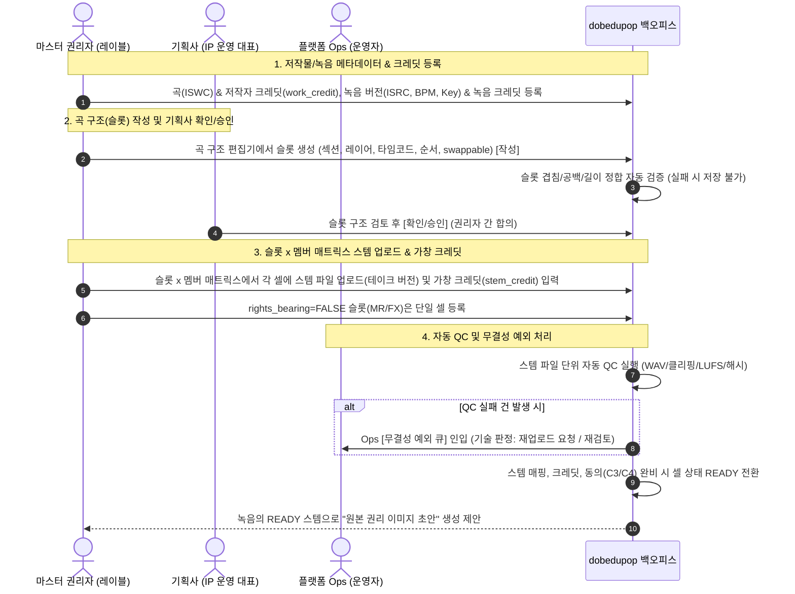
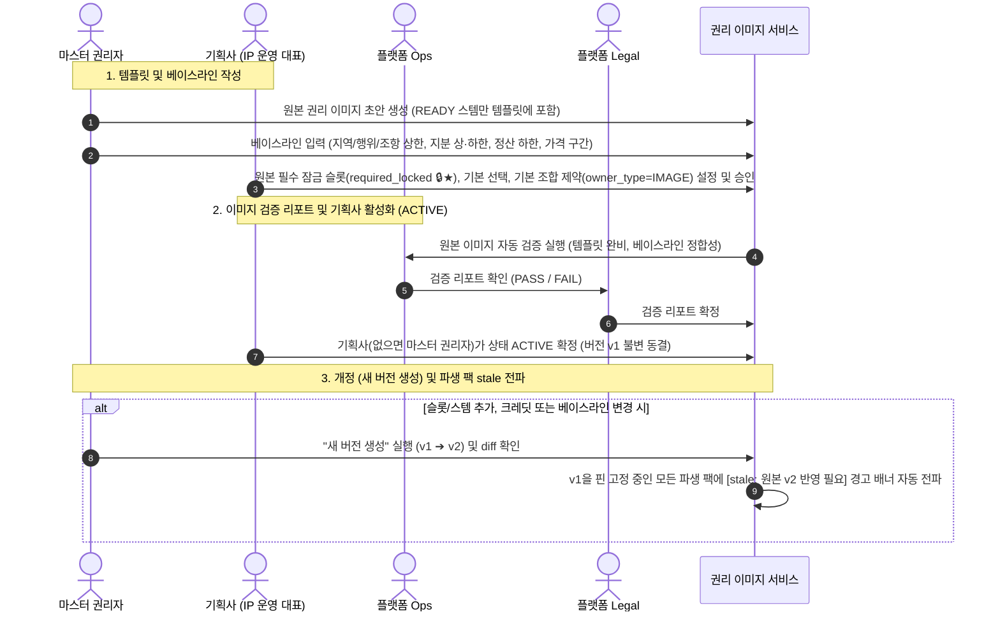
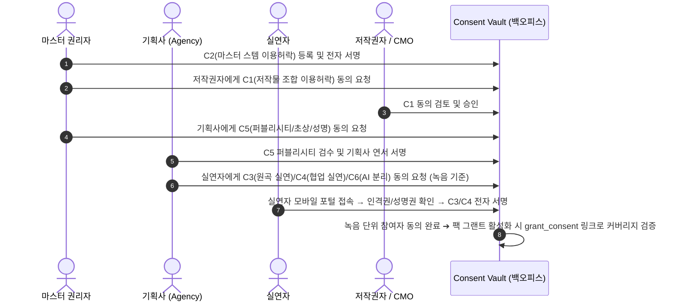
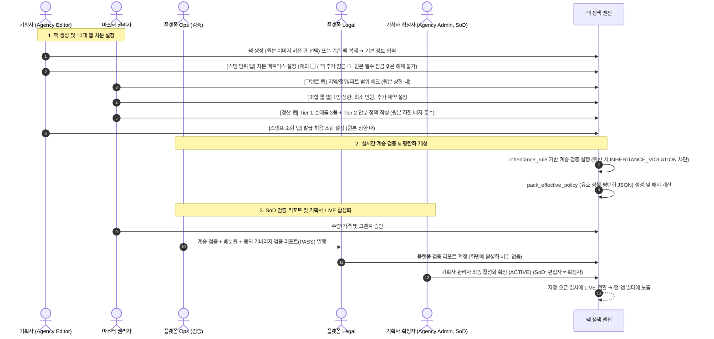
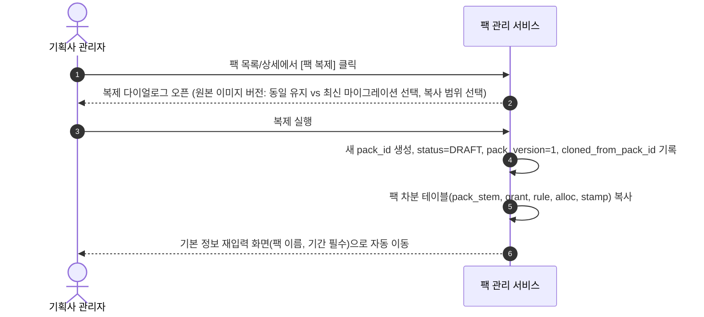
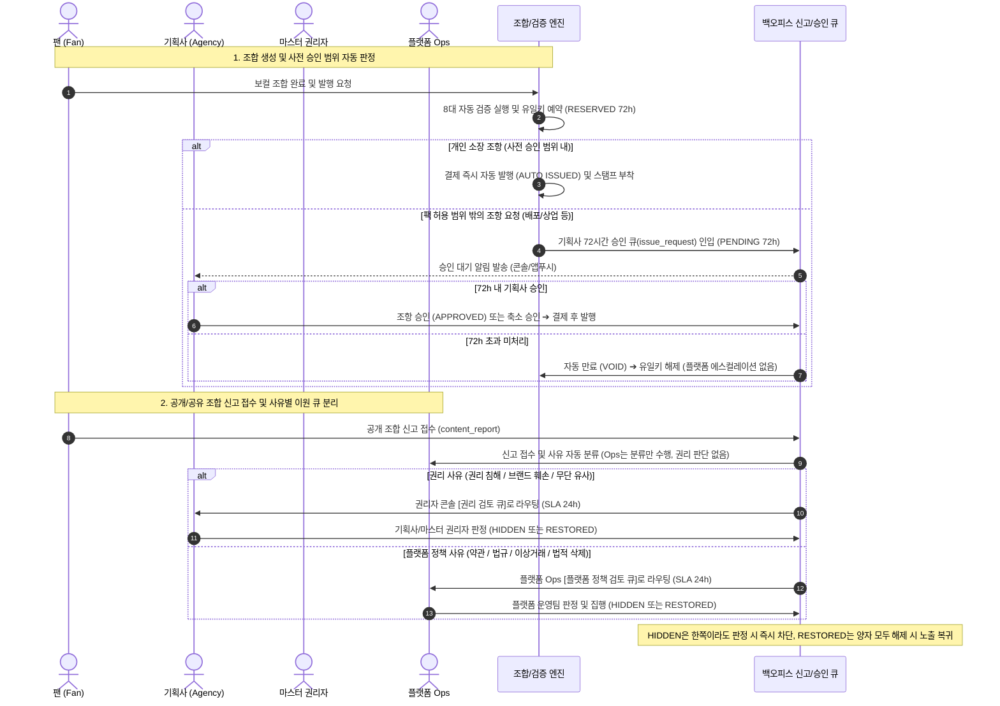
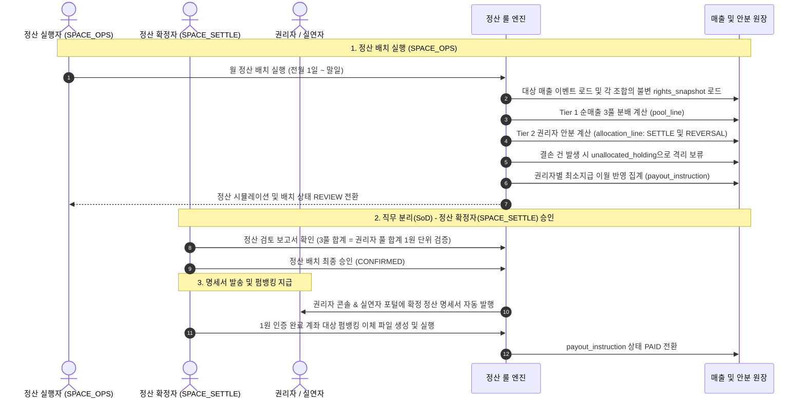
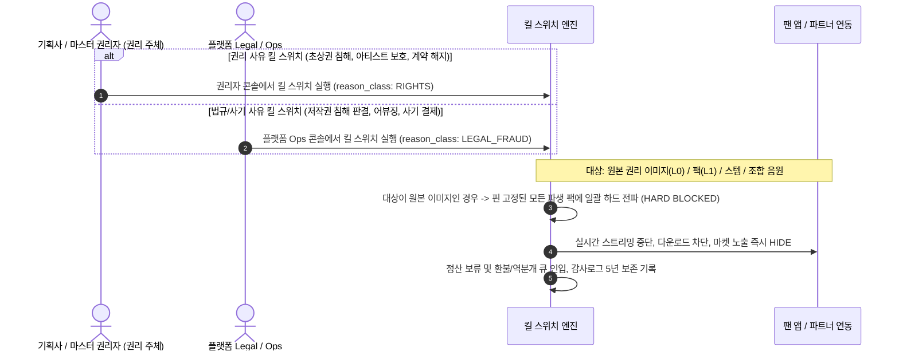

# dobedupop 백오피스 IA, 와이어프레임 및 Userflow 설계서

- **문서 버전**: v2.1 (2026-09-21)
- **상태**: 설계 확정
- **기준 정책 및 가이드 문서**: `03_dobedupop_플랫폼설계/설계_히스토리/데이터모델.md` (v2.2), `03_dobedupop_플랫폼설계/설계_히스토리/백오피스_UI설계가이드_작품슬롯스템_팩관리_v1.1.md`, `보컬조합_백오피스_구성방안_v1.3_20260921.docx`, `보컬조합_사업기획서_v1.13_20260918.docx`

---

## 1. 개요 및 설계 원칙

### 1.1 시스템 목적
dobedupop 백오피스는 보컬 스템의 등록부터 곡 구조 슬롯 정의, 원본 권리 이미지(L0) 템플릿 및 권리 베이스라인 구축, 채널·에디션별 팩 이미지(L1) 차분 생성, 계승 검증(`inheritance_rule`), 팬 조합 72h 발행 승인 큐(기획사 전담), 사유별 이원화 신고 검토(권리 검토 큐 vs 플랫폼 정책 검토 큐), 2계층 정산 배치 실행 및 불변 스냅샷 모니터링까지 **음악 IP의 자산화 및 정산 전 생애주기를 지원하는 통합 운영 콘솔**이다.

### 1.2 4대 포털/콘솔 체계
1. **플랫폼 운영 백오피스 (Platform Ops)**: dobedupop 운영팀/관리자/감사를 위한 통합 운영 도구. 소스 기술 QC, 무결성 예외 처리(자동 QC/슬롯정합/렌더오류), 원본 이미지 및 팩 계승 검증 리포트(PASS/FAIL 판정만, 승인/활성화 버튼 없음), 플랫폼 정책 검토 큐(약관/법규/이상거래), 정산 배치(실행≠확정 SoD), 미배분 보류 관리, 킬 스위치(법규/사기 사유 실행 & 원본 이미지 하드 전파), **위임 대행 업무함**(`acting_on_behalf_of`), 5년 감사로그.
2. **권리자 콘솔 (Rights Holder Console)**: 마스터 권리자(음반제작사/레이블), IP 운영 대표(기획사/매니지먼트), 저작권자(작사/작곡/편곡/CMO)를 위한 웹 콘솔 (테넌트 격리). 곡 구조(슬롯) 정의, 슬롯×멤버 매트릭스 스템 업로드/크레딧, 원본 권리 이미지 템플릿/베이스라인/개정, 팩 10대 탭 차분 관리/복제/활성화, **72h 발행 요청 승인**(기획사 전담), **권리 검토 큐**(권리 침해/브랜드 훼손 판정), 권리 사유 킬 스위치.
3. **실연자 포털 (Performer Portal)**: 보컬리스트, 코러스, 세션, AI 원천 제공자를 위한 **모바일 우선(Mobile-First) 반응형 웹 포털**. 스템별 동의(C3/C4/C6) 서명/철회(30일 유예), 슬롯×곡 기준 스템 사용 이력(`StemUsage`), 1원 송금 실명인증(`payout_account`), 실시간 정산 수익 조회 및 1:1 이의제기.
4. **파트너 콘솔 (B2B Partner Console)**: 팬 플랫폼, 음원 유통사, 숏폼/커머스 등 B2B 제휴사를 위한 연동 콘솔. API 키, 화이트라벨 설정, 웹훅 연동 및 파트너 정산 리포트.

### 1.3 핵심 운영 원칙 (UI & 거버넌스 원칙)
- **플랫폼 운영자는 검증자·집행자이지 권리 결정자가 아니다 (핵심 원칙)**:
  - 플랫폼은 데이터 무결성 검증(오디오 기술 QC, 슬롯 정합, 계승 검증, 커버리지 가드, 렌더 무결성, 유일키)과 플랫폼 정책·법규 준수(약관/법규 위반, 이상거래, 법적 삭제 요청)를 판단하고 정산·지급을 집행한다.
  - 무엇이 권리상 허용되는지, 특정 조합이 IP·브랜드 관점에서 적절한지의 판단(슬롯/크레딧 확정, 허용 범위 결정, 72h 발행 요청 승인, 권리 침해 신고 판정, 정책/팩 활성화)은 권리자만 한다.
  - 플랫폼 운영자 화면에는 권리 승인/반려/활성화 버튼이 없으며, 테넌트가 명시적으로 위임(`tenant.ops_delegation`)한 업무만 "대행 업무함"에서 대행 배지와 함께 수행한다(`acting_on_behalf_of` 감사로그 필수).
- **2계층 이미지 모델 (Two-Layer Image Model)**:
  - **L0 원본 권리 이미지(`rights_image`)**: 녹음 버전의 작품–슬롯–스템–크레딧 템플릿(READY 스템, 필수 잠금 `🔒★`)과 권리 베이스라인(지역/행위/조항 상한, 지분 상·하한, 정산 비율 하한, 가격 구간)을 버전 단위 불변 객체로 관리.
  - **L1 팩 이미지(`vocal_pack`)**: 채널·캠페인·에디션을 하나로 통합한 퍼블리싱 단위. 특정 원본 이미지 버전에 핀 고정되며 **차분만 저장**(컬럼 NULL/행 없음 = 원본 상속).
- **축소 전용 계승 (Restriction-Only Inheritance)**:
  - 팩은 원본의 허용 범위를 좁힐 수만 있다. 필드별 계승 연산은 `inheritance_rule` 격자(SUBSET, LE, GE, SUPERSET, WITHIN_RANGE, LOCK_ONLY_ADD)로 강제되며 위반 시 인라인 오류(`INHERITANCE_VIOLATION`)로 저장을 차단.
- **발행 시 평탄화 (Flattening on Issuance)**:
  - 팩 상세의 "유효 정책 미리보기" 탭에서 원본 ⊕ 차분의 평탄화 결과(`pack_effective_policy`)를 항상 확인 가능. 빌더, 검증, 정산 엔진은 평탄화된 값만 읽고 조합 발행 시 `rights_snapshot.recipe_json`으로 동결.
- **깊이 2 고정 & 팩 복제 (Clone)**:
  - 채널 계층이나 팩 간 상속 없이 깊이는 2단계로 고정. 시즌/이벤트 반복은 "팩 복제" 액션으로 차분 행을 복사한 뒤 기간/이름/조건을 재입력하여 운영(`cloned_from_pack_id`).
- **하드 전파 가시화 (Hard Propagation)**:
  - 동의 철회, 킬 스위치, 원본 REVOKED는 핀 고정과 무관하게 모든 파생 팩에 즉시 경고 배너 및 차단 적용.
- **팬 조합 하이브리드 승인 & 신고 큐 이원화**:
  - 기본 조합은 8대 검증 통과 시 개인 보유 범위에서 즉시 자동 발행(AUTO).
  - 팩 허용 범위 밖의 조항(배포, 상업, 다운로드) 요청만 **기획사 전담 72시간 승인 큐**로 인입되며, 기한 초과 시 자동 만료(`VOID`). 플랫폼 에스컬레이션은 없다.
  - 신고 접수 시 사유를 자동 분류하여 **권리 사유(권리 침해/브랜드 훼손)는 권리자 콘솔의 권리 검토 큐**(기획사/마스터 권리자 판정)로, **플랫폼 정책 사유(약관/법규/이상거래/법적삭제)는 플랫폼 정책 검토 큐**(플랫폼 판정)로 분리 관리(SLA 24h).
- **직무 분리 (Separation of Duties, SoD)**:
  - 정책/배분 편집자 ≠ 정책 활성화 확정자 (`AGENCY_ADMIN` SoD).
  - 정산 배치 실행자(`SPACE_OPS`) ≠ 정산 배치 확정자(`SPACE_SETTLE`).

---

## 2. 정보구조도 (Information Architecture, IA)

```mermaid
graph TD
    Root[dobedupop 통합 백오피스 시스템] --> Ops[1. 플랫폼 운영 백오피스]
    Root --> Holder[2. 권리자 콘솔]
    Root --> Performer[3. 실연자 포털]
    Root --> Partner[4. B2B 파트너 콘솔]

    Ops --> Ops1[1.1 대시보드 - LIVE/stale 팩 모니터링]
    Ops --> Ops2[2. 테넌트 & 표준 계약 - 테넌트/표준계약]
    Ops --> Ops3[3. 무결성 예외 처리 - QC실패/슬롯정합/렌더오류]
    Ops --> Ops4[4. 정책 검증 - 이미지/팩검증 리포트/계승규칙]
    Ops --> Ops5[5. 플랫폼 정책 검토 - 약관/법규/이상거래]
    Ops --> Ops6[6. 정산 콘솔 - 배치 실행≠확정 SoD]
    Ops --> Ops7[7. 보호/분쟁/감사 - 법규사기 킬스위치]
    Ops --> Ops8[8. 위임 대행 - 테넌트 위임 업무함]
    Ops --> Ops9[9. 사용자 관리 - 사용자 계정/역할 및 권한]

    Holder --> Hol1[1. 대시보드]
    Holder --> Hol2[2. 소속 아티스트/파티 - 2.1 파티관리 / 2.2 파티링크 / 2.3 초대]
    Holder --> Hol3[3. 카탈로그/소스 - 슬롯 정의 & 스템 매트릭스]
    Holder --> Hol4[4. 원본 권리 이미지 - 템플릿/베이스라인/ACTIVE]
    Holder --> Hol5[5. 권리/동의 Vault - 녹음 기준 동의]
    Holder --> Hol6[6. 팩 관리 - 10대 탭 상세 & 복제 & ACTIVE]
    Holder --> Hol7[7. 조합결과/승인/신고 - 72h승인 & 권리검토큐]
    Holder --> Hol8[8. 매출/정산명세]
    Holder --> Hol9[9. 테넌트 위임 관리]

    Performer --> Perf1[3.1 홈/대시보드]
    Performer --> Perf2[3.2 동의 관리 - C3/C4/C6]
    Performer --> Perf3[3.3 내 스템 현황 - 슬롯x곡 매핑]
    Performer --> Perf4[3.4 정산/수익 명세 & 이의제기]
    Performer --> Perf5[3.5 정산계좌 1원인증 & 세무]

    Partner --> Part1[4.1 대시보드]
    Partner --> Part2[4.2 API/화이트라벨]
    Partner --> Part3[4.3 캠페인 연동]
    Partner --> Part4[4.4 파트너 정산]
```



---

### 2.1 플랫폼 운영 백오피스 (Platform Ops) 메뉴 구조

| 1Depth | 2Depth | 3Depth | 주요 기능 | 접근 역할 (SoD) |
| :--- | :--- | :--- | :--- | :--- |
| **1. 대시보드** | 1.1 운영 종합 현황 | — | 전체 IP, 조합 수, 정산 완료율, 미배분율, 무결성 예외, 이상거래, 무결성 KPI | Ops, Admin, Auditor |
| | 1.2 실시간 모니터링 | — | **LIVE 팩 수**, **stale 팩 수**, **계승 위반 팩 수**, 무결성 예외 건수, 신고 큐(권리/플랫폼) 잔량 | Ops |
| **2. 테넌트 & 표준 계약**| 2.1 테넌트 관리 | 목록/등록/상세/KYB | 레이블/기획사/CMO/파트너 테넌트(`tenant`) 등록, KYB 확인 등급, 상태 관리 | Ops, Admin |
| | 2.2 표준 계약 관리 | C1~C7 계약 등록 | 표준 계약서 PDF 업로드, 인격권/성명권 규약, 전자서명 템플릿 버전 관리 | Legal, Ops |
| **3. 무결성 예외 처리**| 3.1 자동 QC 실패 큐 | 실패 건 기술 판정 | 오디오 포맷, 무음/클리핑, 라우드니스 QC 실패 건 기술 판정 (재검토/재업로드 요청만, 슬롯/크레딧 수정 불가) | Ops |
| | 3.2 슬롯 정합 오류 | 정합 검증 오류 목록 | 슬롯 겹침/공백/길이 불일치 오류 모니터링 (슬롯 수정 권한 없음) | Ops |
| | 3.3 소스 무결성 검사 큐 | 무결성 의심 건 검사 | 핑거프린트/AI생성/음성유사도 REVIEW 건 소명 확인(`[BO-15]`) | Ops, Security |
| **4. 정책 검증** | 4.0 권리 구조 통합 인스펙터 | 통합 조회 패널 | 테넌트→파티→작품→원본이미지→팩→정산라인 연계 조회 (READ-ONLY, PII마스킹, `[BO-13]`) | Ops, Legal, Finance |
| | 4.1 이미지 검증 리포트 | 원본 이미지 검증 | 원본 이미지 ACTIVE 전 검증 리포트(템플릿 READY 완비, 베이스라인 정합, 기본 제약) 발행 (PASS/FAIL) | Ops, Legal |
| | 4.2 팩 검증 리포트 큐 | 팩 단위 검증 리포트 | 계승 검증(`INHERITANCE_VIOLATION`) + 배분율/커버리지 가드 + 동의 커버리지 리포트 발행 (화면에 승인/활성화 버튼 없음) | Ops, Legal |
| | 4.3 계승 규칙 관리 | `inheritance_rule` 레지스트리| 필드별 연산(SUBSET, LE, GE 등) 및 심각도(ERROR/WARN) 규칙 관리 | Ops, Legal |
| **5. 플랫폼 정책 검토** | 5.1 플랫폼 정책 검토 큐| 약관/법규/이상거래 | 약관/법규/커뮤니티 위반 신고, 이상거래, 법적 삭제 요청 판정 및 집행 (권리 사유는 분류 후 권리자 큐로 라우팅, "권리 판단 없음" 명시) | Ops, Legal |
| | 5.2 워터마크 역추적 | 비가청 워터마크 분석 | 유출/불법 유통 음원의 비가청 워터마크 분석 및 유출자 식별 | Ops, Security |
| | 5.3 부정 이용 조사 | Trust & Safety 케이스 | 이상 조합/거래 탐지 케이스 판정(조사자≠판정자), 역분개·계정정지 집행(`[BO-14]`) | Trust & Safety, Legal |
| | 5.4 무결성 지표 공유 | SHARE 레지스트리 | 침해 음원 해시 및 부정 이용 지표 외부 공유 레지스트리 | Trust & Safety, Legal |
| **6. 정산 콘솔** | 6.1 정산 배치 관리 | 배치 실행/취소 | 일간/주간/월간 정산 배치 실행 (순매출/3풀/Tier 2 연산) | Ops_Operator |
| | 6.2 정산 배치 확정 | 배치 승인/지급 지시 | 정산 결과 검토 및 최종 CONFIRMED 승인 (SoD 필수: 실행자≠확정자) | Settle_Confirmer |
| | 6.3 미배분 원장 | 보류 목록/해소 | `unallocated_holding` 크레딧/동의 결손 및 FRAUD_REVIEW 추적 및 해소 | Ops, Settle |
| | 6.4 지급 및 세무 | 지급 대행/전표 | 1원 계좌인증 확인, 원천징수 영수증, PG/은행 펌뱅킹 지급 파일 생성 | Settle, Finance |
| **7. 보호/분쟁/감사** | 7.1 킬 스위치 (Kill-Switch)| 법규/사기 사유 실행 | 법규 위반/사기 사유 긴급 중단 실행, **원본 권리 이미지(파생 팩 전체 하드 전파)** 차단 집행 | Ops, Legal |
| | 7.2 분쟁 조정 | 3단계 분쟁 큐 | 이의제기 접수 → 협의 중재 → 저작권위원회 에스컬레이션 | Legal, Ops |
| | 7.3 통합 감사로그 | 로그 조회/내보내기 | 5년 법정 보존 감사로그 (소스 접근, 정책 변경, 팩 복제, 대행 행위 `acting_on_behalf_of`) | Auditor, Admin |
| **8. 위임 대행** | 8.1 대행 업무함 | 위임 건 전용 처리 | 테넌트가 위임한 라벨링/크레딧/발행 승인을 해당 테넌트 권한으로 대행 (상단 `[대행 중: 테넌트명]` 배너 고정, 감사로그 자동 기록) | Ops |
| **9. 사용자 관리 (신설)** | **9.1 사용자 계정** | **포털 사용자 CRUD** | 포털 로그인 계정(`user_account`) CRUD, Party 매핑, 2FA 통제, 계정 잠금 해제/비활성화, 비밀번호 초기화 관리 | Ops, Admin |
| | **9.2 역할 및 권한** | **RBAC/SoD & 리소스 매핑** | 12대 `portal_role` 정의, 기능 리소스/API 매핑 **Permission Master**, 역할-권한 매트릭스, 직무 분리(SoD 가드) 상호 배타 규칙 관리 | Ops, Admin |

---

### 2.2 권리자 콘솔 (Rights Holder Console) 메뉴 구조

| 1Depth | 2Depth | 3Depth | 주요 기능 | 사용자 역할 |
| :--- | :--- | :--- | :--- | :--- |
| **1. 대시보드** | 1.1 IP 종합 성과 | — | 보유 IP별 조합 수, 매출액, 정산 현황, 스템 선택률 히트맵 | Master, Agency, Work |
| | 1.2 승인 대기함 | — | 내가 승인해야 할 요청(동의, 팩 승인, 72h 발행 승인, 권리 검토) 모아보기 | Master, Agency, Work |
| **2. 소속 아티스트/파티**| **2.1 파티 관리 / 등록** | **권리 주체 마스터 리스트** | 권리 주체(`party`) 등록, 활동명/실명, ISNI/IPI 번호, 세무 유형(`tax_type`), 지급 경로(`SELF/VIA_PARENT`), 1원 계좌인증 상태 | Agency Admin |
| | **2.2 파티 링크 관리** | **전속/소속 링크 리스트** | 그룹-멤버, 기획사-아티스트 간의 계층 링크, 역할(`role_in_group`), 순서(`sort_order`), 활동 상태, 소속 기간, 재합류/탈퇴 이력 관리 (`party_link`) | Agency Admin |
| | 2.3 실연자 계정/계좌 초대 | 초대 및 계좌 현황 | 실연자 포털 초대 발송(`user_account`), 지급계좌(`payout_account`) 인증 상태 | Agency Admin |
| **3. 카탈로그/소스**| 곡/버전 관리 | 곡 등록/상세 | 곡(ISWC), 버전(ISRC, BPM, Key), 저작자 크레딧(`work_credit`), 녹음 크레딧(`recording_credit`) | Master Owner |
| | **곡 구조(슬롯)** | 슬롯 편집기 | 섹션/레이어/타임코드/순서, `swappable` 지정 (**마스터 권리자 작성 ➔ 기획사 확인/승인**) | Master Owner, Agency |
| | **스템 업로드** | **슬롯 × 멤버 매트릭스**| 파일을 슬롯·멤버 셀에 매핑, 테이크 버전, 셀 단위 가창 크레딧/QC/동의 상태 합성 표시 | Master Owner |
| **4. 원본 권리 이미지** | **이미지 목록/상세** | 템플릿 / 베이스라인 / 버전| `rights_image` 관리. 템플릿(READY 스템, 필수 잠금 `🔒★`), 베이스라인 상한/하한, 기본 제약, 버전 diff, 파생 팩 목록, **기획사 ACTIVE 확정** | Master Owner, Agency |
| **5. 권리/동의 Vault**| **동의 현황** | **녹음(원본 이미지) 기준**| 실연자 동의(C3/C4), 기획사 퍼블리시티(C5), AI(C6) 현황. 팩별 커버리지는 팩 상세에서 조회 | Agency Admin, Master |
| **6. 팩 관리** | **팩 목록** | 채널/상태/기간 필터 | `vocal_pack` 목록. 팩 코드, 원본 이미지 핀 버전, 상태, 계승 검증, `stale` 배너, 복제 액션 | Agency Admin, Master |
| | **팩 상세** | **10대 탭** | ①기본정보, ②스템범위(차분), ③그랜트, ④조합룰, ⑤정산Tier1·2, ⑥스탬프조항, ⑦계승검증, ⑧유효정책미리보기, ⑨승인/활성화(기획사 SoD), ⑩이력/복제 | Agency Admin, Master |
| | **팩 복제** | 복제 다이얼로그 | 복제 원본 선택, 버전 유지 vs 최신 마이그레이션 선택 ➔ 새 DRAFT 팩 생성 | Agency Admin |
| **7. 조합결과/승인/신고**| **72h 발행 요청 승인**| 승인/축소승인/반려 | **팩 허용 범위 밖** 조항 요청 심사 (**기획사 전담**, 72시간 SLA, 미응답 시 VOID, 플랫폼 에스컬레이션 없음) | Agency Admin |
| | **권리 검토 큐** | 권리 침해/브랜드 신고 | 권리 침해/브랜드 훼손/무단 유사 신고 및 권리자 자체 요청 판정 (HIDDEN/RESTORED, SLA 24h) | Agency Admin, Master |
| | 공식 조합 모니터 | 조합 갤러리/킬스위치 | 발행 완료된 조합 음원 감상, **권리 사유 킬 스위치** 실행 | Agency Admin, Master |
| **8. 매출/정산명세** | 월별 정산 명세서 | 명세서 조회/다운로드| 순매출 → Tier 1 → Tier 2 → 실연 풀 내역, PDF/CSV 다운로드 | Master, Agency, Work |
| | 이의 제기 | 정산 이의 신청 | 배분 내역 오류 시 정산 확정 후 14일 이내 이의 접수 | Master, Agency, Work |
| **9. 테넌트 위임 관리**| 위임 업무 설정 | 위임 항목/계약 등록 | 슬롯 라벨링, 크레딧 입력, 발행 승인 등 플랫폼 위임 설정(`tenant.ops_delegation`) 및 계약서 등록 | Master, Agency Admin |

---

### 2.3 실연자 포털 (Performer Portal - 모바일 반응형 웹)

| 1Depth | 2Depth | 3Depth | 주요 기능 | 대상 사용자 |
| :--- | :--- | :--- | :--- | :--- |
| **1. 홈** | 내 대시보드 | 종합 KPI | 이번 달 예상 수익(`allocation_line`), 내 보컬 조합 수, 누적 참여 곡 수, 대기 중인 동의 알림 | 실연자, AI 원천자 |
| | | 퀵 액션 | 동의 서명 바로가기, 정산 계좌 등록 안내 배너, 인기 팬 조합 미리듣기 | 실연자, AI 원천자 |
| **2. 동의 관리** | 서명 대기함 | C3/C4/C6 검토 | 기획사/레이블 스템 동의 요청 상세 검토, 인격권/성명권/정산비율 확인, 모바일 전자서명 | 실연자, AI 원천자 |
| | 동의 완료 목록 | 체결 계약서 조회 | 체결된 동의 계약서 PDF 원문 열람, 허용 범위(영토/행위/파트) 확인 | 실연자, AI 원천자 |
| | 동의 철회 신청 | 30일 유예 철회 | 동의 철회 요청 (`revocation_grace_days` = 30일 안내, 신규 조합 즉시 차단) | 실연자, AI 원천자 |
| **3. 스템 사용현황**| 내 스템 목록 | **슬롯 × 곡 기준 매핑**| 내가 가창한 스템 목록, 어느 슬롯(구간)을 몇 개 팩에서 사용 가능한지 확인, DDEX RIN 크레딧 | 실연자 |
| | 사용 히트맵 | `StemUsage` 시각화 | 팬들이 내 보컬을 어떤 곡, 어떤 파트(Verse/Chorus/Bridge)에서 많이 조합했는지 시각화 | 실연자 |
| | 팬 조합 갤러리 | 조합 음원 재생기 | 내 목소리가 포함된 인기 발행 조합 음원 스트리밍 및 기여 수익액 확인 | 실연자 |
| **4. 정산/수익** | 월별 정산 명세 | 명세서 카드 | 월별 총 발생액, 원천징수세(3.3%), 실지급액, 사용량비례(`STEM_TIME` 60%) vs 균등(`FIXED` 40%) 분해 | 실연자 |
| | 정산 이의 제기 | 1:1 이의 신청 | 크레딧 누락, 파트 시간 오류, 정산 금액 불일치 시 14일 이내 이의 접수 | 실연자 |
| **5. 마이페이지** | 정산 계좌 관리 | 1원 송금 실명인증 | 은행 선택, 계좌번호 입력, 1원 송금 4자리 인증코드 검증, 기본 정산계좌 지정 | 실연자 |
| | 세무 정보 관리 | 암호화 RRN 등록 | 원천징수 소득세 신고용 주민등록번호 암호화(AES-256) 저장, 원천징수영수증 다운로드 | 실연자 |

---

### 2.4 권한 매트릭스 및 직무 분리(SoD) 통제표

> [!IMPORTANT]
> **플랫폼 운영자 = 검증자·집행자 원칙**: 플랫폼 Ops 열에는 권리 판단(승인/반려/활성화) 권한이 없으며, 무결성 예외 처리(기술 판정만), 검증 리포트 발행(PASS/FAIL), 플랫폼 정책 검토(약관/법규/이상거래), 정산 집행, 위임 시 대행만 허용된다.

| 업무 영역 | 마스터 권리자 | 기획사 (Agency) | 저작권자 (Work) | 실연자 | 플랫폼 Ops | 플랫폼 Legal | 플랫폼 Auditor |
| :--- | :---: | :---: | :---: | :---: | :---: | :---: | :---: |
| **곡 구조(슬롯) 편집** | **작성** | **확인/승인** | — | — | 정합 자동 검증/예외 조회 | — | R |
| **스템 업로드/크레딧** | **CRUD** | R | — | R(본인) | 자동 QC 실패 예외 처리(기술 판정만) | — | R |
| **원본 권리 이미지(템플릿·베이스라인)**| **CRU/개정** | 필수 잠금·기본 제약 CRU, **승인** | R(저작권 확인) | — | 검증 리포트 | 검증 확정 | R |
| **팩 기본 정보(채널·기간·가격·수량)** | 승인(수량/가격) | **CRU** | — | — | 검증 | — | R |
| **팩 스템 범위(제외/추가 잠금)** | R | **CRU** | — | — | 검증 | — | R |
| **팩 그랜트(지역/행위/파트)** | **CRU** | 승인 | R | — | 검증 | — | R |
| **팩 조합 룰·제약** | CRU | **CRU/승인** | R | — | 검증 | — | R |
| **팩 정산(Tier 1·2)** | CRU(편집) | **승인/ACTIVE** | 승인(저작권 풀) | R(본인 몫) | 검증 리포트 | 검증 확정 | R |
| **팩 스탬프 조항** | R | **CRU** | — | — | 검증 | — | R |
| **팩 활성화(APPROVED → LIVE)** | — | **확정(SoD: 편집자 ≠ 확정자)**| — | — | — | — | R |
| **팩 복제** | R | **실행** | — | — | — | — | R |
| **발행 요청 승인(팩 범위 밖 조항)** | R | **승인/축소/반려 (기획사 전담)**| — | — | 위임 시 대행 | — | R |
| **권리 검토 큐(권리 침해/브랜드 신고)**| **판정** | **판정** | 요청 | 요청 | 접수·분류만 | — | R |
| **플랫폼 정책 검토 큐(약관/법규/이상거래)**| R | R | — | — | **판정/집행** | 판정 | R |
| **킬 스위치 (긴급)** | 실행(권리 사유)| 실행(권리 사유) | 요청 | 요청(철회) | 실행(법규/사기 사유) | 실행/승인 | 감사 |
| **위임 설정 (`ops_delegation`)** | **CRU(테넌트)** | CRU | — | — | R | — | R |
| **계승 규칙 관리 (`inheritance_rule`)**| — | — | — | — | **CRU** | 승인 | R |
| **정산 배치 실행 / 확정** | — | — | — | — | **배치 실행 (SoD)** | **CONFIRMED (SoD)**| R |

---

## 3. 엔드투엔드 Userflow (사용자 흐름)

### Flow 1. 음원 소스 등록 & 곡 구조(슬롯) 정의 & 스템 매트릭스 플로우



---

### Flow 1-A. 원본 권리 이미지(L0) 확정 및 개정 플로우



---

### Flow 2. Consent Vault 녹음/원본 이미지 기준 동의 체결 플로우



---

### Flow 3. 팩 이미지(L1) 생성, 차분 설정, 계승 검증 및 SoD 활성화 플로우



---

### Flow 4-A. 팩 복제(Clone) 플로우



---

### Flow 5. 하이브리드 조합 승인 & 사유별 이원화 신고 검토 플로우



---

### Flow 6. 월간 정산 배치 실행 및 확정/지급 플로우 (SoD)



---

### Flow 7. 긴급 킬 스위치 (Kill-Switch) 사유 분리 및 하드 전파 플로우



---

## 4. 12대 핵심 화면 정밀 와이어프레임 (Wireframes)

---

### `[BO-01]` 플랫폼 운영 통합 대시보드 (v2.1 갱신)

```
+--------------------------------------------------------------------------------------------------------------------+
| dobedupop [Platform Ops]                                  [알림 5] | [작업 큐 12] | 홍길동(운영팀) | [로그아웃]    |
+--------------------------------------------------------------------------------------------------------------------+
| [대시보드] | [테넌트/계약] | [무결성 예외] | [정책 검증] | [플랫폼 정책 검토] | [정산 콘솔] | [보호/감사] | [위임 대행] |
+--------------------------------------------------------------------------------------------------------------------+
| 📊 플랫폼 운영 현황 요약 (Real-time Dashboard)                                         [기준일시: 2026-09-21 09:00] |
+--------------------------------------------------------------------------------------------------------------------+
| [LIVE 팩 수] | [stale 팩 경고] | [계승위반 팩] | [무결성 예외] | [신고 잔량(권리/플랫폼)] | [정산 완료율] | [미배분율] |
|   18 개 팩   |    2 개 팩 ⚠️   |    0 건 (정상)|    3 건 ⚠️    |    1 건 / 2 건           |    99.85 %    | 0.12% (정상)|
+--------------------------------------------------------------------------------------------------------------------+
| ⚠️ 긴급 조치 및 모니터링 현황 (Action Required - 플랫폼 기술/운영 영역)                                             |
| +----------------------------------------------------------------------------------------------------------------+ |
| | [원본 이미지 개정 stale 팩]      2 건 (CB-2026-A01, CB-2026-A02: 원본 v2 반영 검증 필요)       [마이그레이션 검증 >]| |
| | [무결성 예외 처리 대기]          3 건 (자동 QC 실패 2건, 슬롯 정합 오류 1건)                   [예외 처리하기 >]    | |
| | [플랫폼 정책 검토 큐]            2 건 (약관 위반 신고 1건, 이상 결제 패턴 1건)                 [정책 검토하기 >]    | |
| | [크레딧/동의 결손 미배분 보류]   2 건 (보류 금액: ₩185,000)                             [원장 확인 >]        | |
| | [신규 팩 계승 검증 요청]         4 건 (플랫폼 계승 검증 리포트 발행 대기)               [리포트 작성 >]      | |
| +----------------------------------------------------------------------------------------------------------------+ |
+--------------------------------------------------------------------------------------------------------------------+
```

---

### `[BO-02']` 곡 구조 편집기 & 슬롯 × 멤버 매트릭스 (권리자 콘솔)

```
+--------------------------------------------------------------------------------------------------------------------+
| dobedupop [권리자 콘솔] > 카탈로그 > Super Star > Original Ver. (rcd_01) > 슬롯/스템                               |
+--------------------------------------------------------------------------------------------------------------------+
| ISRC KR-A01-26-00012 | BPM 128.0 | Key C#m | 03:24 | 마스터 권리자 (주)두비덥뮤직 | 원본 이미지: rim_01 v1 (ACTIVE)   |
+--------------------------------------------------------------------------------------------------------------------+
| ▣ 곡 구조(슬롯) — 파형 위 구간 정의 (마스터 권리자 작성 ➔ 기획사 확인)  [레이어: MAIN ▾]   [슬롯 추가] [기획사 확인요청]|
| [INTRO 0:00-0:15][VERSE1 0:15-0:45][PRE 0:45-1:05][CHORUS 1:05-1:45][BRIDGE 1:45-2:15][OUTRO 2:15-3:24] [MR FULL]  |
|  slt_01 swap     slt_02 swap        slt_03 swap    slt_04 swap        slt_05 swap       slt_06 swap      slt_MR ✕  |
+--------------------------------------------------------------------------------------------------------------------+
| ▣ 슬롯 × 멤버 매트릭스 (레이어 MAIN)   셀 = 스템 파일   ● READY  ◐ QC/크레딧 대기  ○ 미업로드  ⊘ 동의 미비          |
| +-----------+------------+------------+------------+------------+                                                  |
| | 슬롯      | 멤버 A     | 멤버 B     | 멤버 C     | 멤버 D     |  ← 열 = voice/party (녹음 크레딧 기준 자동 제안)   |
| +-----------+------------+------------+------------+------------+                                                  |
| | INTRO     | ● t1       | ● t1       | ● t1       | ● t1       |                                                  |
| | VERSE1    | ● t1       | ● t2       | ● t1       | ◐ t1 QC    |                                                  |
| | PRE       | ● t1       | ● t1       | ● t1       | ● t1       |                                                  |
| | CHORUS    | ● t1       | ● t1       | ● t1       | ⊘ t1 C3    |                                                  |
| | BRIDGE    | ● t1       | ● t1       | ● t1       | ● t1       |                                                  |
| | OUTRO     | ● t1       | ● t1       | ○          | ● t1       |                                                  |
| | MR (FULL) | ● (단일 셀, rights_bearing=F)                    |                                                  |
| +-----------+------------+------------+------------+------------+                                                  |
| 합계: 슬롯 7 / 스템 25 / READY 21 / 대기 3 / 미업로드 1          [파일 드래그: 셀에 놓으면 슬롯·멤버 자동 매핑]       |
+--------------------------------------------------------------------------------------------------------------------+
| ▸ 셀 상세 (VERSE1 × 멤버 B, stm_B_V1 t2)                                                                          |
|   파일 stm_B_V1_t2.wav | SHA-256 …a91f | 48kHz/24bit | -18.2 LUFS | QC PASSED | 테이크 v2 (v1 REJECTED: 클리핑)       |
|   가창 크레딧: 김철수 (ISNI 0000-0002) MAIN_VOCAL FEATURED   동의: C3 SIGNED 2026-09-03   상태: READY               |
|   [재업로드(새 테이크)] [크레딧 수정] [QC 재요청]                                                                   |
+--------------------------------------------------------------------------------------------------------------------+
```

---

### `[BO-02-OPS]` 무결성 예외 처리 큐 (플랫폼 운영 백오피스)

```
+--------------------------------------------------------------------------------------------------------------------+
| dobedupop [Platform Ops] > 무결성 예외 처리 > 자동 QC 실패 & 정합 오류 큐                                          |
+--------------------------------------------------------------------------------------------------------------------+
| ⚠️ 무결성 예외 목록 (기술 판정 전용 화면 — 슬롯/크레딧 수정 불가, 재검토 및 재업로드 요청만 가능)                   |
| +-------------+----------------------+-----------+-------------------------+--------------------+----------------+ |
| | 예외 ID     | 대상 파일/슬롯       | 소속 곡   | 예외 유형               | 기술 측정치        | 조치/기술판정  | |
| +-------------+----------------------+-----------+-------------------------+--------------------+----------------+ |
| | exc_081     | stm_D_V1_t1.wav      | Super Star| QC_CLIPPING_DETECTED    | True Peak +1.2dBFS | [재업로드요청] | |
| | exc_082     | slt_03 (PRE)         | Super Star| TIMECODE_OVERLAP        | slt_02와 0.5s 겹침 | [권리자알림]   | |
| | exc_083     | rnd_proc_9912        | Blue Wave | RENDER_INTEGRITY_FAIL   | 버퍼 언더런 발생   | [재렌더링실행] | |
| +-------------+----------------------+-----------+-------------------------+--------------------+----------------+ |
+--------------------------------------------------------------------------------------------------------------------+
```

---

### `[BO-11]` 원본 권리 이미지 관리 (권리자 콘솔)

```
+--------------------------------------------------------------------------------------------------------------------+
| dobedupop [권리자 콘솔] > 원본 권리 이미지 > rim_01 (Super Star / Original Ver.)   버전 v1 ACTIVE   [새 버전 생성]  |
+--------------------------------------------------------------------------------------------------------------------+
| 탭: [템플릿] [베이스라인] [기본 제약] [버전/diff] [파생 팩(3)] [검증 리포트]                                        |
+--------------------------------------------------------------------------------------------------------------------+
| [템플릿]  슬롯 × 멤버 (READY만 포함)   ▣ = 포함  🔒 = 필수 잠금(기획사)  ★ = 기본 선택                            |
| | 슬롯     | A      | B      | C      | D      |                                                                    |
| | INTRO    | ▣★     | ▣      | ▣      | ▣      |                                                                    |
| | VERSE1   | ▣      | ▣★     | ▣      | ▣      |                                                                    |
| | CHORUS   | ▣🔒★   | —      | —      | —      |  ← 필수 잠금 슬롯은 나머지 셀 자동 제외                             |
| | …        |        |        |        |        |                                                                    |
+--------------------------------------------------------------------------------------------------------------------+
| [베이스라인]  (팩은 아래 값을 좁힐 수만 있음)                                                                       |
|  지역 상한 [KR][JP][GLOBAL]   행위 상한 [PREVIEW][COMBINE][PERSONAL_HOLD][SHARE_LINK][PLATFORM_DISTRIBUTE][DOWNLOAD] |
|  스탬프 조항 상한 [PERSONAL_HOLD][PLATFORM_DISTRIBUTE][LIMITED_USE][DOWNLOAD]  (COMMERCIAL 미허용)                  |
|  1인 지분 상한 ≤ [9000] bps   최소 인원 ≥ [2]   권리자 풀 ≥ [6000] bps   실연 풀 버킷 ≥ [2000] bps   가격 [8,000~15,000]|
+--------------------------------------------------------------------------------------------------------------------+
| [파생 팩]  CB-2026-A01 팬클럽 (LIVE, v1 핀)  CB-2026-A02 파트너 숏폼 (LIVE, v1 핀)  CB-2026-A03 (DRAFT, v1 핀)      |
|  ⚠ 새 버전 생성 시 위 팩에 "stale" 표시. 동의 철회·킬 스위치는 즉시 전파.                                          |
+--------------------------------------------------------------------------------------------------------------------+
```

---

### `[BO-12]` 팩 관리 — 목록 및 10대 탭 상세 (권리자 콘솔)

```
+--------------------------------------------------------------------------------------------------------------------+
| dobedupop [권리자 콘솔] > 팩 관리 > CB-2026-A02 파트너 숏폼 2026 가을   상태 REVIEW   pack_version 3   [복제] [승인요청]|
| 원본 이미지: rim_01 v1 (ACTIVE) 🔗핀   ⚠ stale 아님   계승 검증: PASS (WARN 1)   유효 정책 해시: 3f9c…                 |
+--------------------------------------------------------------------------------------------------------------------+
| 탭: [기본 정보] [스템 범위] [그랜트] [조합 룰] [정산 Tier1·2] [스탬프 조항] [계승 검증] [유효 정책 미리보기] [승인/활성화] [이력] |
+--------------------------------------------------------------------------------------------------------------------+
| [기본 정보]  채널 PARTNER_SHORTFORM | 파트너 (주)숏폼A | 에디션 STANDARD | 기간 2026-10-01 ~ 2026-10-31 | 가격 ₩10,000 |
|  (원본 8,000~15,000 ✓) | 발행 한도 1,000 | 유일 스코프 (o) PACK ( ) FAN_PACK                                         |
+--------------------------------------------------------------------------------------------------------------------+
| [스템 범위]  차분 매트릭스   ▣ 상속(선택 가능)  ▢ 제외(팩 차분)  🔒 원본 필수 잠금(해제 불가)  🔐 팩 추가 잠금        |
| | 슬롯     | A      | B      | C      | D      |                                                                    |
| | INTRO    | ▣      | ▣      | ▣      | ▢      |  ← D 열 전체 제외 (외부 채널 C3 미링크)                             |
| | CHORUS   | ▣🔒    | —      | —      | —      |                                                                    |
| | BRIDGE   | ▣🔐    | ▢      | ▢      | ▢      |  ← 팩 추가 잠금                                                     |
|  변경 행 수: 7 (차분만 저장)                                                                                        |
+--------------------------------------------------------------------------------------------------------------------+
| [그랜트]  지역 [x]GLOBAL(상한 내) | 행위 [x]PREVIEW [x]COMBINE [x]PERSONAL_HOLD [x]PLATFORM_DISTRIBUTE [ ]DOWNLOAD     |
|  [ ]COMMERCIAL(원본 상한 밖 — 비활성)  | 파트 범위: 상속(전체) | 동의 링크: A,B,C C3 SIGNED ✓  D 미링크(제외됨)         |
+--------------------------------------------------------------------------------------------------------------------+
| [조합 룰]  1인 상한 (o)원본 상속 9000 ( )직접 [8000] ✓≤9000 | 최소 인원 (o)상속 2 ( )직접 [ ] | 추가 제약: CO_OCCURRENCE(B,C) WARN|
|  원본 기본 제약(비활성화 불가): ADJACENT A→D BLOCK, CONSECUTIVE_SWAP(VERSE1·PRE) NO_SWAP                              |
+--------------------------------------------------------------------------------------------------------------------+
| [정산 Tier 1 & 2] (기존 BO-04 에디터 내장)                                                                         |
|  - Tier 1 권리자 풀: [ 7,000 ] bps (원본 하한 ≥6000 bps ✓) | 플랫폼 [ 2,000 ] bps | 팬 인센티브 [ 1,000 ] bps         |
|  - Tier 2 실연 풀 버킷: [ 2,500 ] bps (원본 하한 ≥2000 bps ✓) | 실연 풀 모드: (o) USAGE_WEIGHTED (60% 주실연 / 40% 부실연)|
+--------------------------------------------------------------------------------------------------------------------+
| [스탬프 조항]  개인소장(AUTO 즉시발급) | 플랫폼배포(AGENCY 72h 승인) | 한정이용(3회) | 상업이용(금지) | 다운로드(금지)    |
+--------------------------------------------------------------------------------------------------------------------+
| [계승 검증]  PASS 11 / WARN 1 / FAIL 0                                                                             |
|  ⚠ WARN issuance.max_single_member_bps 8000 → 원본 상한 9000 대비 강화됨(정보)                                        |
|  ✓ grant.territories ⊆ {KR,JP,GLOBAL}  ✓ settlement.rights_pool_bps 7000 ≥ 6000  ✓ constraint.set ⊇ IMAGE 제약 …      |
+--------------------------------------------------------------------------------------------------------------------+
| [유효 정책 미리보기]  effective_json (요약 뷰 / JSON 뷰)  — 빌더·검증·정산 엔진이 읽는 최종 값. 발행 시 스냅샷으로 동결 |
+--------------------------------------------------------------------------------------------------------------------+
| [승인 / 활성화]  기획사 편집자: 김기획 ➔ 마스터 승인 완료 ➔ 플랫폼 검증 리포트 PASS (Legal 확정) ➔ [LIVE 활성화 확정 (기획사대표)] |
+--------------------------------------------------------------------------------------------------------------------+
```

---

### `[BO-12-CLONE]` 팩 복제 다이얼로그

```
+------------------------------------------------------------------+
| 팩 복제: CB-2026-A02 → 새 팩                                     |
| 원본 이미지 버전  (o) 동일 유지 (rim_01 v1)  ( ) 최신으로 (v2) ⚠재검증 |
| 복사 범위  [x]스템 범위 [x]그랜트 [x]조합 룰 [x]정산 [x]스탬프 조항   |
| 초기화     ID/코드 신규, DRAFT, version 1, 발행 수 0, 기간·이름 재입력 |
|                                        [취소]  [복제 후 설정으로 이동] |
+------------------------------------------------------------------+
```

---

### `[BO-04-OPS]` 팩 검증 리포트 큐 (플랫폼 운영 백오피스)

```
+--------------------------------------------------------------------------------------------------------------------+
| dobedupop [Platform Ops] > 정책 검증 > 팩 검증 큐                                                                  |
+--------------------------------------------------------------------------------------------------------------------+
| 📋 팩 단위 정책 검증 리포트 (화면에 승인/활성화 버튼 없음 — PASS / FAIL 리포트 발행 및 Legal 확정 전용)           |
| +-----------+----------------------+-----------+-------------------------+-------------+------------+------------+ |
| | 팩 코드   | 팩 명칭              | 핀 버전   | 검증 항목 (계승/가드/동의)| 검증 결과   | 리포트일시 | 조치       | |
| +-----------+----------------------+-----------+-------------------------+-------------+------------+------------+ |
| | CB-A02    | 파트너 숏폼 2026     | rim_01 v1 | 계승: PASS / 가드: 100% | ALL PASS    | 09-21 09:30| [리포트보기| |
| | CB-A03    | 한정판 보컬 팩       | rim_01 v1 | 계승: INHERIT_VIOLATION | FAIL (1건)  | 09-21 09:15| [오류상세 >| |
| +-----------+----------------------+-----------+-------------------------+-------------+------------+------------+ |
+--------------------------------------------------------------------------------------------------------------------+
```

---

### `[BO-06]` 72h 발행 승인 큐 & 권리 검토 큐 (권리자 콘솔)

```
+--------------------------------------------------------------------------------------------------------------------+
| dobedupop [권리자 콘솔] > 조합 결과 검토 / 승인 / 신고                                                             |
+--------------------------------------------------------------------------------------------------------------------+
| [ 탭: 72h 발행 요청 승인 (기획사 전담) ]  |  [ 탭: 권리 검토 큐 (권리 침해/브랜드 신고) ]                                   |
+--------------------------------------------------------------------------------------------------------------------+
| ⏳ 72시간 발행 요청 승인 (팩 허용 범위 밖 요청, 72h 미처리 시 자동 VOID, 플랫폼 에스컬레이션 없음)                  |
| +-------------+----------------------+-----------+-------------------------+-------------+----------+------------+ |
| | 요청 ID     | 조합 ID (대외코드)   | 소속 팩   | 요청 조항 집합          | 8대검증결과 | 남은시간 | 심사/처리  | |
| +-------------+----------------------+-----------+-------------------------+-------------+----------+------------+ |
| | irq_9821    | VC-20261001-0042     | CB-2026-A1| PLATFORM_DISTRIBUTE     | ALL PASS (8)| 04:12:30 | [승인/축소]| |
| | irq_9822    | VC-20261001-0089     | CB-2026-A2| PLATFORM_DISTRIBUTE, USE| ALL PASS (8)| 28:45:10 | [승인/반려]| |
| +-------------+----------------------+-----------+-------------------------+-------------+----------+------------+ |
|                                                                                                                    |
| 🛡️ 권리 검토 큐 (권리 침해 / 브랜드 훼손 / 무단 유사 신고 판정 — SLA 24시간)                                      |
| +-------------+----------------------+-----------+-------------------------+-------------+----------+------------+ |
| | 신고 ID     | 대상 조합 ID         | 신고 유형 | 신고 사유               | 접수일시    | 상태     | 판정       | |
| +-------------+----------------------+-----------+-------------------------+-------------+----------+------------+ |
| | rpt_102     | VC-20260918-0012     | RIGHTS    | 아티스트 이미지 훼손    | 09-21 08:30 | 심사대기 | [HIDDEN처분| |
| | rpt_105     | VC-20260919-0045     | RIGHTS    | 무단 목소리 조합 유사   | 09-20 17:20 | 심사대기 | [소명/유지]| |
| +-------------+----------------------+-----------+-------------------------+-------------+----------+------------+ |
+--------------------------------------------------------------------------------------------------------------------+
```

---

### `[BO-06-P]` 플랫폼 정책 검토 큐 (플랫폼 운영 백오피스)

```
+--------------------------------------------------------------------------------------------------------------------+
| dobedupop [Platform Ops] > 플랫폼 정책 검토 > 약관 / 법규 / 이상거래 검토 큐                                       |
+--------------------------------------------------------------------------------------------------------------------+
| ⚖️ 플랫폼 정책 검토 목록 (약관 위반, 법규, 이상거래, 법적 삭제 요청 판정 — "권리 판단 없음" 고지)                  |
| +-------------+----------------------+-----------+-------------------------+-------------+----------+------------+ |
| | 신고 ID     | 대상 조합 ID / 계정  | 정책 유형 | 위반 사유               | 탐지 방식   | 상태     | 판정/집행  | |
| +-------------+----------------------+-----------+-------------------------+-------------+----------+------------+ |
| | rpt_P201    | VC-20260920-0981     | POLICY    | 커뮤니티 욕설/음란 텍스트| 자동 키워드 | 접수완료 | [강제숨김] | |
| | rpt_P202    | usr_abuser_99        | FRAUD     | 1인 다계정 유일키 선점  | 이상거래탐지| 모니터링 | [계정정지] | |
| +-------------+----------------------+-----------+-------------------------+-------------+----------+------------+ |
+--------------------------------------------------------------------------------------------------------------------+
```

---

### `[BO-08-OPS]` 위임 대행 업무함 (플랫폼 운영 백오피스)

```
+--------------------------------------------------------------------------------------------------------------------+
| dobedupop [Platform Ops] > 위임 대행 > 대행 업무함                                                                 |
+--------------------------------------------------------------------------------------------------------------------+
| 🏢 [현재 대행 중: (주)두비덥뮤직 (tnt_001)]  위임 근거: 계약서 #DEL-2026-01 [전문보기 >]  [대행 테넌트 전환 ▼]      |
| ⚠️ 플랫폼 운영자가 테넌트의 명시적 위임에 따라 권리자 업무를 대행합니다. 모든 대행 행위는 감사로그에 자동 기록됩니다.   |
+--------------------------------------------------------------------------------------------------------------------+
| 대행 가능 업무: [x] 슬롯 라벨링  [x] 스템 크레딧 입력  [x] 72h 발행 승인  [ ] 권리 검토(미위임)                     |
| +-------------+----------------------+-----------+-------------------------+-------------+-----------------------+ |
| | 작업 구분   | 대상 자산 / 요청     | 소속 곡   | 위임 요청 내용          | 기한        | 대행 실행             | |
| +-------------+----------------------+-----------+-------------------------+-------------+-----------------------+ |
| | 슬롯라벨링  | slt_01 ~ slt_06      | Super Star| 타임코드 및 swappable   | 09-21 18:00 | [대행으로 슬롯확정 >] | |
| | 발행승인    | irq_9821             | Super Star| PLATFORM_DISTRIBUTE     | 09-22 09:00 | [대행으로 승인하기 >] | |
| +-------------+----------------------+-----------+-------------------------+-------------+-----------------------+ |
+--------------------------------------------------------------------------------------------------------------------+
```

---

### `[BO-07]` 정산 콘솔 - 월간 배치 실행/확정 (SoD) & 미배분 원장

```
+--------------------------------------------------------------------------------------------------------------------+
| dobedupop [Platform Ops / Settlement] > 정산 콘솔 > 정산 배치 관리                                                |
+--------------------------------------------------------------------------------------------------------------------+
| 📅 정산 배치: BAT-2026-09 (2026년 9월 정기 정산) | 상태: [REVIEW (확정대기)] | 대상 이벤트: 4,250 건 (환불 12건 포함) |
+--------------------------------------------------------------------------------------------------------------------+
| [1. 플랫폼 총 순매출]     [2. 권리자 풀 (Tier 1 70%)]   [3. 플랫폼 수수료 (20%)]    [4. 팬 인센티브 (10%)]          |
|    ₩397,450,000 원            ₩278,215,000 원              ₩79,490,000 원              ₩39,745,000 원 (비현금포인트)|
+--------------------------------------------------------------------------------------------------------------------+
| 👥 Tier 2 권리자 풀 안분 집계 결과 (allocation_line 합계: ₩278,215,000 원 / 1원 오차 없음)                         |
| +-------------------------+----------------------+--------------------+--------------------+---------------------+ |
| | 권리 주체 (Party)       | 구분 (Role)          | 당월 안분액 (KRW)  | 전월 이월 / 공제   | 최종 지급 대상액    | |
| +-------------------------+----------------------+--------------------+--------------------+---------------------+ |
| | (주)두비덥뮤직          | 마스터 권리자 (45%)  |     ₩125,196,750   |               ₩0   |        ₩125,196,750 | |
| | 한국음악저작권협회      | 저작권 풀 (25%)      |      ₩69,553,750   |               ₩0   |         ₩69,553,750 | |
| | 스타엔터테인먼트        | 기획사 (5%)          |      ₩13,910,750   |               ₩0   |         ₩13,910,750 | |
| | 홍길동 (멤버A)          | 실연자 (주실연 60%)  |      ₩41,732,250   |         −₩150,000  |         ₩41,582,250 | |
| | 김철수 (멤버B)          | 실연자 (주실연 60%)  |      ₩20,866,125   |               ₩0   |         ₩20,866,125 | |
| | 이영희 (코러스C)        | 실연자 (부실연 40%)  |       ₩6,955,375   |               ₩0   |          ₩6,955,375 | |
| +-------------------------+----------------------+--------------------+--------------------+---------------------+ |
| 🔐 직무 분리 통제 (SoD Status): 배치 실행자 홍길동(SPACE_OPS) ≠ 배치 확정자 김정산(SPACE_SETTLE) 로그인 중         |
|                             [배치 재계산 (Ops)]       [정산 명세서 CSV 내보내기]       [정산 배치 확정 (CONFIRM)]  |
+--------------------------------------------------------------------------------------------------------------------+
```

---

### `[PF-01] ~ [PF-05]` 실연자 모바일 웹 포털 5대 화면

```
+----------------------------------------+ +----------------------------------------+
| [PF-01] 홈 대시보드         [알림 2] 👤| | [PF-02] 동의 관리                   👤|
+----------------------------------------+ +----------------------------------------+
| 안녕하세요, 홍길동(멤버A) 님!          | | [ 탭: 서명 대기 (1) ] | [ 동의 완료 (4) ]|
| 💰 9월 예상 정산 수익                   | | -------------------------------------- |
| ₩ 41,582,250 원                        | | • [C3] Super Star (Acoustic Ver.)      |
| [지난달 대비 +18.4% ↑]                 | |   - 요청사: (주)스타엔터테인먼트       |
| 🔔 [C3] 스템동의 요청 1건 [서명하기 >] | |   - 주실연 60% 사용량 비례 정산        |
| 💳 정산 계좌: ✅ 신한은행 인증완료     | |   [ 📄 계약서 전문 확인 및 전자서명 > ] |
+----------------------------------------+ +----------------------------------------+
| [홈]  [동의]  [스템]  [정산]  [계좌/MY] | | [홈]  [동의]  [스템]  [정산]  [계좌/MY] |
+----------------------------------------+ +----------------------------------------+

+----------------------------------------+ +----------------------------------------+
| [PF-03] 스템 현황 (슬롯x곡 매핑)     👤| | [PF-04] 정산 명세                   👤|
+----------------------------------------+ +----------------------------------------+
| 📊 파트별 팬 조합 선택률 (StemUsage)   | | [ 2026년 9월 정산 내역 (확정) ▼ ]      |
| [VERSE 1]  ████████████████ 88.4% (1위)| | 💵 9월 총 실지급액: ₩ 40,210,035 원   |
| [CHORUS 1] ████████████     65.2% (2위)| | • 발생액: ₩41,582,250 (원천세 3.3%공제)|
| -------------------------------------- | | -------------------------------------- |
| 🎙️ 내 가창 스템 목록 (슬롯 매핑)      | | 📈 Tier 2 실연 풀 배분 세부 내역:      |
| • Super Star > VERSE 1 (slt_02)        | |  1. 사용량 비례(STEM_TIME 60%): 2,494만|
|   - 가용 팩: CB-2026-A01, CB-2026-A02  | |  2. 균등 배분(FIXED 40%): 1,663만      |
| • Super Star > CHORUS (slt_04)         | | [ 1:1 정산 이의 제기 신청하기 (D-14) ] |
+----------------------------------------+ +----------------------------------------+
| [홈]  [동의]  [스템]  [정산]  [계좌/MY] | | [홈]  [동의]  [스템]  [정산]  [계좌/MY] |
+----------------------------------------+ +----------------------------------------+

+----------------------------------------+
| [PF-05] 정산 계좌(1원인증) & 세무    👤|
+----------------------------------------+
| 💳 실명 인증 정산 계좌 (payout_account)|
| [은행] 신한은행 (088)                  |
| [계좌] 110-***-48212                   |
| [예금주] 홍길동 (본인 실명)            |
| -> 상태: ✅ 실명인증 완료 (ACTIVE)     |
| -------------------------------------- |
| 📑 원천징수 세무 정보 (소득세 신고용)  |
| • 주민등록번호: 950101 - ●●●●●●●       |
| • 국세청 실명 검증: ✅ 확인 완료 (PASS)|
| [ 📄 2026년 원천징수영수증 다운로드 ]  |
+----------------------------------------+
| [홈]  [동의]  [스템]  [정산]  [계좌/MY] |
+----------------------------------------+
```

---

### `[BO-09]` 테넌트 상세, 소속 Party / 계층(`party_link`) 및 위임 설정

```
+--------------------------------------------------------------------------------------------------------------------+
| 테넌트 상세: tnt_001 [(주)두비덥뮤직 (MASTER_OWNER)]            [상태: ACTIVE] [국가: KR] [사업자: 105-86-12345]  |
+--------------------------------------------------------------------------------------------------------------------+
| 탭: [ 🏢 테넌트 기본정보 ] | [ 👥 소속 Party & 계층 (12) ] | [ 🔐 포털 계정/권한 (6) ] | [ ⚙️ 플랫폼 위임 설정 ]       |
+--------------------------------------------------------------------------------------------------------------------+
| ⚙️ 플랫폼 위임 설정 (`tenant.ops_delegation`)                                                        [위임 계약 갱신] |
| ------------------------------------------------------------------------------------------------------------------ |
| • 위임 계약 문서: #DEL-2026-01 (유효기간: 2026-01-01 ~ 2026-12-31) [문서 다운로드]                                  |
| • 위임 항목 체크:                                                                                                  |
|   [v] SLOT_LABELING (곡 구조 슬롯 타임코드 및 swappable 라벨링 대행)                                               |
|   [v] STEM_CREDIT (스템 가창 크레딧 및 메타데이터 입력 대행)                                                       |
|   [v] ISSUE_REQUEST_APPROVAL (72h 발행 승인 큐 1차 심사 대행)                                                      |
|   [ ] RIGHTS_REVIEW (권리 침해 신고 판정 — 위임 안 함: 권리자 직접 판정)                                          |
+--------------------------------------------------------------------------------------------------------------------+
```

---

### `[BO-10]` 지급계좌(`payout_account`) 및 세무 관리

```
+--------------------------------------------------------------------------------------------------------------------+
| 6.4 지급 및 세무 관리 (payout_account / payout_instruction)                                                        |
+--------------------------------------------------------------------------------------------------------------------+
| 🔍 검색 필터: [테넌트: 전체 ▼] [인증상태: 전체 ▼] [세무유형: 전체 ▼]                                [+ 정산계좌 등록 요청] |
+--------------------------------------------------------------------------------------------------------------------+
| 계좌 ID  | 권리 주체 (Party)   | 소속 테넌트  | 금융기관 / 계좌번호(마스킹) | 예금주명 | 1원인증 상태 | 세무식별자 | 관리   |
| ------------------------------------------------------------------------------------------------------------------ |
| acc_001  | (주)스타엔터테인먼트| 스타엔터(AG) | 기업은행 (***-****-1234)   | (주)스타 | ✅ API 인증  | 214-87..OK | [조회] |
| acc_002  | 홍길동 (pty_nova_01)| 스타엔터(AG) | 국민은행 (***-****-5678)   | 홍길동   | ✅ 1원인증완료| 9501..PASS | [조회] |
| acc_003  | 김철수 (pty_nova_02)| 스타엔터(AG) | 신한은행 (***-****-9012)   | 김철수   | ✅ 1원인증완료| 9605..PASS | [조회] |
| acc_004  | 이영희 (pty_nova_03)| 스타엔터(AG) | —                           | —        | ⏳ 등록대기  | 미등록     | [재요청]|
+--------------------------------------------------------------------------------------------------------------------+
```

---

## 5. 검증 오류 코드 및 팬 안내 문구 매핑

| 검증 영역 | 에러 코드 | 발생 시점 | 백오피스 원인 설명 | 팬 앱 노출 문구 (대안 제시 UX) |
| :--- | :--- | :--- | :--- | :--- |
| **계승 검증** | `INHERITANCE_VIOLATION` | 팩 저장/승인 요청 | 원본 권리 이미지 베이스라인 상한/하한 위반 | 없음 (팩 미활성 차단) |
| **원본 개정** | `BASE_IMAGE_STALE` | 원본 개정 후 | 팩이 참조하는 원본 이미지 버전이 구버전임 | 없음 (백오피스 마이그레이션 배너) |
| **템플릿 정합**| `IMAGE_TEMPLATE_INCOMPLETE`| 원본 이미지 ACTIVE | 템플릿 내 READY 아닌 스템이 포함됨 | 없음 |
| **스템 범위** | `PACK_STEM_NOT_IN_IMAGE` | 팩 스템 범위 저장 | 핀 고정 이미지 템플릿에 없는 스템 등록 시도 | 없음 |
| **이용 그랜트** | `GRANT_TERRITORY` | 빌더 조합 검증 | 라이센스 지역 제한 (특정 국가 미허용) | *"이 멤버/파트는 현재 지역에서는 선택할 수 없어요. 가능한 다른 멋진 멤버를 추천해 드릴게요!"* |
| | `GRANT_ACTION` | 빌더 조합 검증 | 허용되지 않은 이용 방식 요청 | *"이용 조항에 맞지 않는 설정이에요. 기본 개인 소장용으로 먼저 들어보시겠어요?"* |
| | `GRANT_PART` | 빌더 조합 검증 | 특정 파트 사용 제한 (원곡 보존 구간) | *"이 파트는 원곡 보존 구간이에요. 다른 파트의 보컬을 조합해 보세요!"* |
| **발행 비율 룰**| `ISSUANCE_RATIO` | 빌더 조합 검증 | 1인 상한 90% 초과 또는 2인 미만 지분 | *"한 멤버의 비율은 최대 90%까지 가능해요. 두 명 이상의 목소리를 조화롭게 섞어보세요!" [비율 자동보정]* |
| **조합 제약** | `CONSTRAINT_CO_OCCURRENCE`| 빌더 조합 검증 | 공존 금지 멤버 쌍 동시 선택 | *"이 두 멤버는 이번 팩에서 함께 배치할 수 없어요. 다른 멤버와의 조합을 시도해 보세요!"* |
| | `CONSTRAINT_ADJACENT` | 빌더 조합 검증 | 특정 멤버 간 인접 연속 배치 금지 | *"이 파트 다음에는 다른 멤버를 배치해 주세요. 더 다채로운 보컬 밸런스가 완성돼요!"* |
| | `CONSTRAINT_CONSECUTIVE_SWAP`| 빌더 조합 검증 | 연속 스템 교체 규칙 위반 | *"연속된 파트는 같은 멤버의 보컬로 이어질 때 가장 자연스러워요!"* |
| **유일키** | `IDENTITY_COLLISION`| 빌더 조합 검증 | 동일한 지문(조합)이 이미 존재함 | *"앗! 완전히 같은 조합이 이미 발행(또는 예약)되었어요. 한 파트만 살짝 바꿔도 나만의 유일한 조합이 돼요!"* |
| **예약 만료** | `RESERVATION_EXPIRED` | 예약 유효기간 만료 | 72시간 예약 기한 만료 | *"예약 유효시간(72시간)이 지나 조합이 해제되었어요. 지금 바로 다시 예약하시겠어요?"* |
| **승인 큐** | `ISSUE_REQUEST_PENDING` | 승인 큐 인입 | 기획사 승인 대기 중 (팩 범위 밖 조항) | *"특별한 배포 권한을 요청하셨네요! 기획사에서 72시간 이내에 검토 후 알려드릴게요."* |
